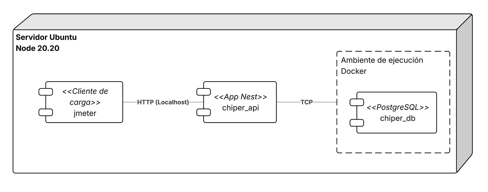
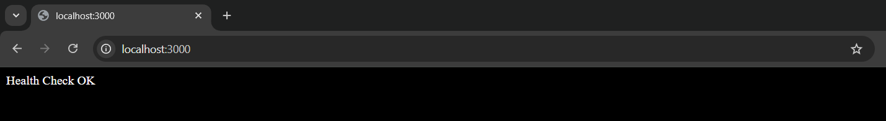
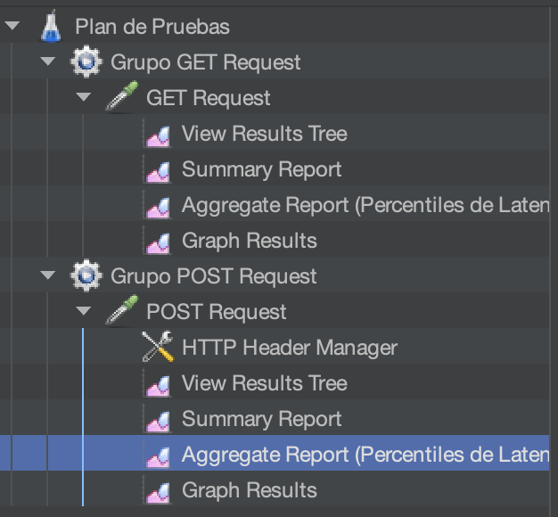

# Lab 2 — Pruebas de Carga al Monolito de Cheapest

## 1. Índice

- [1. Índice](#1-índice)
- [2. Etapas del laboratorio](#2-etapas-del-laboratorio)
- [3. Objetivos](#3-objetivos)
- [4. Planeación del laboratorio](#4-planeación-del-laboratorio)
- [5. Ejecución del laboratorio](#5-ejecución-del-laboratorio)
- [6. Realización de pruebas](#6-realización-de-pruebas)
- [7. Entregables](#7-entregables)

## 2. Etapas del laboratorio

| Etapa                           | Resumen                                                                                | Uso de IA generativa                                                                          |
| ------------------------------- | -------------------------------------------------------------------------------------- | --------------------------------------------------------------------------------------------- |
| 1. Contexto experimental y ASRs | Definición del experimento, de los requerimientos significativos para la arquitectura (ASRs), de los criterios de éxito y del marco de evaluación del monolito. | Uso acotado para entender ASRs; el análisis de impacto debe ser propio.                     |
| 2. Preparación del entorno      | Levantamiento de base de datos, backend y verificación inicial del entorno de pruebas. | Recomendado para resolver bloqueos técnicos de instalación y configuración.                   |
| 3. Diseño de pruebas            | Definición de distribución de datos, matriz de carga e hipótesis de degradación.       | Puede ayudar a proponer diseños, pero se debe justificar con el contexto de Cheapest. |
| 4. Ejecución de pruebas         | Ejecución con JMeter (herramienta de pruebas de carga) y con un script en Python para cargas altas. | Recomendado en cargas altas para generar o ajustar scripts de prueba y análisis.              |
| 5. Entregables y conclusiones   | Reporte de resultados, punto de inflexion y propuestas de mejora arquitectónica.       | No recomendado para redactar conclusiones sin evidencia del experimento.                      |

## 3. Objetivos

- Ejecutar **pruebas de carga locales** (enviar muchas peticiones simultáneas para medir cómo responde el sistema) sobre el backend monolítico de Cheapest.
- Encontrar el **punto de inflexión** del sistema: el máximo de usuarios simultáneos que soporta antes de incumplir alguno de sus requerimientos de calidad (ASRs).
- Analizar el comportamiento del monolito bajo carga: latencia (cuánto tarda en responder), throughput (cuántas peticiones atiende por segundo), errores y cuellos de botella.
- Proponer mejoras de arquitectura y tácticas para mejorar desempeño y disponibilidad.

## 4. Planeación del laboratorio

En el Lab 1 usted conoció cómo está construido el backend de Cheapest: un **monolito** en NestJS, organizado en módulos y capas, con una base de datos PostgreSQL. En este laboratorio va a medir cuánta carga soporta ese monolito, tal como está, corriendo en su propia máquina. El resultado es la **línea base** contra la que se compararán todas las arquitecturas de los laboratorios siguientes.

**Conceptos que se presentan en este laboratorio.**

| Concepto | Qué es |
| --- | --- |
| ASR | *Architecturally Significant Requirement*: requerimiento que condiciona las decisiones de arquitectura. Se escribe como un escenario con una **medida de respuesta** verificable (por ejemplo, "responder en menos de 1000 ms"). |
| Prueba de carga | Experimento en el que una herramienta simula a muchos usuarios enviando peticiones al mismo tiempo, para medir cómo se comporta el sistema. |
| Latencia | Tiempo que tarda el sistema en responder una petición. |
| Percentil (p95, p99) | El p99 de la latencia es el tiempo en el que respondió el 99% de las peticiones (o menos). Es una medida más realista que el promedio, porque el promedio esconde al pequeño porcentaje de usuarios que tuvo una experiencia muy lenta. El p95 es lo mismo para el 95%. |
| Throughput | Cantidad de peticiones que el sistema atiende por unidad de tiempo (peticiones por segundo, req/s). |
| Error % | Porcentaje de peticiones que fallaron (respuesta de error, tiempo de espera agotado o conexión rechazada). |
| Punto de inflexión | Nivel de carga a partir del cual el sistema deja de cumplir al menos uno de sus ASRs. |
| Cuello de botella | El componente que se satura primero y limita la capacidad de todo el sistema. |
| JMeter | Apache JMeter, herramienta de escritorio para definir y ejecutar pruebas de carga. |
| Thread (hilo) | En JMeter, un usuario simulado. 100 threads equivalen a 100 usuarios enviando peticiones. |
| Ramp-up | Tiempo, en segundos, que tarda la herramienta en poner a trabajar a todos los usuarios simulados. Con 100 threads y un ramp-up de 20 s, arranca un usuario nuevo cada 0,2 s. |
| Seed / seeder | Script que llena la base de datos con datos de prueba (*seed* = semilla) antes de ejecutar las pruebas. |
| Pool de conexiones | Conjunto de conexiones a la base de datos que la aplicación mantiene abiertas y reutiliza. Si todas están ocupadas, las peticiones nuevas esperan en fila. |
| Índice (de base de datos) | Estructura que le permite a la base de datos encontrar filas sin recorrer toda la tabla. Sin índice, una búsqueda se vuelve más lenta a medida que la tabla crece. |
| Docker Compose | Herramienta de Docker que levanta uno o varios contenedores descritos en un archivo `docker-compose.yml`. |

### 4.1 Hipótesis de diseño

| # | Hipótesis |
| --- | --- |
| H1 | **Si** mantenemos el backend de Cheapest como un monolito en capas desplegado en un único nodo, sin ninguna optimización (sin índices en las tablas consultadas y con el pool de conexiones por defecto, de 10 conexiones), **entonces** el sistema cumple sus ASRs en operación normal (500 req/min): el p99 de la consulta de productos disponibles se mantiene por debajo de 1000 ms, **porque** con poca concurrencia todas las llamadas entre módulos ocurren dentro del mismo proceso y la única comunicación por red es con la base de datos. |
| H2 | **Si** sometemos ese mismo monolito a una carga creciente hasta el pico de un evento de promociones (5000 req/min), **entonces** se incumple al menos un ASR antes de llegar al pico (el punto de inflexión queda por debajo de 5000 req/min), **porque** todas las peticiones, de lectura y de escritura, compiten por un único proceso de Node.js y por las mismas 10 conexiones a la base de datos. |
| H3 | **Si** el cuello de botella del monolito está en la base de datos (consultas sin índices y pool de conexiones pequeño) y no en el procesamiento de la aplicación, **entonces** la consulta de productos disponibles se degrada a medida que crece el histórico de pedidos de la tienda, aun con la misma cantidad de usuarios, **porque** sin índices la base de datos recorre las tablas completas en cada consulta. |

### 4.2 Escenarios de calidad vinculados

| ID    | Descripción                                                                                                                                                                                                                                                           | Medidas de respuesta a satisfacer |
| ----- | --------------------------------------------------------------------------------------------------------------------------------------------------------------------------------------------------------------------------------------------------------------------- | --------------------- |
| ASR 1 | Como tendero, quiero consultar los productos que alguna vez he pedido, que actualmente estén en promoción y disponibles en el catálogo de mi zona, con una latencia p99 de **1000 ms** en operación normal (500 req/min).                                                       | Latencia p99 < 1000ms |
| ASR 2 | Como director de operaciones de Cheapest, durante eventos con promociones en donde múltiples tiendas están comprando, quiero que al menos el **98% de los pedidos** sean creados exitosamente, aun cuando un alto número de tenderos realicen pedidos simultáneamente, se estiman (5000 req/min). | Error % ≤ 2%          |


> **Criterio de punto de inflexión:** *basta con que se incumpla **al menos uno** de los dos ASRs.*

Los dos endpoints evaluados en este laboratorio corresponden directamente a los ASRs definidos. Ambos forman parte del módulo `logistica` del backend monolítico de Cheapest.

#### ASR 1 — GET `/logistics/tenderos/productos-disponibles`

**Método:** `GET`  
**Ruta:** `/logistics/tenderos/productos-disponibles`

**Query params:**

| Parámetro  | Tipo   | Validación        | Descripción                                |
| ---------- | ------ | ----------------- | ------------------------------------------ |
| `tiendaId` | string | UUID, requerido   | Identificador de la tienda del tendero     |
| `zona`     | string | string, requerido | Zona geográfica sobre la que se consulta   |

**Ejemplo de request:**
```
GET /logistics/tenderos/productos-disponibles?tiendaId=bbbbbbbb-bbbb-4bbb-8bbb-bbbbbbbbbbbb&zona=Zona+Norte
```

**Respuesta exitosa (200):** arreglo de productos con campos `id`, `nombre`, `marca`, `categoria`, `presentacion`, `precioBase`, entre otros.

**Lógica interna:**
El endpoint resuelve la intersección de tres condiciones sobre la tabla `productos`, mediante **una sola consulta** con tres subconsultas `EXISTS` correlacionadas (todo el trabajo ocurre en PostgreSQL, no en la aplicación):
1. `EXISTS` sobre `items_pedido` ⋈ `pedidos` filtrando por `tiendaId`: el producto fue pedido alguna vez por esa tienda.
2. `EXISTS` sobre `promociones` ⋈ `promocion_tiendas`: hay una promoción vigente hoy para ese producto y esa tienda.
3. `EXISTS` sobre `disponibilidad_zona` ⋈ `catalogos` filtrando por `zona`: hay disponibilidad > 0 en un catálogo de la zona.

> Revise la implementación real en `src/logistica/repositories/producto.repository.ts`
> (`findProductosDisponiblesParaTendero`) y contrástela con esta descripción y con la del POST antes de responder las preguntas de cuello de botella: ¿el costo está en los `EXISTS` de esta lectura o en otra parte? Note que **no hay índices** sobre `pedidos.tiendaId`, `items_pedido.productoId`, `catalogos.zona` ni `disponibilidad_zona.productoId`, y que el pool de conexiones usa el valor por defecto de `pg` (10), porque `src/datasources/database.providers.ts` no lo configura.

#### ASR 2 — POST `/logistics/pedidos`

**Método:** `POST`  
**Ruta:** `/logistics/pedidos`  
**Content-Type:** `application/json`

**Body (ejemplo con 2 ítems):**
```json
{
  "identificador": "PED-20260601-001",
  "tiendaId": "bbbbbbbb-bbbb-4bbb-8bbb-bbbbbbbbbbbb",
  "fechaHoraCreacion": "2026-06-01T10:00:00.000Z",
  "montoTotal": 85000,
  "monedaId": "cccccccc-cccc-4ccc-8ccc-cccccccccccc",
  "estado": "creado",
  "items": [
    { "productoId": "aaaaaaaa-aaaa-4aaa-8aaa-aaaaaaaaaaaa", "cantidad": 5, "precioUnitario": 12000, "descuento": 0,   "monedaId": "cccccccc-cccc-4ccc-8ccc-cccccccccccc" },
    { "productoId": "aaaaaaaa-aaaa-4aaa-8aaa-aaaaaaaaaaab", "cantidad": 3, "precioUnitario": 8500,  "descuento": 500, "monedaId": "cccccccc-cccc-4ccc-8ccc-cccccccccccc" }
  ]
}
```

**Campos requeridos del body:**

| Campo               | Tipo             | Descripción                               |
| ------------------- | ---------------- | ----------------------------------------- |
| `identificador`     | string (max 100) | Código único del pedido                   |
| `tiendaId`          | UUID             | Tienda que realiza el pedido              |
| `fechaHoraCreacion` | ISO 8601         | Fecha y hora de creación                  |
| `montoTotal`        | number > 0       | Valor total del pedido                    |
| `monedaId`          | UUID             | Moneda en que se expresa el monto         |
| `estado`            | enum (opcional)  | Estado inicial del pedido                 |
| `items`             | array (mín. 1)   | Productos con `productoId`, `cantidad`, `precioUnitario`, `descuento` y `monedaId` |

**Respuesta exitosa (201):** objeto pedido creado con su `id` y lista de ítems.

> Este endpoint realiza escritura transaccional en la base de datos. Bajo alta concurrencia puede generar contención de locks y saturación del pool de conexiones.

> [!IMPORTANT]
> **Pregunta 1:**
> En el contexto de Cheapest, el endpoint GET evaluado combina lectura histórica, promociones y disponibilidad por zona, mientras el POST confirma pedidos en eventos de alta demanda.
> Si solo pudiera optimizar **uno** antes de un pico comercial, ¿cuál priorizaría y por qué?
>
> Argumente su decisión en términos de:
> - impacto en negocio,
> - riesgo de incumplimiento de ASRs,
> - tipo de carga,
> - y costo/tiempo de implementación de mejoras.

### 4.3 Tácticas y patrones

Este laboratorio **no agrega** ninguna táctica ni patrón nuevo: mide el monolito tal como está. Lo que sigue describe lo que ya tiene el sistema bajo prueba, para que pueda razonar sobre sus resultados.

#### 4.3.1 Patrones de diseño

Los mismos que recorrió en el Lab 1: **inyección de dependencias** (Nest construye y entrega las dependencias de cada clase), **Repository** (una clase por entidad encapsula las consultas a la base de datos) y **DTO** (clases que describen y validan los datos de entrada). Para este experimento importa sobre todo el Repository: es donde está escrita la consulta del GET y donde se decide cuántas veces viaja el POST a la base de datos.

#### 4.3.2 Tácticas de arquitectura

El sistema bajo prueba no aplica todavía ninguna táctica de desempeño ni de disponibilidad: no hay índices sobre las columnas consultadas, el pool de conexiones tiene su tamaño por defecto, no hay caché y hay una sola instancia de la aplicación. Esas ausencias son deliberadas: usted va a encontrar el punto donde el sistema se rompe y a proponer, con evidencia, cuáles tácticas harían falta.

#### 4.3.3 Estilos aplicados

| Estilos de Arquitectura asociados | Análisis |
| --------------------------------- | ------------------------------------------------------------------------------------------------------------------------- |
| Monolito                          | - Favorece latencia y testeabilidad.<br>- Desfavorece escalabilidad y disponibilidad.                                     |
| Cliente-servidor                  | - Favorece seguridad (el control de acceso a los datos es centralizado).<br>- Puede introducir un cuello de botella o punto único de falla en el servidor si este no se replica; esto no descarta que el servidor pueda escalarse horizontalmente. |
| Capas                             | - Favorece la mantenibilidad y la flexibilidad del sistema.<br>- Desfavorece latencia y aumenta la complejidad.           |

### 4.4 Diseño del experimento

#### 4.4.1 ¿Cómo se va a validar la hipótesis?

1. **Preparar el sistema bajo prueba.** Levantar la base de datos y el monolito en su máquina, y verificar que responde.
2. **Diseñar los datos.** Definir cuántos registros hay en cada tabla y cómo se distribuyen entre tiendas y zonas, de forma que el escenario se parezca a Cheapest en hora pico.
3. **Aumentar la carga por escalones.** Ejecutar una matriz de pruebas que va desde 5 usuarios simulados hasta la carga del pico, primero con JMeter y, para las cargas altas, con un script en Python.
4. **Medir cada endpoint por separado.** Una campaña completa para el GET y otra para el POST, repitiendo cada escalón varias veces.
5. **Comparar con los umbrales de los ASRs.** Ubicar el primer escalón donde el p99 del GET supera 1000 ms o el porcentaje de error del POST supera 2%: ese es el punto de inflexión.
6. **Buscar la causa.** Revisar el código de los dos endpoints y variar los puntos de sensibilidad (datos, pool de conexiones, índices) para identificar el cuello de botella.

#### 4.4.2 ¿Qué componentes se van a diseñar o modificar?

| Componente | Cambio |
| --- | --- |
| `src/datasources/load-seed.yaml` | Usted diseña el número de registros por tabla y su distribución. |
| Plan de pruebas de JMeter (`load_test.jmx`) | Usted ajusta usuarios simulados, ramp-up y repeticiones para cada escalón de carga. |
| Script de carga en Python | Usted lo genera con ayuda de un agente de IA para los escalones de carga alta. |
| Monolito de Cheapest (API y base de datos) | No se modifica para la medición base. Solo se toca, de forma opcional, para explorar los puntos de sensibilidad. |

#### 4.4.3 ¿Qué métricas se van a medir?

| Métrica | Hipótesis / ASR | Umbral |
| --- | --- | --- |
| p99 y p95 de la latencia del GET, por escalón de carga | H1, H3 / ASR 1 | p99 < 1000 ms en operación normal (500 req/min) |
| Error % del POST, por escalón de carga | H2 / ASR 2 | ≤ 2% en el pico (5000 req/min) |
| Throughput (req/s) de cada endpoint | H2 | Debe crecer con la carga; cuando deja de crecer, el sistema está saturado |
| Punto de inflexión (usuarios simulados y req/s) de cada endpoint | H2 | Primer escalón donde se incumple un ASR |

### 4.5 Planeación del experimento

#### 4.5.1 Recursos requeridos

| Tecnologías asociadas         | Selección y Justificación                                                                                                                                                                          |
| ----------------------------- | -------------------------------------------------------------------------------------------------------------------------------------------------------------------------------------------------- |
| **Frameworks**                | - **NestJS:** Framework backend para Node.js basado en TypeScript que promueve arquitectura modular, inyección de dependencias y separación por capas, facilitando mantenibilidad y escalabilidad. |
| **Lenguajes de programación** | - **TypeScript:** Lenguaje principal del backend, aporta tipado estático y mayor robustez en el desarrollo.                                                                                        |
| **Plataforma de ejecución**   | - **Node.js:** Entorno de ejecución basado en event loop, adecuado para aplicaciones I/O intensivas como APIs REST.                                                                                |
| **Bases de datos**            | - **PostgreSQL:** Base de datos relacional robusta que soporta transacciones ACID, índices avanzados y optimización de consultas complejas (JOINs).                                                |
| **Herramientas de análisis**  | - **Apache JMeter:** Herramienta de pruebas de carga utilizada para simular concurrencia y medir latencia, throughput y porcentaje de error.                                                      |
| **Contenedores (opcional)**   | - **Docker:** Permite levantar servicios en entornos aislados para facilitar reproducibilidad del experimento.                                                                                     |
| **Librerías**                 | - **TypeORM:** ORM utilizado por NestJS para mapear entidades a tablas y manejar consultas, relaciones y transacciones.                                                                            |

Además necesita: **Java (JDK) 8 o superior** para ejecutar JMeter, **Python 3** para el script de cargas altas, y acceso a GitHub Copilot u otro agente de IA para generar ese script. Los datos de prueba los genera el seeder del proyecto a partir del archivo `load-seed.yaml`.

#### 4.5.2 Elementos de arquitectura involucrados

Se trabaja sobre la **vista de despliegue** del monolito: la API, la base de datos y el cliente que genera la carga.



*Figura 1. Despliegue de los componentes del backend monolítico de Cheapest (API, base de datos) sobre un único nodo de ejecución local.*

Note que todos los componentes están desplegados en un único nodo de ejecución, en este caso su máquina local, de igual forma note que la comunicación entre componentes sigue los mismos protocolos que seguiría si se ejecutaran en nodos distintos.

Se miden dos conectores: el HTTP entre el generador de carga y la API, y la conexión entre la API y PostgreSQL (el pool de conexiones).

#### 4.5.3 Esfuerzo estimado

Referencia para planear; puede variar según su máquina y su experiencia con las herramientas.

| Etapa | Esfuerzo aprox. |
| --- | --- |
| Preparación del entorno (base de datos, backend, JMeter) | 0,5 h |
| Diseño de la distribución de datos | 1 h |
| Generación y ajuste del script de carga en Python | 1 h |
| Ejecución de la matriz de pruebas (GET y POST, con repeticiones) | 2,5 h |
| Análisis de resultados y entregables | 1,5 h |
| **Total** | **6,5 h-persona** |

## 5. Ejecución del laboratorio

### 5.1 Obtener el código

En el repo del backend ([Cheapest-api](https://github.com/ISIS-2212-Arquitecturas-Robustas/Cheapest-api)) diríjase a la rama `load_tests`:

```bash
git checkout load_tests
```

### 5.2 Levantar PostgreSQL con Docker (recomendado)

Ejecute el siguiente comando **desde el directorio base del repositorio** (donde se encuentra el archivo `docker-compose.yml`); si lo ejecuta desde otro directorio, Docker no encontrará el archivo y fallará. El flag `up` crea (si no existe) y levanta el contenedor definido en el `docker-compose.yml` para el servicio `postgres`, dejándolo corriendo en segundo plano (`-d`):

```bash
docker compose up postgres -d
```

> [!WARNING]
> Si en el Lab 1 levantó PostgreSQL con Docker y ese contenedor sigue corriendo, es muy probable que el puerto `5432` siga ocupado y el comando anterior falle con un error similar a:
> ```
> Error response from daemon: failed to set up container networking: driver failed programming external connectivity on endpoint cheapest-postgres (5d86a48a3d107d38bfa708e8f6a067bf9cf5210839d04ff07a5e176bd25d855e): Bind for 0.0.0.0:5432 failed: port is already allocated
> ```
> Antes de levantar el nuevo entorno, detenga y elimine el contenedor anterior. Ejecute `docker ps` para ver su nombre (en el Lab 1 se llamaba `cheapest-db`) y luego:
> ```bash
> docker stop <nombre_del_contenedor>
> docker rm <nombre_del_contenedor>
> ```

### 5.3 Levantar el backend monolítico

```bash
npm install
npm run start:dev
```

Verifique que la aplicación está corriendo:
- http://localhost:3000/health

Usted debería ver algo así:



### 5.4 Cargar los datos de prueba

Los resultados de una prueba de carga dependen de cuántos datos haya en la base de datos: no es lo mismo consultar una tabla con 200 pedidos que una con 200.000. Por eso el proyecto incluye un **seeder**: un script (implementado como un provider de Nest) que llena la base de datos al arrancar la aplicación. Está en `src/datasources/database-seeder.service.ts` y lee el archivo `src/datasources/load-seed.yaml`, donde se configura el número de registros por tabla, el número de tiendas y de zonas, y cómo se distribuye la actividad entre ellas.

El mecanismo para cambiar los datos es siempre el mismo:

1. Edite `src/datasources/load-seed.yaml` con los valores que quiere probar.
2. Elimine la base de datos actual, incluido el volumen donde se guardan los datos:
   ```bash
   docker compose down -v
   ```
   `docker compose down -v` borra el contenedor **y el volumen con nombre `postgres_data`** donde viven los datos.
3. Vuelva a levantar la base de datos:
   ```bash
   docker compose up postgres -d
   ```
4. Reinicie el backend (`npm run start:dev`). Al arrancar, el seeder vuelve a llenar la base con el `load-seed.yaml` vigente.

> [!NOTE]
> Si al arrancar el seeder encuentra que ya hay al menos tantos `pedidos` como los configurados, no agrega ni recorta nada. Por eso, si no elimina el volumen, un cambio en `load-seed.yaml` no tiene efecto.

En el archivo `src/datasources/seed.sql` va a encontrar IDs de ejemplo que se crean cada vez que se ejecuta el seeder. Como el resto de los datos (y por lo tanto sus IDs) son aleatorios, estos IDs fijos son los que debe usar en las peticiones de las pruebas: `tiendaId = bbbbbbbb-bbbb-4bbb-8bbb-bbbbbbbbbbbb`, `zona = Zona Norte`, `monedaId = cccccccc-cccc-4ccc-8ccc-cccccccccccc` y `productoId = aaaaaaaa-aaaa-4aaa-8aaa-aaaaaaaaaaaa`.

### 5.5 Instalar JMeter y abrir el plan de pruebas

Si no tiene JMeter instalado, descárguelo desde la [página oficial de descarga](https://jmeter.apache.org/download_jmeter.cgi). Requisito previo: JMeter necesita una versión de **Java (JDK) 8 o superior** instalada y configurada en el `PATH` (verifique con `java -version`); una instalación de Java faltante o incorrecta es una causa frecuente de errores confusos al intentar arrancar JMeter. Pasos generales de instalación:
- **Windows:** descargue el `.zip` (binario) desde la página oficial, descomprímalo en una carpeta de su preferencia y ejecute `bin\jmeter.bat`.
- **macOS:** descargue el `.tgz` desde la página oficial (o instale con `brew install jmeter`), descomprímalo y ejecute `bin/jmeter.sh`. También puede requerir que Java esté instalado (`brew install openjdk`).
- **Linux:** descargue el `.tgz`, descomprímalo (`tar -xzf apache-jmeter-x.x.tgz`) y ejecute `bin/jmeter.sh`. Asegúrese de tener el JDK instalado (por ejemplo `sudo apt install default-jdk`).

Descargue el archivo [`load_test.jmx`](recursos/load_test.jmx) el cual contiene las pruebas GET y POST. Este archivo contiene un Summary Report el cual resume métricas de la prueba como Throughput, % de Error, desviación estándar, entre otras. Además, ya trae incluido un listener "Aggregate Report" (renombrado "Percentiles de Latencia") con métricas como P95 y P99.



Un **Plan de Pruebas** es el archivo completo que se abre en la herramienta. Dentro de él, un **Thread Group** ("grupo de hilos") simula a un grupo de usuarios reales — cada "hilo" (thread) es un usuario simulado enviando peticiones al mismo tiempo. Dentro de cada Thread Group hay un **sampler**, que es la petición HTTP concreta que ese usuario va a enviar (en este caso, un GET o un POST), y varios **listeners**, que son las pantallas donde JMeter muestra los resultados de esas peticiones (tiempos de respuesta, errores, gráficas, etc.).

El archivo `load_test.jmx` que se descarga ya trae todo esto configurado — no hay que armarlo desde cero. Trae dos Thread Groups independientes (uno para cada endpoint), cada uno con su sampler y el mismo set de 4 listeners:

- **Grupo GET Request**: simula 5 usuarios (threads) que se van "conectando" en 5 segundos (ramp-up) y cada uno envía la petición una sola vez (1 loop). La petición es `GET /logistics/tenderos/productos-disponibles?tiendaId=...&zona=Zona Norte`.
- **Grupo POST Request**: simula 1 solo usuario, que envía una petición `POST /logistics/pedidos` con headers `Content-Type: application/json` y `Accept: application/json`, y un cuerpo (body) en JSON que representa un pedido con 4 ítems.


> Nota: estos números de threads (5 y 1) son solo el ejemplo inicial que trae el archivo. Al realizar las pruebas usted va a modificarlos para simular cada nivel de carga.

Cada grupo incluye los mismos 4 listeners, que son distintas formas de ver los resultados de la misma prueba:
- **View Results Tree**: muestra el detalle de cada petición y respuesta individual (útil para depurar si algo falla, por ejemplo ver el mensaje de error exacto que devolvió el servidor).
- **Summary Report**: una tabla resumen con throughput (peticiones por segundo), tiempo promedio, mínimo y máximo — pero sin percentiles.
- **Aggregate Report** (aquí renombrado "Percentiles de Latencia"): es la tabla que interesa para los ASRs de este laboratorio, porque ya trae columnas de percentil 90, 95 y 99 calculadas automáticamente — no hay que configurar nada extra para obtener el p95 o el p99 que piden las medidas de respuesta.
- **Graph Results**: una gráfica de los tiempos de respuesta a lo largo del tiempo que dura la prueba.

El Aggregate Report es el listener que se debe reportar como evidencia, porque calcula directamente el p99 que exige el ASR 1 (el tiempo en el que respondió el 99% de las peticiones).

El siguiente [recurso](https://testertina.medium.com/a-beginners-guide-to-performance-testing-with-apache-jmeter-be7a7eb0a6ad) contiene información de que componentes tiene JMeter, apréndalos para modificar los argumentos necesarios en el test que le proveemos.

### 5.6 Generar el script de carga en Python

> [!NOTE]
> JMeter se usa en este laboratorio para los escenarios de carga baja, media y de operación normal, ya que permite visualizar y aprender de forma gráfica los componentes de una prueba de carga (ese es su valor pedagógico). En los escenarios de carga alta, JMeter puede consumir tantos recursos de su computador que se bloquea o deja de responder, y además distorsiona la medición. Por eso debe tener listo un script propio en Python: si JMeter se bloquea, ese escenario se ejecuta con el script.

Para los escenarios de alta carga, dado que JMeter empieza a tener limitaciones de desempeño, **debe usar copilot o el agente de IA de su preferencia para generar un script para la ejecución de pruebas**, este script debe tener las siguientes características:
- Las peticiones deben ser http a los endpoints a los cuales se busca hacer la prueba
- El script debe permitir configurar Ramp-Up y Threads para cada prueba
- Para POST, usar un body JSON realista de “pedido grande” con > 20 ítems (productoId y cantidad)
- Debe registrar por request: timestamp, método, endpoint, status_code, latency_ms, error (si aplica).
- Debe calcular al final:  
	- total requests por tipo (GET/POST)  
	- throughput (req/s)  
	- latencia promedio, p95 y p99 por tipo  
	- Error % por tipo (status >= 400 + timeouts + connection errors)
- Idealmente debería generar la tabla y gráficos para **SU** análisis

Le dejamos un prompt de ejemplo, note que debe cambiar algunos valores para ajustarlo al laboratorio
```
Vamos a realizar pruebas de performance. Necesito un script en Python para ejecutar pruebas de carga ligeras contra un backend NestJS usando HTTP.

Contexto:
- Base URL: http://localhost:3000
- Endpoints a probar:
  - Endpoint GET (lectura pesada): `/logistics/tenderos/productos-disponibles?tiendaId=<uuid>&zona=<zona>`
  - Endpoint POST (escritura): `/logistics/pedidos`

Requerimientos del script:
* Debe permitir configurar por argumentos CLI o variables:
   - --endpoint (endpoint a testear)
   - --users (concurrencia máxima)
   - --ramp-up (segundos)
   - --duration (segundos)
   - --body (para POST, un JSON con > 20 ítems)

* Para POST, usar un body JSON realista de “pedido grande” con > 20 ítems (productoId y cantidad).

* Debe registrar por request: timestamp, método, endpoint, status_code, latency_ms, error (si aplica).
* Debe calcular al final:
   - total requests por tipo (GET/POST)
   - throughput (req/s)
   - latencia promedio, p95 y p99 por tipo
   - Error % por tipo (status >= 400 + timeouts + connection errors)
* Debe exportar resultados a CSV: results_get.csv y results_post.csv con columnas:
   timestamp_iso,status_code,latency_ms,error
* Debe imprimir un resumen final claro en consola. Opcionalmente, generar gráficos de latencia y throughput usando matplotlib o seaborn.

Restricciones:
- Usa solo librerías estándar o, si necesitas, sugiere instalar exactamente UNA librería: httpx o aiohttp. Prefiero async/await.
- Maneja timeouts y errores de conexión, debes registrarlos.
- Incluye instrucciones de ejecución y ejemplo:
  python load_test.py --users 100 --ramp-up 50 --duration 60 --endpoint POST --body sample_body.json
```

Como estudiante usted tiene acceso a Github copilot para generación de código, este [tutorial](../tutoriales/como_usar_github_copilot.md) le explicará como usarlo.

> [!IMPORTANT]
> **Pregunta 4:**
> Para los escenarios de carga alta debe generar un script de carga con ayuda de un agente de IA. En un equipo real, varias personas generarían código con IA sobre el mismo repositorio de Cheapest y es fácil que el estilo, las convenciones y las decisiones de arquitectura se vuelvan inconsistentes.
> Investigue qué técnicas existen para lograr que los agentes de IA generen código siguiendo de forma consistente los patrones y reglas de desarrollo definidas por todo el equipo.

## 6. Realización de pruebas

En la sección anterior dejó el sistema corriendo y las herramientas listas. Aquí se explica qué debe modificar de todo eso para ejecutar las pruebas, cuáles son los puntos que puede ajustar para mejorar o empeorar el desempeño del sistema, y qué corridas debe hacer.

### 6.1 Escenarios de carga

Los dos ASRs definen dos niveles de carga de referencia:

- **Operación normal:** 500 req/min (≈ 8.3 req/s). Aquí se evalúa el ASR 1 (p99 del GET < 1000 ms).
- **Evento de promociones (pico):** 5000 req/min (≈ 83.3 req/s). Aquí se evalúa el ASR 2 (Error % del POST ≤ 2%).

La matriz de pruebas recorre varios escalones entre esos dos niveles (y por debajo del primero) para poder ubicar con precisión el punto donde el sistema deja de cumplir.

### 6.2 Puntos de sensibilidad

Un punto de sensibilidad es un parámetro del que depende directamente la medida de respuesta de un ASR. Estos son los que puede ajustar en este laboratorio y cómo se modifica cada uno:

| Punto de sensibilidad | Dónde se modifica | Cómo se modifica | Efecto esperado |
| --- | --- | --- | --- |
| Usuarios simultáneos | JMeter: campo *Number of Threads (users)* del Thread Group. Script de Python: argumento `--users`. | Use los valores de la matriz de pruebas. | Más usuarios implican más peticiones concurrentes compitiendo por el proceso de Node.js y por las conexiones a la base de datos. |
| Velocidad de entrada de la carga | JMeter: campo *Ramp-up period (seconds)*. Script: `--ramp-up`. | Un ramp-up más corto con los mismos usuarios produce una ráfaga más agresiva. | Un ramp-up corto puede romper el sistema con menos usuarios. |
| Volumen de datos | `src/datasources/load-seed.yaml`: conteos por tabla (`pedidos`, `items_pedido`, `promociones`, `disponibilidad_zona`, etc.). | Edite el archivo, elimine el volumen con `docker compose down -v`, levante de nuevo la base y reinicie el backend. | Más filas hacen más costosa la consulta del GET, porque las tablas no tienen índices. |
| Distribución de los datos | `src/datasources/load-seed.yaml`: llaves `tiendas`, `zonas` y `distribucion` (`tipo: pareto`, `peso_cabeza`, `fraccion_cabeza`). | Igual que el volumen de datos. | Concentrar la actividad en pocas tiendas y zonas hace que la tienda consultada tenga un histórico mucho mayor que el promedio. |
| Tamaño del pool de conexiones | `src/datasources/database.providers.ts`, en la configuración del `DataSource`. Hoy no se define, así que usa el valor por defecto del driver `pg`: 10 conexiones. | Agregue `extra: { max: 20 }` (o el valor que quiera probar) a la configuración del `DataSource` y reinicie el backend. | Un pool más grande reduce la fila de espera en la aplicación, pero traslada más trabajo simultáneo a PostgreSQL. |
| Índices de la base de datos | Entidades de TypeORM en `src/logistica/repositories/entities/`. Hoy no hay índices sobre `pedidos.tiendaId`, `items_pedido.productoId`, `catalogos.zona` ni `disponibilidad_zona.productoId`. | Agregue el decorador `@Index()` sobre la columna en la entidad correspondiente y reinicie el backend (TypeORM crea el índice al arrancar). | Las consultas dejan de recorrer tablas completas; las escrituras se vuelven ligeramente más costosas. |
| Generador de carga | JMeter o script de Python. | Empiece con JMeter; si en los escenarios de carga alta se bloquea o deja de responder, use el script. | Cuando el generador de carga se queda sin recursos en su máquina, distorsiona la medición: los tiempos que reporta ya no son los del sistema bajo prueba. |

> [!IMPORTANT]
> La **matriz mínima de pruebas** se ejecuta con el sistema **sin modificar** (pool por defecto y sin índices): esa es la línea base del curso. Los cambios al pool de conexiones y a los índices son exploraciones adicionales para encontrar la causa de la degradación; si los prueba, repórtelos como corridas aparte y **devuelva el código a su estado original** antes de continuar.

**Parámetros de una prueba en JMeter.** Cada Thread Group del plan de pruebas se configura con tres valores:

- **Number of Threads:** número de usuarios simulados que se lanzan en una iteración.
- **Ramp-Up Period:** tiempo, en segundos, en el que se lanzan esos usuarios. Con 5 threads y un ramp-up de 5 segundos, arranca un usuario nuevo cada segundo.
- **Loop Count:** número de veces que cada usuario repite la petición. Con 1, cada usuario envía una sola petición.

### 6.3 Diseñar los datos de la prueba

> [!WARNING]
> Parte de la tarea es diseñar el número y la distribución de datos en las tablas para que las pruebas tengan sentido. **En los entregables tiene que reportar el número de datos y la distribución que usó en cada prueba, y justificarlos.** En el warm-up de este laboratorio ([`lab_2_warmup.md`](lab_2_warmup.md)) se diseña un `load-seed.yaml` y puede usarlo como punto de partida.
>
> El `load-seed.yaml` que trae la rama `load_tests` viene con **valores de relleno, arbitrarios y uniformes** (todos números redondos), pensados solo para que la aplicación arranque. **No son un escenario de prueba válido** y no deben usarse tal cual. Usted debe reemplazarlos por su propio diseño: conteos por tabla, `tiendas`, `zonas` y `distribucion`, cada uno **justificado con el contexto de Cheapest**. Un diseño realista no es uniforme: hay tiendas que compran mucho más que otras (distribución tipo Pareto). Se espera además que ajuste el archivo según lo que quiera estresar: por ejemplo, aumentar el histórico de pedidos para estresar el GET, o concentrar la demanda para estresar el POST.

> [!IMPORTANT]
> **Pregunta 2:**
> Diseñe una distribución de datos que haga realista el escenario de Cheapest en hora pico (tiendas con comportamientos heterogéneos, zonas con distinta densidad de pedidos y promociones activas). Tome como punto de partida el warm-up ([`lab_2_warmup.md`](lab_2_warmup.md)).
> - ¿Qué sesgos introduciría una distribución uniforme y cómo podría llevar a conclusiones erróneas sobre el punto de inflexión?
> - Proponga al menos **dos estrategias de distribución** y explique qué hipótesis de arquitectura valida cada una (una orientada a estresar el GET / ASR 1 y otra el POST / ASR 2).

### 6.4 Matriz mínima de pruebas

Cada corrida se ejecuta **por endpoint**: una para el GET (ASR 1) y otra para el POST (ASR 2), porque los dos ASRs se miden por separado (p99 del GET, Error % del POST) y en el análisis de resultados deberá comparar cuál de los dos se degradó primero. Es decir, los conteos de abajo son por endpoint.

Repeticiones mínimas **por endpoint**:
- **Operación normal** y **Estrés fuerte** (los dos puntos donde se evalúan los ASRs): **5 corridas** cada uno.
- **Alta carga**, **Muy alta carga**, **Estrés**: **3 corridas** cada uno (más si el quiebre no es claro).
- **Smoke test**, **Baja carga**, **Carga media**: **1 corrida** cada uno (sanity check de la línea base).

Esto da como mínimo 22 corridas por endpoint ≈ **44 corridas en total**. Si algún ASR no se rompe dentro de la matriz, extienda con más threads / ramp-up más corto hasta ubicar el punto de inflexión.

La columna **Herramienta** es una sugerencia: los cuatro primeros escenarios se ejecutan con JMeter; en los cuatro de mayor carga es probable que JMeter se bloquee en su computador, y en ese caso se ejecutan con el script de Python. Las columnas **Ramp-Up** y **Loops** aplican a JMeter. Los escenarios que se ejecutan con el script no usan Loops sino **Duración**: el script corre `--duration` segundos sosteniendo la concurrencia objetivo. Use **60 s** de duración salvo que necesite más para estabilizar el throughput.

| Test                 | Herramienta sugerida | Ramp-Up | Threads / `--users` | Loops | Duración | Throughput objetivo (req/s) |
| -------------------- | ----------- | ------- | ------------------- | ----- | -------- | --------------------------- |
| **Smoke test**       | JMeter      | 5s      | 5                   | 1     | —        | 1                           |
| **Baja carga**       | JMeter      | 10s     | 30                  | 1     | —        | 3                           |
| **Carga media**      | JMeter      | 20s     | 100                 | 1     | —        | 5                           |
| **Operación normal** | JMeter      | 50s     | 450                 | 1     | —        | 9                           |
| **Alta carga**       | Script de Python si JMeter se bloquea | 75s     | 1500                | N/A   | 60s      | 20                          |
| **Muy alta carga**   | Script de Python si JMeter se bloquea | 100s    | 3000                | N/A   | 60s      | 30                          |
| **Estrés**           | Script de Python si JMeter se bloquea | 150s    | 7500                | N/A   | 60s      | 50                          |
| **Estrés fuerte** (= "Evento de promociones / pico", 5000 req/min ≈ 90 req/s) | Script de Python si JMeter se bloquea | 200s | 18000 | N/A | 60s | 90 |

### 6.5 Procedimiento para cada corrida

**Con JMeter:**

1. Abra [`load_test.jmx`](recursos/load_test.jmx) y seleccione el Thread Group del endpoint que va a probar (GET o POST). Deshabilite el otro (clic derecho → *Disable*) para medir un endpoint a la vez.
2. Ponga en *Number of Threads*, *Ramp-up period* y *Loop Count* los valores de la fila de la matriz que va a ejecutar.
3. Limpie los resultados anteriores (*Run → Clear All*); de lo contrario se mezclan con los de la corrida nueva.
4. Ejecute con *Start* y espere a que termine.
5. Anote, del Aggregate Report ("Percentiles de Latencia") y del Summary Report: p99, p95, throughput y Error %. Tome la captura de pantalla.
6. Repita la corrida tantas veces como indica la matriz para ese escenario.

**Con el script de Python (si JMeter se bloquea o deja de responder con la carga de la fila):** ejecute el script con los valores de la fila (`--users`, `--ramp-up`, `--duration 60`) y guarde el resumen que imprime y los archivos CSV que genera.

> [!CAUTION]
> **Contaminación entre corridas.** **Cada corrida del POST inserta pedidos reales** para la misma tienda (`bbbbbbbb-...-bbbb`) que consulta el GET, y el GET se vuelve más costoso a medida que crece el histórico de esa tienda. Si encadena corridas sin limpiar la base de datos, cada corrida del POST degrada el GET de la siguiente, y el punto de inflexión que reporte quedará desplazado.
> Para que las repeticiones sean repeticiones del *mismo* experimento y no una serie que se degrada sola:
> - Elimine el volumen (`docker compose down -v`), levante de nuevo la base de datos y reinicie el backend **entre la campaña completa de GET y la campaña completa de POST**, y
> - vuelva a hacerlo cada vez que cambie el `load-seed.yaml`.

> [!IMPORTANT]
> **Pregunta 3:**
> La matriz propuesta aumenta la carga de forma escalonada, pero no necesariamente separa bien las causas de degradación.
> ¿Qué cambiaría en el diseño experimental para distinguir si el quiebre proviene principalmente de:
> - saturación del **pool de conexiones** (`pg` usa el valor por defecto 10, no configurado en `src/datasources/database.providers.ts`),
> - **consultas SQL ineficientes** (no hay índices en `pedidos.tiendaId`, `items_pedido.productoId`, `catalogos.zona` ni `disponibilidad_zona.productoId`),
> - **límites del generador de carga** (JMeter puede bloquearse o distorsionar la medición con cargas altas)?
>
> Defina un diseño alternativo con **variables controladas** y los **resultados esperados para cada hipótesis**.

## 7. Entregables

> [!WARNING]
> - Todos los entregables deben estar bien organizados y documentados en un archivo de Word o PDF, siguiendo los numerales de esta sección.
> - Las capturas de pantalla mostrando la ejecución del laboratorio son tan importantes como los resultados.
> - Incluya los prompts utilizados para la generación de pruebas.

### 7.1 Resultados

#### 7.1.1 ¿Qué se observó?

Describa, sin interpretar todavía, cómo se comportó el sistema a medida que aumentó la carga:

- Qué pasó con los tiempos de respuesta y con los errores de cada endpoint al subir de escalón.
- Qué tipo de errores aparecieron (respuestas con código 5xx, tiempos de espera agotados, conexiones rechazadas) y a partir de qué escalón.
- Qué observó en su máquina durante las corridas más pesadas (uso de CPU y memoria del proceso de Node.js, del contenedor de PostgreSQL y del generador de carga).
- Qué observó al cambiar los puntos de sensibilidad que haya explorado (datos, pool de conexiones, índices).

#### 7.1.2 ¿Qué métricas se obtuvieron?

Complete la siguiente tabla con los datos que obtuvo, sin interpretarlos. En el documento deben ir las capturas de pantalla como evidencia de cada corrida: el "Summary Report", el "Aggregate Report" ("Percentiles de Latencia") y la configuración de JMeter o del script de Python.

> [!IMPORTANT]
> No es suficiente con reportar únicamente los escenarios de operación normal y de evento de promociones; se espera que documente el incremento progresivo de carga y las repeticiones de la matriz mínima de pruebas, para ubicar con precisión el punto de inflexión.
> **La tabla se llena por endpoint** (una fila por corrida de GET y una por corrida de POST), porque el ASR 1 se evalúa sobre el p99 del GET y el ASR 2 sobre el Error % del POST. Repeticiones mínimas **por endpoint**:
> - **Operación normal** y **Estrés fuerte**: **5 corridas** cada uno.
> - **Alta carga**, **Muy alta carga**, **Estrés**: **3 corridas** cada uno.
> - **Smoke test**, **Baja carga**, **Carga media**: **1 corrida** cada uno.
>
> Total mínimo ≈ 22 corridas por endpoint (≈ 44 en total). Para los escenarios con script de Python registre también la **Duración** usada (`--duration`, por defecto 60 s). Si ningún ASR se rompe dentro de la matriz, extienda con más `--users` o un ramp-up más corto y repórtelo.

Use una tabla como la siguiente (replique las filas según el número de corridas de cada escenario; puede mantener GET y POST en una sola tabla con la columna **Endpoint** o hacer dos tablas separadas):

| Escenario | Endpoint | Corrida | Threads / users | Ramp-up | Duración | p99 (ms) | p95 (ms) | Throughput | Error % |
| --------- | -------- | ------- | --------------- | ------- | -------- | -------- | -------- | ---------- | ------- |
| Smoke test | GET  | 1 | 5 | 5s | — |  |  |  |  |
| Smoke test | POST | 1 | 5 | 5s | — |  |  |  |  |
| Baja carga | GET | 1 | 30 | 10s | — |  |  |  |  |
| Baja carga | POST | 1 | 30 | 10s | — |  |  |  |  |
| Carga media | GET | 1 | 100 | 20s | — |  |  |  |  |
| Carga media | POST | 1 | 100 | 20s | — |  |  |  |  |
| Operación normal | GET  | 1–5 | 450 | 50s | — |  |  |  |  |
| Operación normal | POST | 1–5 | 450 | 50s | — |  |  |  |  |
| Alta carga | GET  | 1–3 | 1500 | 75s | 60s |  |  |  |  |
| Alta carga | POST | 1–3 | 1500 | 75s | 60s |  |  |  |  |
| Muy alta carga | GET  | 1–3 | 3000 | 100s | 60s |  |  |  |  |
| Muy alta carga | POST | 1–3 | 3000 | 100s | 60s |  |  |  |  |
| Estrés | GET  | 1–3 | 7500 | 150s | 60s |  |  |  |  |
| Estrés | POST | 1–3 | 7500 | 150s | 60s |  |  |  |  |
| Estrés fuerte (pico) | GET  | 1–5 | 18000 | 200s | 60s |  |  |  |  |
| Estrés fuerte (pico) | POST | 1–5 | 18000 | 200s | 60s |  |  |  |  |

Reporte también, para cada escenario, el `load-seed.yaml` que usó: número de registros por tabla, número de tiendas y zonas, y distribución.

### 7.2 Análisis de resultados

Extensión sugerida para el análisis completo: 1 a 2 páginas.

#### 7.2.1 ¿Qué significan los datos frente al escenario de calidad?

- **Punto de inflexión:** en qué nivel de carga se alcanzó y cuál ASR se incumplió primero (el p99 del GET por encima de 1000 ms o el Error % del POST por encima de 2%), con los datos que lo respaldan.
- **Cuello de botella y patrón de degradación:** dónde está el cuello de botella y si la degradación fue gradual o abrupta. Sustente su respuesta revisando el código real de los dos endpoints (`producto.repository.ts` para el GET; `pedido.service.ts` y `pedido.repository.ts` para el POST): ¿el trabajo pesado del GET ocurre en la aplicación o dentro de PostgreSQL? ¿Cuántos viajes a la base de datos hace el POST por cada ítem del pedido? Considere también la ausencia de índices y el tamaño del pool de conexiones. Indique **qué endpoint se degradó primero y por qué**.
- **Distribución de datos:** confirme qué distribución usó finalmente en cada escenario y por qué, de forma coherente con las dos estrategias de distribución que propuso al diseñar los datos de la prueba.

#### 7.2.2 ¿Se cumple la hipótesis?

Para cada hipótesis indique si se cumple, se cumple parcialmente o no se cumple, y con qué dato lo sustenta:

- H1: el monolito sin optimizar cumple los ASRs en operación normal (500 req/min).
- H2: el punto de inflexión del monolito queda por debajo del pico de 5000 req/min.
- H3: el cuello de botella está en la base de datos (consultas sin índices y pool de 10 conexiones) y no en el procesamiento de la aplicación.

### 7.3 Conclusión

#### 7.3.1 ¿Qué se aprendió del experimento?

Más allá de si el monolito cumplió o no: ¿qué aprendió sobre cómo se degrada un sistema bajo carga, sobre la influencia de los datos en los resultados y sobre los límites de las herramientas con las que midió? ¿Qué haría distinto si tuviera que repetir el experimento?

### 7.4 Decisión arquitectónica

#### 7.4.1 ¿Qué se decide?

Indique si **adopta, modifica o descarta** la arquitectura actual (monolito en un único nodo, sin optimizaciones) para soportar los ASRs de Cheapest, y justifique la decisión con sus resultados. ¿El diseño monolítico favoreció el cumplimiento de los ASRs evaluados?

#### 7.4.2 ¿Qué cambios se hacen a la arquitectura?

Si el diseño actual favoreció el cumplimiento de los ASRs, explique cómo. De lo contrario, proponga qué modificaciones de arquitectura (estilos o tácticas) haría para cumplirlos, y sobre cuál componente actúa cada una. Relacione cada propuesta con el cuello de botella que identificó.

### 7.5 Respuestas a las preguntas orientadoras

Incluya las respuestas argumentadas a las cuatro preguntas planteadas a lo largo del laboratorio. Deben ir más allá de lo superficial. Se repiten aquí para que no tenga que buscarlas:

- **Pregunta 1.** En Cheapest, el endpoint GET evaluado combina lectura histórica, promociones y disponibilidad por zona, mientras el POST confirma pedidos en eventos de alta demanda. Si solo pudiera optimizar **uno** antes de un pico comercial, ¿cuál priorizaría y por qué? Argumente en términos de impacto en negocio, riesgo de incumplimiento de ASRs, tipo de carga, y costo y tiempo de implementación de las mejoras.
- **Pregunta 2.** Diseñe una distribución de datos que haga realista el escenario de Cheapest en hora pico (tiendas con comportamientos heterogéneos, zonas con distinta densidad de pedidos y promociones activas). ¿Qué sesgos introduciría una distribución uniforme y cómo podría llevar a conclusiones erróneas sobre el punto de inflexión? Proponga al menos **dos estrategias de distribución** y explique qué hipótesis de arquitectura valida cada una (una orientada a estresar el GET y el ASR 1, y otra el POST y el ASR 2).
- **Pregunta 3.** La matriz propuesta aumenta la carga de forma escalonada, pero no necesariamente separa bien las causas de degradación. ¿Qué cambiaría en el diseño experimental para distinguir si el quiebre proviene principalmente de la saturación del **pool de conexiones**, de **consultas SQL ineficientes** (sin índices) o de los **límites del generador de carga**? Defina un diseño alternativo con **variables controladas** y los **resultados esperados para cada hipótesis**.
- **Pregunta 4.** En un equipo real, varias personas generarían código con IA sobre el mismo repositorio de Cheapest, y es fácil que el estilo, las convenciones y las decisiones de arquitectura se vuelvan inconsistentes. Investigue qué técnicas existen para lograr que los agentes de IA generen código siguiendo de forma consistente los patrones y reglas de desarrollo definidas por todo el equipo.

### 7.6 Evidencias y código

- Capturas de pantalla del "Summary Report", del "Aggregate Report" ("Percentiles de Latencia") y de la configuración de JMeter o del script de Python, para cada corrida.
- Los prompts utilizados para generar el script de carga.
- El archivo `load-seed.yaml` final utilizado en cada escenario (si usó más de una variante, inclúyalas todas e indique a qué escenario corresponde cada una).
- El **script de Python** de pruebas de carga generado con IA.
- Los archivos de resultados que haya producido (`results_get.csv`, `results_post.csv`) y las gráficas generadas.

### 7.7 Formato de entrega

Suba **un único archivo comprimido (`.zip`)** que contenga:

1. El **informe** en PDF o Word (`.pdf` o `.docx`) con los numerales de resultados, análisis de resultados, conclusión, decisión arquitectónica y respuestas a las preguntas orientadoras, más las capturas de pantalla y los prompts.
2. El **código** (no se debe entregar un enlace a repositorio): los archivos `load-seed.yaml`, el script de Python, los archivos de resultados y las gráficas.

> [!IMPORTANT]
> **¿A dónde se suben los entregables?**
> A la Actividad correspondiente en el aula de Bloque Neón de su sección.
