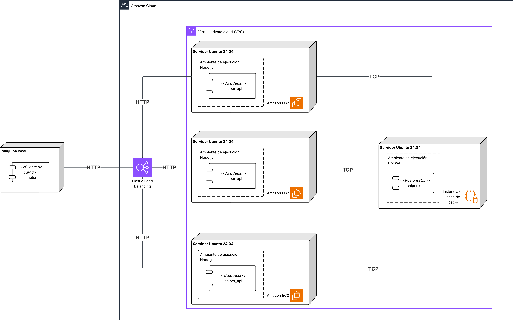

# Lab 3 — Pruebas de Carga en AWS para el Monolito de Cheapest

## 1. Índice

- [1. Índice](#1-índice)
- [2. Etapas del laboratorio](#2-etapas-del-laboratorio)
- [3. Objetivos](#3-objetivos)
- [4. Planeación del laboratorio](#4-planeación-del-laboratorio)
- [5. Ejecución del laboratorio](#5-ejecución-del-laboratorio)
- [6. Realización de pruebas](#6-realización-de-pruebas)
- [7. Entregables](#7-entregables)
- [Nota final (créditos AWS)](#nota-final-créditos-aws)

## 2. Etapas del laboratorio

| Etapa                                  | Resumen                                                                                                   | Uso de IA generativa                                                                                                       |
| -------------------------------------- | --------------------------------------------------------------------------------------------------------- | -------------------------------------------------------------------------------------------------------------------------- |
| 1. Experimento y ASRs                  | Definicion de objetivo de carga y criterios de exito para el monolito desplegado en la nube de Amazon (AWS). | Uso acotado para apoyo conceptual.                                            |
| 2. Analisis de arquitectura desplegada | Revision de la topologia (monolito replicado en varias maquinas detras de un balanceador de carga) y sus implicaciones. | Uso acotado para apoyo conceptual.                                                |
| 3. Despliegue en AWS                   | Reglas de seguridad de red, creacion de las maquinas virtuales para la aplicacion y la base de datos, y configuracion del balanceador de carga. | Recomendado para deteccion de inconsistencias de configuracion.                                          |
| 4. Diseño y ejecucion de pruebas       | Aplicacion de matriz de carga con JMeter o script Python/Bash para cargas altas.                               | Recomendado para resolver errores. |
| 5. Interpretacion y entregables        | Identificacion robusta del punto de inflexion y documentacion de evidencia.                               | No recomendado para redactar conclusiones.                                                       |

> Este laboratorio continúa el trabajo del **Lab 2**. El objetivo es ejecutar pruebas de carga sobre los mismos dos endpoints (la consulta de productos disponibles, GET, y la creación de pedidos, POST), ahora desplegados en AWS.

## 3. Objetivos

- Ejecutar **pruebas de carga** sobre el backend monolítico de Cheapest desplegado en máquinas virtuales de AWS, replicado detrás de un **balanceador de carga** (un componente que reparte las peticiones entre varias copias de la aplicación).
- Preparar la infraestructura en AWS necesaria para las pruebas: reglas de seguridad de red, máquinas virtuales para la aplicación y para la base de datos, y el balanceador de carga.
- Encontrar el **punto de inflexión** del sistema (máximo de usuarios simulados antes de incumplir los ASRs).
- Analizar el comportamiento del monolito bajo carga: **latencia, throughput, errores** y posibles cuellos de botella.
- Proponer **mejoras de arquitectura y/o tácticas** para mejorar desempeño y disponibilidad.

## 4. Planeación del laboratorio

En el Lab 2 usted midió el monolito de Cheapest corriendo completo en su máquina: la aplicación, la base de datos y el generador de carga compartían el mismo computador. En este laboratorio el mismo monolito se despliega en la nube de Amazon (AWS) con dos cambios de arquitectura: la base de datos pasa a una máquina propia y la aplicación se **replica en tres máquinas** que reciben las peticiones a través de un balanceador de carga. Las pruebas son las mismas del Lab 2, para poder comparar.

**Conceptos que se presentan en este laboratorio.**

| Concepto | Qué es |
| --- | --- |
| AWS | Amazon Web Services: plataforma de computación en la nube. Permite alquilar por demanda máquinas, redes y servicios en los centros de datos de Amazon. |
| AWS Academy / Learner Lab | Programa por el que usted recibe una cuenta de AWS con créditos limitados para el curso. El Learner Lab es el ambiente donde se inicia esa cuenta. |
| Consola de AWS | Página web desde la que se crean y administran todos los recursos de AWS. |
| CloudShell | Terminal dentro de la consola de AWS, ya autenticada, desde la que se ejecutan comandos de AWS (`aws ...`). |
| EC2 | *Elastic Compute Cloud*: servicio de AWS para crear máquinas virtuales. A cada máquina se le llama **instancia**. |
| AMI | *Amazon Machine Image*: plantilla con el sistema operativo con el que arranca una instancia (aquí, Ubuntu Server 24.04). |
| Tipo de instancia | Tamaño de la máquina virtual. `t2.medium` significa 2 CPU virtuales (vCPU) y 4 GiB de memoria. |
| Región y zona de disponibilidad (AZ) | Una región es una ubicación geográfica de AWS (usaremos `us-east-1`). Cada región tiene varias zonas de disponibilidad: centros de datos independientes (`us-east-1a`, `us-east-1b`, ...). |
| VPC y subred | Una VPC es una red privada dentro de AWS donde viven sus instancias. Una subred es un segmento de esa red, ubicado en una zona de disponibilidad. |
| IP pública e IP privada | La IP pública permite llegar a la instancia desde internet. La IP privada solo sirve dentro de la VPC, entre instancias. |
| Security Group | Conjunto de reglas de red que define qué tráfico puede entrar a una instancia (qué puerto, desde qué origen). Funciona como un cortafuegos. |
| Key pair y SSH | SSH es el protocolo para abrir una terminal remota en una instancia. El key pair es el par de llaves que lo autoriza; usted conserva la llave privada en un archivo `.pem`. |
| Balanceador de carga | Componente que recibe todas las peticiones y las reparte entre varias copias de la aplicación. |
| ALB | *Application Load Balancer*: el balanceador de carga de AWS para tráfico HTTP. |
| Target group | Lista de instancias entre las que el ALB reparte el tráfico. |
| Health check | Petición periódica que el ALB le hace a cada instancia (aquí, a `/health`) para saber si está sana. A una instancia que no responde deja de enviarle tráfico. |
| Escalamiento horizontal y vertical | Horizontal: agregar más máquinas iguales. Vertical: hacer más grande la máquina (más CPU y memoria). |

### 4.1 Hipótesis de diseño

| # | Hipótesis |
| --- | --- |
| H1 | **Si** replicamos el monolito en tres instancias detrás de un balanceador de carga (escalamiento horizontal), **entonces** el punto de inflexión se alcanza con más carga que con una sola instancia y el throughput máximo aumenta, **porque** las peticiones se reparten y cada instancia aporta su propio proceso de Node.js y su propio pool de conexiones a la base de datos. |
| H2 | **Si** las tres instancias de la aplicación comparten una única base de datos, **entonces** el throughput no crece en proporción al número de instancias (tres instancias no atienden el triple) y el porcentaje de error de la creación de pedidos en el pico de 5000 req/min sigue por encima de 2%, **porque** la base de datos es un recurso compartido que no se replicó: triplicar las instancias triplica las conexiones y las consultas simultáneas contra el mismo PostgreSQL. |
| H3 | **Si** separamos la aplicación y la base de datos en máquinas distintas, **entonces** el p99 de la consulta de productos disponibles se mantiene por debajo de 1000 ms en operación normal (500 req/min), **porque** la aplicación y la base de datos dejan de competir por la misma CPU y memoria, a cambio de un salto de red adicional en cada consulta. |

### 4.2 Escenarios de calidad vinculados

Los ASRs son los mismos del Lab 2:

| ID    | Descripción                                                                                                                                                                                                                                                           | Medidas de respuesta a satisfacer |
| ----- | --------------------------------------------------------------------------------------------------------------------------------------------------------------------------------------------------------------------------------------------------------------------- | --------------------- |
| ASR 1 | Como tendero, quiero consultar los productos que alguna vez he pedido, que actualmente estén en promoción y disponibles en el catálogo de mi zona, con una latencia p99 de **1000 ms** en operación normal (500 req/min).                                                       | Latencia p99 < 1000ms |
| ASR 2 | Como director de operaciones de Cheapest, durante eventos con promociones en donde múltiples tiendas están comprando, quiero que al menos el **98% de los pedidos** sean creados exitosamente, aun cuando un alto número de tenderos realicen pedidos simultáneamente, se estiman (5000 req/min). | Error % ≤ 2%          |

> [!IMPORTANT]
> **Pregunta 1:**
> ASR 1 (latencia de la consulta) y ASR 2 (pedidos creados con éxito) pueden entrar en tensión en picos de demanda.
> En el contexto de Cheapest, si una decisión de arquitectura mejora el p99 pero empeora el porcentaje de éxito, ¿qué criterio de priorización usaría y por qué?
> Responda considerando impacto al tendero e impacto al negocio.

**Qué se va a probar.** Los mismos dos endpoints del Lab 2:

1. **GET `/logistics/tenderos/productos-disponibles` (lectura pesada):** consulta los productos que una tienda alguna vez pidió, que están en promoción y disponibles en el catálogo de su zona. Cruza varias tablas (pedidos, ítems, productos, promociones, catálogos y disponibilidad). Sobre este endpoint se evalúa el ASR 1.
2. **POST `/logistics/pedidos` (escritura pesada):** crea un pedido con muchos ítems, lo que implica escribir varias filas relacionadas (el pedido y sus ítems) en una transacción. Sobre este endpoint se evalúa el ASR 2.

### 4.3 Tácticas y patrones

#### 4.3.1 Patrones de diseño

Este laboratorio no agrega patrones de diseño al código: la aplicación es exactamente la misma del Lab 2 (monolito en capas con inyección de dependencias, Repository y DTO). Lo que cambia es **dónde y cuántas veces** se despliega.

#### 4.3.2 Tácticas de arquitectura

| Táctica | Análisis |
| --- | --- |
| Replicación horizontal con balanceador de carga | Distribuye el tráfico entrante entre 3 instancias de cómputo para mejorar disponibilidad y, en algunos casos, escalabilidad. No elimina cuellos de botella internos del monolito ni garantiza menor latencia si la base de datos es el límite. |
| Separación de la aplicación y la base de datos en nodos distintos | Evita que compitan por CPU y memoria y permite dimensionarlas por separado. Agrega un salto de red a cada consulta y un componente más que puede fallar. |
| Redundancia en varias zonas de disponibilidad | Cada instancia de la aplicación se ubica en una zona distinta, de modo que la falla de un centro de datos no derriba todas las copias. La base de datos, con una sola instancia, sigue siendo un punto único de falla. |
| Detección de fallas con health check | El balanceador revisa periódicamente `/health` en cada instancia y deja de enviarle tráfico a la que no responde. |

**El balanceador de carga (ALB) en detalle.** El Application Load Balancer se usa como táctica de escalamiento horizontal del monolito. En lugar de un solo backend, el tráfico se reparte entre **tres instancias EC2** con la misma aplicación.

**Que resuelve en este lab**

- Aumenta capacidad total de procesamiento al repartir solicitudes.
- Reduce el riesgo de que una sola instancia se sature primero.
- Mejora disponibilidad si una instancia falla (el ALB deja de enrutarle).

**Que no resuelve**

- No evita cuellos de botella compartidos (DB, pool de conexiones, locks).
- No mejora el desempeño de una consulta costosa por si sola.
- Puede ocultar inconsistencia de configuracion entre instancias si no se revisan metricas por instancia.

**Como se observa en los resultados**

- Throughput total mayor que el de una instancia individual, hasta el limite de la base de datos.
- p95/p99 mas estables en cargas medias, pero degradacion similar si la base de datos se satura.

#### 4.3.3 Estilos aplicados

| Estilos de arquitectura asociados | Analisis (atributos de calidad que favorece y desfavorece) |
| --- | --- |
| Monolito | Favorece latencia y mantenibilidad.<br>Desfavorece escalabilidad y disponibilidad. |
| Cliente / Servidor | Favorece mantenibilidad.<br>Desfavorece escalabilidad y disponibilidad. |
| Capas | Favorece mantenibilidad.<br>Puede desfavorecer latencia (mas saltos y abstraccion) y complejidad. |

> [!IMPORTANT]
> **Pregunta 2:**
> La topología de este laboratorio combina monolito + ALB + múltiples instancias.
> ¿Qué atributo de calidad está mejorando realmente y cuál podría estar sobreestimándose si no se analizan correctamente las métricas?
> Qué criterio usaría para evitar conclusiones engañosas cuando hay balanceo de carga pero no hay desacoplamiento funcional interno.

### 4.4 Diseño del experimento

#### 4.4.1 ¿Cómo se va a validar la hipótesis?

1. **Desplegar la arquitectura en AWS:** una instancia para la base de datos, tres para la aplicación y el balanceador de carga delante de ellas.
2. **Ejecutar la matriz de pruebas del Lab 2** contra el balanceador, con las tres instancias activas, midiendo el GET y el POST por separado.
3. **Ejecutar una corrida de control con una sola instancia** activa detrás del balanceador, para aislar el efecto de la replicación: es la única forma de saber cuánto aportan las dos instancias adicionales.
4. **Comparar con los umbrales de los ASRs** y ubicar el punto de inflexión de cada endpoint.
5. **Comparar con los resultados del Lab 2** (monolito local) para evaluar el efecto de separar la aplicación de la base de datos.

#### 4.4.2 ¿Qué componentes se van a diseñar o modificar?

| Componente | Cambio |
| --- | --- |
| Security Groups | Tres grupos de reglas de red: acceso por SSH, acceso a PostgreSQL y acceso HTTP a la aplicación. |
| Instancia `Cheapest-db` | Máquina nueva que ejecuta PostgreSQL en un contenedor de Docker. |
| Instancias `Cheapest-app-1`, `Cheapest-app-2` y `Cheapest-app-3` | Tres máquinas nuevas, cada una en una zona de disponibilidad distinta, con el monolito de la rama `load_tests`. |
| Archivo `.env` de cada instancia de aplicación | `DB_HOST` apunta a la IP privada de `Cheapest-db`. |
| ALB y target group | Reparten el tráfico entre las tres instancias de aplicación. |
| Plan de JMeter y script de Python | Dejan de apuntar a `localhost` y apuntan al nombre DNS del balanceador. |
| Código del monolito | No se modifica. |

#### 4.4.3 ¿Qué métricas se van a medir?

| Métrica | Hipótesis / ASR | Umbral |
| --- | --- | --- |
| p99 y p95 del GET por escalón de carga | H3 / ASR 1 | p99 < 1000 ms en operación normal (500 req/min) |
| Error % del POST por escalón de carga | H2 / ASR 2 | ≤ 2% en el pico (5000 req/min) |
| Throughput (req/s) por endpoint, con 3 instancias y con 1 instancia | H1, H2 | Con escalamiento ideal, 3 instancias atenderían el triple que 1 |
| Punto de inflexión de cada endpoint, con 3 instancias y con 1 instancia | H1 | Debe alcanzarse con más carga cuando hay 3 instancias |
| Punto de inflexión frente al obtenido en el Lab 2 | H3 | Comparación |

### 4.5 Planeación del experimento

#### 4.5.1 Recursos requeridos

| Recurso | Detalle |
| --- | --- |
| Cuenta de AWS | AWS Academy (Learner Lab), con créditos limitados: detenga o elimine los recursos al terminar. |
| Cómputo | 4 instancias EC2 `t2.medium` (2 vCPU, 4 GiB de memoria, 8 GB de disco) con Ubuntu Server 24.04 LTS. |
| Red | 3 Security Groups y 1 Application Load Balancer con su target group. |
| Software en las instancias | Docker y PostgreSQL (en la instancia de base de datos); Node.js LTS, npm y Git (en las instancias de aplicación). |
| Código | Repositorio Cheapest-api, rama `load_tests` (la misma del Lab 2). |
| Generador de carga | JMeter con el plan `load_test.jmx` del Lab 2, y el script de Python que generó en el Lab 2 para las cargas altas. |
| Datos de prueba | Los genera el seeder de la aplicación a partir de `load-seed.yaml`, como en el Lab 2. |
| Resultados del Lab 2 | Son la referencia de comparación. |

Tecnologías del sistema bajo prueba:

| Categoría                | Tecnologías   |
| ------------------------ | ------------- |
| Framework backend        | NestJS        |
| Lenguaje                 | TypeScript    |
| Base de datos            | PostgreSQL    |
| ORM                      | TypeORM       |
| Plataforma de despliegue | AWS EC2       |

#### 4.5.2 Elementos de arquitectura involucrados

Se trabaja sobre la **vista de despliegue**:



*Diagrama del despliegue objetivo: el ALB recibe el tráfico generado por JMeter (desde su computador) y lo distribuye entre las tres instancias EC2 de aplicación (`Cheapest-app-1/2/3`), las cuales se conectan por IP privada a la instancia EC2 de base de datos (`Cheapest-db`).*

> [!NOTE]
> El ícono usado para `Cheapest-db` es distinto al de las instancias de aplicación **solo como convención visual** para diferenciar su rol (base de datos vs. aplicación). En términos de infraestructura, `Cheapest-db` **es una instancia EC2** igual que las de aplicación, solo que ejecuta un contenedor de PostgreSQL en lugar del monolito NestJS.
>
> Tipo de instancia y recursos de cada máquina del diagrama:
>
> | Instancia | Tipo | vCPU | RAM | Almacenamiento |
> | --- | --- | --- | --- | --- |
> | `Cheapest-db` | `t2.medium` | 2 | 4 GiB | 8 GB |
> | `Cheapest-app-1` | `t2.medium` | 2 | 4 GiB | 8 GB |
> | `Cheapest-app-2` | `t2.medium` | 2 | 4 GiB | 8 GB |
> | `Cheapest-app-3` | `t2.medium` | 2 | 4 GiB | 8 GB |

**Objetivo del despliegue:** separar la aplicación y la base de datos en máquinas distintas y escalar el monolito con balanceo.

- **EC2 Cheapest-db**: PostgreSQL
- **EC2 Cheapest-app-1/2/3**: NestJS (monolito)
- Cliente: su computador (JMeter se usa para generar carga)

Se miden dos conectores: el HTTP entre el generador de carga y el balanceador (y de este a las instancias), y la conexión entre las instancias de aplicación y PostgreSQL.

> [!IMPORTANT]
> **Pregunta 3:**
> Antes de desplegar, justifique por qué en Cheapest tendría sentido separar App y DB en instancias distintas incluso si el costo y la complejidad operativa aumentan.
> ¿Qué riesgos de arquitectura está mitigando y cuáles está introduciendo al mover un monolito local a una topología distribuida en AWS?
> Represente su respuesta con una tabla comparativa donde se vean explícitamente los riesgos mitigados e introducidos.

#### 4.5.3 Esfuerzo estimado

Referencia para planear; puede variar según su experiencia con AWS.

| Etapa | Esfuerzo aprox. |
| --- | --- |
| Acceso a AWS y reglas de seguridad de red | 0,5 h |
| Instancia de base de datos | 0,5 h |
| Tres instancias de aplicación | 1 h |
| Balanceador de carga y verificación | 0,5 h |
| Ejecución de la matriz de pruebas y de la corrida de control | 2,5 h |
| Análisis de resultados y entregables | 1,5 h |
| **Total** | **6,5 h-persona** |

## 5. Ejecución del laboratorio

### 5.1 Acceso a AWS Academy

La consola de administración de AWS es una plataforma web que unifica el acceso y manejo de todos los servicios ofrecidos por AWS. Usaremos la consola para desarrollar los laboratorios que son propios del curso y el proyecto. La mayoría de los servicios de nube se cobran por demanda y se pueden detener cuando usted lo necesite. En este curso se hará uso de AWS Academy que proporciona créditos para poder acceder a los recursos de AWS. Estos créditos son limitados así que úselos de forma consciente.

La invitación a AWS Academy debió haber llegado a su correo Uniandes con el asunto: “Invitación al curso”. De lo contrario, revise en correo no deseado o informe al personal docente. Dentro del correo oprima el botón de “Comenzar” y siga las instrucciones para iniciar sesión como estudiante.


Cuando ingrese a la plataforma de AWS Academy podrá observar la sección “Módulos”. Bajo el módulo “Bienvenida e información general sobre el curso” entre a “Guía del estudiante del Laboratorio de aprendizaje de AWS Academy”.


Para iniciar el ambiente de AWS siga estos pasos:

1. Presione el botón **"Start Lab"**.
2. Espere hasta que el indicador de estado cambie a **punto verde**; esto indica que el ambiente ya está listo y puede acceder a la consola de AWS (abriendo el enlace **"AWS"** que aparece junto al indicador). Usted debe ver algo así


> [!WARNING]
> **No presione "Reset Lab"** salvo que sea estrictamente necesario (por ejemplo, si el ambiente quedó en un estado irrecuperable). El reseteo del ambiente puede demorar **bastante tiempo** en completarse y durante ese lapso no podrá acceder a los recursos de AWS.

> [!WARNING]
> Para este laboratorio y los siguientes se van a crear en múltiples oportunidades elementos comunes de infraestructura. Para esto usted tendrá disponibles los tutoriales de AWS, estos le presentarán dos formas de crear los recursos, con la herramienta CloudShell o a través de la consola de AWS. Se recomienda que emplee ambas formas de usar AWS al menos una vez. Sin embargo, **es importante que sepa como usar la consola de AWS ya que sus evidencias deben ser capturas de pantalla de la misma en donde se vea la infraestructura desplegada.**

### 5.2 Configurar la seguridad de red (Security Groups)

Un Security Group es un conjunto de reglas que define qué tráfico puede entrar a una instancia. Va a crear tres: uno para poder conectarse por SSH, uno para que la aplicación llegue a la base de datos y uno para que las peticiones HTTP lleguen a la aplicación.

> Nota: use nombres **sin tildes** y sin caracteres especiales.

Cree los tres Security Groups con los parámetros de las tablas siguientes. Para el paso a paso vaya a este tutorial:
- [Tutorial para crear Security Groups en AWS](../tutoriales/crear_security_groups.md)

#### Security Group 1 — SSH

| Parámetro    | Valor                          |
| ------------ | ------------------------------ |
| Nombre       | `Cheapest-ssh`                   |
| Descripción  | Acceso SSH a instancias        |
| Inbound rule | TCP 22 (SSH) desde `Anywhere-IPv4` |

#### Security Group 2 — PostgreSQL

| Parámetro    | Valor                          |
| ------------ | ------------------------------ |
| Nombre       | `Cheapest-db`                    |
| Descripción  | Acceso a PostgreSQL            |
| Inbound rule | TCP 5432 desde `Anywhere-IPv4` |

> En un entorno real, 5432 **no** se abre a todo internet. Para el laboratorio lo haremos así por simplicidad.

#### Security Group 3 — HTTP API (Cheapest)

| Parámetro    | Valor                          |
| ------------ | ------------------------------ |
| Nombre       | `Cheapest-http`                  |
| Descripción  | Acceso HTTP al monolito (API)  |
| Inbound rule | TCP 3000 desde `Anywhere-IPv4` |

> Si su backend corre en otro puerto, ajuste esta regla para que coincida con su configuración.

Usted debe ver algo así


> [!IMPORTANT]
> **Pregunta 4:**
> Proponga un diseño mínimo de seguridad para Cheapest que elimine la exposición pública de infraestructura que debería ser privada.
>
> Debe incluir al menos:
> - origen permitido de tráfico,
> - estrategia de segmentación de red
>
> Pista: Uno de los principios más importantes de seguridad es *least permissions*, que menciona que un sistema debería tener la cantidad mínima de permisos posibles. Revise qué configuraciones podría modificar para reducir los permisos de la infraestructura.

### 5.3 Crear la instancia EC2 de la base de datos (PostgreSQL)

Cree una instancia EC2 con los parámetros de la tabla. Para el paso a paso siga este tutorial:
- [Tutorial para crear instancias de EC2 en AWS](../tutoriales/crear_instancia_ec2.md)

| Parámetro         | Valor                      |
| ----------------- | -------------------------- |
| Nombre            | `Cheapest-db`                |
| AMI               | Ubuntu Server 24.04 LTS    |
| Tipo de instancia | `t2.medium`                  |
| Key pair          | `vockey` (o una llave propia, ver nota) |
| IP pública        | Habilitar                  |
| Security Groups   | `Cheapest-ssh` + `Cheapest-db` |
| Almacenamiento    | 8 GB                       |

> [!IMPORTANT]
> **Key pair (llave SSH):** el archivo `.pem` que se usa más adelante en `ssh -i <archivo>.pem ...` es la llave privada del **key pair** que usted seleccione al crear la instancia. AWS solo le entrega el `.pem` en el momento de crear la llave, y el key pair **no se puede cambiar** después de lanzar la instancia. Tiene dos opciones:
>
> - **`vockey` (recomendada):** es el key pair que AWS Academy ya creó en su cuenta. Descargue su llave privada desde la página del Learner Lab en **AWS Details → SSH key → Download PEM** (archivo `labsuser.pem`
> - **Llave propia:** créela antes de lanzar la instancia (en la consola: **EC2 → Key Pairs → Create key pair**, formato `.pem`; o por CLI con el **Paso 2** del [Tutorial para crear instancias de EC2](../tutoriales/crear_instancia_ec2.md)) y guarde el archivo que se descarga.
>
> En Linux/macOS, restrinja los permisos del archivo antes de usarlo, o SSH lo rechazará (`UNPROTECTED PRIVATE KEY FILE`): `chmod 400 labsuser.pem`.
>
> Use el **mismo key pair** para `Cheapest-db` y para las tres instancias de aplicación que creará después. Si crea una instancia con **"Proceed without a key pair"**, solo podrá conectarse por EC2 Instance Connect.

> [!NOTE]
> Evalúe usar la AMI **Amazon Linux con Docker preinstalado** como alternativa a Ubuntu Server 24.04 LTS. Esto le ahorra instalar Docker manualmente y le permite enfocarse antes en las pruebas de carga. Si opta por esta AMI, tenga en cuenta que el usuario de conexión SSH suele ser `ec2-user` en lugar de `ubuntu`, y que los comandos de gestión de paquetes (`yum`/`dnf`) difieren de los de Ubuntu (`apt`).

#### Conexión a la instancia de base de datos

**Opción A — EC2 Instance Connect (recomendada):**

Desde la consola web de AWS puede conectarse directamente a la instancia sin necesidad de un terminal externo ni de gestionar archivos `.pem`:

1. En la consola de EC2, seleccione la instancia `Cheapest-db`.
2. Presione **Connect**.
3. Elija la pestaña **EC2 Instance Connect** y presione **Connect**.
4. Se abrirá una terminal en el navegador ya autenticada contra la instancia.

**Opción B — SSH externo:**

Conéctese a la instancia desde su terminal usando el archivo `.pem` del key pair que seleccionó al crearla (por ejemplo `labsuser.pem` si usó `vockey`):

```bash
ssh -i <archivo>.pem ubuntu@<IP_PUBLICA_DB>
```

#### Ejecutar la base de datos (Cheapest-db)

1. Conéctese por SSH a `Cheapest-db`.
2. Instale Docker. La AMI **Ubuntu Server 24.04 LTS no trae Docker preinstalado**: siga los pasos 1 a 7 del [Tutorial para instalar Docker](../tutoriales/instalar_docker_en_una_maquina_EC2.md).

> [!NOTE]
> Si usó la AMI de Amazon Linux con Docker preinstalado, omita la instalación y continúe con la verificación.

3. Verifique que Docker quedó instalado y el servicio está corriendo (debe mostrar `active (running)`):

```bash
sudo docker --version
sudo service docker status
```

4. Levante PostgreSQL con Docker (si no existe el contenedor, créelo; si existe, inícielo):

```bash
# Opción A: crear y levantar (primera vez)
sudo docker run --name cheapest-db  -e POSTGRES_PASSWORD=postgres  -e POSTGRES_DB=cheapest  -p 5432:5432  -d postgres

# Opción B: si ya existe, solo iniciar
sudo docker start cheapest-db
```

5. Verifique que está arriba:

```bash
sudo docker ps
```


### 5.4 Crear las instancias EC2 de la aplicación (monolito de Cheapest)

Cree **tres** instancias EC2, una por cada zona de disponibilidad. Distribuirlas en AZs distintas garantiza que una falla de zona no derribe todas las instancias al mismo tiempo, mejorando la disponibilidad del sistema.

| Parámetro         | `Cheapest-app-1`               | `Cheapest-app-2`               | `Cheapest-app-3`               |
| ----------------- | ---------------------------- | ---------------------------- | ---------------------------- |
| Nombre            | `Cheapest-app-1`               | `Cheapest-app-2`               | `Cheapest-app-3`               |
| AMI               | Ubuntu Server 24.04 LTS      | Ubuntu Server 24.04 LTS      | Ubuntu Server 24.04 LTS      |
| Tipo de instancia | `t2.medium`                  | `t2.medium`                  | `t2.medium`                  |
| Key pair          | `vockey` (el mismo de `Cheapest-db`) | `vockey` (el mismo de `Cheapest-db`) | `vockey` (el mismo de `Cheapest-db`) |
| IP pública        | Habilitar                    | Habilitar                    | Habilitar                    |
| Security Groups   | `Cheapest-ssh` + `Cheapest-http` | `Cheapest-ssh` + `Cheapest-http` | `Cheapest-ssh` + `Cheapest-http` |
| Almacenamiento    | 8 GB                         | 8 GB                         | 8 GB                         |
| AZ (Zona)         | `us-east-1a`                 | `us-east-1b`                 | `us-east-1c`                 |

Para obtener el `SubnetId` de cada AZ antes de crear cada instancia, siga el **Paso 5** del [Tutorial para crear instancias de EC2 en AWS](../tutoriales/crear_instancia_ec2.md).

#### Conexión por SSH a cada instancia EC2

Use el mismo archivo `.pem` del key pair con el que creó la instancia de base de datos. También puede conectarse con EC2 Instance Connect desde la consola (seleccione la instancia, presione **Connect**, elija la pestaña **EC2 Instance Connect** y presione **Connect**).

```bash
ssh -i <archivo>.pem ubuntu@<IP_PUBLICA_APP>
```

#### Instalación de Node.js (LTS), npm y Git

```bash
# Dependencias básicas
sudo apt update
sudo apt install -y git curl

# Instalar NVM
curl -o- https://raw.githubusercontent.com/nvm-sh/nvm/v0.39.7/install.sh | bash

# Cargar NVM en la sesión actual
export NVM_DIR="$HOME/.nvm"
[ -s "$NVM_DIR/nvm.sh" ] && \. "$NVM_DIR/nvm.sh"

# Instalar Node LTS
nvm install --lts

# Usar la versión LTS por defecto
nvm alias default 'lts/*'
nvm use default

# Verificar instalación
node -v
npm -v
```

#### Clonar el repositorio del backend

Clone el repositorio del backend de su proyecto (reemplace la URL, **y recuerde que estamos trabajando sobre la rama load_tests**):

```bash
git clone <URL_REPO_BACKEND_Cheapest>
cd <CARPETA_REPO>
nvm install
```

Instale dependencias:

```bash
npm install
```

#### Configuración de conexión a la base de datos

Configure variables de entorno o archivo. La idea es que **HOST** apunte a la **IP privada** de `Cheapest-db` (misma VPC).


Para configurarlo copie el archivo de ejemplo

``` bash
cp .env.example .env
```

Con el comando `cat .env` usted verá el contenido del archivo (los valores reales de `.env.example` del repo):

```bash
NODE_ENV=production
APP_PORT=3000

DB_TYPE=postgres
DB_HOST=localhost
DB_PORT=5432
DB_USERNAME=postgres
DB_PASSWORD=postgres
DB_NAME=cheapest
```

Modifique **únicamente** `DB_HOST` para que apunte a la **IP privada** de `Cheapest-db` (misma VPC). El usuario, la contraseña y el nombre de la base (`postgres`/`postgres`/`cheapest`) ya coinciden con los que definió al crear el contenedor de PostgreSQL en la instancia `Cheapest-db`.

Para modificar el archivo puede usar `nano` o `vim`:

```bash
nano .env
```

> [!IMPORTANT]
> **Pregunta 5:**
> Para el laboratorio usaremos la IP privada para conectar la aplicación a la base de datos. Compare el uso de IP privada vs IP pública para la conexión entre App y Base de Datos en este laboratorio.
>
> ¿Qué diferencias esperaría en seguridad, latencia, estabilidad y costo operativo para Cheapest, y en qué casos podría justificarse usar cada opción?
> Apoye la comparación con una tabla.

#### Ejecución y carga de datos

```bash
npm run start
```

> Al arrancar, la aplicación ejecuta el seeder, que llena la base de datos según el archivo `src/datasources/load-seed.yaml`, igual que en el Lab 2. Use el mismo diseño de datos que usó en el Lab 2 para que los resultados sean comparables.

> [!WARNING]
> **Arranque la primera instancia de app y espere a que responda en `/health` antes de arrancar las otras dos.** El seeder corre al inicio de cada instancia: si las tres arrancan a la vez contra una base vacía, las tres intentarán poblarla al mismo tiempo (datos duplicados o errores de arranque). Con la base ya poblada, las demás instancias detectan los datos existentes y no insertan nada.

#### Verificación desde el navegador

En su computador, abra para cada instancia de aplicación:
- `http://<IP_PUBLICA_APP>:3000/health`

### 5.5 Configurar el balanceador de carga (ALB)

El balanceador se compone de tres piezas: el **ALB** (recibe las peticiones en el puerto 80), un **target group** (la lista de instancias a las que reparte el tráfico, con su health check en `/health`) y un **listener** (la regla que dice "lo que llegue al puerto 80 se envía a este target group").

1. Configure el balanceador siguiendo este tutorial:
   - [Tutorial para configurar Load Balancer](../tutoriales/configurar_load_balancer.md)
2. Registre como targets las instancias `Cheapest-app-1`, `Cheapest-app-2` y `Cheapest-app-3`.
3. Identifique el **nombre DNS del ALB** (algo como `Cheapest-alb-123456789.us-east-1.elb.amazonaws.com`). Es la dirección a la que apuntarán JMeter y el script de carga.

### 5.6 Verificar el despliegue completo

En su computador, abra:
- `http://<DNS_ALB>/health`

Si responde, el balanceador está enviando tráfico a las instancias. Verifique además, en la consola de EC2 → **Target Groups** → su target group → pestaña **Targets**, que las tres instancias aparezcan como `healthy`.

### 5.7 Reiniciar los servicios si detuvo las instancias

> [!NOTE]
> Este paso **solo aplica** en los siguientes casos:
> - Para `Cheapest-db`: cuando la **instancia** fue detenida (stopped) y necesita reiniciar el contenedor de PostgreSQL.
> - Para las instancias de aplicación: cuando el **proceso de Node** fue detenido (no necesariamente cuando toda la instancia fue detenida).
>
> Si ninguna instancia o proceso fue detenido, puede omitir este paso.

Si las instancias quedaron detenidas, inícielas antes de ejecutar las pruebas:

1. Inicie `Cheapest-db` y verifique el contenedor de PostgreSQL:

```bash
sudo docker start cheapest-db
sudo docker ps
```

2. En cada instancia de app, levante la aplicación:

```bash
npm run start
```

## 6. Realización de pruebas

En la sección anterior dejó desplegada la arquitectura: tres instancias de aplicación detrás del balanceador y una instancia de base de datos. Aquí se explica qué puede modificar de ese despliegue para mejorar o empeorar el desempeño, y qué corridas debe ejecutar.

> En el **Lab 2** ya aprendió a usar JMeter. En este laboratorio el foco es ejecutar la matriz de pruebas contra el balanceador, medir **p99 y p95**, y detectar el **punto de inflexión**.

### 6.1 Escenarios de carga

Son los dos niveles de carga de referencia que definen los ASRs:

- **Operación normal:** 500 req/min (≈ 8.3 req/s). Aquí se evalúa el ASR 1 (p99 del GET < 1000 ms).
- **Evento de promociones (pico):** 5000 req/min (≈ 83.3 req/s). Aquí se evalúa el ASR 2 (Error % del POST ≤ 2%).

### 6.2 Puntos de sensibilidad

Estos son los parámetros del despliegue de los que depende el cumplimiento de los ASRs, y cómo se modifica cada uno:

| Punto de sensibilidad | Cómo se modifica | Efecto esperado |
| --- | --- | --- |
| **Número de instancias de aplicación que reciben tráfico** (escalamiento horizontal) | Consola: EC2 → **Target Groups** → su target group → pestaña **Targets** → seleccione una instancia → **Deregister**. Para volver a incluirla: **Register targets**. Por CloudShell: `aws elbv2 deregister-targets --target-group-arn <TARGET_GROUP_ARN> --targets Id=<INSTANCE_ID>` y `aws elbv2 register-targets --target-group-arn <TARGET_GROUP_ARN> --targets Id=<INSTANCE_ID>`. | Menos instancias implican menos procesos de Node.js y menos conexiones a la base de datos: el punto de inflexión debería alcanzarse con menos carga. |
| **Tamaño de las instancias de aplicación** (escalamiento vertical) | Consola: EC2 → seleccione la instancia → **Instance state → Stop instance** → **Actions → Instance settings → Change instance type** → elija otro tipo (por ejemplo `t2.large`: 2 vCPU y 8 GiB) → **Start instance**. Al reiniciar, vuelva a levantar la aplicación con `npm run start`. | Más CPU y memoria por instancia. Tenga en cuenta que Node.js ejecuta el código de la aplicación en un solo hilo. |
| **Tamaño de la instancia de base de datos** | El mismo procedimiento de cambio de tipo, sobre `Cheapest-db`. Después de iniciarla, levante de nuevo el contenedor con `sudo docker start cheapest-db`. La IP privada de la instancia se conserva. | Si el cuello de botella es PostgreSQL, es el cambio con mayor efecto. |
| **Algoritmo de balanceo** | Consola: EC2 → **Target Groups** → su target group → pestaña **Attributes** → **Edit** → *Load balancing algorithm*: *Round robin* (por turnos) o *Least outstanding requests* (a la instancia con menos peticiones pendientes). | Con peticiones de duración muy desigual, repartir por turnos puede sobrecargar una instancia mientras otra está libre. |
| **Tamaño del pool de conexiones** | En cada instancia de aplicación, agregue `extra: { max: <N> }` a la configuración del `DataSource` en `src/datasources/database.providers.ts` y reinicie la aplicación. Por defecto son 10 conexiones por instancia, es decir, 30 en total con tres instancias. | Más conexiones reducen la espera en la aplicación, pero aumentan el trabajo simultáneo de PostgreSQL. |
| **Volumen y distribución de los datos** | Archivo `src/datasources/load-seed.yaml`, como en el Lab 2. Para volver a sembrar, elimine y recree el contenedor de PostgreSQL en `Cheapest-db` (`sudo docker rm -f cheapest-db` y de nuevo el comando `sudo docker run ...` con el que lo creó) y reinicie **una sola** instancia de aplicación primero. | Más filas hacen más costosa la consulta del GET. |
| **Usuarios simulados y ramp-up** | Campos *Number of Threads* y *Ramp-up period* de JMeter, o `--users` y `--ramp-up` del script. | Definen la carga de cada escalón de la matriz. |

> [!IMPORTANT]
> **Pregunta 6:**
> Existen múltiples algoritmos de balanceo de carga, y cada uno responde a características del tráfico, del número de usuarios, de su comportamiento o incluso del hardware. Investigue qué algoritmo usa el ALB por defecto y haga una tabla comparativa, en múltiples aspectos, con los algoritmos Round-robin, Hashing por IP, Least connections y Least response time. En esta tabla **debe comparar las características de los algoritmos aplicados a Cheapest**.

### 6.3 Matriz mínima de pruebas (configuración base: 3 instancias)

Ejecute la matriz **por endpoint** (una campaña para el GET y otra para el POST), con las tres instancias registradas en el target group y sin modificar ningún otro punto de sensibilidad. Ejecute al menos **8 repeticiones** para *Operación normal* y *Estrés fuerte*. Para el resto, ejecute al menos **4** (o más si el quiebre no es claro):

| Test                 | Ramp-Up | Threads | Loops | Usuarios concurrentes (req/seg) |
| -------------------- | ------- | ------- | ----- | ------------------------------- |
| **Smoke test**       | 5s      | 5       | 1     | 1                               |
| **Baja carga**       | 10s     | 10      | 1     | 3                               |
| **Carga media**      | 20s     | 100     | 1     | 5                               |
| **Operación normal** | 50s     | 450     | 1     | 9                               |
| **Alta carga**       | 75s     | 1500    | N/A   | 20                              |
| **Muy alta carga**   | 100s    | 3000    | N/A   | 30                              |
| **Estrés**           | 150s    | 7500    | N/A   | 50                              |
| **Estrés fuerte**    | 200s    | 18000   | N/A   | 90                              |

> Mantenga constantes los parámetros base para que el comparativo sea válido.

### 6.4 Cómo ejecutar cada corrida

**Con JMeter:**

1. Use el archivo [`load_test.jmx`](../lab_2/recursos/load_test.jmx) del Lab 2 (incluye las pruebas **GET** y **POST**).
2. En el sampler HTTP de cada Thread Group, actualice:
   - `Server Name or IP` = el nombre DNS del ALB (sin `http://`)
   - `Port` = `80`
3. Ponga en *Number of Threads*, *Ramp-up period* y *Loop Count* los valores de la fila de la matriz, limpie los resultados anteriores (*Run → Clear All*) y ejecute.
4. Anote p99, p95, throughput y Error % del Aggregate Report y del Summary Report, y tome la captura.

**Con el script de Python:** en las filas de mayor carga, JMeter puede convertirse en el cuello de botella en su propio computador. Si JMeter se bloquea o deja de responder, ejecute esas filas con el script de Python que generó en el Lab 2, cambiando la URL base de `http://localhost:3000` a `http://<DNS_ALB>`.

### 6.5 Corrida de control: una sola instancia

Para saber cuánto aporta la replicación, repita una parte de la matriz con **una sola instancia** recibiendo tráfico:

1. Retire del target group dos de las tres instancias de aplicación (*Deregister*), de modo que solo quede `Cheapest-app-1`. Espere a que las dos instancias retiradas terminen de drenarse (dejan de aparecer en la pestaña **Targets** o aparecen como `draining` y luego desaparecen).
2. Ejecute, para el GET y para el POST, las filas **Operación normal** y **Alta carga** de la matriz, al menos **2 repeticiones** de cada una.
3. Registre los mismos datos (p99, p95, throughput y Error %).
4. Vuelva a registrar las dos instancias en el target group y verifique que las tres queden `healthy`.

Si quiere explorar otros puntos de sensibilidad (tipo de instancia, algoritmo de balanceo, pool de conexiones), cambie **uno a la vez**, repita las mismas dos filas y repórtelo como una corrida adicional.

### 6.6 Cómo leer los resultados

JMeter reporta, para cada corrida:

- **# Samples:** cantidad total de peticiones.
- **Average:** tiempo promedio de respuesta (ms).
- **p95/p99:** percentiles de latencia.
- **Min/Max:** tiempos extremos.
- **Std. Dev.:** variabilidad.
- **Error %:** porcentaje de fallos.
- **Throughput:** peticiones por segundo.

**Umbrales por ASR:**

- **ASR 1 (latencia de la consulta de productos disponibles):** `p99 < 1000 ms`
- **ASR 2 (pedidos creados con éxito):** `Error % ≤ 2%`

**Punto de inflexión.** Para cada endpoint, es el **mayor** número de usuarios simulados con el que **todavía** se cumple su ASR (p99 < 1000 ms para el GET; Error % ≤ 2% para el POST). Reporte también el primer escalón de la matriz en el que deja de cumplirse.

## 7. Entregables

Entregue un informe organizado con los siguientes numerales.

### 7.1 Resultados

#### 7.1.1 ¿Qué se observó?

Describa, sin interpretar todavía:

- Cómo cambiaron los tiempos de respuesta y los errores de cada endpoint a medida que aumentó la carga.
- Qué tipo de errores aparecieron y a partir de qué escalón.
- Cómo se repartió el tráfico entre las tres instancias (por ejemplo, si alguna dejó de aparecer como `healthy` durante una corrida).
- Qué cambió al dejar una sola instancia recibiendo tráfico, y al modificar cualquier otro punto de sensibilidad que haya explorado.

#### 7.1.2 ¿Qué métricas se obtuvieron?

Entregue **dos tablas** con la configuración base de 3 instancias (una por endpoint):

- Tabla A: Resultados del **GET**
- Tabla B: Resultados del **POST**

Use este formato (con **p95 y p99**), una fila por cada repetición:

| # threads/users | Ramp-up (s) | p99 (ms) | p95 (ms) | Throughput (req/s) | Error % |
|---:|---:|---:|---:|---:|---:|
| 5 | 5 |  |  |  |  |
| 10 | 10 |  |  |  |  |
| ... | ... |  |  |  |  |

> [!IMPORTANT]
> Cada tabla debe estar **completa** y respetar el mínimo de repeticiones de la matriz de pruebas:
> - **8 repeticiones** como mínimo para *Operación normal* y *Estrés fuerte*.
> - **4 repeticiones** como mínimo para el resto de escenarios (Smoke test, Baja carga, Carga media, Alta carga, Muy alta carga, Estrés).
>
> De cada repetición se espera reportar todas las columnas de la tabla (threads, ramp-up, p99, p95, throughput, error %) y **marcar explícitamente** el registro correspondiente al **punto de inflexión** (por ejemplo resaltando la fila o con una nota al pie).

Entregue además la **Tabla C**, con la corrida de control de una sola instancia:

| Endpoint | Instancias activas | # threads/users | Ramp-up (s) | # Repetición | p99 (ms) | p95 (ms) | Throughput (req/s) | Error % |
| --- | ---: | ---: | ---: | ---: | ---: | ---: | ---: | ---: |
| GET | 1 | 450 | 50 | 1 |  |  |  |  |
| GET | 1 | 1500 | 75 | 1 |  |  |  |  |
| POST | 1 | 450 | 50 | 1 |  |  |  |  |
| POST | 1 | 1500 | 75 | 1 |  |  |  |  |
| ... | ... | ... | ... | ... |  |  |  |  |

Si exploró otros puntos de sensibilidad, agregue sus corridas a la Tabla C indicando qué cambió.

### 7.2 Análisis de resultados

Extensión sugerida para el análisis completo: 1 a 2 páginas.

#### 7.2.1 ¿Qué significan los datos frente al escenario de calidad?

- ¿Cuál fue el punto de inflexión de cada endpoint y cuál ASR se rompió primero (el p99 del GET por encima de 1000 ms o el Error % del POST por encima de 2%)?
- ¿El patrón de degradación fue gradual o abrupto? ¿Cuál fue el cuello de botella más probable?
- ¿Qué endpoint se degradó primero y por qué ocurrió?
- Compare el throughput y el punto de inflexión con 3 instancias y con 1 instancia: ¿tres instancias atendieron el triple? Si no, ¿qué componente lo explica?
- Compare cuantitativamente estos resultados con los del **Lab 2** (monolito local): ¿cómo cambiaron el punto de inflexión, el p99, el throughput y el error % al separar la aplicación de la base de datos y replicar la aplicación detrás del balanceador? ¿La mejora (o la falta de ella) es coherente con el cuello de botella que identificó?

#### 7.2.2 ¿Se cumple la hipótesis?

Para cada hipótesis indique si se cumple, se cumple parcialmente o no se cumple, y con qué dato lo sustenta:

- H1: con tres instancias detrás del balanceador, el punto de inflexión se alcanza con más carga y el throughput máximo es mayor que con una sola instancia.
- H2: el throughput no crece en proporción al número de instancias, y la creación de pedidos sigue superando 2% de error en el pico, porque la base de datos es compartida.
- H3: con la aplicación y la base de datos en máquinas distintas, el p99 de la consulta se mantiene por debajo de 1000 ms en operación normal.

### 7.3 Conclusión

#### 7.3.1 ¿Qué se aprendió del experimento?

Más allá de si los ASRs se cumplieron: ¿qué aprendió sobre lo que resuelve y lo que no resuelve replicar una aplicación detrás de un balanceador de carga? ¿Qué aprendió sobre cómo cambia un experimento de carga cuando el sistema está en la nube y el generador de carga en su computador?

### 7.4 Decisión arquitectónica

#### 7.4.1 ¿Qué se decide?

Indique si **adopta, modifica o descarta** la arquitectura evaluada (monolito replicado en tres instancias detrás de un balanceador, con una base de datos compartida en una instancia propia) para cumplir los ASRs de Cheapest. Con base en los resultados, ¿el diseño monolítico replicado favorece el cumplimiento de los ASRs? Explique.

#### 7.4.2 ¿Qué cambios se hacen a la arquitectura?

¿Qué cambios de arquitectura (estilos, tácticas o patrones) propone para cumplir los ASRs? Indique sobre qué componente actúa cada cambio y por qué ataca el cuello de botella que identificó.

### 7.5 Respuestas a las preguntas orientadoras

Incluya las respuestas argumentadas a las preguntas planteadas a lo largo del laboratorio. Cada respuesta debe incluir los elementos que pide la pregunta (tablas, gráficas o diagramas) y debe ir más allá de lo superficial. Se repiten aquí para que no tenga que buscarlas:

- **Pregunta 1.** ASR 1 (latencia de la consulta) y ASR 2 (pedidos creados con éxito) pueden entrar en tensión en picos de demanda. En el contexto de Cheapest, si una decisión de arquitectura mejora el p99 pero empeora el porcentaje de éxito, ¿qué criterio de priorización usaría y por qué? Considere el impacto al tendero y al negocio.
- **Pregunta 2.** La topología de este laboratorio combina monolito, balanceador de carga y múltiples instancias. ¿Qué atributo de calidad está mejorando realmente y cuál podría estar sobreestimándose si no se analizan correctamente las métricas? ¿Qué criterio usaría para evitar conclusiones engañosas cuando hay balanceo de carga pero no hay desacoplamiento funcional interno?
- **Pregunta 3.** Justifique por qué en Cheapest tendría sentido separar la aplicación y la base de datos en instancias distintas incluso si el costo y la complejidad operativa aumentan. ¿Qué riesgos de arquitectura está mitigando y cuáles está introduciendo al mover un monolito local a una topología distribuida en AWS? Represente su respuesta con una tabla comparativa de riesgos mitigados e introducidos.
- **Pregunta 4.** Proponga un diseño mínimo de seguridad para Cheapest que elimine la exposición pública de infraestructura que debería ser privada. Debe incluir al menos el origen permitido de tráfico y la estrategia de segmentación de red. Pista: aplique el principio de *least permissions* (un sistema debería tener la cantidad mínima de permisos posibles) y revise qué configuraciones de los Security Groups podría restringir.
- **Pregunta 5.** Compare el uso de la IP privada frente a la IP pública para la conexión entre la aplicación y la base de datos. ¿Qué diferencias esperaría en seguridad, latencia, estabilidad y costo operativo para Cheapest, y en qué casos podría justificarse cada opción? Apoye la comparación con una tabla.
- **Pregunta 6.** Investigue qué algoritmo de balanceo usa el ALB por defecto y haga una tabla comparativa, en múltiples aspectos, con los algoritmos Round-robin, Hashing por IP, Least connections y Least response time, comparando sus características **aplicadas a Cheapest**.

### 7.6 Evidencias

Capturas del despliegue de la arquitectura en AWS:

- Las 4 instancias EC2 (`Cheapest-db`, `Cheapest-app-1/2/3`) en estado `running`.
- Los 3 Security Groups con sus reglas de entrada.
- El ALB y su target group con las 3 instancias `healthy`.
- `sudo docker ps` en `Cheapest-db` con el contenedor de PostgreSQL arriba.

Evidencias de las pruebas de carga:

- Configuración de la prueba (JMeter o script).
- Ejecución de pruebas (capturas de Summary Report y Aggregate Report, o registros del script). Al menos para la corrida donde **deja de cumplirse** algún ASR y dos corridas relevantes más.
- El target group con una sola instancia registrada durante la corrida de control.
- **Prompts utilizados** (si usó IA) y el **script final**.

### 7.7 Formato de entrega

Un informe en PDF o Word con los numerales de resultados, análisis de resultados, conclusión, decisión arquitectónica, respuestas a las preguntas orientadoras y evidencias; y, si aplica, el script de carga.

> [!IMPORTANT]
> **¿A dónde se suben los entregables?**
> A la Actividad correspondiente en el aula de Bloque Neón de su sección.

## Nota final (créditos AWS)

Cuando termine:
- **Detenga o elimine** las instancias e infraestructura creada.

Para hacerlo:

1. **Instancias EC2** (`Cheapest-db`, `Cheapest-app-1/2/3`): en la consola de EC2, seleccione cada instancia, luego **Instance state → Stop instance** (para conservarlas y reanudar después) o **Terminate instance** (para eliminarlas definitivamente). El procedimiento detallado de gestión de instancias se documenta en el [Tutorial para crear instancias de EC2 en AWS](../tutoriales/crear_instancia_ec2.md).
2. **Application Load Balancer (ALB)**: en la consola de EC2 → **Load Balancers**, seleccione el ALB creado y use **Actions → Delete**. Ver el [Tutorial para configurar Load Balancer](../tutoriales/configurar_load_balancer.md).
3. **Security Groups** (`Cheapest-ssh`, `Cheapest-db`, `Cheapest-http`): solo pueden eliminarse una vez no estén asociados a ninguna instancia o ALB activo; en la consola de EC2 → **Security Groups**, selecciónelos y use **Actions → Delete security groups**.

> [!NOTE]
> Recuerde que los créditos de AWS Academy son limitados. Verifique que no queden instancias en estado `running` antes de cerrar la sesión del Learning Lab.
