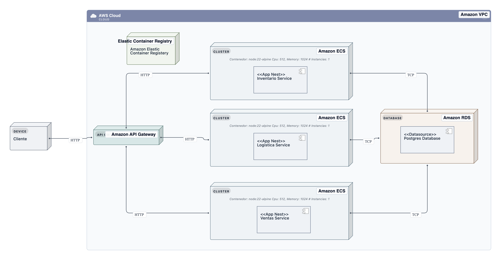
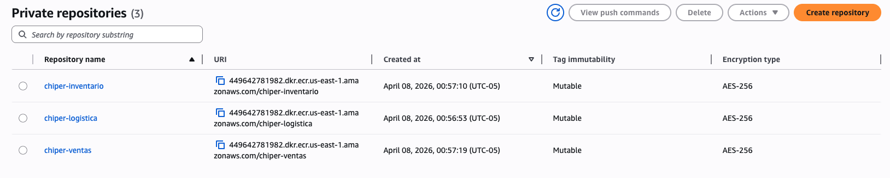
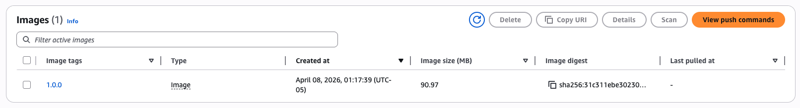

# Lab 4 — Pruebas de Carga en AWS para la Arquitectura de Microservicios

## 1. Índice

- [1. Índice](#1-índice)
- [2. Etapas del laboratorio](#2-etapas-del-laboratorio)
- [3. Objetivos](#3-objetivos)
- [4. Planeación del laboratorio](#4-planeación-del-laboratorio)
- [5. Ejecución del laboratorio](#5-ejecución-del-laboratorio)
- [6. Realización de pruebas](#6-realización-de-pruebas)
- [7. Entregables](#7-entregables)
- [Nota final (créditos AWS)](#nota-final-créditos-aws)

## 2. Etapas del laboratorio

| Etapa                                  | Resumen                                                                                     | Uso de IA generativa                                                                            |
| -------------------------------------- | ------------------------------------------------------------------------------------------- | ----------------------------------------------------------------------------------------------- |
| 1. Experimento y ASRs de escalabilidad | Hipótesis de diseño, escenarios de calidad vinculados (ASRs), diseño y planeación del experimento de carga simultánea en microservicios.       | Uso acotado para ordenar hipotesis; la priorizacion de ASRs debe ser propia.                    |
| 2. Analisis arquitectonico             | Evaluacion de los estilos (microservicios, puerta de entrada unica o API Gateway) y de las tacticas de escalamiento.             | Recomendado para contrastar trade-offs.                      |
| 3. Despliegue en AWS                   | Publicacion de las imagenes de los servicios, creacion de la base de datos administrada, despliegue de los servicios en contenedores y configuracion de la puerta de entrada (API Gateway). | Recomendado para asistencia operativa (comandos/configuracion), con verificacion manual en AWS. |
| 4. Pruebas de carga simultaneas        | Ejecucion de GET y POST en paralelo para observar aislamiento y escalabilidad por servicio. | Recomendado para automatizar experimentos.                   |
| 5. Interpretacion y entregables        | Analisis de eficiencia de escalamiento y consolidacion de resultados.                       | No recomendado para generar conclusiones sin evidencia cuantitativa.                            |

## 3. Objetivos

- Desplegar la aplicación de Cheapest en una arquitectura de **microservicios** (la aplicación dividida en varios servicios pequeños que se despliegan y escalan por separado) usando AWS.
- Ejecutar pruebas de carga sobre dos endpoints criticos (GET y POST) en simultaneo.
- Evaluar el atributo de calidad principal del laboratorio: escalabilidad.
- Analizar el comportamiento del sistema distribuido bajo carga: latencia, throughput, errores y capacidad de escalar por servicio.
- Proponer mejoras de arquitectura y configuracion de infraestructura para mejorar escalabilidad y disponibilidad.

## 4. Planeación del laboratorio

En el Lab 3 usted replicó el monolito completo en tres máquinas detrás de un balanceador de carga. Esa arquitectura tiene un límite: el monolito solo puede escalarse **entero**, aunque la carga esté concentrada en una sola funcionalidad. En este laboratorio la misma aplicación se divide en tres **microservicios** (Logística, Inventario y Ventas), cada uno empaquetado en su propio contenedor, y se despliega con servicios administrados de AWS. Las pruebas son las mismas de los laboratorios anteriores, pero ahora el GET y el POST se ejecutan **al mismo tiempo**.

**Conceptos que se presentan en este laboratorio.**

| Concepto | Qué es |
| --- | --- |
| Microservicio | Servicio pequeño que implementa una parte del negocio (por ejemplo, Inventario), corre en su propio proceso y se comunica con los demás por la red (aquí, por HTTP). |
| Imagen de Docker | Paquete que contiene una aplicación y todo lo que necesita para ejecutarse. Un contenedor es una imagen en ejecución. |
| Tag | Etiqueta de versión de una imagen (por ejemplo `1.0.0`). |
| ECR | *Elastic Container Registry*: servicio de AWS donde se guardan las imágenes de Docker. Cada imagen vive en un **repositorio** de ECR. En este laboratorio es el primer paso del despliegue: usted construye en su computador la imagen de cada microservicio y la sube a su repositorio de ECR (uno por microservicio). |
| ECS | *Elastic Container Service*: servicio de AWS que ejecuta contenedores y los mantiene corriendo. En este laboratorio, ECS no construye nada: descarga de ECR la imagen de cada microservicio (la que usted publicó) y la ejecuta. Por eso ECR va antes que ECS en el despliegue. |
| Fargate | Modo de ECS en el que AWS pone las máquinas: usted solo indica qué contenedor correr y con cuánta CPU y memoria, sin crear instancias EC2. |
| Tarea (*task*) | Un contenedor (o grupo de contenedores) en ejecución dentro de ECS. Es el equivalente a "una copia" del microservicio. |
| Task definition | Plantilla que describe una tarea: qué imagen usa, cuánta CPU y memoria tiene, qué puerto expone y qué variables de entorno recibe. |
| Servicio de ECS | Configuración que le dice a ECS cuántas tareas de una task definition debe mantener corriendo. |
| Desired count | Número de tareas que un servicio de ECS debe mantener encendidas. Subirlo es escalar horizontalmente. |
| Clúster de ECS | Agrupación lógica donde corren los servicios y sus tareas. |
| RDS | *Relational Database Service*: base de datos administrada por AWS. Usted no instala ni mantiene PostgreSQL; AWS lo hace. |
| API Gateway | Servicio de AWS que funciona como puerta de entrada única: recibe todas las peticiones de los clientes y las enruta al microservicio que corresponde según la ruta. |
| Ruta, integración y stage (de API Gateway) | Una **ruta** es un patrón de URL (por ejemplo `/logistics/*`); una **integración** es el destino al que se reenvía; un **stage** es un ambiente publicado de la API, que aparece como prefijo en la URL (aquí, `lab`). |
| Listener (de un balanceador) | Regla que indica en qué puerto escucha el balanceador y a qué target group reenvía lo que llega. |
| CloudWatch | Servicio de AWS que recoge métricas (uso de CPU, memoria, número de peticiones) y registros de los demás servicios. |
| Monorepo | Un solo repositorio de código que contiene varias aplicaciones y las librerías que comparten. |

### 4.1 Hipótesis de diseño

| # | Hipótesis |
| --- | --- |
| H1 | **Si** separamos la aplicación en microservicios (Logística, Inventario, Ventas) desplegados de forma independiente en ECS/Fargate, **entonces** el sistema sostiene 5000 req/min de carga simultánea GET + POST (throughput ≥ 83.3 req/s, error % ≤ 10%), **porque** cada servicio se escala según su propia demanda y una carga pesada en uno no consume la capacidad de los demás. |
| H2 | **Si** aplicamos replicación horizontal de tareas ECS y escalamiento independiente por microservicio, **entonces** el p99 de `POST /logistics/pedidos` se mantiene < 2000 ms bajo carga simultánea, **porque** las tareas adicionales reparten las peticiones y reducen la utilización de cada una. |
| H3 | **Si** usamos una base de datos administrada (RDS) compartida por los servicios, **entonces** el punto de inflexión del sistema lo determinará el acoplamiento con RDS más que la capacidad de cómputo de ECS, **porque** escalar tareas aumenta el número de conexiones y consultas concurrentes contra un único recurso que no escala horizontalmente. |

### 4.2 Escenarios de calidad vinculados

#### REQ1 — Latencia

**Historia de usuario**

- **Yo como** tendero,
- **quiero** confirmar mis pedidos,
- **para** recibir la confirmación en un tiempo que no interrumpa la atención a mis clientes.

**Escenario**

| Elemento | Descripción |
| --- | --- |
| Estímulo | Confirmar un pedido (`POST /logistics/pedidos`). |
| Artefacto | Microservicio de Logística, que expone `/logistics/pedidos` (y la base de datos RDS que usa). |
| Ambiente | Mientras otros tenderos consultan productos disponibles (`GET`) y confirman pedidos al mismo tiempo, con una carga total que va de operación normal (8 TPS, 500 req/min) a pico (83 TPS, 5000 req/min), sobre la arquitectura desplegada en AWS. |
| Medida de la respuesta | p99 de la confirmación de pedido < 2000 ms. |

#### REQ2 — Disponibilidad

**Historia de usuario**

- **Yo como** tendero,
- **quiero** consultar los productos disponibles para mi tienda,
- **para** ofrecerlos a mis clientes sin que la consulta falle.

**Escenario**

| Elemento | Descripción |
| --- | --- |
| Estímulo | Consultar los productos disponibles para una tienda (`GET /logistics/tenderos/productos-disponibles`). |
| Artefacto | Microservicio de Logística, que expone `/logistics/tenderos/productos-disponibles` (y la base de datos RDS que usa). |
| Ambiente | Evento de alta demanda: 83 TPS (5000 req/min) de carga total, mientras otros tenderos confirman pedidos (`POST`) al mismo tiempo. |
| Medida de la respuesta | Error % de las consultas <= 10%. |

#### REQ3 — Escalabilidad

**Historia de usuario**

- **Yo como** gerente de operaciones (COO),
- **quiero** que los tenderos puedan confirmar sus pedidos,
- **para** atender de forma adecuada el crecimiento de la demanda en las campañas de promociones.

**Escenario**

| Elemento | Descripción |
| --- | --- |
| Estímulo | Confirmar un pedido (`POST /logistics/pedidos`). |
| Artefacto | Arquitectura de microservicios completa (API Gateway, ALB, ECS/Fargate, RDS), con el microservicio de Logística como punto de entrada de la confirmación de pedidos. |
| Ambiente | Pico comercial (por ejemplo, promociones) en el que la carga total crece de 8 TPS (500 req/min) a 83 TPS (5000 req/min), es decir, un crecimiento de 900%, mientras otros tenderos consultan productos disponibles (`GET`) al mismo tiempo. |
| Medida de la respuesta | Al alcanzar la carga máxima de la matriz (prueba *Estrés fuerte*, ramp-up de 200 s): throughput total >= 83,3 TPS (req/s) y Error % de las confirmaciones de pedido <= 10%. |

### 4.3 Tácticas y patrones

#### 4.3.1 Patrones de diseño

| Patrón | Para qué se usa en este laboratorio |
| --- | --- |
| API Gateway (puerta de entrada única) | Los clientes conocen una sola dirección; el gateway enruta cada petición al microservicio correspondiente según el prefijo de la ruta. Favorece seguridad y control del tráfico; agrega un salto de red. |
| Cliente HTTP dedicado con tiempo de espera | Las llamadas que en el monolito eran directas entre módulos (por ejemplo, Inventario preguntando a Logística si un producto existe) ahora son peticiones HTTP hechas por una clase cliente, con un tiempo máximo de espera configurable. |
| Endpoint de health check | Cada microservicio expone `/health` para que el balanceador pueda saber si una tarea está sana antes de enviarle tráfico. |
| Base de datos compartida | Los tres microservicios usan la misma base de datos PostgreSQL, y cada uno registra solo sus propias tablas. Simplifica la migración desde el monolito, pero mantiene acoplados a los servicios a través de los datos. |

#### 4.3.2 Tácticas de arquitectura

| Tacticas | Analisis (atributos de calidad que favorece y desfavorece) |
| --- | --- |
| Replicacion horizontal | Favorece mayor capacidad de procesamiento y tolerancia a fallos por redundancia.<br>Desfavorece costos y mantenibilidad. |
| Escalamiento independiente por microservicio | Favorece costos, escalabilidad y elasticidad.<br>Desfavorece mantenibilidad. |
| Balanceo de trafico por servicio | Favorece disponibilidad.<br>Desfavorece latencia y mantenibilidad. |
| Uso de base de datos administrada | Favorece disponibilidad y mantenibilidad.<br>Desfavorece costos y portabilidad. |

#### 4.3.3 Estilos aplicados

| Estilos de arquitectura asociados | Analisis (atributos de calidad que favorece y desfavorece) |
| --- | --- |
| Microservicios | Favorece escalabilidad independiente por dominio funcional, despliegue desacoplado y resiliencia localizada.<br>Desfavorece complejidad operativa, observabilidad y mayor costo de coordinacion. |

> [!IMPORTANT]
> **Pregunta 2:**
> Si el sistema no cumple REQ3 (escalabilidad: sostener 83,3 req/s con error ≤ 10% en el pico) durante carga simultánea, ¿cómo determinaría si el problema está en desacoplamiento insuficiente entre microservicios o en capacidad de infraestructura (ECS, RDS o API Gateway)?

### 4.4 Diseño del experimento

#### 4.4.1 ¿Cómo se va a validar la hipótesis?

Cada escenario de calidad habla de una sola funcionalidad: REQ1 y REQ3 de confirmar pedidos (`POST /logistics/pedidos`) y REQ2 de consultar productos disponibles (`GET /logistics/tenderos/productos-disponibles`). Lo que vamos a probar es cómo se comportan esas funcionalidades **en concurrencia**, es decir, mientras la otra también recibe carga. El plan es el siguiente:

1. **Referencia del monolito.** Con los resultados del Lab 3, analice qué tan eficiente fue escalar el monolito al agregar recursos e identifique el punto a partir del cual deja de ser proporcional. Este análisis es la referencia de comparación para las etapas siguientes y se entrega en el informe, como respuesta a la pregunta orientadora sobre la eficiencia de escalar el monolito.
2. **Despliegue de los microservicios.** Publique la imagen de cada servicio en ECR, cree la base de datos en RDS y cárguele los datos base (se crea vacía; sin datos, el GET retorna una lista vacía y el POST falla), despliegue el balanceador de carga y los servicios en ECS, y exponga las rutas mediante API Gateway. Al finalizar, verifique con los endpoints de `health` que los tres servicios responden.
3. **Definición de la distribución de carga.** Establezca qué proporción de las peticiones son GET y cuáles POST, y configure en JMeter dos Thread Groups, uno por endpoint, que se ejecuten simultáneamente.
4. **Ejecución escalonada de la carga.** Ejecute la matriz de pruebas de menor a mayor carga, con el mínimo de repeticiones exigido para cada prueba. En cada ejecución registre, por endpoint, el p99, el p95, el throughput y el error %.
5. **Comparación con los umbrales.** Determine en qué escalón deja de cumplirse cada ASR (REQ1, REQ2 y REQ3) e identifique el punto de inflexión del GET, del POST y del sistema completo.
6. **Identificación del cuello de botella.** Si algún ASR se incumple, analice en CloudWatch si la causa es la capacidad de las tareas de ECS, el acoplamiento entre servicios o la base de datos compartida.
7. **Corrida con escalamiento.** Aumente el número de tareas del servicio que se saturó primero y repita los escalones críticos, para medir cuánto aporta escalar un solo servicio.
8. **Análisis comparativo.** Contraste los resultados con el comportamiento del monolito del Lab 3 y concluya en qué medida la separación en microservicios y el escalamiento independiente de cada servicio contribuyeron al cumplimiento de los ASR.

#### 4.4.2 ¿Qué componentes se van a diseñar o modificar?

Los componentes de software son los tres microservicios en los que se dividió el monolito. Usted no escribe este código: ya está en la rama `microservicios`, y la [guía de migración](./guia_migracion_monolito_microservicios.md) explica cada cambio.

| Componente de software | Cambio respecto al monolito |
| --- | --- |
| Microservicio de Logística | Aplicación independiente (puerto 3001) con la lógica de catálogo, productos, pedidos, despachos y promociones. Atiende los dos endpoints que se miden. |
| Microservicio de Inventario | Aplicación independiente (puerto 3002). La consulta que antes hacía directamente al módulo de Logística ahora es una petición HTTP a través de un cliente dedicado. |
| Microservicio de Ventas | Aplicación independiente (puerto 3003), que también consulta a Logística por HTTP. |
| Librería compartida de base de datos | Cada microservicio registra solo sus propias entidades sobre la misma base de datos. |
| Endpoint de health de cada microservicio | Nuevo `GET /health`, que el balanceador usa para saber si una tarea está sana. |

#### 4.4.3 ¿Qué métricas se van a medir?

| Métrica | Hipótesis / ASR | Umbral |
| --- | --- | --- |
| p99 y p95 por endpoint | H2 / REQ1 | p99 de la confirmación de pedido < 2000 ms |
| Error % por endpoint (GET para REQ2, POST para REQ3) | H1 / REQ2, REQ3 | ≤ 10% |
| Throughput total y por endpoint | H1 / REQ3 | ≥ 83.3 req/s a 5000 req/min |
| Punto de inflexión de GET, de POST y global | H2, H3 | Primer escalón donde el throughput deja de crecer con la carga, el p99 se dispara o el Error % supera el umbral |
| Uso de CPU y memoria de las tareas ECS; CPU y conexiones de RDS | H3 | Cuál recurso se acerca primero a su límite |

### 4.5 Planeación del experimento

#### 4.5.1 Recursos requeridos

| Recurso | Detalle |
| --- | --- |
| Infraestructura AWS | API Gateway, ALB, ECS/Fargate, ECR y RDS (PostgreSQL) en su cuenta de AWS Academy |
| Herramientas locales | Docker, AWS CLI (o CloudShell), JMeter, el script en Python de los laboratorios anteriores y los resultados del Lab 3 como referencia |
| Código | Repositorio Cheapest-api, rama `microservicios` |
| Datos de prueba | Script de seed de la rama `microservicios` (`npm run db:seed`) |
| Créditos AWS | Elimine los recursos al terminar |

Tecnologías involucradas y su documentación:

| Categoría | Tecnologías | Recurso de referencia |
| --- | --- | --- |
| Gateway de entrada | Amazon API Gateway | [Documentación oficial API Gateway](https://docs.aws.amazon.com/apigateway/) |
| Orquestación de contenedores | Amazon ECS (Fargate) | [Documentación oficial Amazon ECS](https://docs.aws.amazon.com/ecs/) |
| Registro de imágenes | Amazon ECR | [Documentación oficial Amazon ECR](https://docs.aws.amazon.com/ecr/) |
| Base de datos relacional | Amazon RDS (PostgreSQL) | [Documentación oficial Amazon RDS](https://docs.aws.amazon.com/rds/) |
| Framework backend | NestJS | [Documentación oficial NestJS](https://docs.nestjs.com/) |
| Lenguaje | TypeScript | [Documentación oficial TypeScript](https://www.typescriptlang.org/docs/) |
| ORM | TypeORM | [Documentación oficial TypeORM](https://typeorm.io/) |
| Pruebas de carga | Apache JMeter | [Documentación oficial Apache JMeter](https://jmeter.apache.org/usermanual/index.html) |

#### 4.5.2 Elementos de arquitectura involucrados

El experimento toca la **vista de despliegue**. Estos son los elementos que se crean o se miden:

| Elemento | Qué se hace con él |
| --- | --- |
| Microservicios de Logística, Inventario y Ventas | Se despliegan como tres servicios de ECS/Fargate, cada uno con su propio `desired count` y su propio tamaño de tarea. |
| Repositorios de ECR | Guardan la imagen `1.0.0` de cada microservicio. |
| Base de datos RDS (PostgreSQL) | Una sola, compartida por los tres microservicios. Se crea y se le cargan los datos base. |
| Application Load Balancer | Uno solo, con un listener y un target group por servicio: da una dirección estable y reparte el tráfico entre las tareas. |
| API Gateway | Punto de entrada único, con rutas hacia cada microservicio. |
| Generador de carga (JMeter o script) | Dos cargas simultáneas, GET y POST, desde su computador. |

Los conectores que se miden son el HTTP entre el generador de carga y API Gateway, y la conexión de los microservicios con la base de datos compartida.



*Diagrama de despliegue. Cada servicio de ECS indica la imagen del contenedor, la CPU y la memoria de cada tarea, y el número de instancias (tareas) con el que arranca: 1 por microservicio.*

#### 4.5.3 Esfuerzo estimado

Referencia para planear; puede variar según su experiencia con AWS.

| Etapa | Esfuerzo aprox. |
| --- | --- |
| Despliegue en AWS | 1 h |
| Ejecución de la matriz de carga (con repeticiones mínimas) y de la corrida con escalamiento | 1,5 h |
| Interpretación de resultados y entregables | 1,5 h |
| **Total** | **4 h-persona** |

## 5. Ejecución del laboratorio

La ejecución sigue los mismos pasos del diseño del experimento. En esta sección se hacen los dos primeros: la referencia del monolito y el despliegue de los microservicios.

### 5.1 Referencia del monolito

Antes de desplegar, analice con sus resultados del Lab 3 qué tan eficiente fue escalar el monolito. No requiere infraestructura: es un análisis que se entrega en el informe y que le servirá de punto de comparación cuando mida los microservicios.

> [!IMPORTANT]
> **Pregunta 1:**
> REQ1, REQ2 y REQ3 pueden degradarse de forma diferente por servicio.
> Antes de desplegar los microservicios, analice qué tan eficiente es escalar el monolito **agregando recursos** (eje X: instancias, vCPU o memoria; no carga). Con sus resultados del **Lab 3** como datos de partida, defina un criterio matemático simple (por ejemplo, ganancia marginal de throughput por recurso agregado, `ΔThroughput / ΔRecursos`), compare sus resultados con el escalamiento ideal (lineal) y explique a partir de qué punto agregar recursos deja de traducirse en throughput proporcional en Cheapest y qué componente de la arquitectura lo explica.
> La respuesta debe apoyarse en los ASRs.

### 5.2 Despliegue de los microservicios

Antes de iniciar el despliegue, revise la guía de migración. Los cambios de código no son el foco del laboratorio, pero determinan cómo debe desplegar y configurar los servicios:

- [Guia de migracion de monolito a microservicios](./guia_migracion_monolito_microservicios.md)

El despliegue se hace en este orden: (1) publicar la imagen de cada microservicio, (2) crear la base de datos y cargarle datos, (3) crear el balanceador de carga, (4) crear los servicios que ejecutan los contenedores, (5) exponerlos por la puerta de entrada y (6) verificar.

#### Paso 1: publicar las imágenes en ECR

ECS no construye las aplicaciones: descarga una imagen de Docker ya construida y la ejecuta. Por eso el primer paso es construir la imagen de cada microservicio y subirla a ECR, el registro de imágenes de AWS.

Debe crear un repositorio por servicio. Los cambios con respecto al monolito están en la rama `microservicios`

| Servicio   | Nombre sugerido del repositorio | Nombre de la imagen | Tag imagen |
| ---------- | --------------------------- | ---------- | ---------- |
| Logistica  | `cheapest-logistica`          | `logistica-service`          | `1.0.0`    |
| Inventario | `cheapest-inventario`         | `inventario-service`         | `1.0.0`    |
| Ventas     | `cheapest-ventas`             | `ventas-service`             | `1.0.0`    |

Para cada servicio debe: construir la imagen, etiquetarla con el URI del repositorio y publicarla en ECR. Haga lo siguiente:

1. Siga el tutorial [Subir imágenes Docker a Amazon ECR](../tutoriales/subir_imagenes%20_a_ecr.md), que explica paso a paso cómo publicar la imagen de un servicio; el tutorial lo hace con `inventario-service` en el repositorio `cheapest-inventario`.
2. Haga el mismo procedimiento para `logistica-service` (repositorio `cheapest-logistica`) y para `ventas-service` (repositorio `cheapest-ventas`), cambiando el nombre del repositorio y de la imagen según la tabla anterior.
3. Use el tag `1.0.0` en los tres servicios. El tutorial usa `0.0.1` como ejemplo, así que reemplácelo por `1.0.0`.
4. Verifique que los tres repositorios existen y que cada uno contiene su imagen con el tag `1.0.0`.

Al final tendrá que ver algo así:

Y dentro de cada repositorio


#### Paso 2: crear la base de datos en RDS y cargar los datos base

Todos los microservicios comparten una única base de datos PostgreSQL en RDS. Para crearla:

1. Siga el tutorial [Crear una instancia RDS PostgreSQL para Cheapest](../tutoriales/crear_instancia_rds.md) (versión CloudShell), que crea la instancia en 6 pasos:
   1. Identifica la VPC y las subredes donde se va a crear la base de datos.
   2. Crea el *DB Subnet Group* que usará la instancia.
   3. Crea el Security Group de RDS y autoriza el puerto 5432 **solo** desde el Security Group de las tareas ECS, de modo que únicamente los microservicios puedan conectarse.
   4. Crea la instancia RDS PostgreSQL (base `Cheapest`, usuario `postgres`).
   5. Espera a que la instancia esté disponible.
   6. Consulta el endpoint de la instancia.
2. Al terminar, anote el endpoint (`DB_HOST`), el nombre de la base (`--db-name`, `Cheapest` en el tutorial) y la contraseña del usuario `postgres`; los necesitará en los pasos siguientes.
3. Cree el esquema (las tablas) y cargue los datos base, siguiendo las instrucciones que vienen a continuación. Este paso se hace aquí y no en el tutorial, porque usa el script de seed que viene en el código de la rama `microservicios`.
4. Conserve el endpoint, el nombre de la base y la contraseña: son los valores de las variables de entorno `DB_HOST`, `DB_NAME` y `DB_PASSWORD` que les dará a los microservicios cuando los cree en ECS.

##### Crear el esquema y cargar los datos base

La RDS se crea **vacía**: sin tablas y sin datos. A diferencia del Lab 3, en la rama `microservicios` los servicios **no** ejecutan un seeder al arrancar. Sin este paso, las pruebas de carga no tienen datos: el GET responde una lista vacía y el POST falla porque la tienda, los productos y la moneda del pedido no existen.

- **Esquema (tablas):** lo crea TypeORM (`synchronize`) cuando `DB_SYNCHRONIZE=true`. El script de seed también sincroniza el esquema completo (las entidades de los tres servicios) antes de insertar los datos.
- **Datos:** el script `npm run db:seed` de la rama `microservicios` carga `libs/shared/database/src/seed.sql`, que contiene los mismos UUID fijos que usa el plan de JMeter del Lab 2 (tiendas `bbbbbbbb-...`, productos `aaaaaaaa-...`, moneda `cccccccc-...`, zonas `Zona Norte`/`Zona Sur`). Si detecta que la base ya tiene datos, no inserta nada.

Ejecútelo **una sola vez**, desde su computador, con el repositorio en la rama `microservicios` (después de `npm install`) y **antes** de crear los servicios de ECS.

> [!IMPORTANT]
> La RDS se creó con `--no-publicly-accessible`, por lo que **no es alcanzable desde su computador** sin importar las reglas del Security Group. Correr `npm run db:seed` directamente fallará por timeout, o peor: si no define `DB_HOST`, el script sembrará silenciosamente un Postgres local (hace `process.env.DB_HOST ??= '127.0.0.1'`) y le dará una falsa sensación de éxito.

Para sembrar la RDS desde su computador, hágala temporalmente pública y restrinja el acceso a su propia IP. Los comandos `aws` puede correrlos en CloudShell o en su terminal, pero el paso 1 (`curl`) debe correrlo en su computador, para obtener la IP de su computador y no la de CloudShell:

```bash
# 1. Anote su IP pública actual (corra este comando en SU computador o busque "cuál es mi IP" en Google)
curl -s https://checkip.amazonaws.com

# 2. Haga la instancia temporalmente pública
aws rds modify-db-instance --db-instance-identifier Cheapest-rds --publicly-accessible --apply-immediately

# 3. Espere a que el cambio se aplique (puede tardar 1-2 minutos)
aws rds describe-db-instances --db-instance-identifier Cheapest-rds --query "DBInstances[0].PubliclyAccessible"

# 4. Abra el puerto 5432 SOLO para su IP (no 0.0.0.0/0: expondría las credenciales de la base a internet)
aws ec2 authorize-security-group-ingress --group-id <SG_RDS_ID> --protocol tcp --port 5432 --cidr <SU_IP_PUBLICA>/32
```

Luego, desde su computador, corra el seed apuntando explícitamente a la RDS:

```bash
DB_HOST=<ENDPOINT_RDS> DB_PORT=5432 DB_USERNAME=postgres DB_PASSWORD=<PASSWORD> DB_NAME=Cheapest npm run db:seed
```

> En Windows (PowerShell), defina cada variable antes del comando: `$env:DB_HOST="<ENDPOINT_RDS>"`, `$env:DB_USERNAME="postgres"`, etc., y luego ejecute `npm run db:seed`.

Salida esperada: `Database seeded successfully.` (o `Database already seeded. Skipping.` si ya se había cargado).

> [!WARNING]
> Defina siempre `DB_HOST` al correr el seed. Si lo omite, el script usa `127.0.0.1` y, si tiene un Postgres local corriendo, lo sembrará a él y el comando terminará sin errores aunque la RDS siga vacía.

Al terminar, **revierta los cambios** para no dejar la base expuesta:

```bash
aws rds modify-db-instance --db-instance-identifier Cheapest-rds --no-publicly-accessible --apply-immediately
aws ec2 revoke-security-group-ingress --group-id <SG_RDS_ID> --protocol tcp --port 5432 --cidr <SU_IP_PUBLICA>/32
```

#### Paso 3: crear el balanceador de carga (ALB)

Cada tarea de Fargate recibe una IP nueva cada vez que se reinicia, y API Gateway solo puede apuntar a una dirección. Para que los servicios tengan una dirección estable y para que, al escalar, las tareas nuevas reciban tráfico, delante de los servicios va un **Application Load Balancer (ALB)**: reparte las peticiones entre las tareas de cada servicio y tiene un nombre DNS que no cambia.

Siga el tutorial [Configurar un Application Load Balancer para servicios de ECS](../tutoriales/configurar_alb_para_ecs.md), que explica paso a paso cómo crear el ALB:

1. Crear el Security Group del ALB y permitir los puertos 3001 a 3003 (paso 1).
2. Permitir que el ALB llegue a las tareas, agregando al Security Group de las tareas una regla de entrada desde el Security Group del ALB (paso 2).
3. Crear el ALB (paso 3).
4. Crear un target group por servicio, con health check en `/health` (paso 4).
5. Crear un listener por servicio, que reenvía al target group correspondiente (paso 5).

El ALB es **uno solo** y tiene tres listeners, uno por servicio. Use estos valores:

| Servicio | Target group | Puerto del listener | Puerto del contenedor |
| --- | --- | --- | --- |
| Logística | `tg-Cheapest-logistica` | 3001 | 3001 |
| Inventario | `tg-Cheapest-inventario` | 3002 | 3002 |
| Ventas | `tg-Cheapest-ventas` | 3003 | 3003 |

Al terminar, anote el **nombre DNS del ALB** (`<ALB_DNS>`): es la dirección estable que usará como valor de la variable `LOGISTICA_BASE_URL` de los microservicios y como destino de las integraciones de API Gateway. El registro de cada servicio en su target group se hace en el momento de crear el servicio en ECS, en el paso siguiente.

#### Paso 4: crear los servicios en ECS

En esta sección va a desplegar los tres microservicios como servicios de ECS (Fargate). Siga el tutorial [Crear un servicio en Amazon ECS](../tutoriales/crear_instancia_ecs.md), que explica paso a paso cómo desplegar **un** servicio (`inventario`) así:

1. Configurar el Security Group para los puertos de la aplicación (paso 0).
2. Crear el clúster de ECS (paso 1).
3. Escribir el archivo `task-definition.json` (paso 2) y registrarlo (paso 3).
4. Crear el servicio a partir de la task definition (paso 4).
5. Verificar que la tarea esté `RUNNING` (pasos 5 a 8).

El tutorial usa valores de ejemplo (`inventario-task`, puerto `3000`, imagen `inventario_service:v1`, etc.). Usted debe seguir los mismos pasos, pero **reemplazando esos valores por los de las tablas de esta sección**, una vez por cada servicio (Logística, Inventario y Ventas):

- **Paso 0 (Security Group):** use un único Security Group para las tareas de los tres servicios (el mismo que autorizó en el Security Group de RDS al crear la base de datos), con reglas de entrada para los puertos 3001, 3002 y 3003 **desde el Security Group del ALB** (esa regla ya la creó al configurar el balanceador). Sin esas reglas, el ALB marca las tareas como `unhealthy` y no les envía tráfico.
- **Paso 1 (clúster):** créelo una sola vez (`Cheapest-cluster`); los tres servicios corren en el mismo clúster.
- **Pasos 2 y 3 (task definition):** en el `task-definition.json` de cada servicio, ponga en `family` el nombre de la columna *Task Definition* de la primera tabla (por ejemplo `td-Cheapest-logistica`), en `image` la URI de la imagen que publicó en ECR (con el tag `1.0.0`), en `containerPort` el puerto del servicio y en `environment` las variables de la columna *Variables a declarar*, con los valores de la segunda tabla.
- **Paso 4 (servicio):** use como `--service-name` el nombre de la columna *Servicio ECS* (por ejemplo `svc-Cheapest-logistica`), como `--task-definition` la task definition del servicio y como `--desired-count` el valor de *Desired count inicial*. Además, registre el servicio en su target group con `--load-balancers targetGroupArn=<TG_ARN>,containerName=<NOMBRE_CONTENEDOR>,containerPort=<PUERTO>`: `<TG_ARN>` es el target group que creó para ese servicio al configurar el balanceador (`tg-Cheapest-logistica`, `tg-Cheapest-inventario` o `tg-Cheapest-ventas`) y `containerName` es el `name` del contenedor en su task definition.
- **Pasos 5 a 8 (verificación):** compruebe que la tarea de cada servicio queda en `RUNNING` y que en su target group aparece `healthy` (`aws elbv2 describe-target-health --target-group-arn <TG_ARN>`, puede tardar uno o dos minutos).

Recursos de ECS (Fargate) y parametros necesarios para el proyecto del curso:

| Servicio   | Task Definition        | Servicio ECS            | Puerto contenedor | Desired count inicial | Variables a declarar                                                                         |
| ---------- | ---------------------- | ----------------------- | ----------------- | --------------------- | -------------------------------------------------------------------------------------------- |
| Logistica  | `td-Cheapest-logistica`  | `svc-Cheapest-logistica`  | 3001              | 1                     | `PORT=3001`, `DB_HOST`, `DB_PORT`, `DB_USERNAME`, `DB_PASSWORD`, `DB_NAME`, `DB_SYNCHRONIZE=true`                       |
| Inventario | `td-Cheapest-inventario` | `svc-Cheapest-inventario` | 3002              | 1                     | `PORT=3002`, `DB_HOST`, `DB_PORT`, `DB_USERNAME`, `DB_PASSWORD`, `DB_NAME`, `DB_SYNCHRONIZE=true`, `LOGISTICA_BASE_URL` |
| Ventas     | `td-Cheapest-ventas`     | `svc-Cheapest-ventas`     | 3003              | 1                     | `PORT=3003`, `DB_HOST`, `DB_PORT`, `DB_USERNAME`, `DB_PASSWORD`, `DB_NAME`, `DB_SYNCHRONIZE=true`, `LOGISTICA_BASE_URL` |

Valores de las variables:

| Variable | Valor |
| --- | --- |
| `DB_HOST` | Endpoint de la RDS (paso 6 del tutorial de RDS), por ejemplo `cheapest-rds.xxxxxxxx.us-east-1.rds.amazonaws.com` |
| `DB_PORT` | `5432` |
| `DB_USERNAME` | `postgres` (el `--master-username` de la RDS) |
| `DB_PASSWORD` | La contraseña que definió en `--master-user-password` |
| `DB_NAME` | El `--db-name` de la RDS (`Cheapest` en el tutorial; respete mayúsculas y minúsculas) |
| `DB_SYNCHRONIZE` | `true`: cada servicio crea o actualiza las tablas de sus entidades al arrancar. El código también usa `true` si la variable no está definida, pero declárela explícitamente para no depender de ese valor por defecto |
| `LOGISTICA_BASE_URL` | `http://<ALB_DNS>:3001` (el nombre DNS del ALB y el puerto del listener de Logística), sin `/` final ni prefijo `/logistics` (el cliente HTTP lo agrega) |

> [!NOTE]
> Use el nombre `DB_USERNAME`, el mismo del `.env.example`, del `docker-compose.yml` y de la [guía de migración](./guia_migracion_monolito_microservicios.md#4-variables-de-entorno). El código también acepta `DB_USER` como alias, pero use un solo nombre en las tres task definitions.

**Orden de creación:** como `LOGISTICA_BASE_URL` usa el nombre DNS del ALB, que ya conoce, puede crear los tres servicios en cualquier orden.

Verifique que todas las tareas queden en estado `RUNNING` y `healthy` en su target group antes de pasar a API Gateway. Puede probar cada servicio a través del ALB con `curl http://<ALB_DNS>:<PUERTO>/health`.

#### Paso 5: exponer las APIs con API Gateway

En esta sección va a exponer los tres microservicios a través de una única API HTTP en API Gateway. Siga el tutorial [Configurar API Gateway para microservicios de Cheapest](../tutoriales/configurar_api_gateway.md) (versión CloudShell), que explica paso a paso cómo exponer un servicio así:

1. Crear la API HTTP (paso 1).
2. Crear la integración de negocio y la integración de health hacia el ALB (paso 2).
3. Crear la ruta de negocio (`ANY /<prefijo>/{proxy+}`) y la ruta de health (`GET /<prefijo>/health`) (paso 3).
4. Crear el stage (paso 4).
5. Obtener la URL de invocación (paso 5) y probar los endpoints (paso 6).

El tutorial deja como variables el prefijo, el puerto y la dirección del backend de cada servicio (`<PREFIJO_SERVICIO>`, `<PUERTO>`, `<ALB_DNS>`). Usted debe seguir los mismos pasos, **reemplazando esas variables por los valores de las tablas de esta sección**:

- **Paso 1:** cree la API **una sola vez**, con el nombre `Cheapest-ms-api` y tipo HTTP API (tabla de recursos globales, más abajo).
- **Pasos 2 y 3:** **repítalos para cada servicio** (Logística, Inventario y Ventas). En `<PREFIJO_SERVICIO>` use el prefijo de la primera tabla (`logistics`, `inventory` o `ventas`), en `<PUERTO>` el puerto del servicio (3001, 3002 o 3003) y en `<ALB_DNS>` el nombre DNS del ALB. Al final debe tener seis rutas: una de negocio y una de health por servicio. La segunda tabla muestra la ruta de health y el backend real al que debe apuntar cada una.
- **Paso 4:** cree el stage con el nombre `lab` y con `--auto-deploy`, tal como lo indica el tutorial.
- **Pasos 5 y 6:** guarde la URL de invocación, porque es la que usará en JMeter, y pruebe con `curl` el `health` de cada servicio.

Recursos de API Gateway (una ruta por servicio) y parametros necesarios:

| Servicio   | Route track (prefijo) |
| ---------- | --------------------- |
| Logistica  | `/logistics/*`        |
| Inventario | `/inventory/*`        |
| Ventas     | `/ventas/*`           |

Ademas del proxy de negocio (`/<prefijo>/{proxy+}`), cree una ruta especifica por servicio para el healthcheck, ya que el `HealthController` de cada microservicio expone `/health` en la raiz del contenedor (sin el prefijo del servicio):

| Servicio   | Ruta en API Gateway | Backend real          |
| ---------- | -------------------- | ---------------------- |
| Logistica  | `GET /logistics/health` | `http://<ALB_DNS>:3001/health` |
| Inventario | `GET /inventory/health` | `http://<ALB_DNS>:3002/health` |
| Ventas     | `GET /ventas/health`    | `http://<ALB_DNS>:3003/health`    |

Recursos globales de API Gateway y parametros necesarios:

| Recurso global | Nombre sugerido | Parametros necesarios                                                                   |
| -------------- | --------------- | --------------------------------------------------------------------------------------- |
| API            | `Cheapest-ms-api` | Tipo **HTTP API** (`--protocol-type HTTP`), CORS y autorizacion `NONE` para el laboratorio. |
| Stage          | `lab`           | Creado con `--auto-deploy`.   |
| Deployment     | — (automatico)  | Con `--auto-deploy`, cada cambio en rutas e integraciones se publica solo en el stage; no necesita crear deployments manuales. |

> [!NOTE]
> Use **HTTP API**, no REST API. Son dos productos distintos de API Gateway con comandos distintos: todos los comandos de este laboratorio y del tutorial (`aws apigatewayv2 ...`) corresponden a HTTP API. Si crea una REST API (`aws apigateway ...` o la opción "REST API" en la consola), esos comandos no le van a funcionar.

#### Paso 6: verificar el despliegue

> [!NOTE]
> Tanto las integraciones de API Gateway como `LOGISTICA_BASE_URL` apuntan al **DNS del ALB**, que no cambia cuando las tareas se reinician o se escalan (el ALB registra las tareas nuevas por su cuenta). Solo tendría que actualizarlos si elimina y vuelve a crear el ALB: en ese caso, actualice las integraciones siguiendo el paso 7 del [tutorial de API Gateway](../tutoriales/configurar_api_gateway.md#7-si-la-dirección-del-backend-cambia-actualizar-la-integración) y registre una nueva revisión de las task definitions de inventario y ventas con el `LOGISTICA_BASE_URL` nuevo.
>
> **Síntoma típico de `LOGISTICA_BASE_URL` incorrecta:** `/inventory/health` y `/ventas/health` responden bien, pero las operaciones de inventario o ventas que validan productos tardan unos 3 segundos (`LOGISTICA_TIMEOUT_MS`) y devuelven `503` con el mensaje `Logistica service is unavailable`.

Desde su computador, pruebe primero el health de cada servicio (no existe un `/health` global unico, cada microservicio expone el suyo bajo su propio prefijo de ruta):

- GET: `https://<API_ID>.execute-api.<REGION>.amazonaws.com/<STAGE>/logistics/health`
- GET: `https://<API_ID>.execute-api.<REGION>.amazonaws.com/<STAGE>/inventory/health`
- GET: `https://<API_ID>.execute-api.<REGION>.amazonaws.com/<STAGE>/ventas/health`

Verifique que los tres respondan correctamente antes de iniciar pruebas de carga.

> [!TIP]
> Si alguna de estas rutas no responde, no diagnostique solo desde API Gateway. Vaya de adentro hacia afuera: (1) que la tarea esté `RUNNING` en ECS; (2) que esté `healthy` en su target group (`aws elbv2 describe-target-health --target-group-arn <TG_ARN>`); (3) que `curl http://<ALB_DNS>:<PUERTO>/health` responda. Si el target está `unhealthy`, revise el Security Group de las tareas (debe permitir el puerto desde el Security Group del ALB). Si el `curl` al ALB funciona pero la ruta de API Gateway da 404, la integración de health probablemente quedó apuntando a `/<prefijo>/health` en vez de `/health`.

## 6. Realización de pruebas

En la sección anterior dejó desplegados los tres microservicios, cada uno con **una sola tarea**. Aquí se explica qué puede modificar de ese despliegue para mejorar o empeorar el desempeño, y se ejecutan los pasos restantes del diseño del experimento: definir la distribución de carga, ejecutar la carga por escalones, comparar con los umbrales, identificar el cuello de botella y repetir con escalamiento.

> Las pruebas base son las mismas de los laboratorios anteriores, pero ahora el escenario principal ejecuta GET y POST en simultáneo para evaluar la escalabilidad de servicios independientes.

### 6.1 Puntos de sensibilidad

Estos son los parámetros del despliegue de los que depende el cumplimiento de los ASRs:

| Punto de sensibilidad | Dónde se modifica | Efecto esperado |
| --- | --- | --- |
| **Número de tareas de un servicio** (escalamiento horizontal) | El `desired count` del servicio de ECS. | Más tareas reparten las peticiones; también abren más conexiones contra la misma base de datos. |
| **Tamaño de cada tarea** (escalamiento vertical) | Los campos `cpu` y `memory` de la task definition. | Más capacidad por tarea, sin aumentar el número de procesos. |
| **Tamaño de la base de datos** | La clase de la instancia de RDS (el tutorial la crea como `db.t3.micro`). Se cambia con `aws rds modify-db-instance --db-instance-identifier Cheapest-rds --db-instance-class <CLASE> --apply-immediately` (por ejemplo `db.t3.small` o `db.t3.medium`); la base queda unos minutos no disponible. | Si el cuello de botella es la base de datos compartida, es el cambio con mayor efecto. |
| **Distribución GET/POST** | El reparto de threads entre los dos Thread Groups de JMeter. | Cambia qué tipo de trabajo (lecturas costosas o escrituras transaccionales) domina la carga. |
| **Usuarios simulados y ramp-up** | Campos *Number of Threads* y *Ramp-up period* de JMeter, o los argumentos del script. | Definen la carga de cada escalón de la matriz. |

> [!NOTE]
> **¿Quién decide cuántas tareas corren?** Usted. El `desired count` de cada servicio es el número de tareas que ECS debe mantener encendidas: ECS/Fargate solo se encarga de mantener ese número (por ejemplo, reinicia una tarea que se cae) y no lo cambia por su cuenta, porque en este laboratorio **no se configura ningún escalamiento automático**. Tampoco lo hacen API Gateway ni el ALB: su trabajo es solo enrutar y repartir las peticiones. Todos los servicios empiezan con `desired count = 1` y, si quiere cambiarlo, debe hacerlo manualmente:
>
> ```bash
> aws ecs update-service --cluster Cheapest-cluster --service <SERVICIO_ECS> --desired-count <N>
> ```
>
> `<SERVICIO_ECS>` es el **nombre** del servicio de ECS (`svc-Cheapest-logistica`, `svc-Cheapest-inventario` o `svc-Cheapest-ventas`), y `<N>` es el número de tareas que quiere mantener.

**Cómo se escala un servicio en ECS.** Hay dos formas de darle más capacidad a un servicio, y se pueden combinar:

| Estrategia | Qué se cambia | Dónde se configura |
| --- | --- | --- |
| **Horizontal** | Se agregan más tareas iguales. | El `desired count` del servicio ECS. |
| **Vertical** | Se hace más grande cada tarea (más CPU y memoria). | Los campos `cpu` y `memory` de la task definition. |
| **Mixta** | Ambas a la vez: más tareas y más grandes. | El `desired count` y los campos `cpu` y `memory`. |

*Escalamiento horizontal.* Cambie el número de tareas del servicio y verifique que todas queden en `RUNNING`:

```bash
aws ecs update-service --cluster Cheapest-cluster --service svc-Cheapest-logistica --desired-count 2
aws ecs list-tasks --cluster Cheapest-cluster --service-name svc-Cheapest-logistica
```

> [!NOTE]
> Cuando ECS lanza las tareas nuevas, las registra automáticamente en el target group del servicio y el ALB reparte las peticiones entre todas las tareas sanas (por defecto, en turnos). No hay que configurar nada más.

*Escalamiento vertical.* El tamaño de la tarea está en el `task-definition.json` (`cpu` en unidades de CPU, donde 1024 es 1 vCPU, y `memory` en MB; el tutorial de ECS usa `512` y `1024`). Cámbielos por valores mayores, registre una nueva revisión de la task definition y actualice el servicio para que use esa revisión:

```bash
aws ecs register-task-definition --cli-input-json file://task-definition.json
aws ecs update-service --cluster Cheapest-cluster --service svc-Cheapest-logistica --task-definition td-Cheapest-logistica
```

Fargate solo acepta ciertas combinaciones de CPU y memoria:

| `cpu` | Memoria permitida |
| --- | --- |
| 256 (0,25 vCPU) | 512 MB a 2 GB |
| 512 (0,5 vCPU) | 1 GB a 4 GB |
| 1024 (1 vCPU) | 2 GB a 8 GB |
| 2048 (2 vCPU) | 4 GB a 16 GB |
| 4096 (4 vCPU) | 8 GB a 30 GB |

Al actualizar el servicio, ECS reemplaza la tarea por una nueva (con otra IP) y el ALB la registra automáticamente: no hay que actualizar las integraciones de API Gateway ni `LOGISTICA_BASE_URL`.

*Escalamiento mixto.* Combine ambos: primero cambie el tamaño de la tarea en la task definition (vertical) y luego ajuste el `desired count` (horizontal) con los comandos anteriores.

> [!IMPORTANT]
> **Pregunta 3:**
> Suponga que solo puede aumentar `desired count` en un servicio antes de una ventana comercial crítica.
> ¿Cuál escalaría primero en Cheapest y bajo qué evidencia cuantitativa tomaría esa decisión?
> Incluya qué métrica usaría para evitar escalar a ciegas.

### 6.2 Definición de la distribución de carga

**Qué endpoints se ejecutan en simultáneo.** En cada ejecución de la matriz corren al mismo tiempo dos cargas, cada una sobre una funcionalidad de los ASRs:

| Carga | Endpoint (vía API Gateway) | ASR asociado |
| --- | --- | --- |
| GET: consultar productos disponibles | `GET /lab/logistics/tenderos/productos-disponibles?tiendaId=<UUID>&zona=Zona Norte` | REQ2 |
| POST: confirmar un pedido | `POST /lab/logistics/pedidos` | REQ1 y REQ3 |

El prefijo `/lab` es el nombre del stage que creó en API Gateway. Ambas cargas se ejecutan a la vez en el mismo plan de JMeter, cada una en su propio Thread Group; así cada endpoint se mide con el otro compitiendo por los mismos recursos (las tareas de ECS y la base de datos RDS).

**Escenarios de carga** (carga total, sumando GET y POST):

- Operación normal: 500 req/min total.
- Evento de promociones (pico): 5000 req/min total.

**Distribución GET/POST.** Se expresa como "% de GET / % de POST" y indica qué proporción de la carga total le corresponde a cada endpoint. Por ejemplo, **60/40** significa que el 60% de los threads (y de las peticiones) va al GET y el 40% al POST; **50/50** significa mitad y mitad. Como en JMeter cada Thread Group es una carga, la distribución se traduce en repartir los threads totales entre los dos grupos. Con 200 threads totales:

| Distribución | Grupo GET | Grupo POST |
| --- | ---: | ---: |
| 60/40 | 120 threads | 80 threads |
| 50/50 | 100 threads | 100 threads |

Para el smoke test (la prueba pequeña inicial) use 50/50. Para el resto de la matriz usted escoge la distribución y debe justificarla en el informe.

> [!IMPORTANT]
> **Pregunta 4:**
> La distribución de carga indica cuántas de las peticiones son de consulta (GET) y cuántas de confirmación de pedido (POST). Se escribe "% GET / % POST": por ejemplo, 70/30 significa que de cada 100 peticiones, 70 son GET y 30 son POST; 50/50 significa 50 GET y 50 POST.
> Diseñe una estrategia de distribución de carga GET/POST que represente un lunes de alta demanda en Cheapest (piense cuántos tenderos consultan productos frente a cuántos confirman pedidos).
> ¿Qué distribución escogería para evaluar riesgo real y cuál para estresar el peor caso técnico?
> Justifique por qué no necesariamente deben coincidir.

### 6.3 Ejecución escalonada de la carga

#### Matriz mínima de pruebas

Esta es la matriz que va a recorrer, de menor a mayor carga. La columna **Threads totales** es la suma de los threads de los dos Thread Groups, repartidos según la distribución GET/POST. Use el mismo ramp-up en ambos grupos. Ejecute la matriz con la configuración base: **una tarea por servicio**.

| Test | Ramp-Up | Threads totales | Loops | Carga concurrente total (req/s) | Repeticiones mínimas |
| --- | --- | --- | --- | --- | ---: |
| Smoke test | 5s | 10 | 1 | 1 | 4 |
| Baja carga | 10s | 40 | 1 | 3 | 4 |
| Carga media | 20s | 200 | 1 | 5 | 4 |
| Operación normal | 50s | 900 | 1 | 9 | 8 |
| Alta carga | 75s | 3000 | N/A | 20 | 4 |
| Muy alta carga | 100s | 6000 | N/A | 30 | 4 |
| Estrés | 150s | 12000 | N/A | 50 | 4 |
| Estrés fuerte | 200s | 24000 | N/A | 90 | 8 |

> [!IMPORTANT]
> El mínimo de repeticiones indicado en la columna "Repeticiones mínimas" **es obligatorio y forma parte de la calificación**. Las tablas de resultados de los entregables son una extensión directa de esta matriz: cada fila de la matriz debe tener tantas filas de resultados como repeticiones mínimas se indican aquí. Entregar las tablas de resultados sin haber ejecutado el mínimo de repeticiones de cada prueba se considera una matriz de pruebas incompleta.

#### Prueba base: smoke test

Antes de escalar la carga, ejecute la primera fila de la matriz, una prueba pequeña para confirmar que todo funciona. Siga estos pasos:

1. Descargue el plan [`load_test.jmx`](../lab_2/recursos/load_test.jmx) del Lab 2 y ábralo en JMeter. Ya trae dos Thread Groups, **Grupo GET Request** y **Grupo POST Request**, cada uno con su petición y sus listeners.
2. En el sampler de **cada** Thread Group, cambie estos valores para apuntar a API Gateway en lugar de `localhost`:

   | Campo | Valor |
   | --- | --- |
   | Protocol | `https` |
   | Server Name or IP | `<API_ID>.execute-api.<REGION>.amazonaws.com` (la URL de invocación que obtuvo al configurar API Gateway, sin `https://` ni el stage) |
   | Port Number | `443` |
   | Path (GET) | `/lab/logistics/tenderos/productos-disponibles?tiendaId=<UUID_TIENDA>&zona=Zona Norte` |
   | Path (POST) | `/lab/logistics/pedidos` |

   Use los UUID que cargó con el script de seed (el plan trae los mismos UUID fijos del seed; si los cambió, actualícelos también en el cuerpo del POST).
3. Configure cada Thread Group para el smoke test de la matriz (10 threads totales, repartidos 50/50):

   | | Grupo GET | Grupo POST |
   | --- | --- | --- |
   | Number of Threads | 5 | 5 |
   | Ramp-up period (s) | 5 | 5 |
   | Loop Count | 1 | 1 |

4. Ejecute el plan completo (botón **Start**): JMeter lanza los dos Thread Groups al mismo tiempo.
5. Revise que la prueba sea válida: en **View Results Tree** las peticiones GET deben responder `200` y las POST `2xx`, y el **Error %** debe ser 0. Si hay errores, no siga escalando: revise primero el health de los tres servicios y que los datos base estén cargados en la base de datos.
6. Registre, para **cada** Thread Group, el p99, el p95, el throughput y el error % del **Aggregate Report** y del **Summary Report**. Esta es la línea base contra la que comparará el resto de las pruebas.
7. Repita el smoke test las veces que indica la matriz (4 repeticiones).

#### Resto de la matriz

Después del smoke test, recorra la matriz de arriba hacia abajo (de menor a mayor carga) con el mismo plan de JMeter. Para **cada fila** haga lo siguiente:

1. **Calcule los threads de cada grupo.** Tome los *Threads totales* de la fila y repártalos según la distribución GET/POST que escogió. Ejemplo con la fila *Baja carga* (40 threads totales) y una distribución 60/40: Grupo GET = 40 × 0,6 = **24** threads y Grupo POST = 40 × 0,4 = **16** threads.
2. **Configure los dos Thread Groups.** En *Number of Threads* ponga los valores calculados; en *Ramp-up period* ponga el ramp-up de la fila (10 s en el ejemplo), el **mismo en ambos grupos**; y en *Loop Count* ponga 1. Así los dos grupos empiezan y terminan juntos y la prueba es comparable entre filas.
3. **Limpie los resultados anteriores.** En cada listener (Aggregate Report, Summary Report) use *Clear All* antes de ejecutar; de lo contrario se mezclan las métricas de esta ejecución con las de la anterior.
4. **Ejecute** el plan con **Start** y espere a que terminen ambos Thread Groups. Anote la hora de inicio y de fin de la corrida: la necesitará para buscar en CloudWatch el uso de CPU de las tareas ECS y de la base de datos RDS durante ese intervalo.
5. **Registre los resultados por endpoint.** Del Aggregate Report y del Summary Report anote, para el Grupo GET y para el Grupo POST por separado, el p99, el p95, el throughput y el error %. Guárdelos con *Save Table Data* (CSV) para no perderlos y llene la fila correspondiente de las tablas de resultados de los entregables.
6. **Repita** la prueba tantas veces como indique la columna *Repeticiones mínimas* (los pasos 3 a 5 en cada repetición), esperando 1 o 2 minutos entre repeticiones para que las tareas y la base de datos se estabilicen, y verificando que las tareas sigan en `RUNNING`.
7. **Decida si continúa.** Si en alguna fila deja de cumplirse un ASR (REQ1, REQ2 o REQ3), marque esa fila como el punto donde se incumple, pero continúe con las filas siguientes para poder ubicar el punto de inflexión.

En las filas de mayor carga (columna *Loops* = N/A) es posible que JMeter se bloquee o deje de responder en su computador. Si eso ocurre, ejecute esas filas con un script de Python (puede ser el mismo de los Labs 2 y 3, apuntando ahora a la URL de API Gateway), manteniendo:

- la misma distribución GET/POST y el mismo ramp-up de la fila,
- la ejecución simultánea de GET y POST,
- las métricas por endpoint (p95, p99, throughput, error %),
- y el registro de la hora de cada resultado, para poder cruzarlo con las métricas de CloudWatch.

### 6.4 Comparación con los umbrales

Para saber si una prueba cumple o no, compare las métricas que registró en JMeter (o en el script) con los umbrales de los ASR:

| ASR | Funcionalidad | Qué medir en cada ejecución | Se cumple si |
| --- | --- | --- | --- |
| REQ1 (latencia) | `POST /logistics/pedidos` | p99 del Grupo POST | p99 < 2000 ms |
| REQ2 (disponibilidad) | `GET /logistics/tenderos/productos-disponibles` | Error % del Grupo GET | Error % <= 10% |
| REQ3 (escalabilidad) | `POST /logistics/pedidos` en el pico de 5000 req/min de carga total | Throughput total de la prueba y Error % del Grupo POST | Throughput total >= 83.3 req/s y Error % <= 10% |

> [!NOTE]
> **Punto de inflexión:** es la primera fila de la matriz (de menor a mayor carga) donde el sistema deja de escalar de forma eficiente. Se da en la primera fila donde ocurre, de forma sostenida, **al menos uno** de estos casos:
>
> - El throughput deja de crecer en proporción a la carga ofrecida (los threads de la matriz): la curva se aplana mientras la carga sigue subiendo.
> - El p99 empieza a crecer de forma no lineal respecto al aumento de carga.
> - El Error % supera el umbral del ASR correspondiente (10% para REQ2 y REQ3).
>
> Identifíquelo en tres niveles: para el GET, para el POST y para el **sistema completo** (GET y POST en simultáneo). Para decidir en qué fila ocurre, compare filas consecutivas de la matriz.

### 6.5 Identificación del cuello de botella

Si algún ASR se incumple, hay que determinar qué recurso se saturó primero: las tareas de ECS de algún servicio, la base de datos compartida o API Gateway.

**Cómo ver las métricas de la infraestructura (CloudWatch).** CloudWatch es el servicio de AWS que recoge las métricas de los demás servicios. Para este laboratorio basta con consultarlas desde la consola de cada servicio:

- **Tareas de ECS:** consola de ECS → clúster `Cheapest-cluster` → seleccione el servicio → pestaña **Health and metrics**. Muestra el uso de CPU y de memoria del servicio.
- **Base de datos RDS:** consola de RDS → **Databases** → `Cheapest-rds` → pestaña **Monitoring**. Revise `CPUUtilization` (uso de CPU) y `DatabaseConnections` (conexiones abiertas).
- **API Gateway:** consola de API Gateway → `Cheapest-ms-api` → **Metrics**. Revise el número de peticiones, los errores 4xx y 5xx, y la latencia.

Ajuste el rango de tiempo de las gráficas al intervalo exacto de cada corrida.

### 6.6 Corrida con escalamiento

Para medir cuánto aporta escalar un solo servicio, repita una parte de la matriz después de aumentar el número de tareas del servicio que se saturó primero:

1. Con las métricas de CloudWatch de las corridas anteriores, identifique qué servicio de ECS llegó primero a su límite de CPU o memoria.
2. Aumente su `desired count` a 2 (por ejemplo, `aws ecs update-service --cluster Cheapest-cluster --service svc-Cheapest-logistica --desired-count 2`) y espere a que las dos tareas estén `RUNNING` y `healthy` en su target group.
3. Repita, al menos **2 veces** cada una, la fila **Operación normal** y la primera fila donde se incumplió un ASR.
4. Registre los mismos datos por endpoint y, de nuevo, las métricas de CloudWatch de las tareas y de la base de datos.
5. Si quiere explorar otro punto de sensibilidad (tamaño de la tarea, tamaño de la base de datos), cambie **uno a la vez** y repita las mismas dos filas.

## 7. Entregables

Entregue un informe organizado con los siguientes numerales.

### 7.1 Resultados

#### 7.1.1 ¿Qué se observó?

Describa, sin interpretar todavía:

- Cómo cambiaron la latencia y los errores del GET y del POST a medida que aumentó la carga simultánea.
- Qué mostraron las métricas de CloudWatch durante las corridas: uso de CPU y memoria de las tareas de cada servicio, y CPU y conexiones de la base de datos RDS.
- Qué tipo de errores aparecieron (por ejemplo `502`, `503`, `504` o tiempos de espera agotados) y a partir de qué fila.
- Qué cambió al aumentar el número de tareas del servicio que se saturó primero.

#### 7.1.2 ¿Qué métricas se obtuvieron?

Entregue **dos tablas** con la configuración base de una tarea por servicio (una por endpoint):

- Tabla A: Resultados del **GET** (en escenario simultáneo)
- Tabla B: Resultados del **POST** (en escenario simultáneo)

Formato sugerido (las mismas columnas `Test`, `Ramp-Up` y `Threads totales` de la matriz de pruebas, con una fila por cada repetición y las métricas medidas):

| Test | Ramp-Up | Threads totales | # Repetición | p99 (ms) | p95 (ms) | Throughput (req/s) | Error % |
| --- | ---: | ---: | ---: | ---: | ---: | ---: | ---: |
| Smoke test | 5s | 10 | 1 |  |  |  |  |
| Smoke test | 5s | 10 | 2 |  |  |  |  |
| ... | ... | ... | ... |  |  |  |  |
| Operación normal | 50s | 900 | 1 |  |  |  |  |
| ... | ... | ... | ... |  |  |  |  |

> [!IMPORTANT]
> Cada tabla debe estar **completa** y respetar el mínimo de repeticiones de la matriz de pruebas:
> - **8 repeticiones** como mínimo para *Operación normal* y *Estrés fuerte*.
> - **4 repeticiones** como mínimo para el resto de escenarios (Smoke test, Baja carga, Carga media, Alta carga, Muy alta carga, Estrés).
>
> De cada repetición se espera reportar todas las columnas de la tabla y **marcar explícitamente** (resaltando la fila o con una nota al pie) la primera fila donde se incumple cada umbral y el registro correspondiente al **punto de inflexión**.

Entregue además la **Tabla C**, con la corrida con escalamiento:

| Servicio escalado | Desired count | Test | Endpoint | # Repetición | p99 (ms) | p95 (ms) | Throughput (req/s) | Error % |
| --- | ---: | --- | --- | ---: | ---: | ---: | ---: | ---: |
|  | 2 | Operación normal | GET | 1 |  |  |  |  |
|  | 2 | Operación normal | POST | 1 |  |  |  |  |
| ... | ... | ... | ... | ... |  |  |  |  |

Indique también la distribución GET/POST que usó.

### 7.2 Análisis de resultados

Extensión sugerida para el análisis completo: 1 a 2 páginas. Junto a cada punto se indica qué dato debe interpretar para resolverlo.

#### 7.2.1 ¿Qué significan los datos frente al escenario de calidad?

1. **¿Cuál fue el punto de inflexión de GET y de POST cuando se ejecutaron simultáneamente?** Use las Tablas A y B: la primera fila donde el throughput deja de crecer con la carga, el p99 se dispara o el Error % supera el umbral.
2. **¿Qué servicio se degradó primero y por qué?** Compare, durante las pruebas, el uso de CPU y memoria de las tareas ECS de cada servicio y de la base de datos RDS (CloudWatch), y vea cuál se acerca primero al límite.
3. **¿El patrón de degradación fue gradual o abrupto?** Mire cómo cambian el p99 y el error % entre filas consecutivas de la matriz: si crecen de forma progresiva, es gradual; si saltan de golpe entre dos filas, es abrupto.
4. **¿Cuál fue el cuello de botella principal (aplicación, red, API Gateway, RDS u otro)?** Use las métricas de CloudWatch de las tareas ECS, de la base de datos RDS (CPU y conexiones) y de API Gateway.
5. **¿Cómo cambió el comportamiento frente al monolito del Lab 3?** Compare p99, throughput y error % de este laboratorio con los del Lab 3 para niveles de carga equivalentes.
6. **¿Qué tanto aportó escalar solo el servicio que se saturó primero?** Compare la Tabla C con las Tablas A y B, y explique qué ventaja tiene esto frente al monolito del Lab 3, que solo puede escalarse completo.

#### 7.2.2 ¿Se cumple la hipótesis?

Para cada hipótesis indique si se cumple, se cumple parcialmente o no se cumple, y con qué dato lo sustenta:

- H1: con la aplicación separada en microservicios desplegados de forma independiente, el sistema sostiene 5000 req/min de carga simultánea (throughput ≥ 83,3 req/s y error ≤ 10%).
- H2: con replicación horizontal de tareas y escalamiento independiente por servicio, el p99 de la confirmación de pedidos se mantiene por debajo de 2000 ms bajo carga simultánea.
- H3: el punto de inflexión lo determina la base de datos RDS compartida más que la capacidad de cómputo de ECS.

### 7.3 Conclusión

#### 7.3.1 ¿Qué se aprendió del experimento?

Más allá de si los ASRs se cumplieron: ¿qué aprendió sobre lo que cambia y lo que no cambia al pasar de un monolito replicado a microservicios que comparten una base de datos? ¿Qué aprendió sobre cómo ubicar un cuello de botella en un sistema distribuido?

### 7.4 Decisión arquitectónica

#### 7.4.1 ¿Qué se decide?

- Indique si **adopta, modifica o descarta** la arquitectura evaluada (microservicios en ECS/Fargate detrás de API Gateway, con una base de datos RDS compartida) para cumplir los ASRs de Cheapest.
- **Dada la evidencia recolectada, ¿qué estrategia de escalamiento en ECS recomienda (horizontal, vertical o mixta) y por qué?** Apóyese en si el recurso saturado fue la CPU o la memoria de una tarea (vertical) o la cantidad de peticiones concurrentes (horizontal), y en lo que midió al escalar un solo servicio.

#### 7.4.2 ¿Qué cambios se hacen a la arquitectura?

- **¿Qué cambios de arquitectura propone para reducir el acoplamiento con RDS y qué trade-offs introducen?** Parta del cuello de botella que identificó. Investigue qué tácticas (diferentes de una base de datos por servicio) puede usar y justifique con el contexto de Cheapest.
- **Si tuviera que priorizar una inversión de infraestructura para el siguiente pico de 5000 req/min, ¿cuál componente reforzaría primero y cómo justifica la decisión con las medidas de respuesta?** Compare sus resultados de la fila de pico con los umbrales de los ASR (p99 de la confirmación de pedido < 2000 ms, error ≤ 10% y throughput ≥ 83,3 req/s).

### 7.5 Respuestas a las preguntas orientadoras

Incluya las respuestas argumentadas a las cuatro preguntas planteadas a lo largo del laboratorio. Cada respuesta debe incluir los elementos que pide la pregunta y debe ir más allá de lo superficial. Se repiten aquí para que no tenga que buscarlas:

- **Pregunta 1.** Los tres ASRs (latencia de la confirmación de pedidos, disponibilidad de la consulta de productos y escalabilidad en el pico) pueden degradarse de forma diferente por servicio. Antes de desplegar los microservicios, analice qué tan eficiente es escalar el monolito **agregando recursos** (eje X: instancias, vCPU o memoria; no carga). Con sus resultados del **Lab 3** como datos de partida, defina un criterio matemático simple (por ejemplo, ganancia marginal de throughput por recurso agregado, `ΔThroughput / ΔRecursos`), compare sus resultados con el escalamiento ideal (lineal) y explique a partir de qué punto agregar recursos deja de traducirse en throughput proporcional en Cheapest y qué componente de la arquitectura lo explica. La respuesta debe apoyarse en los ASRs.
- **Pregunta 2.** Si el sistema no cumple el ASR de escalabilidad (sostener 83,3 req/s con error ≤ 10% en el pico) durante carga simultánea, ¿cómo determinaría si el problema está en desacoplamiento insuficiente entre microservicios o en capacidad de infraestructura (ECS, RDS o API Gateway)?
- **Pregunta 3.** Suponga que solo puede aumentar el `desired count` de un servicio antes de una ventana comercial crítica. ¿Cuál escalaría primero en Cheapest y bajo qué evidencia cuantitativa tomaría esa decisión? Incluya qué métrica usaría para evitar escalar a ciegas.
- **Pregunta 4.** Diseñe una estrategia de distribución de carga GET/POST (qué porcentaje de las peticiones son consultas y qué porcentaje son confirmaciones de pedido) que represente un lunes de alta demanda en Cheapest. ¿Qué distribución escogería para evaluar riesgo real y cuál para estresar el peor caso técnico? Justifique por qué no necesariamente deben coincidir.

### 7.6 Evidencias

Capturas del despliegue de la arquitectura en AWS:

- Los repositorios de ECR con la imagen `1.0.0` de cada servicio.
- La base de datos RDS en estado disponible.
- Los servicios de ECS y la cantidad de tareas por servicio, en estado `RUNNING`.
- El ALB con sus tres target groups y las tareas en `healthy`.
- La configuración de API Gateway: la API, el stage `lab` y las rutas usadas.

Evidencias de las pruebas de carga:

- Configuración de la prueba: los Thread Groups GET y POST en simultáneo (o el script) con la distribución GET/POST que escogió.
- Ejecución de pruebas (capturas de Summary Report y Aggregate Report, o registros del script). Al menos para la corrida donde **deja de cumplirse** algún ASR y dos corridas relevantes más.
- Gráficas de CloudWatch de las tareas de ECS y de la base de datos RDS durante esas corridas.
- El servicio de ECS escalado a 2 tareas durante la corrida con escalamiento.
- **Prompts utilizados** (si usó IA) y el **script final** (si aplica).

### 7.7 Formato de entrega

Un informe en PDF o Word con los numerales de resultados, análisis de resultados, conclusión, decisión arquitectónica, respuestas a las preguntas orientadoras y evidencias; y, si aplica, el script de carga.

> [!IMPORTANT]
> **¿A dónde se suben los entregables?**
> A la Actividad correspondiente en el aula de Bloque Neón de su sección.

## Nota final (créditos AWS)

Cuando termine, detenga o elimine los recursos que creó para evitar consumo innecesario de créditos: los servicios y el clúster de ECS, la base de datos RDS, el balanceador de carga, la API de API Gateway y las imágenes que ya no use en ECR. Cada tutorial que siguió termina con una sección que explica cómo eliminar lo que creó.
