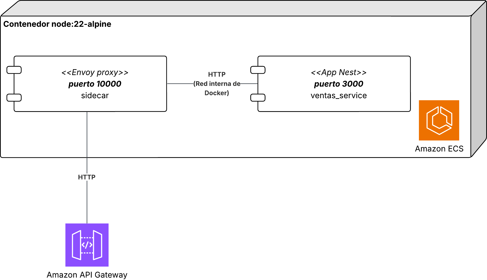
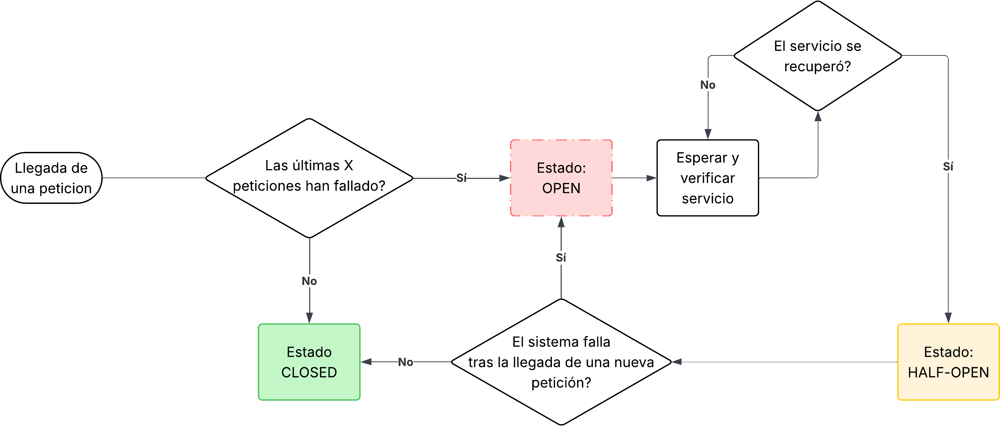
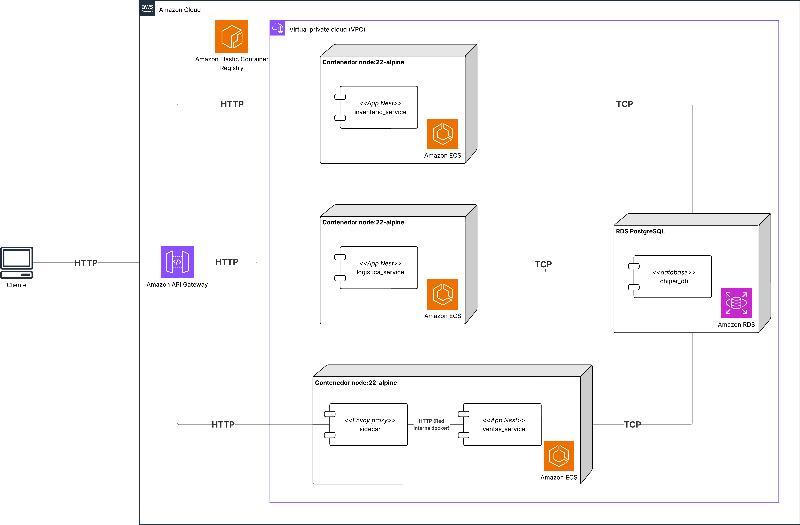

# Lab 5 — Disponibilidad en Microservicios: Circuit Breaker, Retry, Rate Limiting, Outbox e Idempotencia

## 1. Índice

- [1. Índice](#1-índice)
- [2. Etapas del laboratorio](#2-etapas-del-laboratorio)
- [3. Objetivos](#3-objetivos)
- [4. Planeación del laboratorio](#4-planeación-del-laboratorio)
- [5. Ejecución del laboratorio](#5-ejecución-del-laboratorio)
- [6. Realización de pruebas](#6-realización-de-pruebas)
- [7. Entregables](#7-entregables)
- [Nota final (créditos AWS)](#nota-final-créditos-aws)

## 2. Etapas del laboratorio

| Etapa                                      | Resumen                                                                                                          | Uso de IA generativa                                                                                      |
| ------------------------------------------ | ---------------------------------------------------------------------------------------------------------------- | --------------------------------------------------------------------------------------------------------- |
| 1. Contexto del experimento de resiliencia | Modelado del escenario en el que los reintentos automáticos tumban un servicio que ya estaba degradado (*retry storm*), hipótesis de diseño, escenarios de calidad vinculados (ASRs), diseño y planeación del experimento. | Uso acotado para comprender patrones de falla; el criterio de negocio debe ser propio.                    |
| 2. Arquitectura y tacticas                 | Analisis de las tacticas de disponibilidad del laboratorio: un contenedor auxiliar que intercepta las llamadas entre servicios (sidecar), graceful degradation en lugar de errores, corte de llamadas a un servicio caido (circuit breaker) y control de recursos. | Recomendado para comparar parametros y riesgos de configuracion.                                          |
| 3. Preparacion de infraestructura con IaC  | Despliegue reproducible en AWS a partir de un archivo que describe toda la infraestructura (infraestructura como codigo, con CloudFormation) y verificacion del despliegue. | Recomendado para asistir en comandos y troubleshooting de despliegue.                                     |
| 4. Configuración del sidecar de resiliencia | Implementacion de falla controlada en Inventario y configuración del sidecar (el proxy Envoy) en Ventas.                     | Recomendado para soporte de implementacion, revision de parametros y pruebas; validar manualmente resultados. |
| 5. Ejecucion de experimentos y analisis    | Comparacion de la linea base sin protecciones contra cada tactica, y evaluacion de su impacto en los ASRs.                          | No recomendado para redactar conclusiones sin evidencia empirica del laboratorio.                         |
| 6. Consistencia bajo fallo: Outbox e Idempotencia | Demostración del problema de inconsistencia de datos y su solución con dos patrones: Outbox (entrega garantizada de una operación pendiente) e idempotencia (una operación repetida no se aplica dos veces).   | Recomendado para soporte de implementacion; validar manualmente el experimento.                           |

## 3. Objetivos

- Reproducir experimentalmente un **fallo en cascada** (un servicio que falla arrastra a los que dependen de él) provocado por un *retry storm* (una avalancha de reintentos automáticos), tal como ocurre en sistemas en producción reales.
- Implementar tres tácticas de resiliencia a nivel de infraestructura: reintentos con espera creciente entre intentos (*retry* con *backoff* exponencial), corte de llamadas a un servicio caído con *graceful degradation* (*circuit breaker*) y límite de peticiones por segundo (*rate limiting*).
- Desplegar la infraestructura del laboratorio usando Infraestructura como Código (describir la infraestructura en un archivo, en lugar de crearla a mano) con AWS CloudFormation.
- Evaluar el impacto de cada táctica sobre los ASRs del negocio de Cheapest mediante pruebas de carga.
- Demostrar que la resiliencia de infraestructura (circuit breaker, retry) no garantiza consistencia de datos, e implementar los patrones **Outbox** e **Idempotencia** para cerrar esa brecha.
- Reflexionar sobre las limitaciones de las tácticas locales frente a enfoques de resiliencia distribuida centralizada.

## 4. Planeación del laboratorio

En el Lab 4 usted desplegó Cheapest como tres microservicios (Logística, Inventario y Ventas) y midió su escalabilidad. Hasta ahora todos los servicios funcionaban; el único problema era la carga. En este laboratorio se estudia qué pasa cuando **uno de los servicios falla** y los demás dependen de él.

Para eso se introduce explícitamente una dependencia HTTP entre servicios: **Ventas llama a Inventario** para verificar que hay stock antes de registrar una venta. Esta dependencia es el punto de fallo que se va a explorar: **si Inventario se degrada, sin protecciones Ventas también falla.**

**Contexto de negocio.**

Los lunes por la mañana, los tenderos de Cheapest realizan sus reabastecimientos semanales. En estos picos, el servicio de **Inventario**, que valida disponibilidad de stock antes de confirmar un pedido, recibe una carga muy superior a la normal. Sin protecciones, el servicio de **Ventas** (que depende de Inventario) empieza a fallar en cadena: los tenderos no pueden confirmar pedidos, las apps móviles reintentán automáticamente, y ese volumen de reintentos amplifica la carga sobre un servicio ya degradado. El resultado: un sistema que se colapsa a sí mismo.

Este escenario es conocido en la industria como **retry storm** y es uno de los patrones de fallo descritos en el artículo [Failure Mitigation for Microservices: An Intro to Aperture](https://careersatdoordash.com/blog/failure-mitigation-for-microservices-an-intro-to-aperture/) de DoorDash.

> [!IMPORTANT]
> **Pregunta 1:**
> En Cheapest, ¿qué decisión de producto y operación debería tomarse primero cuando aparece un retry storm: proteger disponibilidad percibida (graceful degradation) o proteger consistencia estricta (rechazar operaciones)?
> Argumente su respuesta considerando impacto en tenderos, riesgo financiero y costo de reconciliación posterior.

Un aspecto crítico de este escenario, y que este lab reproduce explícitamente, es que el fallo es **transitorio**: los sistemas de orquestación modernos como ECS detectan tareas poco saludables mediante health checks y las reinician automáticamente. En la práctica, un servicio degradado por un pico de memoria, un pool de conexiones agotado o un spike de CPU puede recuperarse por sí solo en cuestión de segundos o minutos. El servicio de Inventario en este laboratorio simula exactamente eso: se degrada al arrancar y se recupera automáticamente tras `RECOVERY_TIME_MS` milisegundos. Esto hace que el estado **HALF-OPEN** del circuit breaker no sea solo teórico: cuando Inventario se recupera, el circuit breaker lo detecta y vuelve al estado CLOSED, restaurando el flujo normal sin intervención humana.

**Conceptos que se presentan en este laboratorio.** Cada uno se explica con más detalle, y con su aplicación en Cheapest, en la parte de tácticas y patrones.

| Concepto | Qué es |
| --- | --- |
| Fallo en cascada (*cascading failure*) | Un servicio que falla hace fallar a los servicios que dependen de él, y estos a los que dependen de ellos. |
| Timeout | Tiempo máximo que un servicio espera la respuesta de otro antes de darla por fallida. |
| Reintento (*retry*) | Volver a enviar automáticamente una petición que falló. |
| *Retry storm* | Avalancha de reintentos: muchos clientes reintentan al mismo tiempo contra un servicio que ya está degradado y terminan de tumbarlo. |
| *Backoff* exponencial | Esperar cada vez más entre un reintento y el siguiente (por ejemplo 0,1 s, 0,2 s, 0,4 s...). |
| *Jitter* | Variación aleatoria que se le suma a esa espera para que los clientes no reintenten todos en el mismo instante. |
| *Circuit breaker* | Mecanismo que, al detectar que un servicio falla repetidamente, deja de enviarle peticiones por un tiempo y responde de inmediato con un error. Tiene tres estados: CLOSED (el tráfico pasa), OPEN (el tráfico se corta) y HALF-OPEN (deja pasar una petición de prueba para ver si el servicio se recuperó). |
| *Graceful degradation* | Cuando una dependencia no está disponible, responder algo útil aunque incompleto en lugar de un error. La respuesta alternativa se llama *fallback*. |
| *Rate limiting* (o *throttling*) | Limitar cuántas peticiones por segundo se aceptan. Las que exceden el límite se rechazan con el código HTTP 429 (*Too Many Requests*). |
| Proxy | Programa intermediario por el que pasan las peticiones entre dos servicios, y que puede aplicarles reglas (reintentar, cortar, registrar). |
| Sidecar | Contenedor auxiliar que se despliega junto al contenedor de un servicio, dentro de la misma tarea de ECS, y que se encarga de asuntos transversales (aquí, la resiliencia de las llamadas a Inventario) sin tocar el código del servicio. |
| Envoy | El proxy de código abierto que se usa como sidecar en este laboratorio. A su implementación del circuit breaker la llama *outlier detection*. |
| Infraestructura como Código (IaC) | Describir la infraestructura en un archivo de texto que se puede versionar y ejecutar, en lugar de crearla a mano en la consola. |
| CloudFormation | El servicio de AWS para infraestructura como código. El archivo que describe los recursos se llama **template** y el conjunto de recursos que crea a partir de él se llama **stack**. |
| Outbox | Patrón en el que una operación que hay que enviarle a otro servicio se guarda primero en una tabla local, en la misma transacción que el dato de negocio, y un proceso aparte la envía después hasta que logra entregarla. |
| Idempotencia | Propiedad de una operación que produce el mismo resultado aunque se ejecute varias veces. Se logra con una **clave de idempotencia**: un identificador que le permite al receptor reconocer una operación que ya procesó. |
| Línea base (*baseline*) | Medición del sistema sin ninguna protección, contra la que se compara cada táctica. |

> [!NOTE]
> **Nombres:** En el código se usan los nombres de las entidades (`OutboxHttpCall`, `ProcessedCall`) y en SQL los de las tablas (`outbox_http_calls`, `processed_calls`, `items_inventario`). Las columnas están en *camelCase* y en SQL van entre comillas dobles (`"createdAt"`).

### 4.1 Hipótesis de diseño

| # | Hipótesis |
| --- | --- |
| H1 | **Si** implementamos un circuit breaker con graceful degradation en el sidecar Envoy de Ventas, **entonces** `POST /ventas/ventas` responde HTTP 201 con `pending_stock_confirmation` en p99 < 3000 ms aun con Inventario en falla total, **porque** el circuito abierto corta las llamadas al servicio caído y Ventas responde con un fallback local en lugar de esperar timeouts y propagar el error. |
| H2 | **Si** configuramos retry con backoff exponencial + jitter en el sidecar (en lugar de reintentos inmediatos), **entonces** el volumen de requests que recibe Inventario no supera 2x la línea base, **porque** el backoff y el jitter dispersan los reintentos en el tiempo y evitan la amplificación sincronizada (retry storm). |
| H3 | **Si** aplicamos rate limiting (throttling) en API Gateway, **entonces** el tráfico excedente de baja prioridad se rechaza con HTTP 429 sin que el throughput de pedidos válidos caiga más de 10%, **porque** el límite se aplica en el borde, antes de que el tráfico consuma capacidad de los servicios. |
| H4 | **Si** registramos las ventas hechas con graceful degradation con el patrón Outbox y protegemos Inventario con una clave de idempotencia, **entonces** todo decremento de stock pendiente se entrega exactamente una vez tras la recuperación (PENDING → DELIVERED en < 30 s, sin duplicados) y la escritura adicional no sube el p99 de `POST /ventas/ventas` en más de 50 ms, **porque** el Outbox garantiza entrega al menos una vez dentro de la misma transacción de la venta y la idempotencia descarta los reintentos repetidos. |

### 4.2 Escenarios de calidad vinculados

| ID    | Estímulo                                                                                     | Fuente del estímulo                                              | Entorno                                                                  | Artefacto                                                    | Respuesta                                                                                                  | Medida de respuesta                                                                                                                                    |
| ----- | ---------------------------------------------------------------------------------------------- | ------------------------------------------------------------------ | --------------------------------------------------------------------------- | --------------------------------------------------------------- | -------------------------------------------------------------------------------------------------------------- | ------------------------------------------------------------------------------------------------------------------------------------------------------- |
| ASR-1 | El servicio de Inventario deja de responder correctamente (falla total / timeouts sostenidos). | Servicio de Inventario, del cual depende Ventas.                   | Operación normal, pico de tráfico de reabastecimiento (lunes en la mañana). | Servicio de Ventas (endpoint `POST /ventas/ventas`).            | Ventas registra el pedido con graceful degradation en lugar de propagar el error al tendero.                          | Durante fallo total de Inventario, Ventas responde HTTP 201 con `status: pending_stock_confirmation` en p99 < 3000 ms. El p99 se calcula sobre **todas** las peticiones de cada fila de la matriz de carga, incluidas las que ocurren antes de que se abra el circuito. |
| ASR-2 | Los clientes (o el sidecar) reintentan automáticamente las llamadas fallidas hacia Inventario. | Política de retry del sidecar Envoy ante errores 5xx de Inventario. | Inventario degradado, reintentos activos.                                   | Servicio de Inventario.                                          | Los reintentos no deben amplificar desproporcionadamente la carga recibida por Inventario.                      | El factor de amplificación (llamadas de disponibilidad que recibe Inventario en la ronda con reintentos ÷ las que recibe en la línea base, con la misma matriz de carga) es ≤ 2. La fórmula está en la sección 4.4.3. |
| ASR-3 | Un pico de tráfico de baja prioridad (ej. consultas de catálogo masivas) llega al sistema.     | Clientes externos generando tráfico de baja prioridad.               | Operación normal, con tráfico mixto de alta y baja prioridad.               | API Gateway / servicio de Ventas (confirmación de pedidos).     | El rate limiter rechaza el tráfico excedente sin afectar la confirmación de pedidos.                            | El rate limiter rechaza el tráfico excedente con HTTP 429 sin que el throughput de pedidos válidos caiga más de un 10% respecto a la línea base.         |
| ASR-4 | Inventario se recupera tras un período de caída durante el cual se registraron ventas con graceful degradation. | Recuperación del servicio de Inventario.                             | Transición de graceful degradation a operación normal.                                 | Mecanismo de Outbox (Ventas) + endpoint de idempotencia (Inventario). | Toda venta registrada con graceful degradation entrega su decremento de stock exactamente una vez, sin duplicados.     | (a) Contadas desde que Inventario vuelve a responder `/health`, todas las filas de `outbox_http_calls` en estado PENDING pasan a DELIVERED en < 30 s, y ningún `items_inventario.cantidad` refleja decrementos duplicados. (b) Con Inventario sano, el p99 de `POST /ventas/ventas` con Outbox no supera en más de 50 ms el p99 sin Outbox. |

Contexto de negocio de cada ASR (motivación, no parte de la especificación formal):

- **ASR-1**: Como tendero, quiero poder confirmar un pedido incluso cuando el servicio de Inventario esté degradado. Un pedido con stock no confirmado es preferible a un error que me impida completar la compra.
- **ASR-2**: Como negocio, quiero que los reintentos automáticos ante fallos no amplifiquen la carga sobre servicios ya degradados, para evitar empeorar el incidente.
- **ASR-3**: Como negocio, quiero que el tráfico de confirmación de pedidos no se vea afectado por picos de tráfico de baja prioridad.
- **ASR-4**: Como negocio, quiero que toda venta registrada, incluso con graceful degradation (`pending_stock_confirmation`), tenga su decremento de stock entregado exactamente una vez cuando Inventario se recupere, sin que ese mecanismo vuelva lenta la confirmación de pedidos.

### 4.3 Tácticas y patrones

#### 4.3.1 Patrones de diseño

##### Sidecar

Un **sidecar** es un contenedor auxiliar que se despliega junto al contenedor principal dentro de la misma unidad de ejecución (tarea ECS en este caso). Comparte el namespace de red con el servicio principal, lo que le permite interceptar el tráfico sin que la aplicación lo sepa.



**¿Por qué sidecar en lugar de código?**

En este laboratorio las tácticas de disponibilidad se implementan en el sidecar y no dentro del servicio NestJS por tres razones:

1. **Separación de responsabilidades**: el código de negocio de Ventas no debería saber si el circuito está abierto o cerrado; eso es una política de infraestructura.
2. **Cambios sin redespliegue del servicio**: ajustar `num_retries` o `base_ejection_time` solo requiere actualizar la config del sidecar y reiniciarlo, sin tocar ni recompilar la aplicación.
3. **Consistencia cross-lenguaje**: si mañana Ventas se reescribe en Go o Python, el sidecar sigue funcionando igual, sin reimplementar la lógica de retry en cada SDK.

**Relación entre sidecar y graceful degradation**

El sidecar maneja la red (retry, circuit breaker). La graceful degradation —retornar `status: pending_stock_confirmation` en lugar de propagar el error— es una decisión de negocio que vive en el código de Ventas. El sidecar le comunica al servicio que Inventario está caído (mediante un 503 rápido en lugar de un timeout lento), y el servicio decide qué respuesta dar al cliente.

##### Circuit Breaker

Un **circuit breaker** es un control de fallos que corta el tráfico hacia un servicio cuando detecta errores persistentes. Evita que un servicio degradado reciba más carga y permite al cliente responder rápido con una salida controlada.

**Estados básicos**

- **CLOSED**: el circuito está cerrado y el tráfico fluye normalmente.
- **OPEN**: el circuito está abierto, el tráfico se corta inmediatamente y se devuelve un error o se aplica graceful degradation.
- **HALF-OPEN**: tras un tiempo de espera, el circuito permite pasar algunos requests de prueba para verificar si el servicio se ha recuperado. Si esos requests tienen éxito, el circuito vuelve a CLOSED; si fallan, vuelve a OPEN.



**Cómo se ve en Cheapest**

- Ventas llama a Inventario a traves del sidecar Envoy.
- Si Inventario empieza a fallar (timeouts o 5xx), Envoy cuenta los errores.
- Tras `consecutive_5xx`, abre el circuito (OPEN) y responde 503 inmediato.
- Ventas detecta el 503 y aplica graceful degradation.

**Por qué importa**

- Reduce el p99 de Ventas al evitar timeouts largos.
- Protege a Inventario de recibir mas trafico cuando ya esta degradado.
- Permite detectar la recuperacion automatica de Inventario (HALF-OPEN) sin intervencion humana.

**Riesgo si se calibra mal**

- Umbral demasiado bajo: el circuito abre con fallos transitorios y corta trafico legitimo.
- Umbral demasiado alto: tarda en abrir y el sistema sigue colapsando en cascada.

##### Outbox e idempotencia

El circuit breaker y la graceful degradation mantienen a Ventas disponible, pero dejan un problema de datos: la venta quedó registrada y el stock de Inventario nunca se descontó. Dos patrones cierran esa brecha:

- **Outbox:** en la misma transacción en la que Ventas guarda la venta, guarda también una fila en una tabla local (`outbox_http_calls`, entidad `OutboxHttpCall`) que representa "hay que descontar este stock en Inventario". Un proceso en segundo plano lee esa tabla cada 2 segundos y envía la petición a Inventario hasta que logra entregarla. La garantía es de entrega **al menos una vez** (*at-least-once*).
- **Idempotencia:** como "al menos una vez" significa que la misma petición puede llegar repetida, Inventario recibe con cada petición una clave de idempotencia y guarda las claves que ya procesó. Si llega una clave repetida, no vuelve a descontar.

Juntos logran que cada venta descuente el stock exactamente una vez. Verá ambos patrones en detalle, sobre el código, en la última ronda de pruebas.

#### 4.3.2 Tácticas de arquitectura

| Táctica                                     | Análisis                                                                                                                                                                                                                                                         |
| ------------------------------------------- | ---------------------------------------------------------------------------------------------------------------------------------------------------------------------------------------------------------------------------------------------------------------- |
| Reintentos con backoff exponencial + jitter | Favorece la recuperación automática ante fallos transitorios.<br>Sin backoff ni jitter, los reintentos sincronizados pueden amplificar la carga (thundering herd), agravando el incidente en lugar de resolverlo.                                                |
| Circuit Breaker (CLOSED / OPEN / HALF-OPEN) | Favorece disponibilidad del servicio cliente al dejar de enviar requests a un servicio que ya está fallando.<br>Desfavorece consistencia inmediata: el estado OPEN implica que algunas operaciones retornan una respuesta de graceful degradation en lugar de resultados reales. |
| Graceful degradation (fallback)             | Favorece experiencia de usuario y disponibilidad percibida: el sistema sigue aceptando pedidos con graceful degradation.<br>Introduce complejidad en la lógica de negocio para manejar el estado `pending_stock_confirmation`.                                          |
| Rate Limiting (API Gateway throttling)      | Favorece protección de servicios backend ante picos de tráfico y retry storms.<br>Puede afectar a usuarios legítimos si los límites no están bien calibrados para los patrones reales de la demanda.                                                             |
| Proxy sidecar (Envoy)                   | Permite implementar retry y circuit breaker en la capa de red, sin tocar el código de negocio.<br>El sidecar intercepta el tráfico saliente de Ventas hacia Inventario y aplica las políticas configuradas en su archivo YAML.<br>Introduce un salto de red adicional y requiere que los parámetros del sidecar sean coherentes con los timeouts de la aplicación. |

##### Retries (reintentos)

Los **reintentos** permiten recuperar solicitudes ante fallos transitorios (timeouts cortos, reinicios, errores 5xx momentaneos). Para evitar sincronizacion masiva, se usan **backoff exponencial + jitter**.

**Flujo tipico**

```
intento 1 -> falla
espera base_interval (+/- jitter)
intento 2 -> falla
espera min(2x, max_interval)
intento 3 -> exito o error final
```

**Cómo se ve en Cheapest**

- Envoy reintenta automaticamente cuando Inventario responde 5xx.
- El timeout total de la ruta debe cubrir el tiempo de reintentos.
- El numero de reintentos debe respetar ASR-2: no puede duplicar en exceso el trafico hacia Inventario.

**Por qué importa**

- Mejora disponibilidad cuando el fallo es breve.
- Si el fallo es persistente, los retries solo amplifican carga y empeoran el incidente.

##### Graceful Degradation

La **graceful degradation** es una decision de negocio: el servicio devuelve una respuesta util aunque parcial cuando un componente critico no esta disponible. No evita la falla, pero protege la experiencia del usuario.

**Cómo se ve en Cheapest**

- Si Inventario no responde, Ventas registra el pedido con `status: pending_stock_confirmation`.
- El tendero recibe confirmacion de pedido, pero la verificacion de stock queda diferida.

**Por qué importa**

- Mantiene la disponibilidad percibida (ASR-1) aun con Inventario degradado.
- Requiere reglas claras: que significa "pendiente", cuanto tiempo puede estarlo, y como se reconcilia.

> [!IMPORTANT]
> **Pregunta 3 (parte A — propuesta de parámetros):**
> Retry, circuit breaker y rate limiting pueden entrar en conflicto si se calibran mal.
> Proponga un conjunto coherente de parámetros iniciales para Cheapest (timeouts, retries, umbral de apertura, reset timeout, rate y burst) y justifique cómo evitaría inestabilidad sistémica. Incluya un escenario concreto en el que usar reintentos y circuit breaker juntos sin coordinación generaría un problema.

#### 4.3.3 Estilos aplicados

| Estilo | Análisis |
| --- | --- |
| Microservicios | Favorece aislamiento de fallos por servicio y despliegue independiente.<br>Sin tácticas de resiliencia, la comunicación HTTP entre servicios introduce puntos de fallo en cadena. |
| API Gateway | Actúa como punto de control centralizado para rate limiting y throttling.<br>Protege los servicios upstream de picos de tráfico que superan su capacidad. |
| Graceful degradation | Favorece continuidad operativa durante incidentes: el sistema entrega respuestas útiles aunque parciales en lugar de fallar completamente.<br>Requiere acuerdos de negocio claros sobre qué funcionalidades pueden degradarse sin romper la experiencia crítica del tendero. |
| Control de recursos (Resource Control) | Favorece estabilidad bajo carga al limitar concurrencia, throughput y consumo por cliente/ruta (throttling, cuotas, aislamiento).<br>Sin una buena calibración, puede rechazar tráfico legítimo y afectar temporalmente la percepción de disponibilidad. |
| Sidecar | Externaliza responsabilidades transversales (resiliencia, observabilidad, seguridad) a un proceso proxy que corre junto al servicio principal.<br>Permite aplicar y cambiar políticas de resiliencia sin modificar el código de negocio ni redesplegar la aplicación. |

### 4.4 Diseño del experimento

#### 4.4.1 ¿Cómo se va a validar la hipótesis?

Comparando contra una línea base sin protecciones, bajo la misma matriz de carga y con el mismo fallo controlado en Inventario. Las rondas son **acumulativas**: cada una conserva las tácticas de la ronda anterior y agrega una nueva. El efecto de cada táctica se aísla comparando cada ronda con la **inmediatamente anterior** (por ejemplo, el efecto del circuit breaker es la diferencia entre la Ronda 3 y la Ronda 2).

Se realizan cinco rondas. Las cuatro primeras son pruebas de carga con JMeter sobre `POST /ventas/ventas` en AWS, con Inventario en estado de fallo controlado; la quinta se ejecuta en su computador (ver sección 6.7):

| Ronda | Sidecar | Reintentos | Circuit breaker | Rate limiting | Outbox e idempotencia |
| --- | --- | --- | --- | --- | --- |
| 1. Línea base | No | No | No | No | Activo en el código, no se evalúa |
| 2. Reintentos | Sí | Sí | No | No | Activo en el código, no se evalúa |
| 3. Circuit breaker | Sí | Sí | Sí | No | Activo en el código, no se evalúa |
| 4. Tácticas combinadas | Sí | Sí | Sí | Sí | Activo en el código, no se evalúa |
| 5. Outbox e idempotencia | Sí | Sí | Sí | No aplica (local) | Se evalúa |

1. **Línea base (sin protecciones)**: la tarea de Ventas no tiene sidecar; Ventas llama directamente al balanceador de Inventario, sin reintentos ni circuit breaker.
2. **Reintentos con backoff exponencial**: se agrega el sidecar solo con la política de reintentos; el proxy Envoy reintenta automáticamente ante errores 5xx.
3. **Circuit breaker y graceful degradation**: el mismo sidecar con la *outlier detection* activada. Los reintentos siguen activos. Envoy abre el circuito y Ventas retorna `pending_stock_confirmation`.
4. **Tácticas combinadas**: la configuración de la Ronda 3 más rate limiting en API Gateway.
5. **Outbox e idempotencia**: con Inventario caído se crean ventas que retornan `pending_stock_confirmation`; se restaura Inventario y se observa la reconciliación automática vía Outbox. Se valida que una petición repetida con la misma clave no produce decrementos dobles.

> [!IMPORTANT]
> **Pregunta 2:**
> Si usted fuera el líder encargado de llevar estas tácticas a producción en Cheapest, ¿las adoptaría en el mismo orden de las rondas (reintentos, circuit breaker, rate limiting, Outbox e idempotencia), teniendo en cuenta el riesgo de cada cambio? Describa un plan de migración que mitigue los riesgos asociados.
> El plan de migración debe incluir: etapas, tiempo estimado por etapa y las tareas a realizar en cada una.

#### 4.4.2 ¿Qué componentes se van a diseñar o modificar?

| Componente | Cambio |
| --- | --- |
| Inventario | Inyección de un fallo que se recupera solo después de un tiempo (`FAULT_DELAY_MS`, `RECOVERY_TIME_MS`) y endpoint que recibe los descuentos de stock con clave de idempotencia. |
| Ventas | Graceful degradation (`pending_stock_confirmation`) cuando Inventario no está disponible, y escritura transaccional de la venta junto con su fila de Outbox. |
| Sidecar Envoy (en la tarea de Ventas) | Configuración del timeout, de los reintentos con backoff y jitter, y del circuit breaker. |
| API Gateway | Rate limiting sobre el stage `lab`. |

#### 4.4.3 ¿Qué métricas se van a medir?

| Métrica | Hipótesis / ASR | Umbral | Dónde se mide |
| --- | --- | --- | --- |
| p99 de `POST /ventas/ventas` (sobre todas las peticiones de cada fila de la matriz) y % de respuestas 201 con `pending_stock_confirmation` | H1 / ASR-1 | p99 < 3000 ms | JMeter (Summary/Aggregate Report) |
| Factor de amplificación de las llamadas a Inventario (fórmula abajo) | H2 / ASR-2 | ≤ 2 | CloudWatch: `RequestCount` del target group de Inventario, y JMeter |
| Throughput de pedidos válidos y % de respuestas 429 | H3 / ASR-3 | caída ≤ 10% | JMeter |
| Tiempo de PENDING → DELIVERED (contado desde que Inventario vuelve a responder `/health`) y decrementos duplicados en `items_inventario.cantidad` | H4 / ASR-4 (a) | < 30 s, 0 duplicados | SQL sobre `outbox_http_calls` e `items_inventario` |
| Diferencia de p99 de `POST /ventas/ventas` con y sin Outbox, con Inventario sano | H4 / ASR-4 (b) | ≤ 50 ms | JMeter |

**Cómo calcular el factor de amplificación (ASR-2).** El target group de Inventario recibe dos tipos de llamadas: las de disponibilidad (`GET /inventory/items/disponibilidad/...`), que son las que se reintentan, y una llamada del Outbox (`POST /inventory/ventas/desde-outbox`) por cada venta registrada, que no tiene que ver con los reintentos. Por eso hay que restar las segundas:

$$\text{llamadas de disponibilidad} = \text{RequestCount}_{\text{Inventario}} - \text{ventas registradas (respuestas 201)}$$

$$\text{factor} = \frac{\text{llamadas de disponibilidad en la ronda}}{\text{llamadas de disponibilidad en la línea base}}$$

Ejemplo: la matriz completa envía 50 + 200 + 500 + 1500 = 2250 ventas. Si en la línea base CloudWatch suma 4400 peticiones a Inventario y JMeter registró 2200 respuestas 201, hubo 4400 − 2200 = 2200 llamadas de disponibilidad. Si en la ronda de reintentos CloudWatch suma 6300 y hubo 2100 respuestas 201, hubo 4200 llamadas de disponibilidad: factor = 4200 / 2200 ≈ 1,9, que cumple el ASR-2. Como cota teórica, cada venta genera como máximo `1 + num_retries` llamadas de disponibilidad, así que con `num_retries = 2` el peor caso es 3 y el ASR-2 no se cumpliría.

### 4.5 Planeación del experimento

#### 4.5.1 Recursos requeridos

| Recurso | Detalle |
| --- | --- |
| Infraestructura AWS | Stack de CloudFormation (API Gateway, ECS/Fargate, RDS, balanceadores y sidecar Envoy) desplegado en su cuenta, más los repositorios de ECR con las imágenes |
| Herramientas locales | Docker, AWS CLI, JMeter, un cliente de PostgreSQL y el backend de la rama `availability` |
| Datos de prueba | Script de seed de la rama `availability` (`npm run db:seed`) |
| Créditos AWS | Elimine el stack al terminar |

> [!NOTE]
> No se espera que llegue con experiencia previa en todas estas tecnologías. La columna **Recurso para entender qué hace** apunta a documentación oficial u otra referencia introductoria; revísela antes de tocar el template o el sidecar. Adicionalmente, se recomienda usar un asistente de IA (Claude, ChatGPT, etc.) para explorar cada servicio de AWS: pregúntele qué problema resuelve, qué recursos crea "por debajo" y qué pasaría si no existiera esa pieza en la arquitectura. Esto ayuda a construir intuición más allá de copiar comandos.

| Categoría                          | Tecnologías                                | Recurso para entender qué hace                                                                                     |
| ----------------------------------- | -------------------------------------------- | ------------------------------------------------------------------------------------------------------------------- |
| Infraestructura como Código        | AWS CloudFormation                            | [¿Qué es AWS CloudFormation?](https://docs.aws.amazon.com/es_es/AWSCloudFormation/latest/UserGuide/Welcome.html)     |
| Gateway de entrada + Rate Limiting | Amazon API Gateway (throttling por stage)     | [¿Qué es Amazon API Gateway?](https://docs.aws.amazon.com/es_es/apigateway/latest/developerguide/welcome.html)       |
| Orquestación de contenedores       | Amazon ECS (Fargate)                          | [¿Qué es Amazon ECS?](https://docs.aws.amazon.com/es_es/AmazonECS/latest/developerguide/Welcome.html) · [AWS Fargate](https://docs.aws.amazon.com/es_es/AmazonECS/latest/userguide/what-is-fargate.html) |
| Registro de imágenes               | Amazon ECR                                    | [¿Qué es Amazon ECR?](https://docs.aws.amazon.com/es_es/AmazonECR/latest/userguide/what-is-ecr.html)                 |
| Base de datos relacional           | Amazon RDS (PostgreSQL)                       | [¿Qué es Amazon RDS?](https://docs.aws.amazon.com/es_es/AmazonRDS/latest/UserGuide/Welcome.html)                     |
| Observabilidad                     | Amazon CloudWatch                             | [¿Qué es Amazon CloudWatch?](https://docs.aws.amazon.com/es_es/AmazonCloudWatch/latest/monitoring/WhatIsCloudWatch.html) |
| Framework backend                  | NestJS                                        | [Documentación de NestJS](https://docs.nestjs.com/)                                                                   |
| Lenguaje                           | TypeScript                                    | [Handbook de TypeScript](https://www.typescriptlang.org/docs/handbook/intro.html)                                     |
| ORM                                | TypeORM                                       | [Documentación de TypeORM](https://typeorm.io/)                                                                       |
| Proxy sidecar                       | Envoy Proxy                                  | [¿Qué es Envoy?](https://www.envoyproxy.io/docs/envoy/latest/intro/what_is_envoy) · [Patrón Sidecar](https://learn.microsoft.com/es-es/azure/architecture/patterns/sidecar) |
| Pruebas de carga                   | Apache JMeter                                 | [Guía de introducción a JMeter](https://jmeter.apache.org/usermanual/get-started.html)                                |

> [!IMPORTANT]
> **Sugerencia de prompt para IA:** *"Actúo como estudiante de arquitectura de software. Explícame qué hace [servicio de AWS], qué problema arquitectónico resuelve, qué recursos concretos crea cuando lo despliego con CloudFormation, y qué riesgos de disponibilidad o costo debería tener en cuenta al usarlo en un sistema de microservicios como el de este laboratorio."* Use esto como punto de partida, no como respuesta final: valide lo que la IA le diga contra la documentación oficial y contra lo que observe en su propio despliegue.

#### 4.5.2 Elementos de arquitectura involucrados

Servicios de Ventas e Inventario (y Logística como parte del stack), sidecar Envoy, API Gateway, base de datos RDS (tablas `outbox_http_calls` e `items_inventario`) y JMeter como generador de carga. El conector que se estudia es la llamada HTTP de Ventas a Inventario.



*Figura 1. Vista de despliegue del laboratorio: API Gateway enruta hacia los servicios de Logística, Inventario y Ventas corriendo en ECS/Fargate; el sidecar Envoy corre como segundo contenedor dentro de la misma tarea de Ventas e intercepta el tráfico hacia Inventario; JMeter genera la carga de pruebas desde el computador del estudiante.*

> [!NOTE]
> Note que el sidecar se despliega como un contenedor adicional dentro de la misma tarea ECS que Ventas, y el tráfico entre Ventas e Inventario pasa a través del proxy Envoy. Esto permite implementar las tácticas de resiliencia sin modificar el código de negocio de Ventas, y ajustar los parámetros de retry y circuit breaker sin necesidad de redesplegar la aplicación.

#### 4.5.3 Esfuerzo estimado

Referencia para planear; puede variar según su experiencia con AWS. Buena parte del tiempo es espera: la creación del stack (la RDS sola tarda entre 10 y 15 minutos), los despliegues de cada nueva revisión de ECS y la ventana de fallo de 10 minutos de Inventario en cada una de las rondas 1 a 4. Planee el laboratorio en al menos dos sesiones de trabajo.

| Etapa | Esfuerzo aprox. |
| --- | --- |
| Publicación de imágenes, despliegue del stack y carga de datos | 1,5 h |
| Configuración del sidecar y revisión del código | 0,5 h |
| Preparación del plan de JMeter | 0,5 h |
| Ronda de línea base: fallo en cascada (incluye la ventana de 10 min) | 0,75 h |
| Rondas 2 a 4 (cada una: nueva revisión, reinicio de Inventario y ventana de 10 min) | 2,25 h |
| Ronda de Outbox e idempotencia (local) y medición de latencia (AWS) | 1 h |
| Análisis y entregables | 1,5 h |
| **Total** | **8 h-persona** |

## 5. Ejecución del laboratorio

### 5.1 ¿Qué es Infraestructura como Código?

En los labs anteriores, la infraestructura se creó paso a paso desde la consola de AWS: security groups, instancias EC2, RDS, ECS, API Gateway. Este enfoque manual tiene un problema: es propenso a errores, difícil de reproducir y no deja registro de qué se configuró exactamente.

**Infraestructura como Código (IaaC)** resuelve esto declarando la infraestructura en un archivo de texto (código), que puede versionarse, revisarse y ejecutarse de forma reproducible. **AWS CloudFormation** es el servicio nativo de AWS para esto: usted define un *template* YAML o JSON que describe los recursos, y CloudFormation se encarga de crearlos, actualizarlos o eliminarlos.

### 5.2 El template de CloudFormation del laboratorio

Se provee el archivo `lab_5/recursos/cloudformation_template.yaml` con toda la infraestructura del laboratorio declarada. Lea el template antes de ejecutarlo: cada sección tiene comentarios que explican qué recurso crea y por qué.

El template incluye:

| Sección            | Recursos creados                                                              |
| ------------------ | ----------------------------------------------------------------------------- |
| `Parameters`       | ARNs de imágenes ECR, credenciales RDS, VPC/subnets                           |
| `VPC y Networking` | VPC, subnets públicas/privadas, Internet Gateway, Security Groups             |
| `RDS`              | Instancia PostgreSQL, subnet group, security group de base de datos           |
| `ECS Cluster`      | Cluster Fargate compartido, roles IAM de ejecución                            |
| `Task Definitions` | Una por servicio (Logistica, Inventario, Ventas) con variables de entorno     |
| `ECS Services`     | Un servicio ECS por Task Definition, conectado a su ALB                       |
| `Load Balancers`   | ALB por servicio con Target Groups y Health Checks                            |
| `API Gateway`      | HTTP API con rutas `/logistica/*`, `/inventario/*`, `/ventas/*` y stage `lab` |

> [!NOTE]
> Los prefijos de ruta de API Gateway en este laboratorio son **`logistica`/`inventario`**, a diferencia de `logistics`/`inventory` usados en el Lab 4. La lista completa de rutas está en la sección 5.5.

### 5.3 Publicar las imágenes en ECR

Antes de desplegar, publique las imágenes Docker en ECR y anote los URIs. En este laboratorio hay **cuatro imágenes**: las tres del monorepo más la del sidecar Envoy.

| Servicio          | Repositorio sugerido     | Tag     | Dockerfile                          |
| ----------------- | ------------------------ | ------- | ----------------------------------- |
| Logística         | `cheapest-logistica`       | `2.0.0` | `apps/logistica/Dockerfile`         |
| Inventario        | `cheapest-inventario`      | `2.0.0` | `apps/inventario/Dockerfile`        |
| Ventas            | `cheapest-ventas`          | `2.0.0` | `apps/ventas/Dockerfile`            |
| Ventas sidecar    | `cheapest-ventas-sidecar`  | `1.0.0` | `apps/ventas/sidecar/Dockerfile`    |

Tutorial de apoyo:
- [Subir imágenes Docker a Amazon ECR](../tutoriales/subir_imagenes%20_a_ecr.md)

> Use el tag `2.0.0` para distinguir las imágenes con las modificaciones de este lab de las del Lab 4. La rama de trabajo para este laboratorio es **`availability`**.
> Recuerde que debe construir el sidecar como una imagen Docker aparte, usando el Dockerfile en `apps/ventas/sidecar/`, y subirla a ECR también.

> [!IMPORTANT]
> **Complete el sidecar antes de publicarlo.** La imagen `cheapest-ventas-sidecar:1.0.0` debe construirse **después** de completar los seis `???` de `envoy.yaml.tmpl` y de verificarlo localmente (sección 5.8, "Completar la configuración de Envoy"). Si publica el sidecar con los `???`, Envoy no arranca, la tarea de Ventas nunca queda sana y el stack no llega a `CREATE_COMPLETE`. Las otras tres imágenes las puede publicar de una vez.

### 5.4 Desplegar el stack

```bash
aws cloudformation deploy  --template-file lab_5/recursos/cloudformation_template.yaml  --stack-name Cheapest-lab5  --parameter-overrides LogisticaImageUri=<URI_ECR_LOGISTICA>:2.0.0 InventarioImageUri=<URI_ECR_INVENTARIO>:2.0.0 VentasImageUri=<URI_ECR_VENTAS>:2.0.0  VentasSidecarImageUri=<URI_ECR_SIDECAR>:1.0.0 DBPassword=<SU_CONTRASEÑA>  --region us-east-1
```

Monitoree el progreso en la consola de AWS → CloudFormation → Stack `Cheapest-lab5` → pestaña **Events**.

El template ya configura todas las variables de entorno de las tareas: `INVENTARIO_BASE_URL=http://localhost:10000` e `INVENTARIO_TIMEOUT_MS=9000` en Ventas, `INVENTARIO_UPSTREAM_HOST` (el DNS del balanceador de Inventario, que el template obtiene solo) e `INVENTARIO_UPSTREAM_PORT=80` en el sidecar, y `FAULT_DELAY_MS=0` y `RECOVERY_TIME_MS=60000` en Inventario. No tiene que escribir ninguno de esos valores a mano.

> [!IMPORTANT]
> **Ejecute `aws cloudformation deploy` una sola vez.** Todos los cambios posteriores (activar el fallo de Inventario, quitar o poner el sidecar, cambiar la imagen del sidecar) se hacen **en la consola de ECS creando una nueva revisión de la task definition**, como se explica en la sección 6.1. Si vuelve a ejecutar `aws cloudformation deploy` con otros parámetros, CloudFormation puede devolver los servicios a las revisiones que él creó y perder sus cambios.

### 5.5 Verificar el despliegue

Una vez el stack esté en estado `CREATE_COMPLETE`:

```bash
# Obtener la URL del API Gateway
aws cloudformation describe-stacks --stack-name Cheapest-lab5 --query "Stacks[0].Outputs[?OutputKey=='ApiGatewayUrl'].OutputValue" --output text
```

El valor que retorna es la **`BASE_URL`** que se usa en el resto del laboratorio:

```bash
BASE_URL=https://<API_ID>.execute-api.us-east-1.amazonaws.com/lab
```

Todas las peticiones que haga desde su computador o desde JMeter contra AWS pasan por API Gateway y usan estas rutas:

| Para qué | Método y ruta completa |
| --- | --- |
| Salud de cada servicio | `GET {BASE_URL}/logistica/health`, `GET {BASE_URL}/inventario/health`, `GET {BASE_URL}/ventas/health` |
| **Crear una venta (endpoint bajo prueba)** | `POST {BASE_URL}/ventas/ventas` |
| Listar productos externos (para armar el cuerpo de la venta) | `GET {BASE_URL}/ventas/productos-externos` |
| Consultar un ítem de inventario y su `cantidad` | `GET {BASE_URL}/inventario/items/{itemInventarioId}` |
| Disponibilidad de un producto (la que consulta Ventas) | `GET {BASE_URL}/inventario/items/disponibilidad/{productoId}` |

> [!NOTE]
> El primer segmento de la ruta (`/ventas`, `/inventario`, `/logistica`) es el prefijo de API Gateway; el resto es la ruta del controlador. Por eso crear una venta es `/ventas/ventas`. API Gateway traduce `/inventario/...` a la ruta interna `/inventory/...` y `/logistica/...` a `/logistics/...`. Si usa los prefijos en inglés contra `BASE_URL` obtendrá 404. Las rutas en inglés (`/inventory/...`) solo se usan cuando se llama a un servicio **directamente**, sin API Gateway: dentro del código, en los logs y en la Ronda 5 local.

Desde su computador verifique que los tres servicios responden:

```bash
curl -i $BASE_URL/logistica/health
curl -i $BASE_URL/inventario/health
curl -i $BASE_URL/ventas/health
```

Los tres deben retornar HTTP 200 antes de continuar.

### 5.6 Cargar datos base

La base de datos RDS de este stack se crea con `PubliclyAccessible: false`, por lo que no es alcanzable desde su computador. El procedimiento es el mismo que usó en el Lab 4: hágala temporalmente pública y abra el puerto 5432 **solo para su IP**, corra el seed desde su máquina apuntando a la RDS real, y luego revierta ambos cambios.

```bash
# 1. Anote su IP pública actual
MY_IP=$(curl -s https://checkip.amazonaws.com)
echo $MY_IP

# 2. Identifique el Security Group de RDS del stack (tag Name: Cheapest-lab5-rds-sg)
SG_RDS_ID=$(aws ec2 describe-security-groups --filters Name=tag:Name,Values=Cheapest-lab5-rds-sg --query "SecurityGroups[0].GroupId" --output text)

# 3. Haga la instancia temporalmente pública
aws rds modify-db-instance --db-instance-identifier Cheapest-lab5-db --publicly-accessible --apply-immediately

# 4. Espere a que el cambio se aplique (puede tardar 1-2 minutos)
aws rds describe-db-instances --db-instance-identifier Cheapest-lab5-db --query "DBInstances[0].PubliclyAccessible"

# 5. Abra el puerto 5432 SOLO para su IP
aws ec2 authorize-security-group-ingress --group-id $SG_RDS_ID --protocol tcp --port 5432 --cidr ${MY_IP}/32

# 6. Corra el backend en local (rama availability) apuntando a la RDS real y sembrando datos
git checkout availability
npm install
DB_HOST=<RDS_ENDPOINT_DEL_STACK> DB_PORT=5432 DB_USER=postgres DB_PASSWORD=<SU_CONTRASEÑA> DB_NAME=Cheapest npm run db:seed
```

Al terminar, **revierta ambos cambios** para no dejar la base expuesta:

```bash
aws rds modify-db-instance --db-instance-identifier Cheapest-lab5-db --no-publicly-accessible --apply-immediately
aws ec2 revoke-security-group-ingress --group-id $SG_RDS_ID --protocol tcp --port 5432 --cidr ${MY_IP}/32
```

Con los datos sembrados, ya puede ejecutar las pruebas usando los IDs fijos de `seed.sql` (los mismos de los laboratorios anteriores: tienda `bbbbbbbb-bbbb-4bbb-8bbb-bbbbbbbbbbbb`, producto `aaaaaaaa-aaaa-4aaa-8aaa-aaaaaaaaaaaa`, moneda `cccccccc-cccc-4ccc-8ccc-cccccccccccc`). El ítem de inventario de ese producto en esa tienda es `11111111-1111-4111-8111-111111111111`.

Los productos externos se generan con IDs aleatorios: tome el `id` de cualquiera con `GET {BASE_URL}/ventas/productos-externos`. Guarde el cuerpo de la venta en un archivo `venta.json`, que es el que usarán JMeter y los comandos `curl` del laboratorio:

```json
{
  "tiendaId": "bbbbbbbb-bbbb-4bbb-8bbb-bbbbbbbbbbbb",
  "fechaHora": "2026-10-14T10:00:00Z",
  "monedaId": "cccccccc-cccc-4ccc-8ccc-cccccccccccc",
  "items": [
    {
      "productoExternoId": "<ID_DE_UN_PRODUCTO_EXTERNO>",
      "productoId": "aaaaaaaa-aaaa-4aaa-8aaa-aaaaaaaaaaaa",
      "cantidad": 1,
      "precioUnitario": 25.5
    }
  ]
}
```

Pruébelo una vez antes de seguir; debe responder HTTP 201:

```bash
curl -i -X POST $BASE_URL/ventas/ventas -H 'Content-Type: application/json' -d @venta.json
```

### 5.7 Explorar lo que se desplegó

> [!IMPORTANT]
> Antes de seguir a la configuración del sidecar, tómese unos minutos para explorar en la consola de AWS lo que CloudFormation acaba de crear. El objetivo es que el stack no sea una "caja negra": usted debe poder señalar, para cada recurso relevante, con qué parte del template se corresponde y qué rol cumple en la arquitectura.

Realice los siguientes pasos:

1. En **CloudFormation → Stack `Cheapest-lab5` → pestaña Resources**, recorra la lista completa de recursos creados. Por cada tipo de recurso (VPC, Subnets, Security Groups, Target Groups, ALBs, Task Definitions, ECS Services, RDS, API Gateway), identifique la sección correspondiente en `cloudformation_template.yaml`.
2. En **ECS → Clusters**, entre al cluster del laboratorio y revise los tres servicios. Para cada uno, abra la pestaña **Tasks** y confirme que el estado es `RUNNING` y que los health checks pasan.
3. En **EC2 → Load Balancers**, ubique los ALBs creados y revise sus **Target Groups**: confirme que los targets registrados están `healthy`.
4. En **RDS → Databases**, ubique la instancia PostgreSQL y revise su Security Group: confirme que solo permite tráfico desde los security groups de los servicios (no desde `0.0.0.0/0`).
5. En **API Gateway**, abra la API `Cheapest-ms-api` y revise las rutas configuradas (`/logistica/*`, `/inventario/*`, `/ventas/*`) y el stage `lab`.
6. (Opcional, recomendado) Pídale a un asistente de IA que le ayude a interpretar algún recurso o configuración que no le quede clara — por ejemplo, pegue un fragmento del template o una captura de la consola y pregunte qué hace ese recurso específico y cómo se relaciona con los demás.

> [!IMPORTANT]
> **Actividad post-despliegue (hace parte de las evidencias que debe entregar):**
> Elija dos recursos creados por el stack que no haya usado directamente en laboratorios anteriores (por ejemplo, un Target Group, un rol IAM, o una ruta del API Gateway) y explique, en sus propias palabras, qué hacen y por qué son necesarios para que el laboratorio funcione. Acompañe su respuesta con una captura de pantalla de la consola de AWS por cada recurso elegido.

### 5.8 Configurar el sidecar y revisar el código

Las modificaciones de este laboratorio se dividen en tres partes:

1. La inyección de fallos en Inventario (ya implementada en el código base).
2. La **configuración del sidecar Envoy** en Ventas: aquí es donde usted define los parámetros de retry y circuit breaker.
3. Un ajuste mínimo en el servicio de Ventas para la graceful degradation.

#### Inyección de fallos con auto-recuperación en Inventario

El servicio de Inventario ya incorpora un mecanismo de fallo transitorio controlado por dos variables de entorno:

- `FAULT_DELAY_MS`: delay artificial en ms que se agrega a cada respuesta durante el período de fallo.
- `RECOVERY_TIME_MS`: tiempo en ms desde el arranque del proceso hasta que el servicio se recupera automáticamente.

Este código ya existe en `apps/inventario/src/fault.middleware.ts` y se aplica en el endpoint `GET /inventory/items/disponibilidad/:productoId` que Ventas consume. No es necesario modificarlo.

#### El sidecar Envoy: archivos y flujo

El directorio `apps/ventas/sidecar/` contiene tres archivos:

| Archivo            | Rol                                                                              |
| ------------------ | -------------------------------------------------------------------------------- |
| `Dockerfile`       | Imagen base `envoyproxy/envoy:v1.31` + `gettext-base` para la sustitución de variables |
| `entrypoint.sh`    | Al arrancar, sustituye `${INVENTARIO_UPSTREAM_HOST}` y `${INVENTARIO_UPSTREAM_PORT}` en el template y lanza Envoy |
| `envoy.yaml.tmpl`  | Configuración de Envoy con los parámetros de retry y circuit breaker — **usted debe completar los valores marcados con `???`** |


**Variables de entorno del sidecar:**

| Variable                   | Docker Compose (local) | ECS                       | Quién lo llena |
| -------------------------- | ---------------------- | ------------------------- | --- |
| `INVENTARIO_UPSTREAM_HOST` | `inventario`           | DNS del balanceador de Inventario | `docker-compose.yml` en local; el template de CloudFormation en ECS (`!GetAtt InventarioALB.DNSName`). No lo escriba a mano. |
| `INVENTARIO_UPSTREAM_PORT` | `3002`                 | `80`                      | Igual que la anterior. |

**Variables de entorno del contenedor ventas:**

| Variable              | Valor en ECS          | Por qué                                              |
| --------------------- | --------------------- | ---------------------------------------------------- |
| `INVENTARIO_BASE_URL` | `http://localhost:10000` | En ECS los containers del mismo task comparten la red; el sidecar escucha en ese puerto |
| `INVENTARIO_TIMEOUT_MS` | `9000`              | Debe ser mayor que el timeout total del sidecar para no abortar antes de que Envoy resuelva los reintentos |

Ambas ya están en el template. Solo cambian en la Ronda 1, cuando se quita el sidecar (sección 6.3).

#### Completar la configuración de Envoy

Abra `apps/ventas/sidecar/envoy.yaml.tmpl`. Encontrará seis parámetros marcados con `???` y un comentario `TODO` que explica el criterio de diseño de cada uno. Debe reemplazar cada `???` con el valor que usted considera correcto.

Los seis puntos a completar son:

| # | Parámetro Envoy          | Sección              | Qué controla                                                                 |
| - | ------------------------ | -------------------- | ---------------------------------------------------------------------------- |
| 1 | `timeout`                | `route`              | Tiempo máximo total que el sidecar espera por una respuesta (incluyendo todos los reintentos) |
| 2 | `num_retries`            | `retry_policy`       | Número máximo de reintentos ante errores 5xx                                 |
| 3 | `base_interval`          | `retry_back_off`     | Espera base entre reintentos (Envoy añade ±25% de jitter automáticamente)    |
| 4 | `max_interval`           | `retry_back_off`     | Espera máxima entre reintentos                                               |
| 5 | `consecutive_5xx`        | `outlier_detection`  | Errores 5xx consecutivos que abren el circuito (estado OPEN)                 |
| 6 | `base_ejection_time`     | `outlier_detection`  | Tiempo que el circuito permanece OPEN antes de intentar HALF-OPEN            |

**Restricciones de calibración** (úselas para justificar los valores que escoja):

- `timeout` de la ruta ≥ `connect_timeout` × (1 + `num_retries`) + backoff acumulado; de lo contrario los reintentos son abortados por el propio sidecar.
- `1 + num_retries` ≤ 2. Cada venta genera como máximo una llamada original más `num_retries` reintentos, así que en el peor caso (todas las llamadas fallan) el factor de amplificación es `1 + num_retries`. Es lo que exige el ASR-2: con reintentos activos, Inventario no debe recibir más del doble de las llamadas de disponibilidad que recibe sin reintentos (fórmula en la sección 4.4.3).
- `base_ejection_time` < `RECOVERY_TIME_MS` de Inventario, para que el estado HALF-OPEN pueda detectar la recuperación automática del servicio.

> [!IMPORTANT]
> **Pregunta 3 (parte B — valores implementados; es la continuación de la parte A, en la que propuso un conjunto inicial de parámetros):**
> Documente en su entregable los valores que eligió para cada `TODO`, la justificación cuantitativa de cada uno y cómo garantiza que no violan el ASR-2 (factor de amplificación ≤ 2). Para `base_ejection_time` justifique el valor configurado; el análisis de cuándo pasó realmente a HALF-OPEN, con sus mediciones, va en la sección 7.2.1.

**Verificar la configuración de Envoy localmente antes de subir a ECR:**

```bash
# Construir la imagen del sidecar
docker build -t cheapest-ventas-sidecar:local apps/ventas/sidecar/

# Lanzar el sidecar apuntando a un inventario local (para verificar que el YAML es válido)
docker run --rm \
  -e INVENTARIO_UPSTREAM_HOST=host.docker.internal \
  -e INVENTARIO_UPSTREAM_PORT=3002 \
  -p 10000:10000 -p 9901:9901 \
  cheapest-ventas-sidecar:local

# En otra terminal: verificar que Envoy está listo
curl http://localhost:9901/ready
```

Si el YAML tiene errores de sintaxis o valores inválidos (como `???` sin reemplazar), Envoy imprimirá el error y saldrá. Corrija antes de publicar la imagen.

#### Ajuste de código: graceful degradation en Ventas

El sidecar maneja la capa de red. La decisión de negocio —qué responder al cliente cuando Inventario está caído— debe estar en el código de Ventas.

Cuando el circuito está OPEN, el sidecar devuelve HTTP 503 a Ventas. El cliente HTTP (`InventarioDisponibilidadClient`) convierte ese 503 en una excepción `ServiceUnavailableException`. Sin manejo explícito, esa excepción se propaga y Ventas retorna 503 al tendero.

Ese manejo está en `libs/ventas/src/services/venta.service.ts` y ya está aplicado en la rama `availability`; no tiene que escribirlo. Este es el fragmento relevante del método `create()`:

```typescript
// Verificar disponibilidad de stock para items con productoId.
let isDegraded = false;
for (const item of dto.items) {
  if (item.productoId) {
    try {
      const disponible = await this.inventarioClient.isDisponible(item.productoId);
      if (!disponible) {
        throw new BadRequestException(
          `Producto con id ${item.productoId} sin stock disponible`,
        );
      }
    } catch (error) {
      // El sidecar abrió el circuito o Inventario no está disponible:
      // marcar la venta para graceful degradation en lugar de cascadear el fallo.
      if (error instanceof ServiceUnavailableException) {
        isDegraded = true;
      } else {
        throw error; // otros errores (BadRequest, NotFound) se propagan normalmente
      }
    }
  }
}

// ... la venta y su fila de Outbox se guardan en una transacción (sección 6.7) ...

if (isDegraded) {
  return {
    ...this.mapToResponse(venta),
    status: 'pending_stock_confirmation',
    message: 'Pedido registrado. La disponibilidad de stock será confirmada próximamente.',
  };
}
return this.mapToResponse(venta);
```

La variable `isDegraded` es la que conecta la graceful degradation con el Outbox: el `catch` no retorna de inmediato, sino que marca la venta para graceful degradation, deja que la venta se guarde junto con su fila de Outbox y solo al final responde `pending_stock_confirmation`. Volverá sobre esto en la Ronda 5.

> [!NOTE]
> NestJS responde `POST` con **HTTP 201**, tanto para una venta normal como para una con graceful degradation. Lo que distingue la graceful degradation es el campo `status: pending_stock_confirmation` en el cuerpo. En JMeter agregue una *Response Assertion* o un listener que le permita contar cuántas respuestas lo traen.

> Configure `base_ejection_time` del sidecar en un valor inferior a `RECOVERY_TIME_MS` (600 s en las rondas de prueba) para que el estado HALF-OPEN pueda detectar la recuperación automática de Inventario.

### 5.9 Cómo ver métricas en CloudWatch

> [!NOTE]
> **Amazon CloudWatch** es el servicio de observabilidad de AWS para ver métricas (series de tiempo), registros (logs) y alarmas. En este laboratorio lo usará principalmente para observar **cuántas peticiones llegan a Inventario** y **cuántos errores 5xx** se producen durante cada prueba. Estos pasos los repetirá en cada ronda de pruebas.

**Abrir CloudWatch (consola AWS):**

1. Verifique la región: arriba a la derecha seleccione **us-east-1** (la misma región donde desplegó el stack).
2. En la consola de AWS use el buscador y abra **CloudWatch**.
3. En el menú izquierdo: **Metrics** → **All metrics**.

**Ver requests y errores hacia Inventario (vía ALB/Target Group):**

1. En **All metrics** seleccione el namespace **ApplicationELB**.
2. Abra **TargetGroup, LoadBalancer** (o similar). Si no lo ve, pruebe también **LoadBalancer**.
3. Identifique el *target group* de Inventario (normalmente incluye “inventario” en el nombre) y marque estas métricas:
  - `RequestCount` (tráfico total hacia el target group)
  - `HTTPCode_Target_5XX_Count` (errores 5xx generados por el servicio)
  - `TargetResponseTime` (latencia del target vista por el ALB; no reemplaza el p99 de JMeter, pero ayuda a correlacionar)
4. En el gráfico, ajuste:
  - **Time range** al intervalo exacto de su prueba JMeter
  - **Period** a 1 minuto (recomendado) para ver cambios con claridad
  - **Statistic**: `Sum` para `RequestCount` y `HTTPCode_Target_5XX_Count`

> Para estimar *requests/s* desde CloudWatch: si su `RequestCount` es por minuto (period=60s), entonces $\text{req/s} \approx \text{RequestCount}/60$.

**Ver los reintentos y el estado del circuito en los logs del sidecar:**

En Fargate no hay forma directa de abrir el puerto de administración de Envoy (9901) desde su computador, así que el estado del circuito se observa en los **registros de acceso** del sidecar, que Envoy escribe en CloudWatch Logs (grupo `/ecs/Cheapest-ventas-sidecar`). Cada línea corresponde a una petición de Ventas hacia Inventario y tiene esta forma:

```
[2026-10-14T15:02:11.512Z] "GET /inventory/items/disponibilidad/aaaa... HTTP/1.1" 503 UH 0 19 0 - "-" ...
                                                                              ^^^ ^^
                                                                   código HTTP   response flags
```

El segundo campo después de la petición son las *response flags* de Envoy. Las que importan en este laboratorio:

| Flag | Significado | Qué le dice del circuito |
| --- | --- | --- |
| `-` | Respuesta normal de Inventario | CLOSED, Inventario respondió |
| `UT` | *Upstream timeout*: se agotó el `timeout` de la ruta | CLOSED, Inventario es lento; cuenta como 5xx para abrir el circuito |
| `UF` / `URX` | Falla de conexión / se agotaron los reintentos | CLOSED, con reintentos fallidos |
| `UH` | *No healthy upstream*: no hay ningún host de Inventario disponible | **OPEN**: Envoy rechazó la petición sin llamar a Inventario |

Para ver la evolución en el tiempo, abra **CloudWatch → Logs → Logs Insights**, seleccione el grupo `/ecs/Cheapest-ventas-sidecar`, ajuste el rango al de su prueba y ejecute:

```
parse @message /HTTP\/1\.1" (?<code>\d{3}) (?<flags>\S+) /
| filter ispresent(code)
| stats count(*) as peticiones by bin(30s), code, flags
| sort by bin(30s) asc
```

El intervalo en que aparece `UH` es el tiempo con el circuito OPEN. El primer intervalo después de ese en que vuelven las respuestas `200 -` marca el regreso a CLOSED. Para contar reintentos, la ronda con reintentos debe mostrar más llamadas a Inventario (CloudWatch del target group) que peticiones registradas en este log.

> [!TIP]
> En la Ronda 5, que corre en su computador con Docker Compose, sí puede consultar directamente el puerto de administración: `curl -s http://localhost:9901/stats | grep -E "outlier_detection.ejections_active|upstream_rq_retry"`. `ejections_active` > 0 significa circuito OPEN.

## 6. Realización de pruebas

En la sección anterior dejó desplegado el stack, configurado el sidecar y revisado el código. Aquí se explica qué debe modificar de ese despliegue en cada ronda de pruebas y qué parámetros puede ajustar para mejorar o empeorar el comportamiento del sistema.

### 6.1 Puntos de sensibilidad

Todos los cambios de configuración de las rondas 1 a 4 se hacen por **una sola vía**: una nueva revisión de la task definition en la consola de ECS (procedimiento A, abajo). La única excepción es el rate limiting, que se configura en la consola de API Gateway.

| Punto de sensibilidad | Dónde se modifica | Efecto esperado |
| --- | --- | --- |
| **Fallo de Inventario** (`FAULT_DELAY_MS`) | Variable de entorno del contenedor `inventario` en la task definition `td-Cheapest-inventario` (procedimiento A). | `0` = Inventario sano. `5000` = cada consulta de disponibilidad tarda 5 s: el fallo que se quiere estudiar. |
| **Tiempo hasta la recuperación** (`RECOVERY_TIME_MS`) | Variable de entorno del contenedor `inventario` (procedimiento A). El template la deja en `60000`; para las rondas use `600000`. | Define cuánto dura el incidente, contado desde que **arranca** la tarea de Inventario. Con `600000` hay 10 minutos para medir. |
| **Presencia del sidecar** | Task definition `td-Cheapest-ventas` (procedimiento A): con un solo contenedor (`ventas`) e `INVENTARIO_BASE_URL` apuntando al balanceador de Inventario no hay sidecar; con el contenedor `ventas-sidecar` e `INVENTARIO_BASE_URL=http://localhost:10000`, las llamadas pasan por Envoy. | Sin sidecar no hay timeout corto, ni reintentos, ni circuit breaker. |
| **Reintentos** (`num_retries`, `base_interval`, `max_interval`) | Archivo `apps/ventas/sidecar/envoy.yaml.tmpl`. Cada cambio exige reconstruir la imagen del sidecar, publicarla en ECR con un tag nuevo y cambiar la imagen del contenedor `ventas-sidecar` (procedimiento A). | Más reintentos recuperan más fallos transitorios, pero multiplican las peticiones que recibe Inventario. |
| **Timeout de la ruta** (`timeout`) | El mismo archivo `envoy.yaml.tmpl`. | Un timeout corto libera rápido a Ventas, pero puede cortar peticiones que habrían respondido. |
| **Umbral de apertura del circuito** (`consecutive_5xx`) | El mismo archivo `envoy.yaml.tmpl`, sección `outlier_detection`. | Bajo: el circuito abre rápido, incluso por fallos pasajeros. Alto: tarda en abrir y el fallo se propaga más tiempo. |
| **Tiempo que el circuito permanece abierto** (`base_ejection_time`) | El mismo archivo `envoy.yaml.tmpl`, sección `outlier_detection`. | Corto: prueba con frecuencia si Inventario se recuperó. Largo: Ventas tarda en notar la recuperación. |
| **Timeout de Ventas hacia el sidecar** (`INVENTARIO_TIMEOUT_MS`) | Variable de entorno del contenedor `ventas` (procedimiento A). El template la deja en `9000`. | Debe ser mayor que el timeout total del sidecar; si es menor, Ventas aborta antes de que Envoy termine sus reintentos. |
| **Límite de peticiones** (*Rate* y *Burst*) | API Gateway → `Cheapest-ms-api` → stage `lab` → *Default route throttling*. | Un límite bajo protege a los servicios, pero rechaza peticiones legítimas. |
| **Carga** | Threads y ramp-up de JMeter. | Define el nivel de carga de cada fila de la matriz. |

#### Procedimiento A — Crear una nueva revisión de una task definition

1. Consola de AWS → **ECS → Task definitions** → elija la familia (`td-Cheapest-inventario` o `td-Cheapest-ventas`) → seleccione la revisión **más reciente** → **Create new revision** → **Create new revision with JSON**.
2. Haga en el JSON el cambio que pide la ronda (variables en `environment`, imagen en `image`, contenedores en `containerDefinitions`) y haga clic en **Create**.
3. Vaya a **ECS → Clusters → `Cheapest-lab5-cluster` → Services**, seleccione el servicio (`svc-Cheapest-inventario` o `svc-Cheapest-ventas`) → **Update service**, elija la revisión que acaba de crear en **Revision** y haga clic en **Update**.
4. Espere a que en la pestaña **Tasks** quede una sola tarea en `RUNNING` con la revisión nueva (la anterior pasa a `STOPPED`). Tarda entre 2 y 5 minutos.

#### Procedimiento B — Reiniciar Inventario al inicio de cada ronda

`RECOVERY_TIME_MS` se cuenta desde que arranca el proceso de Inventario, no desde que empieza su prueba. Por eso **cada una de las rondas 1 a 4 empieza con una tarea de Inventario recién arrancada**; si no la reinicia, el servicio puede estar ya recuperado y la ronda no mide nada.

1. **ECS → Clusters → `Cheapest-lab5-cluster` → Services → `svc-Cheapest-inventario` → Update service**, marque **Force new deployment** y haga clic en **Update**. (Si en esa misma ronda creó una revisión nueva de Inventario con el procedimiento A, ese despliegue ya reinicia la tarea y puede omitir este paso.)
2. Cuando la tarea nueva esté en `RUNNING` y la anterior en `STOPPED`, abra la tarea nueva y anote su **Started at**. Esa es la hora **T0** de la ronda. Inventario estará degradado hasta T0 + 10 min.
3. Siga el cronograma de la ronda:

| Momento | Qué hacer |
| --- | --- |
| T0 | Inicie la sonda (sección 6.2). |
| T0 + 1 min a T0 + 8 min | Ejecute las cuatro filas de la matriz de carga, una tras otra, dejando unos 15 s entre filas. |
| T0 + 8 min a T0 + 12 min | No envíe más carga; deje correr solo la sonda para observar la recuperación a los 10 min. |
| T0 + 12 min | Detenga la sonda y consulte CloudWatch para el intervalo [T0, T0 + 12 min]. |

> [!NOTE]
> Si una fila de la matriz se demora tanto que no alcanza a terminar las cuatro antes de T0 + 8 min (puede pasar en la línea base, donde cada petición tarda al menos 5 s), detenga la ronda, reinicie Inventario (procedimiento B) y ejecute las filas que faltan en una segunda ventana. Anote las dos T0.

### 6.2 Matriz de carga y sonda

Todas las rondas usan la misma matriz sobre `POST {BASE_URL}/ventas/ventas`, con el cuerpo `venta.json` de la sección 5.6, para que sean comparables. Cada fila es un *Thread Group* de JMeter con **Loop Count = 1**: cada hilo envía exactamente una venta, así que el número de ventas de cada fila es igual al número de hilos.

| Test | Ramp-Up | Threads | Loops | Ventas enviadas |
| --- | --- | --- | --- | --- |
| Baja carga | 10 s | 50 | 1 | 50 |
| Carga media | 20 s | 200 | 1 | 200 |
| Operación normal | 50 s | 500 | 1 | 500 |
| Alta carga | 75 s | 1500 | 1 | 1500 |

Registre para cada fila: p99, p95, error %, throughput total, número de respuestas con `pending_stock_confirmation` y peticiones recibidas por Inventario (CloudWatch).

**Sonda de recuperación.** La matriz termina mucho antes de que Inventario se recupere, así que para ver qué pasa a los 10 minutos se usa una sonda: una venta cada 2 segundos durante toda la ronda, que deja en un archivo la hora, el código HTTP y la latencia de cada petición.

```bash
while true; do
  printf "%s " "$(date +%H:%M:%S)"
  curl -s -o /dev/null -w "%{http_code} %{time_total}\n" -X POST "$BASE_URL/ventas/ventas" \
    -H 'Content-Type: application/json' -d @venta.json
  sleep 2
done | tee sonda_ronda_N.log
```

Detenga la sonda con `Ctrl+C`. Al calcular el factor de amplificación (sección 4.4.3), sume también las ventas registradas por la sonda: `grep -c " 201 " sonda_ronda_N.log`.

### 6.3 Ronda 1 — Línea base: reproducir el fallo en cascada

**Qué modificar del despliegue:**

1. **Activar el fallo en Inventario.** Con el procedimiento A, cree una revisión de `td-Cheapest-inventario` con estas variables del contenedor `inventario`, y actualice `svc-Cheapest-inventario`:
   ```json
   { "name": "FAULT_DELAY_MS", "value": "5000" },
   { "name": "RECOVERY_TIME_MS", "value": "600000" }
   ```
2. **Quitar el sidecar de Ventas.** Con el procedimiento A, cree una revisión de `td-Cheapest-ventas` y en el JSON:
   - borre completo el objeto del contenedor `ventas-sidecar` dentro de `containerDefinitions` (desde su `{` hasta su `}`, incluida la coma que lo separa del contenedor `ventas`);
   - en el contenedor `ventas`, cambie `INVENTARIO_BASE_URL` para que apunte directamente al balanceador de Inventario. El DNS está en las salidas del stack (`aws cloudformation describe-stacks --stack-name Cheapest-lab5 --query "Stacks[0].Outputs[?OutputKey=='InventarioALBDns'].OutputValue" --output text`):
     ```json
     { "name": "INVENTARIO_BASE_URL", "value": "http://<InventarioALBDns>" }
     ```
   Actualice `svc-Cheapest-ventas` con esa revisión y anote su número: es la **revisión sin sidecar**. Anote también el número de la revisión anterior, que tiene el sidecar completo (la que creó CloudFormation): la usará en la Ronda 3.
3. Verifique que la tarea de Ventas tiene un solo contenedor (pestaña **Tasks** → la tarea → **Containers**) y que `curl $BASE_URL/ventas/health` responde 200.

> Desde el paso 1 Inventario arrancó degradado. Como también actualizó Ventas, el reloj de 10 minutos pudo haber avanzado: haga el procedimiento B ahora para tener una ventana completa.

**Ejecución.** Siga el cronograma del procedimiento B: sonda, las cuatro filas de la matriz y observación de la recuperación. El endpoint de Ventas hace una llamada interna a Inventario, que ahora responde con 5 segundos de retraso. Consulte en CloudWatch las peticiones y los errores del target group de Inventario durante la ronda.

**Qué observar:**

- Latencia de Ventas: ¿cómo se propaga el delay de 5 s de Inventario?
- Error % de Ventas: ¿empieza a devolver errores 500 o 503?
- Requests totales a Inventario: ¿aumentan con el tiempo?
- **Recuperación espontánea**: en el archivo de la sonda, ¿qué sucede con la latencia de Ventas alrededor de T0 + 10 min? ¿El sistema se recupera solo? ¿Cuánto tarda Ventas en notar que Inventario ya está bien?
- Punto de colapso: ¿a partir de cuántos threads el sistema deja de responder?

> Anote estos valores como Base. Son el punto de comparación para las tácticas. La recuperación espontánea en el baseline es el caso de control: sin circuit breaker, el sistema se recupera cuando Inventario se recupera, pero el tiempo de recuperación percibido por Ventas puede ser mayor de lo esperado.

### 6.4 Ronda 2 — Reintentos con backoff exponencial y jitter (sidecar)

A partir de esta ronda la tarea de Ventas vuelve a tener el sidecar Envoy. En esta ronda el sidecar tiene **solo la política de reintentos**; el circuit breaker se desactiva.

**Qué modificar del despliegue:**

1. **Construir una imagen del sidecar sin circuit breaker.** En `apps/ventas/sidecar/envoy.yaml.tmpl` cambie temporalmente `enforcing_consecutive_5xx: 100` por `enforcing_consecutive_5xx: 0` (Envoy sigue contando errores, pero no eyecta el host, es decir, el circuito nunca se abre). Construya y publique la imagen con el tag **`1.0.0-solo-retry`**:
   ```bash
   docker build --platform linux/amd64 -t <URI_ECR_SIDECAR>:1.0.0-solo-retry apps/ventas/sidecar/
   docker push <URI_ECR_SIDECAR>:1.0.0-solo-retry
   ```
   Después **devuelva el valor a `100`** en el archivo, para que su repositorio quede con la configuración completa.
2. **Volver a poner el sidecar en Ventas.** Con el procedimiento A, parta de la revisión de `td-Cheapest-ventas` **con sidecar** que anotó en la Ronda 1 (no de la revisión sin sidecar) y cambie solo la imagen del contenedor `ventas-sidecar`:
   ```json
   "image": "<URI_ECR_SIDECAR>:1.0.0-solo-retry"
   ```
   Así quedan restaurados el contenedor `ventas-sidecar` y la variable `INVENTARIO_BASE_URL=http://localhost:10000`. Actualice `svc-Cheapest-ventas`.
3. Reinicie Inventario (procedimiento B) y siga el cronograma.

**Comportamiento esperado**: ante un fallo de Inventario, el sidecar reintenta automáticamente con el backoff que usted configuró, antes de devolver error a Ventas.

**Qué medir**:
- ¿El p99 de Ventas mejora respecto al baseline?
- ¿El volumen de llamadas a Inventario aumenta? Calcule el factor de amplificación con la fórmula de la sección 4.4.3 (ASR-2: no debe superar 2).
- ¿El error % de Ventas mejora? Si Inventario falla consistentemente, el retry no resolverá el error, solo lo retrasará.
- En los logs del sidecar (sección 5.9) deben aparecer respuestas `UT` o `URX`, y nunca `UH`, porque el circuito está desactivado.

> **Observación clave**: el retry solo ayuda con fallos transitorios. Para fallos persistentes (como el delay de 5 s que simulamos), el retry amplifica la carga sin mejorar la disponibilidad. Este es el problema que el circuit breaker resuelve.

### 6.5 Ronda 3 — Circuit breaker con graceful degradation (sidecar y código)

**Qué modificar del despliegue:**

1. Con el procedimiento A, cree una revisión de `td-Cheapest-ventas` que use la imagen completa del sidecar (la que publicó en la sección 5.3, con los reintentos y la *outlier detection* activos):
   ```json
   "image": "<URI_ECR_SIDECAR>:1.0.0"
   ```
   Los reintentos siguen activos: esta ronda mide reintentos más circuit breaker. Actualice `svc-Cheapest-ventas`.
2. Reinicie Inventario (procedimiento B) y siga el cronograma.

**Comportamiento esperado**:
- Primeras llamadas: el circuito está **CLOSED**; las llamadas llegan a Inventario y fallan (delay 5 s → timeout).
- Tras `consecutive_5xx` errores seguidos: el sidecar eyecta el host y el circuito pasa a **OPEN**.
- En estado OPEN: el sidecar rechaza las llamadas inmediatamente con 503. Ventas captura el 503 y retorna `status: pending_stock_confirmation` con HTTP 201 en p99 muy bajo.
- Tras `base_ejection_time` segundos: el sidecar intenta **HALF-OPEN** enviando una sola request de prueba a Inventario.
  - Si Inventario sigue degradado: la prueba falla → vuelve a OPEN.
  - **Si Inventario se recuperó** (después de T0 + 10 min): la prueba tiene éxito → el circuito vuelve a **CLOSED** y el flujo normal se restaura automáticamente.

Esta es la demostración clave del laboratorio: el circuit breaker no solo protege durante el fallo, sino que **detecta la recuperación** del servicio sin intervención humana.

**Cómo observar el estado del circuito:** use la consulta de Logs Insights de la sección 5.9 sobre el intervalo [T0, T0 + 12 min]. Los intervalos con `503 UH` son el circuito OPEN; el regreso a respuestas `200 -` después de T0 + 10 min es el paso a CLOSED. Contraste esos momentos con el archivo de la sonda.

**Qué medir**:
- ¿El p99 de Ventas cae significativamente una vez el circuito está OPEN?
- ¿El error % de Ventas llega a 0% una vez que el circuito está abierto?
- ¿Cuántos requests llegan a Inventario en estado OPEN vs. estado CLOSED?
- **¿En qué momento exacto el circuito pasa a CLOSED tras la recuperación de Inventario?** (hora del primer `200 -` en los logs del sidecar menos T0)

### 6.6 Ronda 4 — Rate limiting en API Gateway y combinación de las tres tácticas

**Qué modificar del despliegue:** configure el límite de peticiones (*throttling*) en el stage `lab` del API Gateway. Ventas sigue con la revisión de la Ronda 3 (sidecar completo).

**Configuración sugerida**:

| Parámetro | Valor | Justificación |
| --- | --- | --- |
| Rate (req/s) | 100 | Límite sostenido para operación normal de Cheapest |
| Burst | 200 | Permite absorber picos breves sin rechazar pedidos legítimos |

Pasos en la consola de AWS:

1. API Gateway → seleccione `Cheapest-ms-api`.
2. Stage `lab` → **Default route throttling**.
3. Configure `Rate` y `Burst` con los valores de la tabla.
4. Haga clic en **Save**.

La ronda tiene dos partes:

**Parte 1 — Tácticas combinadas con la matriz de carga.** Reinicie Inventario (procedimiento B) y ejecute la matriz completa con el cronograma de siempre. Con las tres tácticas activas simultáneamente, esta es la configuración final de las tácticas de resiliencia. Note que las filas de la matriz llegan como mucho a unas 20 ventas nuevas por segundo (1500 hilos en 75 s), por debajo del límite de 100 req/s, así que aquí casi no debería ver 429.

**Parte 2 — Prueba de saturación a 300 req/s.** Para comprobar el rate limiting hace falta una carga que lo supere. Ejecútela **después de T0 + 12 min**, con Inventario ya recuperado, para medir el efecto del límite sin mezclarlo con el fallo. En JMeter cree un Thread Group aparte con:

| Elemento de JMeter | Configuración |
| --- | --- |
| Thread Group | 150 threads, ramp-up 10 s, Loop Count **Infinite**, marque **Specify Thread lifetime** con **Duration** = 120 s |
| Constant Throughput Timer (dentro del Thread Group) | **Target throughput (in samples per minute)** = `18000` (300 req/s × 60) y **Calculate Throughput based on** = *all active threads* |
| HTTP Request | `POST {BASE_URL}/ventas/ventas` con `venta.json` |

El Constant Throughput Timer frena a los hilos para que entre todos no pasen de 300 req/s; los 150 hilos son para que haya suficientes peticiones en vuelo para alcanzar esa tasa. Revise en el Summary Report que el throughput total quedó cerca de 300/s; si queda muy por debajo, suba el número de threads.

Observe que API Gateway devuelve HTTP 429 para las requests que superan el límite. Las requests dentro del límite deben seguir respondiendo normalmente.

**Qué medir**:
- ¿Qué porcentaje de las requests recibe HTTP 429?
- ¿El throughput de las requests que pasan el límite (respuestas 201) se mantiene estable y cerca del rate configurado?
- ¿Cómo cambia el comportamiento de Inventario al estar protegido por el rate limit?

> [!IMPORTANT]
> **Pregunta 4:**
> Si las tres tácticas cumplen ASRs en este laboratorio, ¿qué riesgo residual seguiría existiendo para una operación real de Cheapest a mayor escala?
> Responda identificando al menos dos clases de fallos que estas tácticas no resuelven por sí solas y qué capacidad adicional haría falta. Si la capacidad que propone es una capa de control de tráfico centralizada como Aperture de DoorDash, desarrolle esa comparación en la sección 7.4.2 y aquí solo refiérase a ella, sin repetirla.

### 6.7 Ronda 5 — Consistencia bajo fallo: Outbox e idempotencia

#### El problema que el circuit breaker no resuelve

El circuit breaker y la graceful degradation mantienen a Ventas *disponible*: el tendero recibe una respuesta exitosa incluso cuando Inventario está caído. Pero hay un efecto secundario silencioso: **el stock nunca se decrementó**. Cuando Inventario se recupera, el sistema no sabe cuántas ventas ocurrieron mientras estaba caído.

Peor aún, si el descuento de stock se reintenta (porque un cliente o un proceso no supo si su primera petición llegó), el mismo descuento puede aplicarse dos veces.

Esto demuestra que **resiliencia de infraestructura ≠ consistencia de datos**.

#### Dónde se ejecuta esta ronda

| Parte | Dónde | Por qué |
| --- | --- | --- |
| Fases 1 y 2 (consistencia e idempotencia) | **En su computador**, con Docker Compose | Necesita apagar y encender Inventario al instante y consultar las tablas directamente. En AWS la RDS es privada y reiniciar una tarea tarda minutos. |
| Impacto del Outbox en la latencia | **En AWS**, sobre el stack de las rondas anteriores | Es una prueba de carga comparable con las demás rondas. |

> [!NOTE]
> **Si prefiere hacer las fases 1 y 2 en AWS.** Es posible, pero más lento. El equivalente de apagar y encender Inventario es cambiar el número de tareas del servicio:
> ```bash
> # Apagar Inventario (0 tareas)
> aws ecs update-service --cluster Cheapest-lab5-cluster --service svc-Cheapest-inventario --desired-count 0
> # Encenderlo de nuevo (1 tarea)
> aws ecs update-service --cluster Cheapest-lab5-cluster --service svc-Cheapest-inventario --desired-count 1
> ```
> La tarea nueva tarda uno o dos minutos en quedar sana, y antes de encenderla debe crear una revisión de Inventario con `FAULT_DELAY_MS=0`, o arrancará degradada. Para consultar las tablas tendrá que volver a abrir la RDS a su IP (pasos 1 a 5 de la sección 5.6) y conectarse con `psql -h <RDS_ENDPOINT_DEL_STACK> -U postgres -d Cheapest`. Al terminar, revierta el acceso a la RDS. Use `$BASE_URL/inventario/...` y `$BASE_URL/ventas/...` en lugar de las URLs locales.

#### Preparación del ambiente local

Use **`docker compose`** (con espacio, el plugin de Docker Compose v2). Si su instalación solo tiene el binario antiguo `docker-compose` (con guion), reemplácelo en todos los comandos.

```bash
git checkout availability
docker compose up -d --build        # postgres, logística, inventario, sidecar y ventas
# Espere ~30 s a que los servicios creen las tablas y luego siembre la base local:
npm install                         # si no lo hizo en la sección 5.6
npm run db:seed                     # por defecto apunta a la base de Docker Compose (127.0.0.1:5432, base cheapest)
```

Los servicios se llaman **directamente**, sin API Gateway, así que aquí sí se usan las rutas internas en inglés (`/inventory/...`). Defina estas variables en la terminal:

```bash
INV=http://localhost:3002/inventory
VEN=http://localhost:3003/ventas
ITEM=11111111-1111-4111-8111-111111111111     # items_inventario: producto aaaa... en la tienda bbbb...
sql() { docker compose exec -T postgres psql -U postgres -d cheapest -c "$1"; }
```

Los productos externos de la base local tienen IDs distintos a los de la RDS: tome uno con `curl -s $VEN/productos-externos` y cree `venta-local.json`, igual a `venta.json` de la sección 5.6 pero con ese `productoExternoId`. Verifique que una venta responde 201 **sin** `pending_stock_confirmation`:

```bash
curl -s -X POST $VEN/ventas -H 'Content-Type: application/json' -d @venta-local.json
```

#### Fase 1 — Demostración del problema

**Escenario 1: un descuento aplicado dos veces (sin idempotencia).** Inventario expone dos endpoints para registrar una venta y descontar stock: `POST /inventory/ventas`, sin clave de idempotencia, y `POST /inventory/ventas/desde-outbox`, con clave. Use el primero para simular un cliente que reintenta:

1. Anote la cantidad actual:
   ```bash
   sql "SELECT cantidad FROM items_inventario WHERE id = '$ITEM';"
   ```
2. Envíe **dos veces la misma petición**, que representa una única venta (mismo `ventaId`):
   ```bash
   cat > registro.json <<'JSON'
   {
     "tiendaId": "bbbbbbbb-bbbb-4bbb-8bbb-bbbbbbbbbbbb",
     "productoId": "aaaaaaaa-aaaa-4aaa-8aaa-aaaaaaaaaaaa",
     "ventaId": "f0000000-0000-4000-8000-000000000001",
     "itemInventarioId": "11111111-1111-4111-8111-111111111111",
     "fechaVenta": "2026-10-14T10:00:00Z",
     "cantidad": 1
   }
   JSON
   curl -s -X POST $INV/ventas -H 'Content-Type: application/json' -d @registro.json; echo
   curl -s -X POST $INV/ventas -H 'Content-Type: application/json' -d @registro.json; echo
   ```
3. Vuelva a consultar la cantidad. **Resultado esperado**: bajó en 2, aunque se trataba de una sola venta.

**Escenario 2: ventas registradas sin descuento de stock.**

1. Anote la cantidad actual del ítem (`sql "SELECT cantidad FROM items_inventario WHERE id = '$ITEM';"`) y el número de ventas (`sql "SELECT count(*) FROM ventas;"`).
2. Apague Inventario:
   ```bash
   docker compose stop inventario
   ```
3. Cree 3 ventas:
   ```bash
   for i in 1 2 3; do
     curl -s -X POST $VEN/ventas -H 'Content-Type: application/json' -d @venta-local.json; echo
   done
   ```
   Las tres deben responder HTTP 201 con `status: pending_stock_confirmation`: el sidecar no puede conectarse a Inventario, responde 503 de inmediato y Ventas aplica la graceful degradation.
4. Compare las dos fuentes de verdad mientras Inventario sigue apagado (la base de datos es la misma, así que se puede consultar aunque Inventario no esté):
   ```bash
   sql "SELECT count(*) FROM ventas;"                                      # 3 ventas más
   sql "SELECT cantidad FROM items_inventario WHERE id = '$ITEM';"         # la misma cantidad
   ```
   **Resultado esperado**: hay 3 ventas más, pero el stock no cambió.

Esta es la inconsistencia. Lo único que hace que el sistema "recuerde" que esos tres descuentos están pendientes es la tabla `outbox_http_calls`:

```bash
sql "SELECT id, status, attempts, \"createdAt\" FROM outbox_http_calls ORDER BY \"createdAt\" DESC LIMIT 5;"
```

**Esperado**: tres filas con `status = 'PENDING'` y `attempts` creciendo cada 2 s, porque el publicador del Outbox sigue intentando entregarlas. **Sin el patrón Outbox**, esas filas no existirían y ningún proceso volvería a intentar el descuento: el stock quedaría desactualizado para siempre. **Deje Inventario apagado**: la Fase 2 empieza desde este estado.

> [!IMPORTANT]
> **Pregunta 5:**
> Describa con precisión el estado de inconsistencia que se produce en cada escenario:
> 1. Ventas registradas durante la degradación: ¿qué diferencia hay entre lo que dice la tabla `ventas` y lo que dice `items_inventario.cantidad`?
> 2. Reintento sin idempotencia: ¿qué invariante de negocio se viola? ¿Cómo lo detectaría operacionalmente en Cheapest?

#### Conceptos: Outbox e idempotencia

##### Outbox HTTP

El **patrón Outbox** resuelve la inconsistencia del escenario 2. En lugar de intentar decrementar el stock en el mismo momento que se crea la venta (lo cual falla si Inventario está caído), se escribe una fila en la tabla local `outbox_http_calls` dentro de **la misma transacción** que guarda la venta:

```
POST /ventas/ventas
  ├── INSERT ventas                ┐
  └── INSERT outbox_http_calls     ┘  misma transacción → atomicidad garantizada
                                       si la tx hace commit, el decremento llegará eventualmente
                                       si la tx hace rollback, tampoco queda ningún outbox pendiente

OutboxHttpPublisherService (polling 2 s):
  SELECT * FROM outbox_http_calls WHERE status = 'PENDING'
  → POST /inventory/ventas/desde-outbox (con X-Idempotency-Key)
  → UPDATE SET status = 'DELIVERED' si 2xx o 409
```

La garantía: **at-least-once** — si la venta se guardó, el decremento de stock se entregará eventualmente, incluso si Inventario estuvo caído un buen rato.

##### Idempotencia

El **patrón de Idempotencia** resuelve la inconsistencia del escenario 1. El publicador puede enviar la misma fila de `outbox_http_calls` más de una vez (si falla entre enviarla y marcarla `DELIVERED`). El endpoint `/inventory/ventas/desde-outbox` usa el `id` de esa fila como `X-Idempotency-Key`:

```
POST /inventory/ventas/desde-outbox  (Header: X-Idempotency-Key: <id de la fila de outbox_http_calls>)
  → ¿Existe en processed_calls una fila con "idempotencyKey" = <id>?
      SÍ → responder 409 (ya procesado, no hacer nada)
      NO → decrementar stock + INSERT en processed_calls en la misma transacción
```

Combinando at-least-once (Outbox) con idempotencia (`processed_calls`), el sistema efectivamente garantiza que cada venta decrementa el stock **exactamente una vez**.

#### Revisar la escritura transaccional en `VentaService`

Archivo: `libs/ventas/src/services/venta.service.ts`

El método `create()` ya implementa el Outbox. Revise el código y verifique:
1. La `Venta` y el `OutboxHttpCall` se guardan en la misma transacción. ¿Qué ocurre si el proceso muere entre el `manager.save(Venta)` y el `manager.save(OutboxHttpCall)`?
2. ¿Por qué el `OutboxHttpCall` se crea incluso en el camino de graceful degradation (`isDegraded = true`, sección 5.8)?
3. ¿Qué payload lleva el `OutboxHttpCall`? Verifique que incluye todos los campos que `POST /inventory/ventas/desde-outbox` necesita.

#### Revisar el endpoint con idempotencia en Inventario

Archivo: `libs/inventario/src/services/registro-venta.service.ts` → método `createDesdeOutbox()`

Analice el flujo implementado y responda:
1. ¿Qué ocurre si el proceso de Inventario muere entre `decrementCantidad()` y el `save(ProcessedCall)`? ¿Puede producirse un decremento sin `ProcessedCall`?
2. ¿Por qué se usa el `id` del `OutboxHttpCall` como clave de idempotencia en lugar del `ventaId`?

#### Fase 2 — Verificación del Outbox y la idempotencia

Parte del estado en que terminó la Fase 1: Inventario apagado y tres filas PENDING en `outbox_http_calls`.

1. Encienda Inventario y mida cuándo vuelve a responder. Ese momento es **T_rec**, desde el que se cuenta el tiempo de PENDING → DELIVERED del ASR-4:
   ```bash
   docker compose start inventario
   until curl -sf http://localhost:3002/health > /dev/null; do sleep 1; done; date +%H:%M:%S   # T_rec
   ```
2. Consulte la tabla cada pocos segundos hasta que las tres filas estén en DELIVERED:
   ```bash
   sql "SELECT id, status, attempts, \"deliveredAt\" FROM outbox_http_calls ORDER BY \"createdAt\" DESC LIMIT 5;"
   ```
   El tiempo de reconciliación es el `deliveredAt` más tardío de las tres filas menos T_rec. **Umbral del ASR-4**: < 30 s. Como el publicador revisa la tabla cada 2 s, lo normal es que tarde unos pocos segundos.
3. Verifique el stock:
   ```bash
   sql "SELECT cantidad FROM items_inventario WHERE id = '$ITEM';"
   ```
   **Esperado**: la cantidad bajó exactamente en 3 respecto a la anotada en el paso 1 del escenario 2 (una por cada venta).
4. Pruebe la idempotencia reenviando una entrega que ya se hizo. Tome el `id` y el `payload` de una fila DELIVERED:
   ```bash
   sql "SELECT id, payload FROM outbox_http_calls WHERE status = 'DELIVERED' ORDER BY \"createdAt\" DESC LIMIT 1;"
   ```
   y envíe ese `payload` con ese `id` como clave:
   ```bash
   curl -i -X POST $INV/ventas/desde-outbox \
     -H 'Content-Type: application/json' \
     -H 'X-Idempotency-Key: <id>' \
     -d '<payload>'
   ```
   **Esperado**: HTTP 409 y la cantidad de `items_inventario` no cambia. Compárelo con el escenario 1 de la Fase 1, donde la misma petición repetida sí descontó dos veces.
5. Al terminar, apague el ambiente local con `docker compose down`.

#### Impacto del Outbox en la latencia

Esta parte se hace en AWS. Repita la fila de 500 threads y 50 s de ramp-up sobre `POST {BASE_URL}/ventas/ventas` con Inventario sano (cree una revisión de Inventario con `FAULT_DELAY_MS=0`, procedimiento A), para que el circuito esté CLOSED y cada petición haga la escritura transaccional completa (la venta y su fila de Outbox). Compare el resultado con la misma fila de la ronda de tácticas combinadas, que no tenía Outbox: la diferencia es el costo en latencia de la escritura adicional. **Umbral del ASR-4 (b)**: ≤ 50 ms de diferencia en el p99.

### 6.8 Cómo leer los resultados

Analice los resultados con enfoque en disponibilidad:

- p99 y error % de Ventas en cada ronda (línea base, reintentos, circuit breaker, tácticas combinadas).
- Peticiones recibidas por Inventario en cada ronda (CloudWatch: `RequestCount` del target group de Inventario).
- Transiciones de estado del circuit breaker correlacionadas con la carga (registros del sidecar en CloudWatch, consulta de la sección 5.9).
- Peticiones rechazadas por API Gateway (HTTP 429).

**Umbrales por ASR:**

- **ASR-1** (Ventas sigue respondiendo cuando Inventario falla): Ventas responde HTTP 201 con `pending_stock_confirmation` en p99 < 3000 ms durante el fallo de Inventario, con el p99 calculado sobre todas las peticiones de cada fila de la matriz. Se verifica en la ronda con circuit breaker activo en el sidecar.
- **ASR-2** (los reintentos no amplifican la carga): el factor de amplificación de las llamadas de disponibilidad es ≤ 2. Se calcula con la fórmula de la sección 4.4.3, comparando la ronda de línea base con la ronda de reintentos.
- **ASR-3** (el tráfico excedente no afecta los pedidos): con rate limiting activo, el throughput de pedidos válidos cae menos de 10% respecto a la línea base. Se verifica en la ronda con rate limiting.
- **ASR-4** (cada venta hecha con graceful degradation descuenta su stock exactamente una vez): se verifica en dos dimensiones:
  - **Consistencia**: toda fila de `outbox_http_calls` en PENDING pasa a DELIVERED en menos de 30 s, contados desde que Inventario vuelve a responder `/health` (T_rec, Fase 2); ningún `items_inventario.cantidad` refleja descuentos duplicados.
  - **Impacto en latencia**: el p99 de `POST /ventas/ventas` con Inventario sano y Outbox activo no debe superar en más de 50 ms el p99 de la ronda de tácticas combinadas sin Outbox. Esto verifica que la escritura adicional en `outbox_http_calls` no degrada perceptiblemente la operación principal.

## 7. Entregables

Entregue un informe organizado con los siguientes numerales.

### 7.1 Resultados

#### 7.1.1 ¿Qué se observó?

Describa, sin interpretar todavía, lo que observó en cada ronda:

- **Línea base:** cómo se propagó a Ventas el retraso de 5 s de Inventario, qué errores devolvió Ventas (500, 503, tiempos de espera agotados), a partir de cuántos threads dejó de responder, y qué pasó a los 600 s del arranque de Inventario, cuando este se recuperó solo.
- **Reintentos:** qué pasó con la latencia y los errores de Ventas, y con el número de peticiones que recibió Inventario.
- **Circuit breaker:** en qué momento se abrió el circuito, qué respondió Ventas mientras estuvo abierto y en qué momento volvió a cerrarse tras la recuperación de Inventario.
- **Rate limiting y tácticas combinadas:** qué proporción de las peticiones fue rechazada con 429 y qué pasó con las que sí pasaron.
- **Outbox e idempotencia:** qué pasó con el stock y con la tabla `outbox_http_calls` mientras Inventario estuvo apagado y después de encenderlo, qué pasó al repetir una petición sin clave de idempotencia y qué respondió Inventario al repetirla con la misma clave.

#### 7.1.2 ¿Qué métricas se obtuvieron?

Entregue una tabla comparativa con los resultados de las cuatro rondas de tácticas:

| Ronda | p99 Ventas (ms) | Error % Ventas | Requests/s a Inventario | HTTP 429 % |
| --- | ---: | ---: | ---: | ---: |
| Baseline (sin sidecar, sin protecciones) | | | | N/A |
| Sidecar: retry + backoff | | | | N/A |
| Sidecar: circuit breaker + graceful degradation | | | | N/A |
| Sidecar completo + rate limiting API Gateway | | | | |

Entregue también, **por cada ronda**, una tabla por fila de la matriz de carga:

| # threads | Ramp-up (s) | p99 (ms) | p95 (ms) | Throughput (req/s) | Error % |
| ---: | ---: | ---: | ---: | ---: | ---: |
| 50 | 10 | | | | |
| 200 | 20 | | | | |
| 500 | 50 | | | | |
| 1500 | 75 | | | | |

Agregue los datos de la ronda de Outbox e idempotencia:

**a. Impacto en latencia de `POST /ventas/ventas` (Inventario sano, circuito CLOSED):**

| Ronda | p99 Ventas (ms) | p95 Ventas (ms) | Throughput (req/s) | Error % |
| --- | ---: | ---: | ---: | ---: |
| Tácticas combinadas (sin Outbox) | | | | |
| Tácticas combinadas + Outbox activo | | | | |
| Δ absoluto (con Outbox − sin Outbox) | | | | |

> Use la fila de 500 threads y 50 s de ramp-up con Inventario sano (sin inyección de fallos).

**b. Consistencia y reconciliación:**

| Fase | Descripción | `outbox_http_calls` PENDING → DELIVERED, desde T_rec (s) | Descuentos duplicados |
| --- | --- | ---: | ---: |
| Fase 1 — el problema | Escenario 1: misma petición repetida en `POST /inventory/ventas` (sin clave). Escenario 2: ventas registradas con Inventario apagado | N/A | sí (escenario 1) |
| Fase 2 — con Outbox e idempotencia | Reconciliación tras encender Inventario y reenvío con la misma `X-Idempotency-Key` | | 0 |

Reporte también los seis valores que escogió en `envoy.yaml.tmpl` y los valores de *Rate* y *Burst* de API Gateway.

### 7.2 Análisis de resultados

Extensión sugerida para los numerales 7.2 a 7.4 juntos: 2 a 4 páginas, sin contar tablas ni capturas. Las respuestas a las preguntas orientadoras (7.5) no cuentan en ese límite. Donde un punto de 7.2 a 7.4 se cruza con una pregunta orientadora, se indica cuál; respóndalo una sola vez y en el otro lugar haga referencia.

#### 7.2.1 ¿Qué significan los datos frente al escenario de calidad?

Para cada ASR, compare lo medido con su medida de respuesta e indique si se cumple:

- **ASR-1** (Ventas responde HTTP 201 con `pending_stock_confirmation` en p99 < 3000 ms durante el fallo de Inventario). ¿Qué diferencia operativa tiene para un tendero recibir un error 500 frente a `status: pending_stock_confirmation`? ¿Bajo qué condiciones la degradación es aceptable para el negocio?
- **ASR-2** (con reintentos activos, el factor de amplificación de las llamadas de disponibilidad a Inventario es ≤ 2). ¿Por qué el reintento sin backoff ni jitter puede empeorar una situación de fallo? Relacione la respuesta con el escenario de Cheapest (tenderos reintentando pedidos en el pico del lunes).
- **ASR-3** (el rate limiter rechaza el excedente con 429 sin que el throughput de pedidos válidos caiga más de 10%). ¿Por qué el rate limiting en API Gateway protege mejor ante una avalancha de reintentos que un rate limiting implementado dentro del propio servicio?
- **ASR-4** (toda venta hecha con graceful degradation pasa de PENDING a DELIVERED en menos de 30 s tras la recuperación, sin descuentos duplicados, y el Outbox no sube el p99 en más de 50 ms). Con base en los datos de impacto en latencia, ¿el patrón Outbox aumenta la latencia de `POST /ventas/ventas`? Argumente en qué condiciones ese costo sería aceptable para Cheapest y en cuáles representaría un riesgo para los ASRs. Considere el volumen transaccional, la latencia de la base de datos RDS y si la escritura adicional en `outbox_http_calls` ocurre dentro o fuera de la transacción principal.
- **Paso de OPEN a HALF-OPEN.** Con los tiempos que midió en la Ronda 3 (cuándo se abrió el circuito, cada cuánto hubo peticiones de prueba y cuánto tardó en volver a CLOSED después de T0 + 10 min), ¿cuánto tiempo debería permanecer el circuito en OPEN antes de pasar a HALF-OPEN (`base_ejection_time`)? ¿Qué riesgos hay en pasar a HALF-OPEN demasiado pronto frente a demasiado tarde? Aquí se analiza lo que midió; la justificación del valor que configuró va en la Pregunta 3, parte B.

#### 7.2.2 ¿Se cumple la hipótesis?

Para cada hipótesis indique si se cumple, se cumple parcialmente o no se cumple, y con qué dato lo sustenta:

- H1: con circuit breaker y graceful degradation, `POST /ventas/ventas` responde HTTP 201 con `pending_stock_confirmation` en p99 < 3000 ms aun con Inventario en falla total.
- H2: con reintentos con backoff exponencial y jitter, el factor de amplificación de las llamadas a Inventario es ≤ 2.
- H3: con rate limiting en API Gateway, el tráfico excedente se rechaza con 429 sin que el throughput de pedidos válidos caiga más de 10%.
- H4: con Outbox e idempotencia, cada descuento de stock pendiente se entrega exactamente una vez tras la recuperación, en menos de 30 s, y la escritura adicional no sube el p99 en más de 50 ms.

### 7.3 Conclusión

#### 7.3.1 ¿Qué se aprendió del experimento?

Más allá de si cada táctica funcionó, reflexione sobre:

- ¿Cómo se complementaron los reintentos y el circuit breaker en sus datos (compare la Ronda 2 con la Ronda 3)? El escenario de conflicto entre ambos se pide en la Pregunta 3, parte A; aquí no lo repita.
- ¿Por qué "entrega al menos una vez" más idempotencia no equivale a una garantía distribuida de "exactamente una vez"? ¿Qué requeriría una garantía real de exactamente una vez entre dos servicios con bases de datos independientes?
- ¿Qué ventajas concretas tuvo desplegar con CloudFormation frente a la configuración manual del Lab 4? ¿En qué escenarios del negocio de Cheapest (por ejemplo, la expansión a México o Brasil, o un incidente que obligue a reconstruir el ambiente) sería crítica esta capacidad?

### 7.4 Decisión arquitectónica

#### 7.4.1 ¿Qué se decide?

Para cada táctica (reintentos con backoff y jitter, circuit breaker con graceful degradation, rate limiting en API Gateway, Outbox con idempotencia) indique si la **adopta, la modifica o la descarta** para Cheapest, y con qué parámetros. Incluya en su decisión:

- En este laboratorio las tácticas de resiliencia se implementaron en un sidecar y no en el código de negocio. ¿Qué ventajas concretas tuvo este enfoque? ¿En qué escenarios el sidecar no sería suficiente y se necesitaría lógica de resiliencia dentro de la aplicación?

#### 7.4.2 ¿Qué cambios se hacen a la arquitectura?

- Describa los cambios que quedan en la arquitectura de Cheapest después del experimento: qué componentes nuevos se agregan, con qué configuración y qué reglas de negocio hay que acordar (por ejemplo, cuánto tiempo puede quedar un pedido como pendiente de confirmación de stock).
- Lea el artículo [Failure Mitigation for Microservices: An Intro to Aperture](https://careersatdoordash.com/blog/failure-mitigation-for-microservices-an-intro-to-aperture/) de DoorDash. ¿Qué problema específico resuelve Aperture que el sidecar Envoy de este laboratorio no resuelve? ¿En qué punto del crecimiento de Cheapest tendría sentido adoptar un enfoque centralizado como ese? Si en la Pregunta 4 propuso una capa de este tipo como capacidad adicional, desarróllela aquí y en la Pregunta 4 solo haga referencia.

### 7.5 Respuestas a las preguntas orientadoras

Incluya las respuestas argumentadas a las preguntas planteadas a lo largo del laboratorio. Cada respuesta debe incluir los elementos que pide la pregunta (tablas, gráficas o diagramas) y debe ir más allá de lo superficial. Se repiten aquí para que no tenga que buscarlas:

- **Pregunta 1.** En Cheapest, ¿qué decisión de producto y operación debería tomarse primero cuando aparece una avalancha de reintentos: proteger la disponibilidad percibida (graceful degradation) o proteger la consistencia estricta (rechazar operaciones)? Argumente considerando el impacto en tenderos, el riesgo financiero y el costo de reconciliación posterior.
- **Pregunta 2.** Si usted fuera el líder encargado de llevar estas tácticas a producción en Cheapest, ¿las adoptaría en el mismo orden de las rondas (reintentos, circuit breaker, rate limiting, Outbox e idempotencia), teniendo en cuenta el riesgo de cada cambio? Describa un plan de migración que mitigue los riesgos, con etapas, tiempo estimado por etapa y tareas de cada una.
- **Pregunta 3 (partes A y B, se responden y califican juntas).** Parte A: los reintentos, el circuit breaker y el rate limiting pueden entrar en conflicto si se calibran mal. Proponga un conjunto coherente de parámetros iniciales para Cheapest (timeouts, reintentos, umbral de apertura, tiempo de reapertura, rate y burst) y justifique cómo evitaría inestabilidad sistémica. Incluya un escenario concreto en el que usar reintentos y circuit breaker juntos sin coordinación generaría un problema. Parte B: documente los valores que finalmente eligió para cada `TODO` de `envoy.yaml.tmpl`, la justificación cuantitativa de cada uno y cómo garantiza que no violan el ASR-2 (factor de amplificación ≤ 2).
- **Pregunta 4.** Si las tres tácticas cumplen los ASRs en este laboratorio, ¿qué riesgo residual seguiría existiendo para una operación real de Cheapest a mayor escala? Identifique al menos dos clases de fallos que estas tácticas no resuelven por sí solas y qué capacidad adicional haría falta. Si esa capacidad es una capa centralizada como Aperture, la comparación se desarrolla en 7.4.2.
- **Pregunta 5.** Describa con precisión el estado de inconsistencia que se produce en cada escenario de la Fase 1 de la Ronda 5: (1) ventas registradas durante la degradación: ¿qué diferencia hay entre lo que dice la tabla `ventas` y lo que dice `items_inventario.cantidad`?; (2) reintento sin idempotencia: ¿qué invariante de negocio se viola y cómo lo detectaría operacionalmente en Cheapest?
- **Revisión de la escritura transaccional en `VentaService`.** ¿Qué ocurre si el proceso muere entre el guardado de la venta y el guardado de su fila de Outbox? ¿Por qué la fila de Outbox se crea incluso cuando la venta se registra con graceful degradation? ¿Qué datos lleva la fila de Outbox y son suficientes para lo que necesita `POST /inventory/ventas/desde-outbox`?
- **Revisión del endpoint con idempotencia en Inventario.** ¿Qué ocurre si el proceso de Inventario muere entre el descuento de stock y el guardado de la clave procesada? ¿Puede producirse un descuento sin clave registrada? ¿Por qué se usa como clave de idempotencia el `id` de la fila de Outbox y no el `ventaId`?

### 7.6 Evidencias

Adjunte capturas de:

- Stack CloudFormation en estado `CREATE_COMPLETE`.
- Actividad post-despliegue: los dos recursos del stack que eligió al explorar lo que se desplegó, con una captura de la consola por cada uno y su explicación.
- Task Definition de Ventas mostrando los **dos containers**: `ventas` y `ventas-sidecar`.
- Servicios ECS de los tres microservicios en estado RUNNING.
- API Gateway con throttling configurado devolviendo HTTP 429.
- `envoy.yaml.tmpl` con los valores completados por el estudiante (los seis `TODO`).
- Resultado de la consulta de Logs Insights de la sección 5.9 sobre el grupo `/ecs/Cheapest-ventas-sidecar` para la Ronda 2 (respuestas `UT`/`URX`, reintentos) y para la Ronda 3 (intervalos con `503 UH`, circuito OPEN, y regreso a `200 -` tras la recuperación).
- Respuesta HTTP 201 con `status: pending_stock_confirmation` capturada en JMeter durante el fallo de Inventario.
- Summary Report de JMeter para la ronda baseline y la ronda con tácticas combinadas.
- Resultado de la consulta a `outbox_http_calls` en estado PENDING durante el fallo de Inventario (Ronda 5, Fase 1).
- Captura de la misma tabla con status DELIVERED tras la recuperación.
- Respuesta HTTP 409 ante un retry con el mismo `X-Idempotency-Key`.
- Valor de `items_inventario.cantidad` antes y después de la reconciliación: debe bajar exactamente N unidades (una por cada venta creada en degradación).

Adjunte también:

- Los prompts utilizados (si usó IA).
- Los scripts adicionales de carga (si aplica).

### 7.7 Formato de entrega

Un informe en PDF o Word con los numerales de resultados, análisis de resultados, conclusión, decisión arquitectónica, respuestas a las preguntas orientadoras y evidencias.

> [!IMPORTANT]
> **¿A dónde se suben los entregables?**
> A la Actividad correspondiente en el aula de Bloque Neón de su sección.

## Nota final (créditos AWS)

Cuando termine el laboratorio, elimine todos los recursos para evitar consumo innecesario de créditos:

```bash
aws cloudformation delete-stack --stack-name Cheapest-lab5 --region us-east-1
```

Verifique en la consola que el stack pase a estado `DELETE_COMPLETE` y que no queden recursos huérfanos (especialmente instancias RDS e imágenes en ECR).
