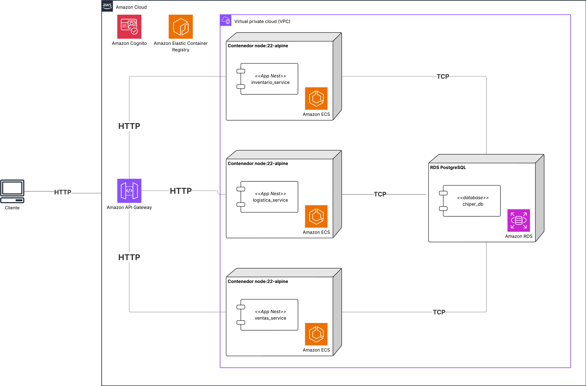

# Lab 6 — Aseguramiento de Microservicios con JWT: Secuestro de Token y Revocación Rápida

## 1. Índice

- [1. Índice](#1-índice)
- [2. Etapas del laboratorio](#2-etapas-del-laboratorio)
- [3. Objetivos](#3-objetivos)
- [4. Planeación del laboratorio](#4-planeación-del-laboratorio)
- [5. Ejecución del laboratorio](#5-ejecución-del-laboratorio)
- [6. Realización de pruebas](#6-realización-de-pruebas)
- [7. Entregables](#7-entregables)
- [Nota final (créditos AWS)](#nota-final-créditos-aws)

## 2. Etapas del laboratorio

| Etapa | Resumen | Uso de IA generativa |
| --- | --- | --- |
| 1. Experimento y ASRs de seguridad | Hipótesis de diseño, escenarios de calidad vinculados (ASRs), diseño y planeación del experimento sobre el incidente: el robo de una credencial (token) de un usuario. | Uso acotado para ordenar hipótesis; los umbrales deben ser propios. |
| 2. Arquitectura, tácticas y patrones | Validación de la credencial del usuario (un token en formato JWT) en la puerta de entrada y en los servicios, credenciales de vida corta y revocación desde el servicio de identidad de AWS (Cognito). | Recomendado para contrastar trade-offs (UX vs seguridad) y riesgos residuales. |
| 3. Preparación en AWS (IaC) | Despliegue reproducible con CloudFormation: microservicios, API Gateway y Cognito. | Recomendado para asistencia operativa; verifique manualmente en AWS. |
| 4. Implementación de seguridad (código) | Autenticación con JWT y autorización por rol en los microservicios (Nest). | Recomendado para soporte de implementación y revisión; validar manualmente. |
| 5. Ejecución del incidente y contención | Simular el robo de la credencial de larga duración (refresh token), revocarla y medir la ventana de exposición. | No recomendado para redactar conclusiones sin evidencia del experimento. |

## 3. Objetivos

- Implementar autenticación basada en **JWT** (*JSON Web Token*: una credencial firmada que el usuario envía en cada petición) en la arquitectura de microservicios de Cheapest, usando Amazon Cognito (el servicio de identidad de AWS) como emisor de esas credenciales.
- Mostrar el límite de que un JWT se valide sin consultar a nadie (*stateless*): un token de acceso comprometido no se puede invalidar al instante.
- Aplicar una táctica de contención práctica: tokens de acceso de vida corta (2–5 min) más la revocación del token de larga duración con el que se renuevan (el *refresh token*), o el cierre de todas las sesiones del usuario (*global sign-out*).
- Validar autorización por rol (RBAC, *Role-Based Access Control*) dentro de los microservicios y diferenciar las respuestas 401 (no autenticado) y 403 (autenticado pero sin permiso).
- Medir y reportar la ventana máxima de exposición del incidente.

## 4. Planeación del laboratorio

Hasta ahora los microservicios de Cheapest aceptaban cualquier petición: nadie verificaba quién la enviaba. En este laboratorio se agrega seguridad a la arquitectura del Lab 4 (API Gateway, tres microservicios en ECS y una base de datos RDS), y se estudia un incidente concreto: qué pasa cuando a un usuario le roban sus credenciales y qué tan rápido se puede contener el daño.

**Contexto de negocio.** Cheapest maneja información sensible y acciones de alto impacto (por ejemplo pedidos, devoluciones y notas crédito). Un secuestro de credenciales (por phishing, malware o filtración de tokens en herramientas) es un incidente realista: el atacante no necesita romper ningún cifrado, le basta con obtener un token válido.

**Conceptos que se presentan en este laboratorio.**

| Concepto | Qué es |
| --- | --- |
| Autenticación | Verificar **quién** hace la petición. |
| Autorización | Verificar **qué puede hacer** quien ya se autenticó. |
| Token | Credencial que el sistema le entrega al usuario cuando inicia sesión, y que el usuario presenta en cada petición en lugar de su contraseña. |
| JWT | *JSON Web Token*: formato de token compuesto por datos del usuario (llamados **claims**: quién es, a qué grupos pertenece, cuándo expira) y una **firma** digital del emisor. Está firmado, no cifrado: cualquiera que lo tenga puede leer su contenido, pero no modificarlo sin que la firma deje de ser válida. |
| Access token | Token de vida corta que viaja en cada petición, en el encabezado `Authorization: Bearer <token>`. Un servicio lo valida localmente, revisando la firma y la fecha de expiración, sin preguntarle a nadie. |
| Refresh token | Token de vida larga que **no** se usa para llamar a las APIs; solo sirve para pedir access tokens nuevos cuando el anterior expira. |
| TTL | *Time To Live*: tiempo de vida de un token. Al cumplirse, el token expira y deja de ser aceptado. |
| *Stateless* (sin estado) | Un servicio valida un JWT solo con la firma y la fecha de expiración, sin consultar una base de datos de sesiones. Por eso es rápido, y por eso mismo no hay forma de "apagar" un token que ya fue emitido. |
| Proveedor de identidad (IdP) | El sistema que conoce a los usuarios, verifica sus contraseñas y emite los tokens. |
| Amazon Cognito | El proveedor de identidad de AWS. Un **User Pool** es el directorio de usuarios; un **App Client** es la configuración con la que una aplicación pide tokens (incluye el TTL de cada token); los **grupos** agrupan usuarios (aquí, `admin` y `operador`) y viajan dentro del token en el claim `cognito:groups`. |
| Emisor y audiencia (`iss`, `aud`) | Claims que indican quién emitió el token y para qué aplicación. Un servicio debe verificar que coincidan con los que espera. |
| JWKS | Conjunto de llaves públicas que publica el emisor, con las que cualquier servicio puede verificar la firma de un token. |
| Revocación y *global sign-out* | Revocar un refresh token lo deja inservible para pedir access tokens nuevos. El global sign-out revoca todos los refresh tokens de un usuario. |
| RBAC | *Role-Based Access Control*: control de acceso por rol. Cada operación exige pertenecer a un grupo determinado. |
| 401 y 403 | `401 Unauthorized`: no se sabe quién es (falta el token o es inválido). `403 Forbidden`: se sabe quién es, pero no tiene permiso para esa operación. |
| JWT authorizer | Función de API Gateway que valida el JWT antes de dejar pasar la petición a los servicios. |
| Guard | Mecanismo de Nest que decide, antes de ejecutar un controlador, si la petición puede continuar. |
| Defensa en profundidad | Aplicar el mismo control en varias capas (aquí, en la puerta de entrada y en cada servicio), para que el fallo de una no deje el sistema desprotegido. |
| Ventana de exposición | Tiempo durante el cual un atacante puede seguir usando una credencial robada. |

**Cómo se usan los dos tokens (flujo mínimo).** El usuario inicia sesión y recibe un access token y un refresh token. Usa el access token para llamar a las APIs. Cuando el access token expira, usa el refresh token para obtener uno nuevo. Si se revoca el refresh token, se corta la emisión de tokens nuevos, pero el access token que ya estaba emitido sigue siendo válido hasta que expire.

> [!WARNING]
> Recuerde que un token JWT **no es un token cifrado**, solo **firmado**. Cualquiera que lo obtenga puede leer su contenido.

> [!IMPORTANT]
> **Pregunta 1:**
> Suponga que un atacante obtiene el refresh token de un usuario de Cheapest.
> ¿Qué puede hacer el atacante con un refresh token válido aunque usted cambie la contraseña del usuario?
> Responda en términos de “capacidad” y “ventana de tiempo”, no en definiciones.

### 4.1 Hipótesis de diseño

| # | Hipótesis |
| --- | --- |
| H1 | **Si** implementamos access tokens de vida corta (2–5 min) junto con la revocación del refresh token (o global sign-out) en Cognito, **entonces** un token secuestrado se contiene y se verifica en menos de 2 minutos desde la detección, y el atacante pierde todo acceso al expirar el access token vigente, **porque** la revocación corta la capacidad de re-emisión y el TTL corto acota el tiempo que sobrevive un access token ya emitido (JWT es *stateless* y no puede invalidarse antes de expirar). |
| H2 | **Si** validamos el JWT en el borde (API Gateway) y de nuevo en cada microservicio, y aplicamos RBAC por `cognito:groups`, **entonces** el 100% de los accesos indebidos se distingue por tipo de falla (sin token o token inválido → 401; token válido sin el grupo requerido → 403) y queda registrado, **porque** la autenticación (¿quién eres?) y la autorización (¿qué puedes hacer?) se evalúan en capas separadas, y cada capa produce su propio código de respuesta. |

### 4.2 Escenarios de calidad vinculados

| ID    | Descripción                                                                                                                                                                                                                                                                                                            |
| ----- | ---------------------------------------------------------------------------------------------------------------------------------------------------------------------------------------------------------------------------------------------------------------------------------------------------------------------- |
| ASR-1 | Como agente de servicio al usuario, dado que un token ha sido comprometido, quiero revocar rápidamente sesiones comprometidas para minimizar el impacto de un secuestro de credenciales. Esto debe suceder, desde detección, revocar y verificar contención en menos de 2 minutos                                      |
| ASR-2 | Como auditor, dado el sistema bajo prueba, quiero que los intentos de acceso indebido queden claramente diferenciados por tipo de falla para facilitar investigación y respuesta. Sin token: 401. Token válido sin grupo requerido: 403. Token inválido/tampered: 401 esto debe quedar registrado el 100% de las veces |


> [!IMPORTANT]
> **Pregunta 2:**
> Elija el tiempo de vida para access token y justifíquelo.
> Debe incluir: (1) ventana de exposición (tiempo que un token es válido), (2) impacto en la experiencia de usuario y operación, (3) impacto en costo/latencia, (4) justificación basada en el contexto de negocio de Cheapest.

### 4.3 Tácticas y patrones

#### 4.3.1 Patrones de diseño

| Patrón | Para qué se usa en este laboratorio |
| --- | --- |
| Proveedor de identidad externo | La gestión de usuarios, contraseñas y emisión de tokens se delega en Amazon Cognito. Los microservicios no guardan contraseñas: solo verifican tokens. |
| Access token más refresh token | Separa la credencial que viaja en cada petición (corta, de bajo riesgo) de la que permite renovarla (larga, que se puede revocar). |
| Autenticación en la puerta de entrada (*gateway authorizer*) | API Gateway valida el token antes de reenviar la petición, de modo que el tráfico inválido no llega a los servicios. |
| Guards y decoradores | En cada microservicio, un guard valida el token (`JwtAuthGuard`) y otro verifica el rol (`RolesGuard`); los decoradores `@Public()` y `@Roles(...)` declaran, sobre cada endpoint, qué protección aplica. |

#### 4.3.2 Tácticas de arquitectura

| Táctica                                                | Qué resuelve                                                     |
| ------------------------------------------------------ | ---------------------------------------------------------------- |
| Autenticación en el borde (API Gateway JWT authorizer) | Rechaza requests sin token/inválidos antes de llegar a servicios |
| Validación JWT en microservicios                       | Defensa en profundidad ante bypass del gateway                   |
| RBAC por grupo (`cognito:groups`)                      | Evita que un usuario ejecute acciones administrativas            |
| TTL corto + revocación refresh/global sign-out         | Contención rápida del incidente                                  |

##### Autenticación en el borde (API Gateway JWT authorizer)

**Qué hace**

- Rechaza requests **sin `Authorization: Bearer`** o con JWT inválido *antes* de enviar tráfico a ECS.
- Valida de forma “criptográfica” (firma) y “lógica” básica (issuer/audience/exp) usando el emisor (Cognito).
- Reduce carga y ruido operacional: evita que servicios paguen por requests claramente inválidas.

**Qué NO hace (riesgos residuales)**

- No invalida un access token robado “en caliente”: si el token es válido y no ha expirado, el gateway lo aceptará.
- No reemplaza la autorización fina dentro de servicios (p. ej. reglas de negocio por endpoint/rol/recurso).
- No cubre bypass internos (tráfico servicio a servicio, accesos directos al LB/servicio, errores de config o rutas sin authorizer).

**Trade-offs**

- Pro: caída temprana, menor latencia promedio para requests inválidas, menor costo/consumo en backend.
- Contra: riesgo de “falso sentido de seguridad” si los microservicios dejan de validar.

##### Validación del JWT en los microservicios (defensa en profundidad)

**Por qué existe si ya hay gateway**

En microservicios, el gateway es un control potente pero no infalible. La validación en servicio cubre:

- Rutas expuestas accidentalmente sin authorizer.
- Acceso directo a servicios.
- Requests internos o integraciones futuras (servicio a servicio) donde el gateway no esté en el medio.

**Validaciones mínimas recomendadas qué validar**

- Firma contra el JWKS de Cognito.
- `iss` (issuer) y `aud` (audience) correctos.
- `exp` y tolerancia de reloj (clock skew) acotada.
- `token_use`: asegurarse de que se trata de **access token** (no ID token).

Esto soporta el ASR-2: que cada intento de acceso indebido se diferencie de forma consistente por tipo de falla y quede registrado.

##### RBAC por grupo (`cognito:groups`)

**Qué hace**

- Restringe acciones por rol/grupo (p. ej. `admin`, `ops`, `tendero`) usando la claim `cognito:groups` presente en el access token.
- Permite que una misma API tenga endpoints públicos (health), autenticados (usuario) y privilegiados (admin) con reglas claras.

##### TTL corto más revocación del refresh token o global sign-out (contención)

JWT es “stateless”: una vez emitido, un access token firmado seguirá siendo aceptado por verificadores hasta que expire. Por eso, para contener un incidente realista:

- Hacemos el access token **de vida corta** (reduce exposición).
- Cortamos la **capacidad de re-emisión** revocando el refresh token o ejecutando global sign-out (corta sesiones).

**Qué resuelve**

- Si un atacante roba un refresh token, puede emitir access tokens nuevos por mucho tiempo. La revocación corta ese canal.
- Si un atacante ya tiene un access token vigente, el daño queda acotado por el TTL (minutos, no horas).

**Trade-offs**

- TTL más corto: mejor contención, pero más renovaciones y más sensibilidad a fallos del flujo de refresh.
- TTL más largo: menos fricción, pero peor seguridad (más minutos de acceso tras robo).

#### 4.3.3 Estilos aplicados

| Estilo | Análisis |
| --- | --- |
| Microservicios con API Gateway | Es la misma arquitectura del Lab 4. La puerta de entrada única permite aplicar la autenticación en un solo punto para todos los servicios. |
| Seguridad por capas (defensa en profundidad) | El token se valida dos veces, en API Gateway y en cada microservicio. Favorece la seguridad ante errores de configuración o accesos que no pasan por el gateway. Agrega algo de procesamiento a cada petición. |

### 4.4 Diseño del experimento

#### 4.4.1 ¿Cómo se va a validar la hipótesis?

- **Para la contención del incidente (H1):** se simula un incidente realista de secuestro de un refresh token, se aplica la contención desde Cognito y se miden los tiempos: cuándo se detecta, cuándo se revoca, cuándo se verifica que el atacante ya no puede renovar tokens y cuándo deja de funcionar el último access token que tenía.
- **Para la diferenciación de accesos indebidos (H2):** se ejecuta cada fila de la tabla de políticas de acceso con el token correcto, sin token, con un token inválido y con un rol insuficiente, y se verifica el código de respuesta y su registro en los logs.

#### 4.4.2 ¿Qué componentes se van a diseñar o modificar?

| Componente | Cambio |
| --- | --- |
| Amazon Cognito | User Pool, App Client, grupos (`admin`, `operador`) y TTL del access token. |
| API Gateway (HTTP API) | JWT authorizer en la puerta de entrada. |
| Librería `libs/shared/auth/` | `JwtAuthGuard` (401), `RolesGuard` (403), `@Public()`, `@Roles(...)` y `AuthLoggerMiddleware` en los microservicios. |

#### 4.4.3 ¿Qué métricas se van a medir?

| Métrica | Hipótesis / ASR | Umbral |
| --- | --- | --- |
| Tiempo entre detección, revocación y verificación de contención | H1 / ASR-1 | < 2 min |
| Ventana máxima de exposición (revocación + TTL restante del access token) | H1 / ASR-1 | ≤ TTL configurado |
| Código HTTP por caso de acceso indebido (sin token, token inválido, rol insuficiente) | H2 / ASR-2 | 401 / 401 / 403 |
| % de respuestas 401/403 registradas en CloudWatch | H2 / ASR-2 | 100% |

### 4.5 Planeación del experimento

#### 4.5.1 Recursos requeridos

| Recurso | Detalle |
| --- | --- |
| Infraestructura AWS | Stack de CloudFormation (Cognito, API Gateway, ECS/Fargate, RDS) desplegado en su cuenta, más los repositorios de ECR con las imágenes |
| Herramientas locales | AWS CLI, `curl` o Postman, `jq` (opcional, para extraer los tokens de las respuestas), Docker y el backend de la rama `cognito-auth` |
| Datos de prueba | Script de seed de la rama `cognito-auth` y los usuarios de prueba que usted cree en Cognito |
| Créditos AWS | Elimine el stack al terminar |

| Categoría | Tecnologías |
| --- | --- |
| Infraestructura como Código | AWS CloudFormation |
| Orquestación de contenedores | Amazon ECS (Fargate) |
| Gateway de entrada + autenticación | Amazon API Gateway (HTTP API) + JWT authorizer |
| Proveedor de identidad (IdP) / emisor de tokens | Amazon Cognito (User Pool, App Client) |
| Estándar de tokens | JWT (access token + refresh token) |

#### 4.5.2 Elementos de arquitectura involucrados

Amazon Cognito (emisor de tokens), API Gateway con JWT authorizer, microservicios de Logística, Inventario y Ventas con la librería de autenticación compartida, y CloudWatch Logs para la evidencia de las respuestas 401 y 403.



Amazon Cognito es un servicio administrado por AWS y es el único componente nuevo frente a la arquitectura del Lab 4.

#### 4.5.3 Esfuerzo estimado

Referencia para planear; puede variar según su experiencia con AWS.

| Etapa | Esfuerzo aprox. |
| --- | --- |
| Preparación de infraestructura con CloudFormation | 0,5 h |
| Revisión de la implementación de JWT y RBAC en los microservicios | 1 h |
| Pruebas de autenticación y autorización | 0,5 h |
| Incidente de secuestro de token y contención por revocación | 1 h |
| Análisis y entregables | 1 h |
| **Total** | **4 h-persona** |

## 5. Ejecución del laboratorio

Este laboratorio incluye un template de CloudFormation basado en la arquitectura del Lab 4, extendido con Cognito y un JWT authorizer.

### 5.1 Publicar las imágenes en ECR

Antes de desplegar, publique las imágenes Docker en ECR desde la rama `cognito-auth`.

Siga el [tutorial para subir imágenes a ECR](../tutoriales/subir_imagenes%20_a_ecr.md). Lo único que cambia para este laboratorio es:

- **Rama:** `cognito-auth`.
- **Imágenes:** se necesitan tres, una por microservicio (`logistica`, `inventario` y `ventas`). Repita los pasos del tutorial para cada una.
- **Repositorios:** `cheapest-logistica`, `cheapest-inventario` y `cheapest-ventas`.
- **Tag:** `1.0.0`.

### 5.2 Desplegar el stack

Desde la carpeta `lab_6/recursos/`:

Reemplace cada `<URI_ECR_...>` por la URI de la imagen que publicó para ese servicio (el formato de la URI se explica en el [paso 4 del tutorial de ECR](../tutoriales/subir_imagenes%20_a_ecr.md#8-paso-4-etiquetar-la-imagen-con-la-uri-de-ecr)):

```bash
aws cloudformation deploy \
  --stack-name Cheapest-lab6-jwt \
  --template-file cloudformation_template.yaml \
  --parameter-overrides \
    LogisticaImageUri=<URI_ECR_LOGISTICA> \
    InventarioImageUri=<URI_ECR_INVENTARIO> \
    VentasImageUri=<URI_ECR_VENTAS> \
    DBPassword=<PASSWORD>
```

Por ejemplo, con los repositorios y el tag `1.0.0` que acaba de publicar:

```bash
aws cloudformation deploy \
  --stack-name Cheapest-lab6-jwt \
  --template-file cloudformation_template.yaml \
  --parameter-overrides \
    LogisticaImageUri=<ACCOUNT_ID>.dkr.ecr.us-east-1.amazonaws.com/cheapest-logistica:1.0.0 \
    InventarioImageUri=<ACCOUNT_ID>.dkr.ecr.us-east-1.amazonaws.com/cheapest-inventario:1.0.0 \
    VentasImageUri=<ACCOUNT_ID>.dkr.ecr.us-east-1.amazonaws.com/cheapest-ventas:1.0.0 \
    DBPassword=<PASSWORD>
```

Al finalizar, guarde los **Outputs** del stack:

- `ApiGatewayUrl`
- `CognitoUserPoolId`
- `CognitoUserPoolClientId`
- `CognitoIssuerUrl`

El template deja el access token con un TTL de 5 minutos y el refresh token con un TTL de 1 día (parámetros `AccessTokenTtlMinutes` y `RefreshTokenTtlDays`).

### 5.3 Verificar el despliegue (health)

Los endpoints de health deben ser **públicos** para monitoreo:

- `GET <ApiGatewayUrl>/logistica/health`
- `GET <ApiGatewayUrl>/inventario/health`
- `GET <ApiGatewayUrl>/ventas/health`

### 5.4 Cargar datos base

La base de datos RDS de este stack se crea con `PubliclyAccessible: false`, por lo que no es alcanzable desde su computador. El procedimiento es el mismo de los laboratorios anteriores: hágala temporalmente pública y abra el puerto 5432 **solo para su IP**, corra el seed desde su máquina apuntando a la RDS real, y luego revierta ambos cambios.

```bash
# 1. Anote su IP pública actual
MY_IP=$(curl -s https://checkip.amazonaws.com)
echo $MY_IP

# 2. Identifique el Security Group de RDS del stack (tag Name: Cheapest-lab6-rds-sg)
SG_RDS_ID=$(aws ec2 describe-security-groups --filters Name=tag:Name,Values=Cheapest-lab6-rds-sg --query "SecurityGroups[0].GroupId" --output text)

# 3. Haga la instancia temporalmente pública
aws rds modify-db-instance --db-instance-identifier Cheapest-lab6-db --publicly-accessible --apply-immediately

# 4. Espere a que el cambio se aplique (puede tardar 1-2 minutos)
aws rds describe-db-instances --db-instance-identifier Cheapest-lab6-db --query "DBInstances[0].PubliclyAccessible"

# 5. Abra el puerto 5432 SOLO para su IP
aws ec2 authorize-security-group-ingress --group-id $SG_RDS_ID --protocol tcp --port 5432 --cidr ${MY_IP}/32

# 6. Corra el backend en local (rama cognito-auth) apuntando a la RDS real y sembrando datos
git checkout cognito-auth
npm install
DB_HOST=<RDS_ENDPOINT_DEL_STACK> DB_PORT=5432 DB_USER=postgres DB_PASSWORD=<SU_CONTRASEÑA> DB_NAME=Cheapest npm run db:seed
```

Al terminar, **revierta ambos cambios** para no dejar la base expuesta:

```bash
aws rds modify-db-instance --db-instance-identifier Cheapest-lab6-db --no-publicly-accessible --apply-immediately
aws ec2 revoke-security-group-ingress --group-id $SG_RDS_ID --protocol tcp --port 5432 --cidr ${MY_IP}/32
```

### 5.5 Revisar la implementación de seguridad en los microservicios

> El código vive en la rama `cognito-auth` del repositorio `Cheapest-api`.

#### Arquitectura de la implementación

Se agregó una librería compartida `libs/shared/auth/` con los siguientes componentes:

| Componente | Archivo | Responsabilidad |
| --- | --- | --- |
| `CognitoAuthModule` | `auth.module.ts` | Módulo global; registra todos los providers |
| `CognitoJwtService` | `cognito-jwt.service.ts` | Verifica JWT contra el JWKS de Cognito (firma, `iss`, `token_use`, `exp`) |
| `JwtAuthGuard` | `guards/jwt-auth.guard.ts` | Extrae y valida el token; devuelve **401** si falta o es inválido |
| `RolesGuard` | `guards/roles.guard.ts` | Verifica `cognito:groups`; devuelve **403** si el rol no coincide |
| `@Public()` | `decorators/public.decorator.ts` | Marca rutas sin autenticación (health checks) |
| `@Roles(...)` | `decorators/roles.decorator.ts` | Restringe un endpoint a grupos de Cognito específicos |
| `AuthLoggerMiddleware` | `middleware/auth-logger.middleware.ts` | Loguea el 100 % de respuestas 401/403 (ASR-2) |

Los guards se aplican **globalmente** en el `main.ts` de cada microservicio vía `useGlobalGuards`.
Las rutas de health tienen `@Public()` a nivel de clase, por lo que no requieren token.

#### Variables de entorno requeridas

Agregar al archivo `.env` de cada microservicio (ver `.env.example`):

| Variable | Descripción | Fuente |
| --- | --- | --- |
| `COGNITO_USER_POOL_ID` | ID del User Pool | Output `CognitoUserPoolId` del stack CF |
| `COGNITO_REGION` | Región AWS | Output `CognitoIssuerUrl` (prefijo región) |
| `COGNITO_CLIENT_ID` | App Client ID | Output `CognitoUserPoolClientId` del stack CF |

#### Tabla de políticas de acceso

Las rutas están escritas como se invocan **a través del API Gateway** (`<ApiGatewayUrl>` + ruta). El gateway traduce el prefijo de cada servicio a la ruta interna del contenedor: `/logistica/{proxy+}` → `/logistics/{proxy}`, `/inventario/{proxy+}` → `/inventory/{proxy}` y `/ventas/{proxy+}` → `/ventas/{proxy}`. Si prueba directo contra el ALB o el contenedor, use la ruta interna (por ejemplo `/logistics/pedidos`).

| Endpoint (vía API Gateway) | Método | Protección | Rol requerido | 200 | 401 | 403 |
| --- | --- | --- | --- | --- | --- | --- |
| `/logistica/health` | GET | Público | — | ✓ | — | — |
| `/inventario/health` | GET | Público | — | ✓ | — | — |
| `/ventas/health` | GET | Público | — | ✓ | — | — |
| `/ventas/ventas` | POST | JWT | `admin` o `operador` | ✓ | sin token / inválido | otro rol |
| `/ventas/ventas` | GET | JWT | `admin` o `operador` | ✓ | sin token / inválido | otro rol |
| `/ventas/ventas/:id` | DELETE | JWT | solo `admin` | ✓ | sin token / inválido | `operador` sin `admin` |
| `/logistica/pedidos` | POST | JWT | `admin` o `operador` | ✓ | sin token / inválido | otro rol |
| `/logistica/pedidos/:id` | DELETE | JWT | solo `admin` | ✓ | sin token / inválido | `operador` sin `admin` |

#### Cómo encajan las piezas

1. El stack de CloudFormation crea el User Pool de Cognito, el App Client y el JWT authorizer de API Gateway, y entrega sus identificadores en los Outputs.
2. Cada microservicio recibe esos identificadores por variables de entorno.
3. Los guards validan el JWT localmente (sin llamar a Cognito en cada petición) usando las llaves públicas de Cognito (JWKS), que guardan en caché.
4. API Gateway también valida el token en la puerta de entrada: es la doble capa de seguridad.

> [!IMPORTANT]
> **Pregunta 3:**
> ¿Por qué es peligroso devolver 403 cuando el token está ausente o es inválido?
> Relacione su respuesta con enumeración de endpoints y debugging operacional.

### 5.6 Crear los usuarios de prueba e iniciar sesión

Los comandos están en [`recursos/auth_cli.md`](recursos/auth_cli.md). Siga sus tres primeros pasos:

1. Cree un usuario de prueba en Cognito y asígnele una contraseña permanente. Asígnelo al grupo `operador`.
2. Cree un segundo usuario y asígnelo al grupo `admin`, y un tercero **sin grupo**. Los necesitará para probar la autorización por rol.
3. Inicie sesión con cada usuario y guarde su `ACCESS_TOKEN` y su `REFRESH_TOKEN`.
4. Pruebe un endpoint protegido con el `ACCESS_TOKEN` del usuario `operador`: `POST <ApiGatewayUrl>/ventas/ventas` debe responder con éxito.

## 6. Realización de pruebas

En la sección anterior dejó desplegado el stack, revisó cómo está implementada la seguridad y creó los usuarios de prueba. Aquí se explica qué puede modificar para ampliar o reducir la exposición del sistema, y qué pruebas debe ejecutar.

### 6.1 Puntos de sensibilidad

| Punto de sensibilidad | Dónde se modifica | Efecto esperado |
| --- | --- | --- |
| **TTL del access token** | Parámetro `AccessTokenTtlMinutes` del template (por defecto 5). Vuelva a ejecutar `aws cloudformation deploy` agregando `AccessTokenTtlMinutes=<minutos>` a `--parameter-overrides`. También puede cambiarse en la consola: Cognito → su User Pool → *App clients* → su App Client → *Edit* → *Access token expiration*. | Es el punto de sensibilidad principal: define cuánto sobrevive un access token robado después de la revocación. Más corto: menor ventana de exposición, pero más renovaciones. |
| **TTL del refresh token** | Parámetro `RefreshTokenTtlDays` del template (por defecto 1). | Define cuánto tiempo puede un atacante seguir renovando tokens si nadie detecta el robo. |
| **Mecanismo de contención** | Comando que se ejecuta ante el incidente: revocar un refresh token (`aws cognito-idp revoke-token`) o cerrar todas las sesiones del usuario (`aws cognito-idp admin-user-global-sign-out`). | Revocar un token corta solo esa sesión; el global sign-out corta todas, incluidas las legítimas del usuario. |
| **Grupo del usuario** | Cognito: `aws cognito-idp admin-add-user-to-group` y `admin-remove-user-from-group`. El cambio aparece en el siguiente token que se emita, no en los ya emitidos. | Determina qué operaciones puede ejecutar (RBAC). |
| **Rol exigido por un endpoint** | Decorador `@Roles(...)` sobre el método del controlador, en el código del microservicio. | Un rol demasiado amplio da más permisos de los necesarios. |
| **Capas que validan el token** | Authorizer de la ruta en API Gateway y guard global (`JwtAuthGuard`) de cada microservicio. | Si una ruta queda sin authorizer en el gateway, la única defensa es el guard del servicio. |

> [!NOTE]
> Los tokens que ya fueron emitidos conservan el TTL con el que nacieron. Si cambia el TTL, vuelva a iniciar sesión para obtener tokens con el valor nuevo.

### 6.2 Prueba de autenticación y autorización por rol

Para **cada fila** de la tabla de políticas de acceso, envíe la petición en estos cuatro casos y anote el código HTTP obtenido:

| Caso | Cómo se construye | Código esperado |
| --- | --- | --- |
| Token correcto | Encabezado `Authorization: Bearer <ACCESS_TOKEN>` de un usuario con el rol requerido. | `200` o `201` |
| Sin token | La misma petición sin el encabezado `Authorization`. | `401` |
| Token inválido | Tome un access token válido y cambie uno de sus caracteres antes de enviarlo. | `401` |
| Rol insuficiente | Access token de un usuario que no pertenece al grupo requerido (por ejemplo, el usuario sin grupo, o el `operador` sobre un endpoint que exige `admin`). | `403` |

Ejemplo, para el caso sin token:

```bash
curl -i -X POST "<ApiGatewayUrl>/ventas/ventas" \
  -H "Content-Type: application/json" \
  -d '{"items":[{"productoId":"aaaaaaaa-aaaa-4aaa-8aaa-aaaaaaaaaaaa","cantidad":1}]}'
```

Después de las pruebas, busque en CloudWatch los registros del `AuthLoggerMiddleware`: consola de CloudWatch → **Log groups** → el grupo de logs del microservicio que recibió la petición → abra el flujo de logs más reciente. Verifique que **cada** respuesta 401 y 403 que provocó quedó registrada. Tenga en cuenta que las peticiones sin token o con token inválido las rechaza API Gateway antes de que lleguen al microservicio: analice qué queda registrado en cada capa.

### 6.3 El incidente: secuestro del refresh token

Este ejercicio simula que un atacante obtiene el **refresh token** de un usuario. Use el usuario `operador` y los comandos de [`recursos/auth_cli.md`](recursos/auth_cli.md):

1. Inicie sesión de nuevo con el usuario y guarde `ACCESS_TOKEN` y `REFRESH_TOKEN`. Anote la hora.
2. Como "atacante", use el `REFRESH_TOKEN` para emitir un access token nuevo, y repítalo varias veces: cada vez obtiene un access token distinto y válido.
3. Con cada access token del atacante, llame al endpoint protegido `POST <ApiGatewayUrl>/ventas/ventas` y confirme que responde con éxito.

> [!IMPORTANT]
> **Pregunta 4:**
> Si el refresh token ya fue robado, ¿qué cambia (y qué NO cambia) si el usuario hace logout en el front-end?

### 6.4 La contención: revocación rápida

Suponga que en este momento se detecta el robo. Anote la **hora de detección** y aplique la contención desde Cognito:

1. Revoque el refresh token (`aws cognito-idp revoke-token`) y anote la **hora de revocación**.
2. Verifique que el refresh token ya no permite emitir access tokens nuevos (el comando de renovación debe fallar) y anote la **hora de verificación**.
3. Verifique que el último access token que obtuvo el atacante **sigue funcionando**: llame al endpoint protegido cada 30 segundos, hasta que responda 401. Anote la hora en que deja de funcionar.

Registre:

- Hora de detección
- Hora de revocación
- Hora de verificación
- TTL configurado del access token
- Hora en que el último access token del atacante dejó de funcionar
- Ventana máxima de exposición observada (desde la detección hasta que ese access token dejó de funcionar)

**Variación.** Repita el incidente y la contención cambiando **un** punto de sensibilidad y compare la ventana de exposición: por ejemplo, despliegue de nuevo con `AccessTokenTtlMinutes=2`, o use el global sign-out en lugar de revocar el refresh token.

## 7. Entregables

Entregue un informe organizado con los siguientes numerales.

### 7.1 Resultados

#### 7.1.1 ¿Qué se observó?

Describa, sin interpretar todavía:

- Qué respondió el sistema en cada uno de los cuatro casos de la prueba de autenticación y autorización (token correcto, sin token, token inválido y rol insuficiente), y qué quedó registrado en los logs de cada capa.
- Qué pudo hacer el "atacante" con el refresh token robado antes de la contención.
- Qué pasó inmediatamente después de revocar: con el refresh token y con el access token que el atacante ya tenía.
- Qué cambió en la variación que ejecutó (otro TTL u otro mecanismo de contención).

#### 7.1.2 ¿Qué métricas se obtuvieron?

**Tabla de políticas y códigos obtenidos** (mínimo 6 filas): para cada endpoint, el método, si es público o protegido, el rol requerido y el código que obtuvo en cada caso.

| Endpoint | Método | Protección | Rol requerido | Token correcto | Sin token | Token inválido | Rol insuficiente | ¿Quedó registrado el 401/403? |
| --- | --- | --- | --- | --- | --- | --- | --- | --- |
| | | | | | | | | |

**Tiempos del incidente:**

| Medida | Corrida base | Variación (indique qué cambió) |
| --- | --- | --- |
| TTL configurado del access token | | |
| Mecanismo de contención usado | | |
| Hora de detección | | |
| Hora de revocación | | |
| Hora de verificación (el refresh token ya no sirve) | | |
| Tiempo entre detección y verificación de la contención | | |
| Hora en que el último access token del atacante dejó de funcionar | | |
| Ventana máxima de exposición observada | | |

### 7.2 Análisis de resultados

#### 7.2.1 ¿Qué significan los datos frente al escenario de calidad?

- **ASR-1** (detectar, revocar y verificar la contención en menos de 2 minutos): ¿se cumplió? ¿Qué parte del tiempo dependió de la persona y cuál del sistema?
- **Ventana de exposición:** calcule la ventana máxima teórica (tiempo de contención más TTL del access token) y compárela con la que observó. ¿De qué parámetro depende principalmente?
- **ASR-2** (cada acceso indebido se diferencia por tipo de falla, 401 o 403, y queda registrado el 100% de las veces): ¿se cumplió en todas las filas? Si alguna respuesta no quedó registrada donde esperaba, explique en qué capa se rechazó la petición.
- ¿Cómo cambió la ventana de exposición en la variación, y qué costo tuvo ese cambio para un usuario legítimo?

#### 7.2.2 ¿Se cumple la hipótesis?

Para cada hipótesis indique si se cumple, se cumple parcialmente o no se cumple, y con qué dato lo sustenta:

- H1: con access tokens de vida corta y revocación del refresh token, un token secuestrado se contiene y se verifica en menos de 2 minutos desde la detección, y el atacante pierde todo acceso cuando expira el access token vigente.
- H2: validando el JWT en la puerta de entrada y en cada microservicio, y aplicando RBAC por grupo, el 100% de los accesos indebidos se distingue por tipo de falla (401 o 403) y queda registrado.

### 7.3 Conclusión

#### 7.3.1 ¿Qué se aprendió del experimento?

Más allá de si la contención funcionó: ¿qué aprendió sobre el costo de que un token se valide sin consultar a nadie? ¿Qué es lo que **no** se puede lograr con revocación y TTL corto, y qué haría falta para lograrlo?

### 7.4 Decisión arquitectónica

#### 7.4.1 ¿Qué se decide?

Indique si **adopta, modifica o descarta** el esquema evaluado (JWT validado en API Gateway y en los microservicios, RBAC por grupos de Cognito, access token de vida corta y revocación del refresh token) para Cheapest. Incluya el **TTL del access token que decide adoptar** y su justificación, coherente con la ventana de exposición que midió.

#### 7.4.2 ¿Qué cambios se hacen a la arquitectura?

Describa qué cambia en la arquitectura de Cheapest: qué componentes se agregan, qué responsabilidad queda en la puerta de entrada y cuál en cada servicio, y qué proceso operativo de respuesta a incidentes hay que definir (quién revoca, con qué comando y cómo se verifica). Si su decisión fue modificar el esquema, indique qué agregaría para reducir el riesgo residual.

### 7.5 Respuestas a las preguntas orientadoras

Incluya las respuestas argumentadas a las cuatro preguntas planteadas a lo largo del laboratorio. Deben ir más allá de lo superficial. Se repiten aquí para que no tenga que buscarlas:

- **Pregunta 1.** Suponga que un atacante obtiene el refresh token de un usuario de Cheapest. ¿Qué puede hacer el atacante con un refresh token válido aunque usted cambie la contraseña del usuario? Responda en términos de "capacidad" y "ventana de tiempo", no en definiciones.
- **Pregunta 2.** Elija el tiempo de vida para el access token y justifíquelo. Debe incluir: (1) la ventana de exposición (tiempo que un token es válido), (2) el impacto en la experiencia de usuario y en la operación, (3) el impacto en costo y latencia, y (4) una justificación basada en el contexto de negocio de Cheapest.
- **Pregunta 3.** ¿Por qué es peligroso devolver 403 cuando el token está ausente o es inválido? Relacione su respuesta con la enumeración de endpoints y con la depuración operacional.
- **Pregunta 4.** Si el refresh token ya fue robado, ¿qué cambia (y qué NO cambia) si el usuario cierra sesión en el front-end?

### 7.6 Evidencias

- **Verificación de JWT y RBAC:** para cada fila de su tabla de políticas, la petición real con el código obtenido (éxito con el rol correcto, 401 sin token o con token inválido, 403 con un rol insuficiente) y los logs de CloudWatch del `AuthLoggerMiddleware` registrando esos 401 y 403.
- **Evidencia del incidente:**
  - Inicio de sesión del usuario de prueba (obtención de `ACCESS_TOKEN` y `REFRESH_TOKEN`).
  - Peticiones exitosas usando el refresh token (antes de revocar).
  - Fallo de la renovación tras revocar (error devuelto por Cognito).
  - Petición fallida después de expirar el access token (401).
- Stack de CloudFormation en estado `CREATE_COMPLETE` y el User Pool de Cognito con sus usuarios y grupos.

### 7.7 Formato de entrega

Un informe en PDF o Word con los numerales de resultados, análisis de resultados, conclusión, decisión arquitectónica, respuestas a las preguntas orientadoras y evidencias.

> [!IMPORTANT]
> **¿A dónde se suben los entregables?**
> A la Actividad correspondiente en el aula de Bloque Neón de su sección.

## Nota final (créditos AWS)

Al terminar, elimine el stack para evitar costos:

```bash
aws cloudformation delete-stack --stack-name Cheapest-lab6-jwt
```
