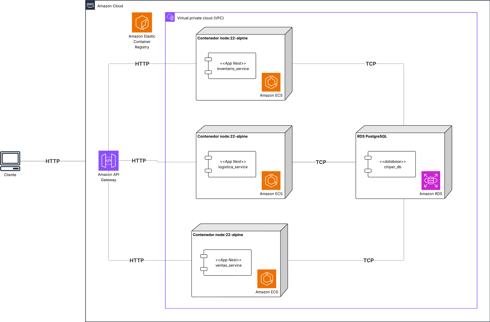

# Lab 7 — Limitaciones de los Microservicios Orientados a Conexión: Fan-out y Latencia compuesta

## 1. Índice

- [1. Índice](#1-índice)
- [2. Etapas del laboratorio](#2-etapas-del-laboratorio)
- [3. Objetivos](#3-objetivos)
- [4. Planeación del laboratorio](#4-planeación-del-laboratorio)
- [5. Ejecución del laboratorio](#5-ejecución-del-laboratorio)
- [6. Realización de pruebas](#6-realización-de-pruebas)
- [7. Entregables](#7-entregables)
- [Nota final (créditos AWS)](#nota-final-créditos-aws)

## 2. Etapas del laboratorio

| Etapa | Resumen | Uso de IA generativa |
| --- | --- | --- |
| 1. Experimento y ASRs | Hipótesis de diseño, escenarios de calidad vinculados (ASRs), diseño y planeación del experimento sobre un servicio que, para responder, llama a otros servicios y espera sus respuestas (orquestación síncrona), y sus criterios de quiebre. | Uso acotado para ordenar hipótesis; la priorización de ASRs debe ser propia. |
| 2. Análisis arquitectónico | Evaluación del patrón de orquestación síncrona: cómo multiplica la carga sobre los servicios a los que llama (fan-out) y cómo acumula sus tiempos de respuesta (latencia compuesta). | Recomendado para contrastar trade-offs y construir los modelos cuantitativos. |
| 3. Despliegue en AWS | Publicación de imágenes desde la rama `microservices-2` y configuración de los servicios en ECS y de API Gateway. | Recomendado para asistencia operativa con verificación manual en AWS. |
| 4. Pruebas de carga en tres fases | Cada servicio por separado → el servicio orquestador bajo carga → el orquestador con uno de los servicios a los que llama con menos capacidad. | Recomendado para automatizar experimentos y documentar métricas por fase. |
| 5. Interpretación y entregables | Análisis de fan-out, latencia compuesta y quiebre de ASRs. | No recomendado para generar conclusiones sin evidencia cuantitativa propia. |

## 3. Objetivos

- Identificar el punto de quiebre de un endpoint que **orquesta** varios microservicios de forma síncrona: para responder, llama a otros servicios por HTTP y espera la respuesta de cada uno.
- Cuantificar dos efectos de ese patrón: la **latencia compuesta** (los tiempos de respuesta de los servicios llamados se suman) y la **amplificación de carga** o *fan-out* (cada petición al orquestador genera varias peticiones a otros servicios).
- Comparar el comportamiento bajo carga del endpoint orquestado frente a los servicios individuales y evidenciar la diferencia entre la suma de p99 individuales y el p99 real del orquestador.
- Reflexionar sobre las limitaciones estructurales del patrón de orquestación síncrona y su impacto en los ASRs de Cheapest.

---

## 4. Planeación del laboratorio

En el Lab 4 usted desplegó Cheapest como tres microservicios y midió endpoints que vivían dentro de un solo servicio. En el Lab 5 estudió qué pasa cuando un servicio del que otro depende **falla**. En este laboratorio no falla nada: todos los servicios funcionan, pero uno de ellos necesita los datos de los otros dos para responder. El experimento muestra que esa forma de componer servicios tiene un límite propio, que aparece solo con la carga.

**Contexto de negocio.**

Los tenderos de Cheapest necesitan una vista consolidada del estado de su tienda para tomar decisiones de reabastecimiento: qué hay en catálogo (Logística), cuánto stock tienen (Inventario) y cuánto han vendido recientemente (Ventas). En un diseño de microservicios orientado a conexión, la forma más directa de entregar esta vista es que el servicio de Ventas llame síncronamente a Logística y a Inventario, consolide los datos y responda.

Este patrón —conocido como **orquestación síncrona**— parece simple y funciona bien a escala baja. El problema emerge bajo carga: la latencia del endpoint consolidado no es el promedio de los tiempos individuales sino su suma. A medida que los servicios dependientes se saturan, cada cola se acumula independientemente, haciendo que el p99 del orquestador se dispare mucho más rápido que el de cualquier servicio individual.

El endpoint nuevo `GET /ventas/resumen-operativo` implementa este patrón: llama secuencialmente a Logística y a Inventario con un **timeout de 8 segundos por llamada**, luego consulta su propia base de datos. El timeout alto es intencional: en microservicios reales, los timeouts generosos son una práctica común para evitar rechazar peticiones válidas en momentos de carga pico. Este laboratorio demuestra que esa configuración, combinada con orquestación síncrona, puede llevar al sistema a un punto de quiebre sin que ningún servicio falle individualmente.

**Conceptos que se presentan en este laboratorio.** Cada uno se desarrolla, con sus fórmulas, en la parte de tácticas y patrones.

| Concepto | Qué es |
| --- | --- |
| Microservicios orientados a conexión | Microservicios que se comunican llamándose directamente entre sí (aquí, por HTTP) y esperando la respuesta. |
| Orquestación síncrona | Patrón en el que un servicio (el **orquestador**) atiende una petición llamando a otros servicios, esperando la respuesta de cada uno y combinando los resultados. |
| Servicio dependiente | Cada uno de los servicios a los que llama el orquestador. |
| Fan-out | Número de peticiones a servicios dependientes que genera cada petición al orquestador. |
| Latencia compuesta (*compounding*) | La latencia del orquestador se construye con las latencias de sus dependientes: si los llama uno tras otro, se suman. |
| Acoplamiento temporal | El orquestador solo puede responder si todos sus dependientes están disponibles y responden a tiempo **en ese mismo momento**. |
| Utilización ($\rho$) | Fracción de la capacidad de un servicio que está en uso: la tasa a la que le llegan peticiones dividida por la tasa a la que puede atenderlas. |
| Saturación | Estado de un servicio cuya utilización se acerca a 1: las peticiones empiezan a hacer fila y la latencia crece de forma desproporcionada. |

### 4.1 Hipótesis de diseño

| # | Hipótesis |
| --- | --- |
| H1 | **Si** implementamos el resumen operativo como orquestación síncrona por HTTP (Ventas llama a Logística e Inventario en cada petición), **entonces** el endpoint viola ASR-1 (p99 < 2000 ms) a cargas donde cada servicio individual sí lo cumple, **porque** la latencia del orquestador es la suma de las latencias de sus dependientes y el fan-out ($F = L \times N$) acelera la saturación ($\rho_i \to 1$) de cada uno. |
| H2 | **Si** el orquestador mantiene timeouts generosos (8 s por llamada) durante un pico de demanda (5000 req/min), **entonces** el error % supera el umbral de ASR-2 (≤ 10%), **porque** las peticiones lentas ocupan recursos del orquestador durante todo el timeout y la cola se propaga hacia el cliente. |
| H3 | **Si** reducimos la capacidad de un servicio dependiente (Inventario con 1 tarea ECS) sin apagarlo, **entonces** el error % del endpoint orquestado excede el 30% de ASR-3, **porque** el acoplamiento temporal hace que la disponibilidad del orquestador dependa de la disponibilidad simultánea de todos sus dependientes. |

> Este laboratorio busca **refutar** el patrón de orquestación síncrona: se espera que los resultados muestren que la arquitectura, por sí sola, produce el punto de quiebre. Durante el laboratorio se le pedirá proponer una alternativa, y esa alternativa se implementa en el Lab 8.

### 4.2 Escenarios de calidad vinculados

| ID | Descripción | Métrica a satisfacer |
| --- | --- | --- |
| ASR-1 | Como tendero, quiero consultar el resumen operativo de mi tienda en un tiempo razonable para tomar decisiones de reabastecimiento. | p99 < 2000 ms durante operación normal (500 req/min) |
| ASR-2 | Como COO, quiero mantener una baja tasa de error incluso durante eventos de alta demanda para no perder operaciones de tenderos. | Error % ≤ 10% durante pico (5000 req/min) |
| ASR-3 | Como tendero, quiero que si uno de los servicios de Cheapest está lento, mi consulta del resumen de tienda siga respondiendo sin fallar por completo. | Con 1 servicio dependiente degradado (desired count reducido a 1 tarea ECS), error % del endpoint orquestado ≤ 30% |

### 4.3 Tácticas y patrones

#### 4.3.1 Patrones de diseño

El único patrón que se agrega es la **orquestación síncrona**: el nuevo endpoint `GET /ventas/resumen-operativo` del servicio de Ventas llama a Logística y luego a Inventario, espera cada respuesta, consulta su propia base de datos y combina todo en una sola respuesta. Las llamadas las hacen clientes HTTP dedicados con tiempo de espera configurable, como los que conoció en la migración a microservicios del Lab 4.

Lo que sigue es el modelo cuantitativo de ese patrón. Lo usará para **predecir** a qué carga se rompe el endpoint antes de medirlo.

El **fan-out** describe cuántas peticiones a servicios dependientes genera cada petición al orquestador. La **latencia compuesta** describe cómo las distribuciones de tiempo de respuesta se acumulan en una cadena síncrona. Estas dos propiedades son las razones estructurales por las que el patrón de orquestación síncrona tiene un límite de escalabilidad más bajo que la suma de sus partes.

##### Fan-out de carga

Sea $L$ la tasa de peticiones al orquestador (req/s) y $N$ el número de servicios dependientes que llama síncronamente:

$$F = L \times N$$

Donde $F$ es la carga total adicional generada sobre los servicios dependientes. Si el orquestador recibe 100 req/s y llama a 2 servicios dependientes, cada uno recibe 100 req/s adicionales **por cada** unidad de carga del orquestador.

> Si los servicios dependientes también reciben tráfico directo de otros clientes, la carga efectiva sobre ellos es $L_{\text{dep}} = L_{\text{directo}} + L_{\text{orquestador}}$.

##### Latencia secuencial esperada

Para llamadas secuenciales, la latencia total mínima del orquestador es:

$$T_{\text{orquestado}} \geq \sum_{i=1}^{N} T_i + (N-1) \cdot \delta_{\text{red}}$$

Donde $T_i$ es el tiempo de respuesta del servicio $i$ y $\delta_{\text{red}}$ es el overhead de red por salto (generalmente 1–5 ms en AWS dentro de la misma VPC).

##### Efecto del fan-out sobre la latencia bajo carga

Cuando el orquestador genera carga adicional sobre los servicios dependientes, la latencia de cada uno aumenta por efecto de cola.

$$T_{i,\text{cargado}} \approx \frac{T_{i,\text{baseline}}}{1 - \rho_i}$$

Donde $\rho_i = \lambda_i / \mu_i$ es la utilización del servicio $i$ ($\lambda_i$ = tasa de llegada, $\mu_i$ = capacidad de servicio). Cuando $\rho_i \to 1$, la latencia crece de forma no lineal hacia el infinito.

Como el orquestador incrementa $\lambda_i$ para cada servicio dependiente, **acelera el aumento de $\rho_i$** y, con él, la degradación de latencia.

##### Compounding de percentiles de latencia

El p99 del orquestador bajo carga es **siempre mayor** que la suma de los p99 individuales, ya que las distribuciones de cola no se suman linealmente:

$$p99_{\text{orquestado}} \geq \sum_{i=1}^{N} p99_i$$

En la práctica, bajo carga sostenida, la brecha entre el p99 orquestado y la suma de p99 individuales crece porque las colas en cada servicio se correlacionan temporalmente: cuando el orquestador está bajo pico, todos sus servicios dependientes lo están simultáneamente.

> **Resumen práctico:** con $N=2$ servicios dependientes y $p99_{\text{individual}} = 200\,\text{ms}$ en baseline, el p99 orquestado en baseline es $\geq 400\,\text{ms}$. Bajo carga donde $\rho \approx 0.7$ en cada servicio dependiente, $T_{\text{cargado}} \approx \frac{200}{1-0.7} = 667\,\text{ms}$ por servicio, y el p99 orquestado supera los $1334\,\text{ms}$ — violando ASR-1 antes de llegar a estrés fuerte.

> [!IMPORTANT]
> **Pregunta 1:**
> Antes de ejecutar las pruebas sobre el endpoint orquestado, estime numéricamente, con las fórmulas de fan-out y de latencia bajo carga que acaba de leer, a qué carga en req/s espera que se viole el ASR-1 (p99 del resumen operativo < 2000 ms).
> Para su estimación use los p99 individuales que mida en la primera fase de las pruebas (cada servicio por separado).
> Compare luego su estimación con el resultado real y explique la diferencia.

#### 4.3.2 Tácticas de arquitectura

Este laboratorio no aplica tácticas nuevas. La tabla resume las tácticas que usted ya conoce y por qué ninguna resuelve el problema estructural del patrón:

| Táctica | ¿Por qué no resuelve el problema estructural? |
| --- | --- |
| Escalamiento horizontal de ECS (servicios dependientes) | Reduce $\rho_i$ y mejora latencia individual, pero el fan-out sigue multiplicando la carga: escalar los servicios dependientes no elimina el compounding de p99. |
| Timeouts más cortos en el orquestador | Reduce la latencia máxima pero aumenta el error %: cambiar el síntoma no corrige la causa. |
| Retry en el orquestador | Amplifica el fan-out: con 1 reintento, $F = L \times N \times 2$. Empeora la saturación de los servicios dependientes. |
| Cacheo de respuestas de servicios dependientes | Mitiga el fan-out para datos que toleran staleness, pero los datos de stock e inventario requieren consistencia reciente en Cheapest. |
| Circuit breaker en un sidecar (lo que hizo en el Lab 5) | Protege al orquestador de un servicio dependiente caído, pero no reduce la latencia compuesta cuando todos funcionan. Solo cambia el problema de latencia por una respuesta degradada. |

> [!IMPORTANT]
> **Pregunta 3:**
> Proponga **una alternativa arquitectónica** al patrón de orquestación síncrona que permita entregar el resumen operativo a los tenderos con p99 < 500 ms, sin necesidad de que Ventas llame síncronamente a Logística e Inventario en el momento de la petición.
> Analice los trade-offs de su propuesta en términos de consistencia de datos, complejidad operativa y costo de implementación para Cheapest.

#### 4.3.3 Estilos aplicados

| Estilo | Análisis |
| --- | --- |
| Microservicios | Favorece desacoplamiento operativo y escalamiento independiente.<br>Sin embargo, la comunicación HTTP síncrona entre servicios introduce acoplamiento temporal: la disponibilidad del orquestador depende de la disponibilidad **simultánea** de todos sus servicios dependientes. |
| API Gateway | Actúa como punto de entrada centralizado y permite observar el tráfico agregado.<br>No puede distinguir el tráfico de fan-out generado por el orquestador del tráfico directo; esto dificulta el diagnóstico de saturación. |
| Orquestación síncrona | Favorece consistencia de la respuesta al momento de la petición (los datos son actuales).<br>Desfavorece latencia, throughput y resiliencia: el orquestador hereda el p99 más alto de todos sus servicios dependientes y cualquier fallo en cascada. |

### 4.4 Diseño del experimento

#### 4.4.1 ¿Cómo se va a validar la hipótesis?

Midiendo primero cada servicio de forma aislada (la referencia), aplicando después la misma matriz de carga al endpoint orquestado y comparando el resultado con la predicción del modelo de fan-out. Finalmente se reduce la capacidad de un servicio dependiente para evaluar el ASR-3. El experimento tiene tres fases progresivas:

**Fase 1 — Baseline por servicio individual**
Medir p99, p95, throughput y error % de cada servicio de forma aislada con la misma matriz de carga. Esto establece la referencia para verificar la fórmula de fan-out.

**Fase 2 — Carga sobre el endpoint orquestado**
Aplicar la misma matriz de carga sobre `GET /ventas/resumen-operativo`. Comparar el p99 real del orquestador con la predicción de la fórmula. Identificar en qué escenario de carga se viola ASR-1.

**Fase 3 — Servicio dependiente degradado**
Reducir el `desired count` de Inventario a 1 tarea en ECS (sin apagarlo, sin inyectar fallos). Observar cómo esta reducción de capacidad impacta el error % del endpoint orquestado. Verificar si ASR-3 se cumple.

> [!IMPORTANT]
> **Pregunta 2:**
> ¿Por qué reducir el `desired count` de Inventario a 1 tarea (sin apagarlo) es un experimento más representativo de una situación real que apagar el servicio por completo?
> Relacione su respuesta con el concepto de **saturación** en la fórmula de fan-out y con escenarios reales de Cheapest .

#### 4.4.2 ¿Qué componentes se van a diseñar o modificar?

| Componente | Cambio |
| --- | --- |
| Ventas | Nuevo endpoint `GET /ventas/resumen-operativo` con llamadas HTTP síncronas y secuenciales a Logística e Inventario (timeout de 8 s por llamada), en la rama `microservices-2`. |
| Servicio de ECS de Inventario | Reducción del `desired count` a 1 tarea en la tercera fase. |
| API Gateway, balanceador, RDS | Sin cambios de topología: es la misma arquitectura del Lab 4. |

#### 4.4.3 ¿Qué métricas se van a medir?

| Métrica | Hipótesis / ASR | Umbral |
| --- | --- | --- |
| p99 y p95 por servicio individual y del endpoint orquestado; p99 predicho por el modelo | H1 / ASR-1 | p99 < 2000 ms a 500 req/min |
| Error % durante pico | H2 / ASR-2 | ≤ 10% a 5000 req/min |
| Error % con Inventario en 1 tarea | H3 / ASR-3 | ≤ 30% |
| Throughput y carga (req/s) a la que se quiebra cada ASR | H1–H3 | punto de quiebre |

### 4.5 Planeación del experimento

#### 4.5.1 Recursos requeridos

| Recurso | Detalle |
| --- | --- |
| Infraestructura AWS | API Gateway, balanceador de carga, ECS/Fargate, ECR y RDS desplegados en su cuenta, con los mismos tutoriales del Lab 4 |
| Herramientas locales | Docker, AWS CLI, JMeter (y el script de Python para las cargas altas) y el código de la rama `microservices-2` |
| Datos de prueba | Script de seed de la rama (`npm run db:seed`) |
| Créditos AWS | Elimine los recursos al terminar |

| Categoría | Tecnologías |
| --- | --- |
| Gateway de entrada | Amazon API Gateway |
| Orquestación de contenedores | Amazon ECS (Fargate) |
| Registro de imágenes | Amazon ECR |
| Base de datos relacional | Amazon RDS (PostgreSQL) |
| Framework backend | NestJS |
| Lenguaje | TypeScript |
| ORM | TypeORM |
| Pruebas de carga | Apache JMeter |

#### 4.5.2 Elementos de arquitectura involucrados

Servicio de Ventas (orquestador), Logística e Inventario (dependientes), API Gateway, balanceador de carga, RDS y JMeter como generador de carga. Los conectores que se estudian son las dos llamadas HTTP de Ventas hacia Logística e Inventario.



La arquitectura de despliegue es idéntica a la del Lab 4. El único cambio visible en tiempo de ejecución es que el servicio de **Ventas** ahora expone un endpoint adicional (`GET /ventas/resumen-operativo`) que, internamente, genera llamadas HTTP síncronas hacia Logística e Inventario antes de responder.

Este cambio no requiere nuevos contenedores ni nuevas rutas de red: el fan-out ocurre dentro del flujo de una petición existente, lo que lo hace difícil de detectar solo con el diagrama de despliegue — y fácil de subestimar en revisiones de arquitectura.

#### 4.5.3 Esfuerzo estimado

Referencia para planear; puede variar según su experiencia con AWS.

| Etapa | Esfuerzo aprox. |
| --- | --- |
| Despliegue en AWS | 1 h |
| Fase 1: cada servicio por separado | 0,5 h |
| Fase 2: endpoint orquestado | 0,5 h |
| Fase 3: servicio dependiente con menos capacidad | 0,5 h |
| Análisis y entregables | 1,5 h |
| **Total** | **4 h-persona** |

---

## 5. Ejecución del laboratorio

El despliegue es el mismo que hizo en el Lab 4 (imágenes en ECR, base de datos en RDS, balanceador de carga, servicios en ECS y rutas en API Gateway), con el código de otra rama. Si conserva la infraestructura del Lab 4, puede reutilizar la base de datos, el balanceador y la API, y solo necesita publicar las imágenes nuevas y actualizar los servicios de ECS. Si la eliminó, siga todos los pasos.

### 5.1 Obtener el código de la rama `microservices-2`

```bash
# Desde el directorio del proyecto
git clone <url-repositorio> Cheapest-api-ms2
cd Cheapest-api-ms2
git checkout microservices-2
```

### 5.2 Publicar las imágenes en ECR

Construya la imagen de cada microservicio desde la rama `microservices-2` y publíquela en su repositorio de ECR, siguiendo el tutorial [Subir imágenes Docker a Amazon ECR](../tutoriales/subir_imagenes%20_a_ecr.md). Use el tag `3.0.0` para distinguirlas de las versiones de laboratorios anteriores.

| Servicio | Nombre repositorio | Tag imagen |
| --- | --- | --- |
| Logística | `cheapest-logistica` | `3.0.0` |
| Inventario | `cheapest-inventario` | `3.0.0` |
| Ventas | `cheapest-ventas` | `3.0.0` |

### 5.3 Crear la base de datos en RDS y cargar los datos base

1. Cree la base de datos siguiendo el tutorial [Crear una instancia RDS PostgreSQL para Cheapest](../tutoriales/crear_instancia_rds.md). Anote el endpoint, el nombre de la base (`Cheapest`) y la contraseña del usuario `postgres`.
2. Cargue los datos base desde su computador, con el repositorio en la rama `microservices-2`. Como la base de datos no es accesible desde internet, hágala temporalmente pública y abra el puerto 5432 solo para su IP:

   ```bash
   # Su IP pública (ejecute este comando en SU computador)
   curl -s https://checkip.amazonaws.com

   # Hacer la base temporalmente pública y abrir el puerto solo para su IP
   aws rds modify-db-instance --db-instance-identifier Cheapest-rds --publicly-accessible --apply-immediately
   aws ec2 authorize-security-group-ingress --group-id <SG_RDS_ID> --protocol tcp --port 5432 --cidr <SU_IP_PUBLICA>/32

   # Cargar los datos (defina siempre DB_HOST; si lo omite, el script usa una base local)
   DB_HOST=<ENDPOINT_RDS> DB_PORT=5432 DB_USERNAME=postgres DB_PASSWORD=<PASSWORD> DB_NAME=Cheapest npm run db:seed

   # Revertir ambos cambios
   aws rds modify-db-instance --db-instance-identifier Cheapest-rds --no-publicly-accessible --apply-immediately
   aws ec2 revoke-security-group-ingress --group-id <SG_RDS_ID> --protocol tcp --port 5432 --cidr <SU_IP_PUBLICA>/32
   ```

### 5.4 Crear el balanceador de carga (ALB)

Siga el tutorial [Configurar un Application Load Balancer para servicios de ECS](../tutoriales/configurar_alb_para_ecs.md). El ALB es uno solo, con un listener y un target group por servicio:

| Servicio | Target group | Puerto del listener | Puerto del contenedor |
| --- | --- | --- | --- |
| Logística | `tg-Cheapest-logistica` | 3001 | 3001 |
| Inventario | `tg-Cheapest-inventario` | 3002 | 3002 |
| Ventas | `tg-Cheapest-ventas` | 3003 | 3003 |

Anote el nombre DNS del ALB (`<ALB_DNS>`).

### 5.5 Crear los servicios en ECS

Siga el tutorial [Crear un servicio en Amazon ECS](../tutoriales/crear_instancia_ecs.md), una vez por cada microservicio, con estos valores:

| Servicio | Task Definition | Servicio ECS | Puerto | Imagen | Desired count inicial |
| --- | --- | --- | --- | --- | --- |
| Logística | `td-Cheapest-logistica` | `svc-Cheapest-logistica` | 3001 | `cheapest-logistica:3.0.0` | 2 |
| Inventario | `td-Cheapest-inventario` | `svc-Cheapest-inventario` | 3002 | `cheapest-inventario:3.0.0` | 2 |
| Ventas | `td-Cheapest-ventas` | `svc-Cheapest-ventas` | 3003 | `cheapest-ventas:3.0.0` | 2 |

> [!NOTE]
> Los tres servicios arrancan con **2 tareas** cada uno. Es la capacidad de referencia para las dos primeras fases de pruebas; en la tercera fase se reduce Inventario a 1 tarea.

Al crear cada servicio, regístrelo en su target group con `--load-balancers targetGroupArn=<TG_ARN>,containerName=<NOMBRE_CONTENEDOR>,containerPort=<PUERTO>`.

Variables de entorno de las tres task definitions:

| Variable | Valor |
| --- | --- |
| `PORT` | `3001` (Logística), `3002` (Inventario) o `3003` (Ventas) |
| `DB_HOST` | Endpoint de la base de datos RDS |
| `DB_PORT` | `5432` |
| `DB_USERNAME` | `postgres` |
| `DB_PASSWORD` | La contraseña que definió al crear la base de datos |
| `DB_NAME` | `Cheapest` (respete mayúsculas y minúsculas) |
| `DB_SYNCHRONIZE` | `true` |
| `LOGISTICA_BASE_URL` | `http://<ALB_DNS>:3001` (en Inventario y en Ventas) |

La task definition de **Ventas** necesita además las variables de los clientes HTTP del nuevo endpoint. Estas URLs apuntan al nombre DNS del ALB y al puerto del listener del servicio correspondiente, no a la IP de una tarea:

| Variable | Valor | Descripción |
| --- | --- | --- |
| `LOGISTICA_BASE_URL` | `http://<ALB_DNS>:3001` | Para que Ventas llame a Logistica (nuevo cliente `LogisticaCatalogosClient`) |
| `INVENTARIO_BASE_URL` | `http://<ALB_DNS>:3002` | Para que Ventas llame a Inventario |
| `INVENTARIO_TIMEOUT_MS` | `8000` | Timeout de 8 s por llamada a Inventario |
| `LOGISTICA_TIMEOUT_MS` | `8000` | Timeout de 8 s por llamada a Logística (sobreescribe el default de 3 s) |

### 5.6 Exponer las APIs con API Gateway

Siga el tutorial [Configurar API Gateway para microservicios de Cheapest](../tutoriales/configurar_api_gateway.md): una API de tipo HTTP API llamada `Cheapest-ms-api`, un stage llamado `lab` creado con `--auto-deploy`, y para cada servicio una ruta de negocio y una ruta de health. **Use los prefijos de ruta reales del backend:**

| Servicio | Ruta de negocio | Ruta de health | Destino en el ALB |
| --- | --- | --- | --- |
| Logística | `ANY /logistics/{proxy+}` | `GET /logistics/health` | `http://<ALB_DNS>:3001` |
| Inventario | `ANY /inventory/{proxy+}` | `GET /inventory/health` | `http://<ALB_DNS>:3002` |
| Ventas | `ANY /ventas/{proxy+}` | `GET /ventas/health` | `http://<ALB_DNS>:3003` |

### 5.7 Verificar el despliegue

Verifique primero el health de los tres servicios (`GET https://<API_ID>.execute-api.<REGION>.amazonaws.com/lab/logistics/health`, y lo mismo con `inventory` y `ventas`). Luego pruebe el endpoint nuevo.

El endpoint requiere un `tiendaId` (UUID) como query param obligatorio:

```bash
# Nuevo endpoint orquestado
GET https://<API_ID>.execute-api.<REGION>.amazonaws.com/lab/ventas/resumen-operativo?tiendaId=<UUID_TIENDA>
```

El endpoint orquestado debe responder con un JSON que incluya secciones `catalogos`, `inventario` y `ventas` (además de `tiendaId`). Verifique que las tres secciones tengan datos antes de iniciar las pruebas de carga — si están vacías, revise que la tienda usada ya tenga catálogos, items de inventario y ventas cargados (ver `npm run db:seed` o cree los datos manualmente vía los endpoints POST de cada servicio).

---

## 6. Realización de pruebas

En la sección anterior dejó desplegados los tres microservicios con 2 tareas cada uno. Aquí se explica qué puede modificar de ese despliegue para mejorar o empeorar el comportamiento del endpoint orquestado, y qué fases de pruebas debe ejecutar.

### 6.1 Puntos de sensibilidad

| Punto de sensibilidad | Dónde se modifica | Efecto esperado |
| --- | --- | --- |
| **Capacidad de un servicio dependiente** (Inventario o Logística) | `desired count` del servicio de ECS: `aws ecs update-service --cluster Cheapest-cluster --service svc-Cheapest-inventario --desired-count <N>`, o en la consola: ECS → clúster → servicio → **Update service** → *Desired tasks*. | Menos tareas implican menor capacidad de atención ($\mu$) y mayor utilización ($\rho$) con la misma carga: la latencia de ese dependiente crece y arrastra al orquestador. Es el cambio de la tercera fase. |
| **Capacidad del orquestador** (Ventas) | `desired count` del servicio `svc-Cheapest-ventas`. | Más tareas de Ventas aceptan más peticiones, y por lo tanto envían **más** carga a los dependientes. |
| **Tiempo de espera por llamada** | Variables `LOGISTICA_TIMEOUT_MS` e `INVENTARIO_TIMEOUT_MS` de la task definition de Ventas (8000 ms en este laboratorio). Requiere registrar una nueva revisión de la task definition y actualizar el servicio. | Un tiempo de espera más corto baja la latencia máxima del orquestador y sube su porcentaje de error. |
| **Tamaño de cada tarea** | Campos `cpu` y `memory` de la task definition. | Más capacidad por tarea, sin cambiar el fan-out. |
| **Tráfico directo a los dependientes** | Ejecutar en JMeter, al mismo tiempo que la carga sobre el orquestador, un Thread Group contra `GET /inventory/items`. | Suma carga a la que ya genera el orquestador y adelanta la saturación del dependiente. |
| **Carga sobre el orquestador** | Threads y ramp-up de JMeter. | Cada petición al orquestador genera una petición a Logística y otra a Inventario. |

### 6.2 Matriz de pruebas

Use el mismo plan de JMeter de los laboratorios anteriores, cambiando la ruta del sampler HTTP según la fase.

| Test | Ramp-Up | Threads | Loops | Carga aproximada (req/s) |
| --- | --- | --- | --- | --- |
| Smoke test | 5 s | 10 | 1 | 1 |
| Baja carga | 10 s | 40 | 1 | 3 |
| Carga media | 20 s | 200 | 1 | 5 |
| Operación normal | 50 s | 900 | 1 | 9 |
| Alta carga | 75 s | 3 000 | N/A | 20 |
| Estrés | 150 s | 12 000 | N/A | 50 |

> Ejecute al menos **6 repeticiones** para operación normal y estrés para obtener resultados estadísticamente estables.

En las filas de mayor carga (*Alta carga* y *Estrés*) es posible que JMeter se bloquee o deje de responder en su computador. Si eso ocurre, ejecute esas filas con el script de Python de los laboratorios anteriores.

### 6.3 Fase 1 — Cada servicio por separado

Ejecute la matriz sobre los tres endpoints individuales, **uno a la vez** (un solo Thread Group activo). Use el mismo `tiendaId` en los tres, para que los resultados sean comparables con los del endpoint orquestado:

- `GET /logistics/catalogos?tiendaId=<UUID_TIENDA>`
- `GET /inventory/items?tiendaId=<UUID_TIENDA>`
- `GET /ventas/ventas?tiendaId=<UUID_TIENDA>`

El objetivo es medir el p99 de cada servicio por separado. Esos valores son los que debe reemplazar en las fórmulas de fan-out y de latencia bajo carga para hacer su predicción, y son la línea base de comparación.

### 6.4 Fase 2 — Carga sobre el endpoint orquestado

Ejecute la misma matriz sobre `GET /ventas/resumen-operativo?tiendaId=<UUID_TIENDA>` (con el mismo `tiendaId` de la primera fase). **No modifique la infraestructura respecto a la primera fase**: el fan-out ya está incorporado en el endpoint.

> [!IMPORTANT]
> **Pregunta 4:**
> Calcule el fan-out real generado sobre Logística e Inventario durante el escenario de "operación normal" (9 req/s al orquestador).
> ¿En qué punto de la Fase 2 el fan-out hace que la utilización $\rho$ de alguno de los servicios dependientes supere 0.7? Use los datos de capacidad medidos en la Fase 1 para estimarlo.
> Muestre el cálculo y compárelo con el comportamiento observado en las métricas de CloudWatch.

### 6.5 Fase 3 — Servicio dependiente con menos capacidad

**Qué modificar del despliegue:**

1. Reduzca el `desired count` del servicio de Inventario de 2 tareas a **1 tarea**:
   ```bash
   aws ecs update-service --cluster Cheapest-cluster --service svc-Cheapest-inventario --desired-count 1
   ```
2. Espere a que ECS retire la tarea sobrante (puede tardar 1 o 2 minutos) y verifique que quede una sola tarea `RUNNING`.
3. Ejecute las filas de **Carga media** y **Alta carga** de la matriz sobre `GET /ventas/resumen-operativo?tiendaId=<UUID_TIENDA>`.

Observe: ¿a partir de qué nivel de carga el error % del endpoint orquestado supera el umbral del ASR-3 (30%)?

Al terminar, devuelva Inventario a 2 tareas si va a seguir haciendo pruebas.

### 6.6 Cómo medir el fan-out en CloudWatch

El fan-out se observa contando cuántas peticiones recibe cada servicio dependiente:

1. En la consola de AWS abra **CloudWatch** → **Metrics** → **All metrics**.
2. Seleccione el namespace **ApplicationELB** y luego **TargetGroup, LoadBalancer**.
3. Marque la métrica `RequestCount` de los target groups de Inventario y de Logística.
4. Ajuste el rango de tiempo al intervalo exacto de la corrida, el periodo a 1 minuto y la estadística a `Sum`.

Compare el `RequestCount` de cada dependiente durante una corrida de la primera fase (cuando usted lo llamó directamente) con el de la misma fila de la matriz en la segunda fase (cuando solo llamó al orquestador).

### 6.7 Cómo leer los resultados

Analice con enfoque en las limitaciones del patrón:

- p99 del endpoint orquestado frente a la suma de los p99 individuales.
- Fan-out real sobre los servicios dependientes, medido en CloudWatch.
- Error % del orquestador con Inventario reducido a 1 tarea.
- Nivel de carga en el que se viola cada ASR.

**Umbrales por ASR:**

- **ASR-1** (el tendero consulta el resumen operativo en un tiempo razonable): p99 del endpoint orquestado < 2000 ms. Se verifica en la segunda fase, en la fila de *Operación normal*.
- **ASR-2** (baja tasa de error en alta demanda): Error % ≤ 10% en la fila de *Estrés*. Se verifica en la segunda fase.
- **ASR-3** (la consulta sigue respondiendo si un servicio está lento): con Inventario reducido a 1 tarea, error % ≤ 30% en la fila de *Carga media*. Se verifica en la tercera fase.

**Punto de quiebre.** Identifique:

- En qué fila de la matriz (threads y req/s) se viola el ASR-1 por primera vez.
- Si el quiebre fue gradual (el p99 sube progresivamente) o abrupto (salta de repente).
- Si el patrón de quiebre coincide con la predicción que hizo con el modelo de fan-out.

> [!IMPORTANT]
> **Pregunta 5:**
> Compare el patrón de degradación del endpoint orquestado de este laboratorio con el que observó en el Lab 5 en la ronda de línea base, cuando Ventas llamaba sin protecciones a un Inventario que respondía con 5 segundos de retraso (`FAULT_DELAY_MS=5000`).
> ¿Cuál de los dos escenarios llega primero al quiebre del ASR de latencia y por qué?
> ¿Qué implicación tiene esto para el diseño de alertas en un sistema de monitoreo real de Cheapest?

---

## 7. Entregables

Entregue un informe organizado con los siguientes numerales.

### 7.1 Resultados

#### 7.1.1 ¿Qué se observó?

Describa, sin interpretar todavía:

- Cómo se comportó cada servicio por separado al aumentar la carga.
- Cómo se comportó el endpoint orquestado con la misma carga, y en qué fila empezó a degradarse.
- Cuántas peticiones recibieron Inventario y Logística, según CloudWatch, cuando la carga iba solo contra el orquestador.
- Qué pasó con los errores del endpoint orquestado al reducir Inventario a 1 tarea, y qué tipo de errores fueron.

#### 7.1.2 ¿Qué métricas se obtuvieron?

Entregue tres tablas, una por fase:

**Tabla A — Cada servicio por separado (Fase 1)**

| Servicio | # threads | Ramp-up (s) | p99 (ms) | p95 (ms) | Throughput (req/s) | Error % |
| --- | ---: | ---: | ---: | ---: | ---: | ---: |
| Logística | 10 | 5 | | | | |
| Inventario | 10 | 5 | | | | |
| Ventas | 10 | 5 | | | | |
| ... | | | | | | |

**Tabla B — Endpoint orquestado (Fase 2)**

| # threads | Ramp-up (s) | p99 (ms) | p95 (ms) | Throughput (req/s) | Error % | p99 predicho (fórmula) |
| ---: | ---: | ---: | ---: | ---: | ---: | ---: |
| 10 | 5 | | | | | |
| ... | | | | | | |

Marque en rojo la fila donde se viola ASR-1 por primera vez.

**Tabla C — Servicio dependiente con menos capacidad (Fase 3)**

| # threads | Ramp-up (s) | p99 (ms) | Error % | ASR-3 cumplido |
| ---: | ---: | ---: | ---: | --- |
| 200 | 20 | | | Sí / No |
| 3 000 | 75 | | | Sí / No |

Reporte también el `RequestCount` de CloudWatch de los target groups de Inventario y Logística en la primera y en la segunda fase, para la misma fila de la matriz.

### 7.2 Análisis de resultados

Extensión sugerida para el análisis completo: 1 a 2 páginas.

#### 7.2.1 ¿Qué significan los datos frente al escenario de calidad?

- ¿En qué nivel de carga se violó el ASR-1 (p99 del resumen operativo < 2000 ms) y qué tanto difirió el p99 real del que predijo con la fórmula? ¿A qué atribuye la diferencia?
- ¿Cuál fue el factor de amplificación de carga (fan-out) observado en CloudWatch sobre Inventario y Logística? ¿Coincide con la fórmula $F = L \times N$?
- ¿Se cumplió el ASR-2 (error ≤ 10% en la fila de estrés)? ¿El patrón de degradación fue gradual o abrupto? ¿Qué dice esto sobre la robustez del sistema ante variaciones de carga?
- ¿Se cumplió el ASR-3 (error ≤ 30% con Inventario reducido a 1 tarea)? ¿Por qué reducir Inventario a 1 tarea provocó errores en el endpoint orquestado aunque Inventario no estuviera caído? Explique en términos de utilización ($\rho$) y tiempo de respuesta.

#### 7.2.2 ¿Se cumple la hipótesis?

Para cada hipótesis indique si se cumple, se cumple parcialmente o no se cumple, y con qué dato lo sustenta:

- H1: el endpoint orquestado viola el ASR de latencia (p99 < 2000 ms) a cargas donde cada servicio individual sí lo cumple.
- H2: con tiempos de espera de 8 s por llamada, el error % del orquestador supera 10% durante el pico.
- H3: al reducir Inventario a 1 tarea, sin apagarlo, el error % del endpoint orquestado supera 30%.

### 7.3 Conclusión

#### 7.3.1 ¿Qué se aprendió del experimento?

Más allá de si los ASRs se violaron: compare este laboratorio con el Lab 5. ¿Qué es más peligroso para Cheapest: un fallo explícito de un servicio, que dispara alertas inmediatas, o una degradación silenciosa por saturación de fan-out, que puede pasar desapercibida? Justifique. ¿Qué aprendió sobre predecir el comportamiento de una arquitectura con un modelo antes de medirla?

### 7.4 Decisión arquitectónica

#### 7.4.1 ¿Qué se decide?

Indique si **adopta, modifica o descarta** la orquestación síncrona por HTTP como forma de entregar el resumen operativo a los tenderos, y justifique con sus resultados. Incluya en su decisión: si el equipo de Cheapest aplicara las tácticas del Lab 5 (circuit breaker y respuesta degradada) sobre este endpoint, ¿resolvería el problema de la latencia compuesta? ¿Qué problema sí resolvería y cuál quedaría abierto?

#### 7.4.2 ¿Qué cambios se hacen a la arquitectura?

¿Qué alternativa arquitectónica propone para entregar el resumen operativo a los tenderos con p99 < 500 ms, sin que Ventas llame a Logística e Inventario en el momento de la petición? ¿Qué trade-offs introduce esa alternativa en el contexto de Cheapest (consistencia de los datos, complejidad, costo)?

### 7.5 Respuestas a las preguntas orientadoras

Incluya las respuestas argumentadas a las cinco preguntas planteadas a lo largo del laboratorio. Cada respuesta debe incluir los elementos que pide la pregunta (cálculos, tablas o gráficas) y debe ir más allá de lo superficial. Se repiten aquí para que no tenga que buscarlas:

- **Pregunta 1.** Antes de ejecutar las pruebas sobre el endpoint orquestado, estime numéricamente, con las fórmulas de fan-out y de latencia bajo carga, a qué carga en req/s espera que se viole el ASR-1 (p99 < 2000 ms), usando los p99 individuales medidos en la primera fase. Compare luego su estimación con el resultado real y explique la diferencia.
- **Pregunta 2.** ¿Por qué reducir el `desired count` de Inventario a 1 tarea (sin apagarlo) es un experimento más representativo de una situación real que apagar el servicio por completo? Relacione su respuesta con el concepto de saturación de la fórmula de fan-out y con escenarios reales de Cheapest.
- **Pregunta 3.** Proponga **una alternativa arquitectónica** al patrón de orquestación síncrona que permita entregar el resumen operativo a los tenderos con p99 < 500 ms, sin que Ventas llame síncronamente a Logística e Inventario en el momento de la petición. Analice los trade-offs de su propuesta en términos de consistencia de datos, complejidad operativa y costo de implementación para Cheapest.
- **Pregunta 4.** Calcule el fan-out real generado sobre Logística e Inventario en el escenario de operación normal (9 req/s al orquestador). ¿En qué punto de la segunda fase el fan-out hace que la utilización $\rho$ de alguno de los servicios dependientes supere 0,7? Use la capacidad medida en la primera fase, muestre el cálculo y compárelo con lo observado en CloudWatch.
- **Pregunta 5.** Compare el patrón de degradación del endpoint orquestado con el que observó en el Lab 5 en la ronda de línea base (Ventas llamando sin protecciones a un Inventario con 5 s de retraso). ¿Cuál de los dos escenarios llega primero al quiebre del ASR de latencia y por qué? ¿Qué implicación tiene esto para el diseño de alertas en un sistema de monitoreo real de Cheapest?

### 7.6 Evidencias

Adjunte capturas de:

- Configuración de API Gateway y la ruta `/ventas/*` apuntando al balanceador.
- Servicios ECS en estado RUNNING (Logística, Inventario, Ventas) con 2 tareas cada uno.
- RDS en estado disponible.
- CloudWatch: `RequestCount` del target group de Inventario durante la primera y la segunda fase (para la misma fila de la matriz), mostrando el efecto de fan-out.
- Configuración de JMeter para cada fase.
- Summary Report por fase.
- Fila donde se viola el ASR-1 por primera vez (resaltada en el Summary Report).
- ECS: servicio de Inventario con `desired count = 1` durante la tercera fase.

Adjunte también los prompts utilizados (si usó IA) y los scripts adicionales de carga (si aplica).

### 7.7 Formato de entrega

Un informe en PDF o Word con los numerales de resultados, análisis de resultados, conclusión, decisión arquitectónica, respuestas a las preguntas orientadoras y evidencias.

> [!IMPORTANT]
> **¿A dónde se suben los entregables?**
> A la Actividad correspondiente en el aula de Bloque Neón de su sección.

---

## Nota final (créditos AWS)

Cuando termine, detenga o elimine los servicios y el clúster de ECS, la base de datos RDS, el balanceador de carga, la API de API Gateway y las imágenes de ECR que no sean necesarias. Si va a hacer el Lab 8 enseguida, tenga en cuenta que ese laboratorio crea su propia infraestructura con CloudFormation.
