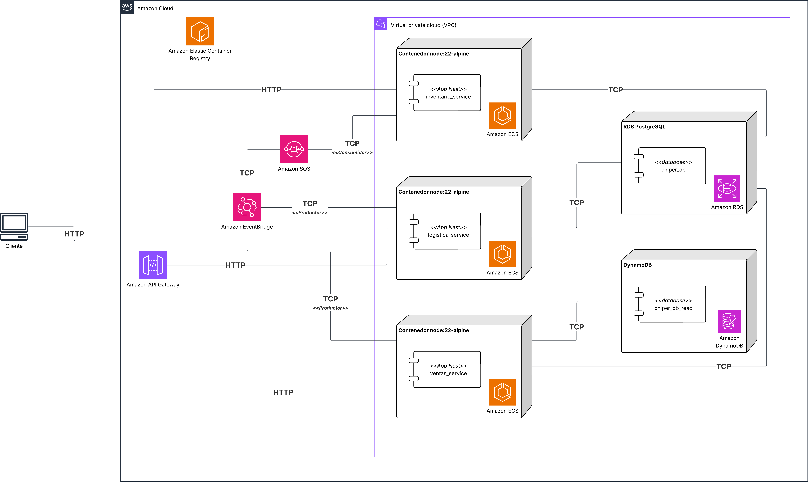
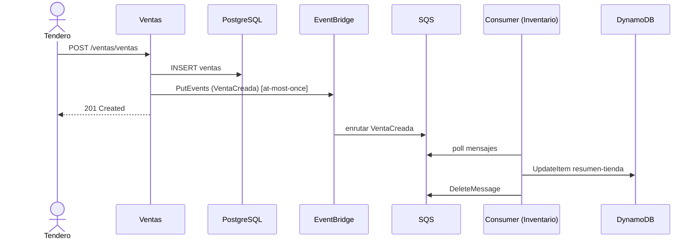
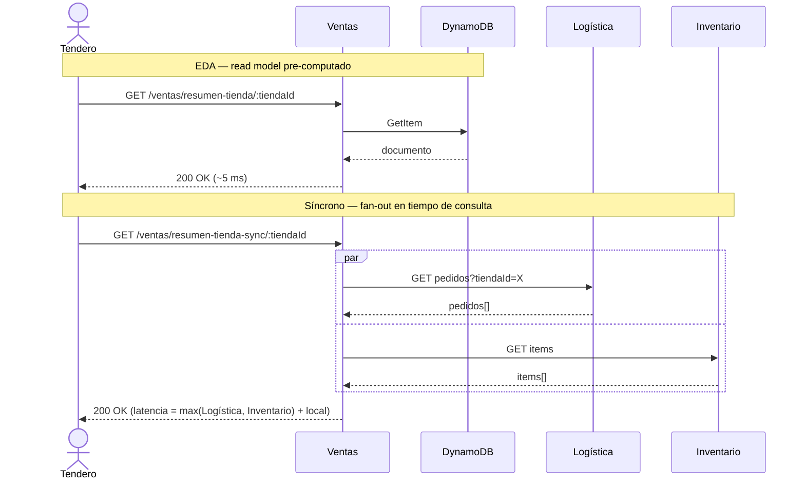
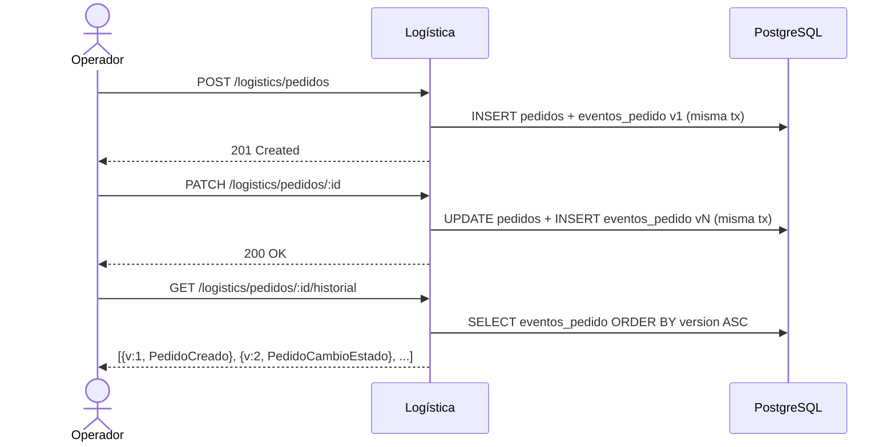

# Lab 8 - Microservicios Orientados a Eventos: EDA, CQRS y Event Sourcing

## 1. Índice

- [1. Índice](#1-índice)
- [2. Etapas del laboratorio](#2-etapas-del-laboratorio)
- [3. Objetivos](#3-objetivos)
- [4. Planeación del laboratorio](#4-planeación-del-laboratorio)
- [5. Ejecución del laboratorio](#5-ejecución-del-laboratorio)
- [6. Realización de pruebas](#6-realización-de-pruebas)
- [7. Entregables](#7-entregables)
- [Nota final (créditos AWS)](#nota-final-créditos-aws)

## 2. Etapas del laboratorio

| Etapa | Resumen | Uso de IA generativa |
| --- | --- | --- |
| 1. Experimento y ASRs | Contextualizar la arquitectura orientada a eventos (EDA) como respuesta a las limitaciones que midió en el Lab 7; hipótesis de diseño, escenarios de calidad vinculados (los mismos ASRs), diseño y planeación del experimento. | Uso acotado para ordenar hipótesis; la justificación de la arquitectura debe ser propia. |
| 2. Arquitectura y conceptos | Análisis de tres ideas: comunicar servicios mediante eventos (EDA), separar el modelo con el que se escribe del modelo con el que se consulta (CQRS) y guardar el historial de cambios como fuente de verdad (Event Sourcing); trade-offs de consistencia eventual y de confiabilidad en la publicación. | Recomendado para contrastar trade-offs de consistencia eventual vs. fuerte. |
| 3. Infraestructura (CloudFormation) | Despliegue en AWS del bus de eventos (EventBridge), la cola de mensajes (SQS) y la base de datos de consulta (DynamoDB). | Recomendado para asistencia operativa; verifique manualmente en la consola. |
| 4. Parte 1 - Event Sourcing | Completar el almacén de eventos de Pedidos y verificar el historial de transiciones. | Recomendado para soporte de implementación; validar comportamiento real. |
| 5. Parte 2 - Modelo de lectura (CQRS) | Verificar que el modelo de lectura en DynamoDB se actualiza a partir de los eventos consumidos desde la cola. | Recomendado para soporte; no sustituye la comprensión del flujo de eventos. |
| 6. Experimento comparativo | Medir la arquitectura por eventos frente a la síncrona con la misma matriz del Lab 7 y verificar los ASRs. | No recomendado para generar conclusiones sin evidencia cuantitativa propia. |

## 3. Objetivos

- Implementar una **arquitectura orientada a eventos** (EDA: los servicios no se llaman entre sí, sino que publican y consumen mensajes que describen lo que ocurrió) que satisfaga los mismos ASRs que el patrón síncrono del Lab 7 no pudo cumplir.
- Separar el modelo de escritura (PostgreSQL) del modelo de lectura (DynamoDB, una base de datos de documentos de AWS) mediante **CQRS**, eliminando el fan-out en el momento de la consulta.
- Implementar **Event Sourcing** (guardar cada cambio de estado como un evento que no se modifica) para el ciclo de vida de los Pedidos, de modo que el estado se pueda reconstruir a partir del historial de eventos.
- Evaluar los trade-offs de confiabilidad en la publicación de eventos: entrega "a lo sumo una vez" (publicación directa al bus de eventos) frente a "al menos una vez" (el patrón Outbox que conoció en el Lab 5), y reflexionar sobre cuándo cada garantía es apropiada para el negocio.
- Comparar cuantitativamente la latencia de la arquitectura por eventos frente a la síncrona y reflexionar sobre los trade-offs y limitaciones de EDA.

---

## 4. Planeación del laboratorio

En el Lab 7 usted midió un endpoint, `GET /ventas/resumen-operativo`, en el que el servicio de Ventas llamaba a Logística y a Inventario y esperaba sus respuestas antes de responder. Ese endpoint violó el ASR de latencia (p99 < 2000 ms) a cargas en las que cada servicio, por separado, funcionaba bien. La causa fue estructural: la latencia del orquestador es la suma de las latencias de los servicios a los que llama, y bajo carga esa suma crece de forma no lineal. En el Lab 7 se le pidió proponer una alternativa. Este laboratorio implementa una.

La idea central es cambiar **cuándo** se hace el trabajo de reunir los datos: en lugar de reunirlos cada vez que un tendero consulta, se reúnen una sola vez, cuando ocurre una venta, y se dejan listos para ser consultados.

**Conceptos que se presentan en este laboratorio.** Cada uno se desarrolla, con su aplicación en Cheapest y su código, en la parte de tácticas y patrones.

| Concepto | Qué es |
| --- | --- |
| Evento | Mensaje que describe algo que **ya ocurrió** en el negocio (por ejemplo, `VentaCreada`). |
| Productor y consumidor | El productor es el servicio que publica un evento; el consumidor es el que lo recibe y reacciona. El productor no sabe quién lo consumirá ni cuándo. |
| Bus de eventos (*broker*) | Intermediario que recibe los eventos de los productores y los reparte a quienes estén interesados. |
| EDA | *Event-Driven Architecture*, arquitectura orientada a eventos: los servicios se comunican publicando y consumiendo eventos, en lugar de llamarse directamente. |
| Amazon EventBridge | El bus de eventos de AWS. Recibe los eventos y, según reglas, los envía a uno o varios destinos. |
| Cola de mensajes | Estructura que guarda mensajes hasta que un consumidor los procesa. Si el consumidor está caído, los mensajes esperan en la cola. |
| Amazon SQS | *Simple Queue Service*, el servicio de colas de AWS. Entrega cada mensaje **al menos una vez**: ocasionalmente puede entregar el mismo mensaje dos veces. |
| DLQ | *Dead Letter Queue*: cola aparte a la que se mueven los mensajes que fallaron varias veces al procesarse, para revisarlos sin bloquear la cola principal. |
| Consistencia eventual | Los datos de consulta pueden estar unos segundos atrasados respecto a los datos reales, pero terminan poniéndose al día. |
| CQRS | *Command Query Responsibility Segregation*: usar un modelo de datos para escribir y otro distinto, optimizado, para consultar. |
| Modelo de escritura y modelo de lectura (*write model*, *read model*) | El de escritura es donde se guardan las operaciones del negocio (aquí, tablas normalizadas en PostgreSQL). El de lectura es una copia ya calculada y lista para consultar (aquí, un documento por tienda en DynamoDB). |
| Proyección y re-proyección | Proyección es el modelo de lectura que se construye procesando los eventos. Re-proyectar es reconstruirlo desde cero, volviendo a procesar los datos de origen. |
| Amazon DynamoDB | Base de datos NoSQL de AWS que guarda documentos identificados por una llave. Leer un documento por su llave (operación `GetItem`) toma unos pocos milisegundos, sin importar la carga. |
| Event Sourcing | Guardar cada cambio de estado de una entidad como un evento en un historial al que solo se le agregan filas. El estado actual se obtiene recorriendo ese historial. |
| Almacén de eventos (*event store*) | La tabla donde se guarda ese historial de eventos. |
| Garantías de entrega | **A lo sumo una vez** (*at-most-once*): el mensaje puede perderse, pero nunca llega repetido. **Al menos una vez** (*at-least-once*): el mensaje nunca se pierde, pero puede llegar repetido. |
| Camino de escritura y camino de lectura (*write path*, *read path*) | Lo que ocurre cuando se registra una operación, y lo que ocurre cuando se consulta. |

**Contexto de negocio.** Cheapest tiene tres necesidades que la arquitectura síncrona no puede satisfacer simultáneamente:

**1. Resumen instantáneo bajo pico de demanda.** Los tenderos consultan su resumen en quincena y fines de semana, exactamente cuando el sistema está más cargado. El endpoint del Lab 7 falló en ese momento. Con CQRS, el modelo de lectura ya está calculado en DynamoDB: cada consulta es la lectura de un documento, de unos 5 ms, independientemente de la carga.

**2. Resiliencia en el registro de ventas.** Una venta debe poderse registrar aunque el servicio de Inventario esté en medio de un despliegue o saturado. Con EDA, `POST /ventas/ventas` guarda la venta en PostgreSQL y publica un evento; la respuesta llega en milisegundos sin esperar a Inventario. Los eventos se procesan cuando Inventario se recupera.

**3. Posibilidad de reconstruir el modelo de lectura.** Si el consumidor de Inventario tiene un error que corrompe el modelo de lectura de DynamoDB, ¿cómo se restaura? Solo es posible si los datos de origen están guardados. El almacén de eventos de Pedidos y la tabla de ventas en PostgreSQL son las fuentes de verdad que permiten reconstruir cualquier proyección, incluidas proyecciones futuras, como los modelos de demanda del equipo de pronósticos de Cheapest.

> [!IMPORTANT]
> **Pregunta 1:**
> Si el servicio de Inventario tarda 1500 ms en procesar el último evento `VentaCreada`, ¿cuánto tarda `GET /ventas/resumen-tienda/:tiendaId`?
> Distinga con precisión entre **latencia de consulta** (tiempo que experimenta el tendero) y **latencia de procesamiento del evento** (tiempo que tarda el consumer en actualizar el read model).
> ¿Qué cambió en la dependencia temporal entre el servicio de Ventas y el de Inventario respecto al Lab 7?

### 4.1 Hipótesis de diseño

| H1 | **Si** implementamos CQRS con un read model pre-computado en DynamoDB, alimentado por eventos `VentaCreada` desde EventBridge y SQS, **entonces** `GET /ventas/resumen-tienda/:tiendaId` responde con p99 < 100 ms bajo cualquier nivel de carga y sin generar requests a Logística ni Inventario, **porque** el fan-out se mueve del tiempo de consulta al tiempo de escritura y cada consulta es un `GetItem` independiente de la carga de los demás servicios. |
| H2 | **Si** desacoplamos Ventas de Inventario mediante eventos (EDA) en el write path, **entonces** `POST /ventas/ventas` responde 201 y el resumen se sigue sirviendo (error % = 0%) aun con Inventario en `desired count = 0`, **porque** los eventos se acumulan en SQS y se procesan cuando el consumer se recupera, eliminando el acoplamiento temporal. |
| H3 | **Si** almacenamos los cambios de estado de los Pedidos como eventos inmutables (Event Sourcing), **entonces** el historial completo del pedido y cualquier proyección pueden reconstruirse por re-proyección, **porque** el event store es la fuente de verdad y el estado actual es una función de sus eventos. |
| H4 | **Si** aceptamos consistencia eventual en el read model, **entonces** el campo `ultimaActualizacion` refleja la última venta en < 10 s bajo carga normal, **porque** el consumer procesa los eventos de SQS de forma asíncrona y a su propio ritmo, a cambio de que la consulta pueda mostrar datos ligeramente obsoletos. |

### 4.2 Escenarios de calidad vinculados

Los ASRs son **idénticos a los del Lab 7**. El objetivo es demostrar que EDA los satisface donde el patrón síncrono falló.

| ID | Descripción | Métrica a satisfacer |
| --- | --- | --- |
| ASR-1 | Como tendero, quiero consultar el resumen operativo de mi tienda en un tiempo razonable para tomar decisiones de reabastecimiento. | p99 < 2000 ms durante operación normal (500 req/min) |
| ASR-2 | Como COO, quiero mantener una baja tasa de error incluso durante eventos de alta demanda para no perder operaciones de tenderos. | Error % ≤ 10% durante pico (5000 req/min) |
| ASR-3 | Como tendero, quiero que si uno de los servicios de Cheapest está lento, mi consulta del resumen de tienda siga respondiendo sin fallar por completo. | Con Inventario en `desired count = 0`, error % de `GET /ventas/resumen-tienda/:tiendaId` = 0% |

Adicionalmente, EDA introduce una propiedad nueva que la arquitectura síncrona no podía ofrecer:

| ID | Descripción | Métrica |
| --- | --- | --- |
| ASR-EDA-4 | Como COO, quiero que el resumen de tienda refleje ventas recientes en un tiempo acotado para no tomar decisiones con datos muy obsoletos. | El campo `ultimaActualizacion` del read model refleja la última venta en < 10 s bajo carga normal |

> [!IMPORTANT]
> **Nótese la tensión entre ASR-1 y ASR-EDA-4.** ASR-1 exige latencia de consulta baja (servida por DynamoDB, independiente del procesamiento de eventos). ASR-EDA-4 exige que los datos sean recientes (depende de la velocidad del consumer). Son propiedades del sistema que viven en partes distintas del flujo y tienen trade-offs distintos.

### 4.3 Tácticas y patrones

#### 4.3.1 Patrones de diseño

##### Event Sourcing

En Event Sourcing el **log de eventos** es la fuente de verdad, no el estado actual. El estado actual de una entidad se obtiene reproduciendo todos los eventos en orden. Los eventos son inmutables y se agregan de forma append-only.

**Cómo se ve en Cheapest**

La tabla `eventos_pedido` registra cada transición de estado de un Pedido: `PedidoCreado`, `PedidoCambioEstado`. Cada evento tiene una versión monotónica. La tabla `pedidos` sigue existiendo como proyección del estado actual (cache), pero si se corrompe, puede reconstruirse reproduciendo los eventos.

**Por qué importa**

- Si el read model de DynamoDB se corrompe por un bug en el consumer, se puede reconstruir volviendo a procesar, desde el origen, las ventas guardadas en PostgreSQL.
- Es posible crear **proyecciones nuevas** a partir del log histórico de eventos sin tocar producción: el equipo de forecasting de Cheapest puede consumir todos los `VentaCreada` para entrenar modelos de demanda.
- El historial de transiciones de un Pedido (`GET /logistics/pedidos/:id/historial`) es una consulta directa al event store, no una reconstrucción desde logs de auditoría.

**Riesgo**

- La tabla de eventos **crece indefinidamente** (append-only). Sin una estrategia de archivado o snapshotting, la re-proyección completa desde el evento 1 se vuelve lenta con el tiempo.
- No toda anomalía se puede corregir con event replay: si el consumer ejecutó una acción externa irreversible (ej. envió un email o descontó stock en un sistema externo), el replay no deshace ese efecto.


**Cambios en el código**

Se agregó la entidad `EventoPedido` en `libs/logistica/src/repositories/entities/evento-pedido.entity.ts`:

```typescript
@Entity('eventos_pedido')
@Index(['pedidoId', 'version'])
export class EventoPedido {
  @PrimaryGeneratedColumn('uuid') id: string;
  @Column('uuid')                 pedidoId: string;
  @Column('varchar', { length: 100 }) tipo: string;  // 'PedidoCreado' | 'PedidoCambioEstado'
  @Column('jsonb')                payload: Record<string, unknown>;
  @Column('int')                  version: number;   // monotónico por pedidoId
  @Column('timestamp')            occurredAt: Date;
  @CreateDateColumn()             createdAt: Date;
}
```

`PedidoService` fue modificado para escribir en `eventos_pedido` dentro de la misma transacción de la escritura del pedido. Los métodos `nextVersion()` y `appendEvent()` del repositorio son los que usted debe completar en este laboratorio: están marcados con `throw new Error('Not implemented')` en el código base.

Se agregó también el endpoint `GET /logistics/pedidos/:id/historial` en `pedido.controller.ts`, que delega a `EventoPedidoRepository.findByPedidoId()` (ya implementado).

##### Publicación y suscripción

Ventas publica el evento `VentaCreada` en el bus de eventos sin saber quién lo va a usar. Una regla de EventBridge lo envía a una cola de SQS, de la que lee el consumidor de Inventario. Agregar un consumidor nuevo (por ejemplo, uno de analítica) no exige cambiar a Ventas: basta con otra regla y otra cola.

#### 4.3.2 Tácticas de arquitectura

| Táctica | Análisis |
| --- | --- |
| Mantener una copia de los datos lista para consultar (modelo de lectura) | Favorece la latencia de consulta: se lee un documento ya calculado. Desfavorece la consistencia: la copia puede estar unos segundos atrasada. |
| Desacoplar en el tiempo con una cola | El productor no espera al consumidor. Favorece la disponibilidad del registro de ventas ante la caída del consumidor. Introduce el riesgo de que la cola crezca y los datos de consulta se atrasen. |
| Cola de mensajes fallidos (DLQ) | Los mensajes que fallan tres veces se apartan para revisión, sin bloquear el resto. |
| Mover el trabajo de la consulta a la escritura | El fan-out no desaparece: se hace una vez por venta, en segundo plano, en lugar de una vez por consulta. |

##### Por qué EDA cambia el perfil de latencia

**Fan-out secuencial — Lab 7 `GET /ventas/resumen-operativo`:**

El Lab 7 llamaba a Logística e Inventario de forma secuencial, por lo que la latencia era la suma de ambas:

$$T_{\text{lab7}} \geq T_{\text{logistica}} + T_{\text{inventario}} + T_{\text{ventas-local}} + 2\,\delta_{\text{red}}$$

**Fan-out paralelo — Lab 8 `GET /ventas/resumen-tienda-sync/:tiendaId`:**

`resumen-tienda-sync` hace las mismas llamadas pero en **paralelo** (`Promise.all`), el mejor caso posible para una arquitectura síncrona:

$$T_{\text{resumen-sync}} \geq \max(T_{\text{logistica}},\; T_{\text{inventario}}) + T_{\text{ventas-local}} + \delta_{\text{red}}$$

El paralelismo reduce la latencia nominal, pero **no elimina el problema estructural**: la respuesta sigue acotada por el servicio más lento. Bajo carga, cuando $\rho_i \to 1$ en cualquier dependiente, $T_i$ crece de forma no lineal (cola M/M/1) y el endpoint absorbe ese crecimiento aunque el otro servicio esté sano. Un servicio saturado contamina la latencia del endpoint completo, sin importar si las llamadas son secuenciales o paralelas.

Ambos patrones comparten la misma debilidad estructural: el **fan-out en tiempo de consulta** acopla temporalmente al orquestador con sus dependientes. EDA rompe ese acoplamiento moviendo el fan-out al tiempo de escritura, que es lo que usted va a medir en el experimento comparativo de este laboratorio.

##### Trade-offs de confiabilidad en la publicación de eventos

La implementación de este lab publica eventos a EventBridge directamente desde `VentaService.create()` tras guardar la venta en PostgreSQL. Esta es una entrega **at-most-once**: si EventBridge no está disponible en el momento exacto del write (error de red, throttle temporal), el evento se pierde aunque la venta esté guardada.

```typescript
// libs/ventas/src/services/venta.service.ts (fragmento simplificado)
const venta = await this.ventaRepository.create(ventaData);   // write de dominio
await this.eventBridgeService.publish({ source: 'Cheapest.ventas', detailType: 'VentaCreada', detail: { ... } });
// Si esta línea falla, la venta existe pero el evento nunca llegó a SQS.
```

El patrón que resuelve este riesgo, el **Outbox** que usted implementó en el Lab 5, garantiza la entrega al menos una vez: escribe el evento en una tabla de la misma base de datos, dentro de la misma transacción, y un proceso en segundo plano lo publica con reintentos. Combinado con **idempotencia** en el consumidor, se obtiene un sistema que tolera fallos sin duplicar efectos. En este laboratorio **no** se usan, de forma deliberada, para que pueda analizar el riesgo.

> [!IMPORTANT]
> **Pregunta 2:**
> `VentaService.create()` publica directamente a EventBridge después de guardar la venta en PostgreSQL.
>
> 1. ¿Qué garantía de entrega tiene esta implementación: at-most-once, at-least-once, o exactly-once? Justifique.
> 2. Describa un escenario concreto en Cheapest donde esta garantía sería un problema real. ¿Qué estado quedaría inconsistente y cómo se manifestaría para el tendero?
> 3. Proponga a alto nivel cómo lo resolvería sin cambiar el esquema de PostgreSQL. No es necesario implementarlo; basta con describir el mecanismo.

#### 4.3.3 Estilos aplicados

##### Event-Driven Architecture (EDA)

En EDA los servicios se comunican publicando y consumiendo **eventos** a través de un broker, en lugar de llamarse directamente. El productor publica un evento y continúa; no sabe quién lo consumirá ni cuándo.

**Cómo se ve en Cheapest**

Ventas publica `VentaCreada` en EventBridge cuando registra una venta. Inventario consume ese evento desde SQS cuando puede, a su propio ritmo. Los dos servicios nunca se llaman directamente en este flujo.

**Por qué importa**

- Elimina el acoplamiento temporal: Ventas responde al tendero sin esperar a Inventario.
- El write path (`POST /ventas/ventas`) no depende de la disponibilidad de Inventario: si Inventario está caído, los eventos se acumulan en SQS y se procesan cuando se recupera.
- El read path (`GET /ventas/resumen-tienda`) no genera ningún fan-out: solo lee DynamoDB.

**Riesgo**

- Introduce **consistencia eventual**: el read model puede estar algunos segundos detrás del write model. Si un tendero consulta el resumen inmediatamente después de registrar una venta, puede no verla reflejada todavía.
- Los errores en el consumer no son visibles al productor: un bug en Inventario puede corromper el read model silenciosamente durante horas.

**Cambios en el código**

Para soportar EDA se creó el módulo compartido `libs/shared/eventbridge/src/eventbridge.service.ts`. Es un wrapper sobre `@aws-sdk/client-eventbridge` que expone un método `publish()` tipado con la interfaz `CheapestEvent`:

```typescript
// libs/shared/eventbridge/src/Cheapest-event.interface.ts
export interface CheapestEvent {
  source: 'Cheapest.ventas' | 'Cheapest.logistica';
  detailType: 'VentaCreada' | 'PedidoCreado' | 'PedidoCambioEstado';
  detail: Record<string, unknown>;
}
```

`EventBridgeService` es consumido directamente por `VentaService` al crear una venta. La publicación es **at-most-once**: si EventBridge no está disponible en el momento del write, el evento se pierde. Esta es una simplificación deliberada; el patrón que resuelve este riesgo (Outbox + idempotencia) es el que usted implementó en el Lab 5.

Para consumir eventos desde SQS, `VentaCreadaConsumer` (en Inventario) usa `setInterval` + `ReceiveMessageCommand` directamente desde `@aws-sdk/client-sqs`, sin dependencia de frameworks externos:

```typescript
// libs/inventario/src/consumers/venta-creada.consumer.ts
onModuleInit() {
  setInterval(() => this.poll(), 2000); // polling cada 2 s
}
```

##### CQRS (Command Query Responsibility Segregation)

CQRS separa el modelo de **escritura** (commands) del modelo de **lectura** (queries) en estructuras de datos distintas, optimizadas para cada propósito. No son dos bases de datos obligatoriamente, pero sí dos modelos distintos.

**Cómo se ve en Cheapest**

- **Write model**: PostgreSQL con tablas normalizadas (`ventas`, `items_venta`). Se optimiza para integridad transaccional.
- **Read model**: DynamoDB con un documento desnormalizado por tienda (`{ tiendaId, ventasMes, totalVentasMes, ultimasVentas }`). Se optimiza para lecturas rápidas con un solo `GetItem`.

La tabla de Ventas en PostgreSQL no se consulta cuando un tendero pide su resumen. Esa consulta va directamente a DynamoDB.

**Por qué importa**

- `GET /ventas/resumen-tienda/:tiendaId` responde en ~5 ms sin importar la carga del sistema, porque lee un documento ya pre-computado.
- El write model puede cambiar su esquema sin afectar el read model, y viceversa.
- El read model se puede reconstruir desde cero volviendo a procesar las ventas guardadas en PostgreSQL (re-proyección).

**Riesgo**

- El read model puede quedar **inconsistente** si el consumer tiene un bug o se cae durante un período. No hay garantía de que ambos modelos estén sincronizados en todo momento.
- Tener dos modelos implica más superficie operativa: hay que monitorear que el consumer esté procesando y que el read model no esté desactualizado más allá del umbral de ASR-EDA-4.

**Cambios en el código**

Se agregaron dos módulos para el read model:

- `libs/shared/dynamo/src/dynamo.service.ts` — crea el `DynamoDBDocumentClient` de `@aws-sdk/lib-dynamodb` a partir de variables de entorno (`AWS_REGION`, `AWS_ENDPOINT_URL`). Se registra como provider en los módulos de Inventario y Ventas.
- `libs/ventas/src/services/resumen-tienda.service.ts` — nuevo servicio que ejecuta un `GetCommand` en DynamoDB con `{ tiendaId, sk: 'RESUMEN' }` y retorna el documento directamente:

```typescript
// libs/ventas/src/services/resumen-tienda.service.ts
async getResumen(tiendaId: string): Promise<ResumenTiendaDto | null> {
  const result = await this.dynamoService.client.send(
    new GetCommand({ TableName: this.tableName, Key: { tiendaId, sk: 'RESUMEN' } }),
  );
  return result.Item ? (result.Item as ResumenTiendaDto) : null;
}
```

El write model (PostgreSQL) no fue modificado. La tabla `ventas` y `items_venta` siguen siendo las mismas; lo único que cambió es que `VentaService.create()` ahora también publica un evento en EventBridge tras guardar la venta, como se explicó al describir la arquitectura orientada a eventos.

### 4.4 Diseño del experimento

#### 4.4.1 ¿Cómo se va a validar la hipótesis?

Con un experimento comparativo de control y tratamiento: dos endpoints que responden la misma pregunta sobre la misma infraestructura, donde la única variable que cambia es *cuándo* ocurre el fan-out (en la consulta o en la escritura). Adicionalmente, se verifica el funcionamiento del Event Sourcing y del modelo de lectura, se prueba el comportamiento con Inventario apagado y se mide qué tan atrasado queda el modelo de lectura respecto a la última venta.

#### 4.4.2 ¿Qué componentes se van a diseñar o modificar?

| Componente | Cambio |
| --- | --- |
| Logística | Almacén de eventos de Pedidos (tabla `eventos_pedido`) y endpoint de historial de transiciones. |
| Ventas | Publicación de `VentaCreada` en EventBridge y dos endpoints de resumen: `resumen-tienda` (por eventos) y `resumen-tienda-sync` (síncrono, de control). |
| Consumidor (en Inventario) | Lectura de la cola de SQS y actualización del modelo de lectura en DynamoDB. |
| EventBridge, SQS, DynamoDB | Infraestructura nueva, desplegada con CloudFormation. |

#### 4.4.3 ¿Qué métricas se van a medir?

| Métrica | Hipótesis / ASR | Umbral |
| --- | --- | --- |
| p99, p95, throughput y error % de `resumen-tienda` vs. `resumen-tienda-sync` por nivel de carga | H1 / ASR-1, ASR-2 | p99 < 2000 ms a 500 req/min; error % ≤ 10% a 5000 req/min |
| `RequestCount` en los Target Groups de Logística e Inventario durante las pruebas | H1 | 0 requests por consulta EDA |
| Respuestas de `POST` y de ambos `GET`, y mensajes acumulados en SQS con Inventario en `desired count = 0` | H2 / ASR-3 | error % = 0% en el read path EDA |
| Historial de versiones de un Pedido en `eventos_pedido` | H3 | eventos ordenados por versión |
| Diferencia entre `ultimaActualizacion` y la última venta | H4 / ASR-EDA-4 | < 10 s |

### 4.5 Planeación del experimento

#### 4.5.1 Recursos requeridos

| Recurso | Detalle |
| --- | --- |
| Infraestructura AWS | Stack de CloudFormation con ECS/Fargate, API Gateway, balanceadores, RDS, EventBridge, SQS y DynamoDB en su cuenta, más los repositorios de ECR con las imágenes. El stack usa una VPC y dos subredes públicas que ya existan en su cuenta |
| Herramientas locales | Docker, AWS CLI, JMeter (y el script de Python para las cargas altas), `curl` o Postman y el código de la rama `cheapest-eda` |
| Datos de prueba | Script de seed de la rama (`npm run db:seed`) y las ventas y pedidos que usted cree durante el laboratorio |
| Créditos AWS | Elimine el stack al terminar |

| Categoría | Tecnología |
| --- | --- |
| Event broker | AWS EventBridge (custom bus `Cheapest-bus`) |
| Cola de mensajes | Amazon SQS (estándar + DLQ) |
| Read model / CQRS | Amazon DynamoDB (on-demand, document store) |
| Write model / Event Store | PostgreSQL + TypeORM (sin cambios estructurales) |
| Infraestructura como Código | AWS CloudFormation |
| Orquestación de contenedores | Amazon ECS (Fargate) |
| Framework backend | NestJS + TypeScript |
| Pruebas de carga | Apache JMeter |

#### 4.5.2 Elementos de arquitectura involucrados

Servicios de Ventas, Logística e Inventario (que contiene al consumidor), PostgreSQL (modelo de escritura y almacén de eventos), EventBridge y SQS (bus y cola de eventos), DynamoDB (modelo de lectura) y JMeter como generador de carga.



Los tres flujos que se tocan o se miden:

###### Write path — registro de una venta



###### Read path — EDA vs. síncrono



###### Event Sourcing — ciclo de vida de un Pedido



#### 4.5.3 Esfuerzo estimado

Referencia para planear; puede variar según su experiencia con AWS.

| Etapa | Esfuerzo aprox. |
| --- | --- |
| Completar y revisar el código (Event Sourcing y modelo de lectura) | 0,5 h |
| Publicación de imágenes y despliegue con CloudFormation | 0,5 h |
| Verificación funcional de Event Sourcing y del modelo de lectura | 0,5 h |
| Experimento comparativo, prueba con Inventario apagado y medición de atraso | 1,5 h |
| Análisis y entregables | 1 h |
| **Total** | **4 h-persona** |

---

## 5. Ejecución del laboratorio

> El código vive en la rama `cheapest-eda` del repositorio `Cheapest-api`.

El orden importa: primero se completa el código, **después** se construyen las imágenes y se despliega. Si despliega antes de completar el código, tendrá que volver a publicar las imágenes.

### 5.1 Parte 1 - Event Sourcing: historial de Pedidos

#### Concepto

En el modelo actual, la tabla `pedidos` tiene una columna `estado` que se **sobreescribe** con cada transición. Si un pedido pasa de `creado` a `aprobado`, el estado anterior desaparece. No hay forma de saber cuándo ocurrió cada transición, ni reconstruir el historial de un pedido para una auditoría.

**Event Sourcing** resuelve esto con un principio simple: en lugar de actualizar el estado, **agregar un evento** que describe lo que ocurrió. La tabla `eventos_pedido` es un append-only log:

```
pedidoId | tipo               | payload                        | version | occurredAt
─────────┼────────────────────┼────────────────────────────────┼─────────┼──────────────
abc-123  | PedidoCreado       | { estado: 'creado', ... }      | 1       | 2024-01-15T10:00
abc-123  | PedidoCambioEstado | { anterior: 'creado',          | 2       | 2024-01-15T10:05
         |                    |   nuevo: 'aprobado', ... }     |         |
abc-123  | PedidoCambioEstado | { anterior: 'aprobado',        | 3       | 2024-01-15T11:30
         |                    |   nuevo: 'enAlistamiento' }    |         |
```

La **versión monotónica** garantiza el orden de los eventos. Reproduciendo los eventos en orden, se puede reconstruir el estado del pedido en cualquier punto del tiempo.

**¿Por qué esto importa para Cheapest?** Si el read model de DynamoDB tiene un error de cálculo (bug en el consumer), los eventos almacenados permiten **re-proyectar** el read model desde cero. Sin el event store, los eventos ya fueron procesados por EventBridge y no son recuperables.

#### Implementación

> La entidad `EventoPedido` ya está definida. Los repositorios tienen métodos con `throw new Error('Not implemented')` que deben completarse.

##### Tarea 1.1 - Completar `EventoPedidoRepository`

Archivo: `libs/logistica/src/repositories/evento-pedido.repository.ts`

Implemente `nextVersion(pedidoId)` y `appendEvent(data)`:

```typescript
async nextVersion(pedidoId: string): Promise<number> {
  // Buscar el último evento del pedido ordenado por version DESC.
  // Si no existe ninguno, retornar 1.
  // Hint: this.repository.findOne({ where: { pedidoId }, order: { version: 'DESC' } })
}

async appendEvent(data: Omit<EventoPedido, 'id' | 'createdAt'>): Promise<EventoPedido> {
  // Crear y guardar el evento.
  // Hint: const entity = this.repository.create(data); return this.repository.save(entity);
}
```

##### Tarea 1.2 - Revisar `PedidoService.update()`

Archivo: `libs/logistica/src/services/pedido.service.ts`

El método `update()` ya tiene el esqueleto que llama a `eventoPedidoRepository.nextVersion(id)`. Verifique que:
1. La llamada a `appendEvent()` ocurre **dentro de la transacción** junto con el `UPDATE pedidos`.
2. El evento `PedidoCambioEstado` incluye `estadoAnterior`, `estadoNuevo` y `version`.
3. Sólo se registra el evento si `dto.estado` es diferente al estado actual.

##### Tarea 1.3 - Verificar el endpoint de historial

El endpoint `GET /logistics/pedidos/:id/historial` ya está registrado en `PedidoController`. Verifique que `getHistorial()` en `PedidoService` retorna los eventos ordenados por `version ASC`.

### 5.2 Parte 2 - Revisar el modelo de lectura (CQRS)

#### Revisar `updateResumenTienda()` en `VentaCreadaConsumer`

Archivo: `libs/inventario/src/consumers/venta-creada.consumer.ts`

El método `updateResumenTienda()` ya tiene la expresión DynamoDB completa. Verifique que los `ExpressionAttributeValues` son correctos:
- `:uno` → `1` (para el `ADD ventasMes`)
- `:total` → `Number(payload.total)` (para el `ADD totalVentasMes`)
- `:nuevaVenta` → array de un elemento con `{ ventaId, fechaHora, total }`

#### Revisar `ResumenTiendaService.getResumen()`

Archivo: `libs/ventas/src/services/resumen-tienda.service.ts`

El método `getResumen()` ya hace el `GetItem` de DynamoDB. Verifique que la clave `{ tiendaId, sk: 'RESUMEN' }` coincide con la clave que el consumer escribe en `updateResumenTienda()`.

> [!IMPORTANT]
> **Pregunta 3:**
> SQS entrega mensajes at-least-once. Esta implementación **no** tiene idempotencia en el consumer.
>
> 1. Describa qué estado queda incorrecto en DynamoDB si el consumer recibe el mismo mensaje `VentaCreada` dos veces. Sea específico: ¿qué campos del documento se ven afectados y cómo?
> 2. ¿Bajo qué circunstancias puede SQS entregar el mismo mensaje más de una vez, incluso sin que haya un bug en el productor?
> 3. Proponga a alto nivel cómo implementaría idempotencia en el consumer para evitar este problema. ¿Qué información necesitaría como clave de idempotencia?

### 5.3 Publicar las imágenes en ECR

Con el código completo, construya la imagen de cada microservicio desde la rama `cheapest-eda` y publíquela en ECR siguiendo el tutorial [Subir imágenes Docker a Amazon ECR](../tutoriales/subir_imagenes%20_a_ecr.md). Use el tag `4.0.0`:

| Servicio | Repositorio ECR | Tag |
| --- | --- | --- |
| Logística | `cheapest-logistica` | `4.0.0` |
| Inventario | `cheapest-inventario` | `4.0.0` |
| Ventas | `cheapest-ventas` | `4.0.0` |

### 5.4 Desplegar el stack

El template de este laboratorio crea toda la infraestructura (clúster y servicios de ECS, balanceadores, base de datos RDS, API Gateway, EventBridge, SQS y DynamoDB), con una excepción:

> [!WARNING]
> Este template, a diferencia de los de los Labs 5 y 6, **no crea su propia VPC**: usted debe pasarle una VPC y dos subredes públicas existentes (`VpcId`, `PublicSubnet1`, `PublicSubnet2`). Puede reutilizar la VPC y las subredes por defecto de su cuenta: ejecute `aws ec2 describe-subnets --query 'Subnets[].[SubnetId,VpcId,MapPublicIpOnLaunch]' --output table` y elija dos subredes de la misma VPC que tengan `MapPublicIpOnLaunch=True`.

```bash
aws cloudformation deploy \
  --stack-name Cheapest-lab8-eda \
  --template-file laboratorios/lab_8/recursos/cloudformation_template.yaml \
  --parameter-overrides \
    LogisticaImageUri=<URI_ECR_LOGISTICA>:4.0.0 \
    InventarioImageUri=<URI_ECR_INVENTARIO>:4.0.0 \
    VentasImageUri=<URI_ECR_VENTAS>:4.0.0 \
    DBPassword=<PASSWORD> \
    VpcId=<VPC_ID> \
    PublicSubnet1=<SUBNET_ID_1> \
    PublicSubnet2=<SUBNET_ID_2>
```

Al finalizar, guarde los **Outputs** del stack:

| Output | Uso |
| --- | --- |
| `ApiGatewayUrl` | Base URL para las pruebas de carga |
| `EventBusBusName` | Nombre del bus de EventBridge |
| `VentaCreadaQueueUrl` | URL de la cola SQS para el consumer |
| `ResumenTiendaTableName` | Nombre de la tabla DynamoDB |

### 5.5 Variables de entorno por servicio

El template CloudFormation configura estas variables automáticamente en las Task Definitions de ECS:

| Variable | Servicio | Descripción |
| --- | --- | --- |
| `AWS_REGION` | todos | Región AWS |
| `EVENTBRIDGE_BUS_NAME` | logistica, ventas | Nombre del custom bus |
| `SQS_VENTA_CREADA_URL` | inventario | URL de la cola SQS |
| `DYNAMO_TABLE_RESUMEN` | inventario, ventas | Nombre de la tabla DynamoDB |

### 5.6 Cargar datos base

La base de datos RDS del stack se crea vacía y no es accesible desde internet. Como en los laboratorios anteriores, hágala temporalmente pública, abra el puerto 5432 solo para su IP, cargue los datos desde su computador (rama `cheapest-eda`, después de `npm install`) y revierta ambos cambios:

```bash
MY_IP=$(curl -s https://checkip.amazonaws.com)
SG_RDS_ID=$(aws ec2 describe-security-groups --filters Name=tag:Name,Values=Cheapest-lab8-rds-sg --query "SecurityGroups[0].GroupId" --output text)

aws rds modify-db-instance --db-instance-identifier Cheapest-lab8-postgres --publicly-accessible --apply-immediately
aws ec2 authorize-security-group-ingress --group-id $SG_RDS_ID --protocol tcp --port 5432 --cidr ${MY_IP}/32

# Endpoint de la base: Output RdsEndpoint del stack. Defina siempre DB_HOST; si lo omite, el script usa una base local.
DB_HOST=<RdsEndpoint> DB_PORT=5432 DB_USERNAME=postgres DB_PASSWORD=<PASSWORD> DB_NAME=Cheapest npm run db:seed

aws rds modify-db-instance --db-instance-identifier Cheapest-lab8-postgres --no-publicly-accessible --apply-immediately
aws ec2 revoke-security-group-ingress --group-id $SG_RDS_ID --protocol tcp --port 5432 --cidr ${MY_IP}/32
```

`Cheapest` es el nombre de la base de datos que crea el template por defecto (parámetro `DBName`); si lo cambió al desplegar, use su valor.

### 5.7 Verificar el despliegue

> [!NOTE]
> En este stack, API Gateway expone los servicios con los prefijos **`/logistica`**, **`/inventario`** y **`/ventas`**, y los traduce a las rutas internas de cada microservicio (`/logistics`, `/inventory` y `/ventas`). Por eso el endpoint interno `GET /logistics/pedidos/:id/historial` se invoca desde afuera como `<ApiGatewayUrl>/logistica/pedidos/<id>/historial`.

```bash
# Health de los tres servicios
GET <ApiGatewayUrl>/logistica/health
GET <ApiGatewayUrl>/inventario/health
GET <ApiGatewayUrl>/ventas/health

# El nuevo endpoint por eventos (debe retornar 404 si la tienda aún no tiene ventas)
GET <ApiGatewayUrl>/ventas/resumen-tienda/<tiendaId>

# El endpoint síncrono de control
GET <ApiGatewayUrl>/ventas/resumen-tienda-sync/<tiendaId>
```

### 5.8 Verificar el Event Sourcing

```bash
# 1. Crear un pedido
POST <ApiGatewayUrl>/logistica/pedidos
# Anotar el pedidoId

# 2. Avanzar el estado tres veces
PATCH <ApiGatewayUrl>/logistica/pedidos/<pedidoId>
{ "estado": "aprobado" }

PATCH <ApiGatewayUrl>/logistica/pedidos/<pedidoId>
{ "estado": "enAlistamiento" }

PATCH <ApiGatewayUrl>/logistica/pedidos/<pedidoId>
{ "estado": "alistado" }

# 3. Consultar el historial
GET <ApiGatewayUrl>/logistica/pedidos/<pedidoId>/historial
```

La respuesta debe mostrar **4 eventos** en orden: `PedidoCreado` (versión 1) + 3 `PedidoCambioEstado` (versiones 2, 3, 4).

### 5.9 Verificar el flujo completo del modelo de lectura

```bash
# 1. Crear al menos 5 ventas para una misma tiendaId
POST <ApiGatewayUrl>/ventas/ventas
{ "tiendaId": "<tiendaId>", ... }

# 2. Esperar ~5 segundos para que el consumer procese desde SQS

# 3. Consultar el read model
GET <ApiGatewayUrl>/ventas/resumen-tienda/<tiendaId>

# Respuesta esperada:
{
  "tiendaId": "<tiendaId>",
  "ventasMes": 5,
  "totalVentasMes": <suma de totales>,
  "ultimasVentas": [...],
  "ultimaActualizacion": "<timestamp>"
}
```

---

## 6. Realización de pruebas

En la sección anterior dejó desplegado el stack, con un servicio de ECS por microservicio (una tarea cada uno), y verificó que los eventos llegan al modelo de lectura. Aquí se explica qué puede modificar para mejorar o empeorar el comportamiento del sistema, y qué pruebas debe ejecutar.

### 6.1 Puntos de sensibilidad

| Punto de sensibilidad | Dónde se modifica | Efecto esperado |
| --- | --- | --- |
| **Momento en que ocurre el fan-out** | Es la variable del experimento: se escoge llamando a `GET /ventas/resumen-tienda-sync/:tiendaId` (fan-out en la consulta) o a `GET /ventas/resumen-tienda/:tiendaId` (fan-out en la escritura). | Con fan-out en la consulta, la latencia depende de Logística e Inventario. Con fan-out en la escritura, la consulta solo lee DynamoDB. |
| **Número de tareas de Inventario** (donde corre el consumidor) | `aws ecs update-service --cluster Cheapest-lab8-cluster --service Cheapest-lab8-inventario --desired-count <N>`, o en la consola: ECS → clúster → servicio → **Update service** → *Desired tasks*. | Con 0 tareas nadie consume la cola: los eventos se acumulan y el modelo de lectura deja de actualizarse. Con más tareas, la cola se procesa más rápido. |
| **Frecuencia con la que el consumidor revisa la cola** | Intervalo del `setInterval` en `libs/inventario/src/consumers/venta-creada.consumer.ts` (2000 ms). Cambiarlo exige volver a construir y publicar la imagen de Inventario. | Un intervalo menor reduce el atraso del modelo de lectura y aumenta las llamadas a SQS. |
| **Ritmo de creación de ventas** | Carga de JMeter sobre `POST /ventas/ventas`. | Si llegan ventas más rápido de lo que el consumidor procesa, la cola crece y el atraso del modelo de lectura aumenta. |
| **Reintentos de la cola** | Propiedades `VisibilityTimeout` (30 s) y `maxReceiveCount` (3) de la cola en el template de CloudFormation. | Definen cuánto tarda en reintentarse un mensaje que falló y cuántas veces se intenta antes de moverlo a la DLQ. |
| **Carga de consulta** | Threads y ramp-up de JMeter. | Define cada fila de la matriz. |

### 6.2 Preparación del experimento comparativo

El experimento compara **dos endpoints que responden la misma pregunta** sobre la misma infraestructura AWS:

| Endpoint | Patrón | Variable que representa |
| --- | --- | --- |
| `GET /ventas/resumen-tienda-sync/:tiendaId` | Síncrono: fan-out a Logística + Inventario **en tiempo de consulta** | Control |
| `GET /ventas/resumen-tienda/:tiendaId` | EDA CQRS: lectura directa de DynamoDB, fan-out ocurrió en tiempo de escritura | Tratamiento |

Ambos endpoints responden la misma pregunta (resumen de una tienda), por lo que la única variable que cambia es **cuándo** ocurre el fan-out. Esto aisla el efecto arquitectónico que queremos medir: el costo del fan-out síncrono en tiempo de consulta.

> [!NOTE]
> El Lab 7 usaba `GET /ventas/resumen-operativo`, que respondía una pregunta diferente (resumen global, no por tienda). Usar ese endpoint como control confunde dos variables a la vez: la arquitectura EDA y la especificidad de la consulta. En este lab usamos un control nuevo -`resumen-tienda-sync`- que responde exactamente la misma pregunta que el endpoint EDA, eliminando el confusor.

**Prerequisito**: antes de ejecutar las pruebas, asegúrese de que el read model de DynamoDB tenga datos para la `tiendaId` que usará en el test. Cree al menos 20 ventas para esa tienda y espere que el consumer las procese (verificar `GET /ventas/resumen-tienda/:tiendaId` devuelve 200).

Configure dos Thread Groups en JMeter con la **misma `tiendaId`**, ejecutados simultáneamente:
- Thread Group 1: `GET /ventas/resumen-tienda-sync/<tiendaId>` (control síncrono)
- Thread Group 2: `GET /ventas/resumen-tienda/<tiendaId>` (tratamiento EDA)

### 6.3 Matriz de carga

Use el mismo plan de JMeter de los laboratorios anteriores, con los dos Thread Groups descritos:

| Test | Ramp-Up | Threads | Loops | Carga aprox. (req/s) |
| --- | ---: | ---: | ---: | ---: |
| Smoke test | 5 s | 10 | 1 | 1 |
| Baja carga | 10 s | 40 | 1 | 3 |
| Carga media | 20 s | 200 | 1 | 5 |
| Operación normal | 50 s | 900 | 1 | 9 |
| Alta carga | 75 s | 3 000 | N/A | 20 |
| Estrés | 150 s | 12 000 | N/A | 50 |

> Ejecute al menos **6 repeticiones** para operación normal y estrés.

En las filas de mayor carga (*Alta carga* y *Estrés*) es posible que JMeter se bloquee o deje de responder en su computador. Si eso ocurre, ejecute esas filas con el script de Python de los laboratorios anteriores.

### 6.4 Métricas a recolectar

Para cada nivel de carga, registre:

| Métrica | `resumen-tienda-sync` (síncrono) | `resumen-tienda` (EDA) |
| --- | --- | --- |
| p99 (ms) | | |
| p95 (ms) | | |
| Throughput (req/s) | | |
| Error % | | |

En CloudWatch, compare el `RequestCount` del Target Group de **Logística** e **Inventario** durante las pruebas de carga para el mismo período de tiempo:
- `resumen-tienda-sync` genera N requests a Logística + N requests a Inventario por cada N consultas (fan-out 1:2 observable en las métricas)
- `resumen-tienda` genera **cero** requests a Logística e Inventario en tiempo de consulta

Esta diferencia en los Target Groups de CloudWatch es la evidencia más directa de que el fan-out fue eliminado del read path.

Para ver el `RequestCount`: consola de CloudWatch → **Metrics** → **All metrics** → namespace **ApplicationELB** → **TargetGroup, LoadBalancer** → métrica `RequestCount` de los target groups de Logística y de Inventario, con el rango de tiempo de la corrida, periodo de 1 minuto y estadística `Sum`.

### 6.5 Prueba con Inventario apagado

**Qué modificar del despliegue:** reduzca a cero las tareas del servicio de Inventario, lo que simula un despliegue en curso o una caída total:

```bash
aws ecs update-service --cluster Cheapest-lab8-cluster --service Cheapest-lab8-inventario --desired-count 0
```

Con Inventario en cero tareas, ejecute la fila de **Alta carga** de la matriz sobre los dos endpoints de resumen y, al mismo tiempo, cree algunas ventas con `POST /ventas/ventas`. Observe en la consola de SQS (cola `Cheapest-venta-creada`) el número de mensajes disponibles. Al terminar, devuelva el servicio a 1 tarea y observe cómo se vacía la cola.

> [!IMPORTANT]
> **Pregunta 4:**
> Con Inventario en `desired count = 0` y la fila de **Alta carga** en ejecución:
>
> 1. ¿Qué responde `POST /ventas/ventas`? ¿Qué responde `GET /ventas/resumen-tienda/:tiendaId` (por eventos)? ¿Qué responde `GET /ventas/resumen-tienda-sync/:tiendaId` (síncrono)? ¿Qué pasa con los mensajes en la cola SQS mientras Inventario está apagado?
> 2. Contraste los tres comportamientos ante la misma falla: el camino de escritura por eventos, el camino de lectura por eventos y el camino de lectura síncrono.
> 3. En el Lab 7, al reducir Inventario a una sola tarea, el endpoint orquestado no pudo cumplir el ASR que pedía seguir respondiendo con un servicio degradado. ¿Qué ASR se satisface ahora? ¿Qué nuevo riesgo introduce esta resiliencia (piense en el tamaño de la cola SQS acumulada y en la ventana de datos potencialmente obsoletos)?

### 6.6 Medir el atraso del modelo de lectura

El ASR-EDA-4 exige que el resumen refleje la última venta en menos de 10 segundos bajo carga normal. Para medirlo:

1. Con Inventario en 1 tarea y la fila de **Operación normal** en ejecución sobre el endpoint por eventos, cree una venta con `POST /ventas/ventas` y anote la hora exacta de la respuesta.
2. Consulte `GET /ventas/resumen-tienda/<tiendaId>` cada segundo hasta que el campo `ultimaActualizacion` cambie y la venta aparezca en `ultimasVentas`. Anote la hora.
3. La diferencia entre las dos horas es el atraso. Repita la medición al menos 5 veces.
4. Repita cambiando **un** punto de sensibilidad (por ejemplo, justo después de volver a encender Inventario con mensajes acumulados en la cola, o con 2 tareas de Inventario) y compare.

### 6.7 Escenario de fallo: limitaciones de EDA

> [!IMPORTANT]
> **Pregunta 5:**
> El equipo de Cheapest despliega una nueva versión del consumer de Inventario con un bug: en lugar de `ADD ventasMes :uno`, usa `ADD ventasMes :dos` (incrementa en 2 en vez de 1). El bug pasa a producción durante 2 horas antes de ser detectado.
>
> Responda con precisión:
> 1. ¿Qué datos en **DynamoDB** son incorrectos? ¿Qué datos en **PostgreSQL** son correctos?
> 2. ¿Cómo se detectaría el bug? ¿Qué tipo de alerta o métrica lo habría surfaceado antes?
> 3. Para corregir DynamoDB, ¿qué información necesita? ¿Puede obtenerla del event store (`eventos_pedido`) o de la tabla `ventas` de PostgreSQL? ¿Cómo sería el proceso de re-proyección?
> 4. ¿Existe algún estado que **no** pueda recuperarse automáticamente con event replay en este diseño? ¿Por qué?
> 5. ¿Qué limitación estructural de EDA revela este escenario comparado con un sistema síncrono tradicional donde Inventario actualiza su estado directamente en cada llamada?
> 6. Adicionalmente, dado que esta implementación usa entrega at-most-once hacia EventBridge: ¿en qué frecuencia de fallos de red o saturación de EventBridge se volvería crítico el riesgo de eventos perdidos para Cheapest? ¿Qué volumen de ventas silenciosamente no reflejadas en el read model sería inaceptable para el negocio?

---

## 7. Entregables

Entregue un informe organizado con los siguientes numerales.

### 7.1 Resultados

#### 7.1.1 ¿Qué se observó?

Describa, sin interpretar todavía:

- Cómo se comportaron los dos endpoints de resumen (el síncrono y el que lee el modelo de lectura) a medida que aumentó la carga.
- Cuántas peticiones recibieron Logística e Inventario, según CloudWatch, por cada tipo de consulta.
- Qué respondieron el registro de ventas y los dos endpoints de resumen con Inventario apagado, qué pasó con la cola de SQS, y qué ocurrió al volver a encenderlo.
- Cuánto tardó una venta en aparecer en el resumen.

#### 7.1.2 ¿Qué métricas se obtuvieron?

**Tabla A - Comparación de latencia: síncrono (fan-out en la consulta) vs. por eventos (modelo de lectura)**

Ambos endpoints responden la misma consulta (el resumen de una tienda); la única diferencia es la arquitectura.

| Nivel de carga | threads | p99 `resumen-tienda-sync` (ms) | p99 `resumen-tienda` EDA (ms) | Factor de mejora | Error % sync | Error % EDA |
| --- | ---: | ---: | ---: | ---: | ---: | ---: |
| Smoke test | 10 | | | | | |
| Baja carga | 40 | | | | | |
| Carga media | 200 | | | | | |
| Operación normal | 900 | | | | | |
| Alta carga | 3 000 | | | | | |
| Estrés | 12 000 | | | | | |

Marque en **rojo** las filas donde el endpoint síncrono viola ASR-1 (p99 > 2000 ms).
Marque en **verde** las filas donde el endpoint EDA satisface ASR-1 (p99 < 2000 ms).

Adicionalmente, reporte el `RequestCount` de CloudWatch de los Target Groups de Logística e Inventario durante el nivel de **Operación normal** para ambos Thread Groups. El endpoint sync debe mostrar ~900 requests a cada servicio downstream; el endpoint EDA debe mostrar 0.

**Tabla B - Historial de eventos de un Pedido**

Muestre la respuesta completa de `GET /logistics/pedidos/:id/historial` para un pedido que haya pasado por al menos **4 transiciones de estado**:

| version | tipo | estadoAnterior | estadoNuevo | occurredAt |
| ---: | --- | --- | --- | --- |
| 1 | PedidoCreado | - | creado | |
| 2 | PedidoCambioEstado | creado | aprobado | |
| 3 | PedidoCambioEstado | aprobado | enAlistamiento | |
| 4 | PedidoCambioEstado | enAlistamiento | alistado | |

**Tabla C - Comportamiento con Inventario apagado (fila de Alta carga)**

| Operación | Código de respuesta | Error % | p99 (ms) |
| --- | --- | ---: | ---: |
| `POST /ventas/ventas` | | | |
| `GET /ventas/resumen-tienda/:tiendaId` (por eventos) | | | |
| `GET /ventas/resumen-tienda-sync/:tiendaId` (síncrono) | | | |

Reporte también el número máximo de mensajes acumulados en la cola y cuánto tardó en vaciarse al volver a encender Inventario.

**Tabla D - Atraso del modelo de lectura**

| Condición | Medición | Hora de la venta | Hora en que apareció en el resumen | Atraso (s) |
| --- | ---: | --- | --- | ---: |
| Operación normal, Inventario con 1 tarea | 1 | | | |
| ... | ... | | | |
| Variación (indique qué cambió) | 1 | | | |

### 7.2 Análisis de resultados

Extensión sugerida para el análisis completo: 2 a 3 páginas.

#### 7.2.1 ¿Qué significan los datos frente al escenario de calidad?

- **ASR-1** (p99 del resumen < 2000 ms en operación normal): ¿en qué nivel de carga lo violó el endpoint síncrono? ¿El endpoint por eventos llegó a violarlo? ¿Qué explica la diferencia estructural?
- **ASR-2** (error ≤ 10% durante el pico): compare el error % de ambos endpoints en las filas de mayor carga.
- **ASR-3** (el resumen sigue respondiendo con un servicio degradado): ¿el endpoint por eventos lo satisface con Inventario apagado? En el Lab 7, ¿el endpoint orquestado lo satisfacía con Inventario reducido a una tarea? Compare ambos resultados.
- **ASR-EDA-4** (el resumen refleja la última venta en menos de 10 s bajo carga normal): ¿se cumplió? ¿De qué punto de sensibilidad depende más?

#### 7.2.2 ¿Se cumple la hipótesis?

Para cada hipótesis indique si se cumple, se cumple parcialmente o no se cumple, y con qué dato lo sustenta:

- H1: con un modelo de lectura ya calculado en DynamoDB, la consulta del resumen responde con p99 < 100 ms bajo cualquier carga y sin generar peticiones a Logística ni a Inventario.
- H2: con Ventas desacoplado de Inventario mediante eventos, `POST /ventas/ventas` responde 201 y el resumen se sigue sirviendo sin errores aun con Inventario apagado.
- H3: con los cambios de estado de los Pedidos guardados como eventos inmutables, el historial completo de un pedido puede reconstruirse.
- H4: aceptando consistencia eventual, el resumen refleja la última venta en menos de 10 s bajo carga normal.

### 7.3 Conclusión

#### 7.3.1 ¿Qué se aprendió del experimento?

Más allá de si los ASRs se cumplieron:

- ¿Qué sacrificó Cheapest al adoptar EDA para el resumen? Nombre dos escenarios de negocio concretos en los que la **consistencia eventual** sería un problema real para Cheapest.
- A partir del escenario del consumidor con un error que estuvo dos horas en producción, ¿qué limitación de EDA revela y cómo se mitigaría en producción?

### 7.4 Decisión arquitectónica

#### 7.4.1 ¿Qué se decide?

Indique si **adopta, modifica o descarta** la arquitectura por eventos con CQRS para el resumen de tienda, y Event Sourcing para los Pedidos, y justifique con sus resultados. Incluya en su decisión: ¿en qué punto el costo operativo de EDA (EventBridge, SQS, DynamoDB y Event Sourcing) deja de valer la pena? ¿Cuándo **no** recomendaría este patrón?

#### 7.4.2 ¿Qué cambios se hacen a la arquitectura?

Describa los cambios que quedan en la arquitectura de Cheapest y los que faltarían para llevarla a producción. Considere el riesgo de la entrega "a lo sumo una vez" hacia EventBridge y la falta de idempotencia en el consumidor: ¿qué nivel de pérdida o duplicación de eventos sería tolerable para Cheapest, y qué agregaría para eliminarlo?

### 7.5 Respuestas a las preguntas orientadoras

Incluya las respuestas argumentadas a las cinco preguntas planteadas a lo largo del laboratorio, con todas sus sub-preguntas. Deben ir más allá de lo superficial. Se repiten aquí para que no tenga que buscarlas:

- **Pregunta 1.** Si el servicio de Inventario tarda 1500 ms en procesar el último evento `VentaCreada`, ¿cuánto tarda `GET /ventas/resumen-tienda/:tiendaId`? Distinga con precisión entre la **latencia de consulta** (el tiempo que experimenta el tendero) y la **latencia de procesamiento del evento** (el tiempo que tarda el consumidor en actualizar el modelo de lectura). ¿Qué cambió en la dependencia temporal entre Ventas e Inventario respecto al Lab 7?
- **Pregunta 2.** `VentaService.create()` publica directamente a EventBridge después de guardar la venta en PostgreSQL. (1) ¿Qué garantía de entrega tiene esta implementación: a lo sumo una vez, al menos una vez o exactamente una vez? Justifique. (2) Describa un escenario concreto en Cheapest en el que esta garantía sería un problema real: ¿qué estado quedaría inconsistente y cómo se manifestaría para el tendero? (3) Proponga, a alto nivel, cómo lo resolvería sin cambiar el esquema de PostgreSQL.
- **Pregunta 3.** SQS entrega mensajes al menos una vez, y esta implementación **no** tiene idempotencia en el consumidor. (1) ¿Qué estado queda incorrecto en DynamoDB si el consumidor recibe dos veces el mismo mensaje `VentaCreada`? Indique qué campos del documento se afectan y cómo. (2) ¿Bajo qué circunstancias puede SQS entregar el mismo mensaje más de una vez, sin que haya un error en el productor? (3) Proponga, a alto nivel, cómo implementaría idempotencia en el consumidor y qué usaría como clave de idempotencia.
- **Pregunta 4.** Con Inventario en `desired count = 0` y la fila de Alta carga en ejecución: (1) ¿qué responden `POST /ventas/ventas`, el resumen por eventos y el resumen síncrono, y qué pasa con los mensajes de la cola? (2) Contraste los tres comportamientos ante la misma falla. (3) ¿Qué ASR se satisface ahora que el endpoint orquestado del Lab 7 no pudo cumplir con Inventario reducido a una tarea, y qué nuevo riesgo introduce esta resiliencia?
- **Pregunta 5.** El equipo de Cheapest despliega una versión del consumidor de Inventario con un error: en lugar de sumar 1 a `ventasMes`, suma 2. El error está dos horas en producción. (1) ¿Qué datos de DynamoDB son incorrectos y cuáles de PostgreSQL son correctos? (2) ¿Cómo se detectaría el error y qué alerta o métrica lo habría revelado antes? (3) Para corregir DynamoDB, ¿qué información necesita, puede obtenerla del almacén de eventos (`eventos_pedido`) o de la tabla `ventas`, y cómo sería la re-proyección? (4) ¿Existe algún estado que **no** pueda recuperarse automáticamente reprocesando eventos en este diseño? (5) ¿Qué limitación estructural de EDA revela este escenario frente a un sistema síncrono tradicional? (6) Dado que la entrega hacia EventBridge es a lo sumo una vez, ¿con qué frecuencia de fallos se volvería crítico el riesgo de eventos perdidos, y qué volumen de ventas no reflejadas en el resumen sería inaceptable para el negocio?

### 7.6 Evidencias

Adjunte capturas de:

- Consola de AWS → EventBridge: bus `Cheapest-bus` en estado `ACTIVE`.
- Consola de AWS → SQS: cola `Cheapest-venta-creada` con el número de mensajes procesados, y su DLQ.
- Consola de AWS → DynamoDB: tabla `Cheapest-resumen-tienda` con al menos un ítem visible.
- `GET /ventas/resumen-tienda/:tiendaId` retornando el documento JSON completo.
- Summary Report de JMeter para ambos Thread Groups en cada nivel de carga (capturas lado a lado: `resumen-tienda-sync` y `resumen-tienda`).
- CloudWatch → `RequestCount` de los target groups de **Logística** e **Inventario**: captura lado a lado durante el nivel de Operación normal para `resumen-tienda-sync` y `resumen-tienda`. Debe mostrar fan-out 1:2 en el síncrono y 0 peticiones en el de eventos.
- ECS → Inventario con `desired count = 0` durante la prueba con Inventario apagado, y la cola de SQS con mensajes acumulados.
- Ventas respondiendo 201 a `POST /ventas/ventas` mientras Inventario está en `desired count = 0`.

### 7.7 Formato de entrega

Un informe en PDF o Word con los numerales de resultados, análisis de resultados, conclusión, decisión arquitectónica, respuestas a las preguntas orientadoras y evidencias, más el código de los métodos que completó.

> [!IMPORTANT]
> **¿A dónde se suben los entregables?**
> A la Actividad correspondiente en el aula de Bloque Neón de su sección.

---

## Nota final (créditos AWS)

Al terminar, elimine los recursos para evitar costos:

```bash
aws cloudformation delete-stack --stack-name Cheapest-lab8-eda
```
